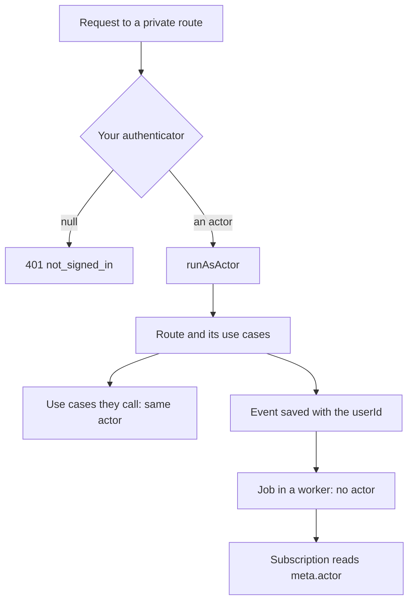

The *actor* is the person who runs a use case: the user signed in to the request. A *scope* is a value newt carries through everything a piece of code calls, such as the team a request works for. Together they answer "who is doing this?" and "on whose data?" without passing them as arguments everywhere.

## The actor

An actor is a small object with the user's id:

```ts
interface Actor {
  userId: string
}
```

You never create it by hand in a route. Each context's router asks your *authenticator* who calls, and runs the route as that actor.

### Where the actor comes from

`newt init` writes `src/auth.ts`. Every context's router uses it:

```ts title="src/auth.ts"
import type { Authenticator } from '@newt-js/core/http'

export const authenticate: Authenticator = async () => null
```

```ts title="src/contexts/tasks/tasks.context.ts"
const router = new HttpRouter({ prefix: '/tasks/api', database })
router.authenticateWith(authenticate)
```

An `Authenticator` takes the request and returns `{ userId }`, or `null` when nobody is signed in. As generated, it returns `null`, so every private route answers `401`. Read a session cookie or a bearer token there; [Authentication](/guides/authentication/) shows how.

For each route that is not `public`:

1. The router calls your authenticator.
2. If it returns `null`, the request ends with `401` and the error code `not_signed_in`.
3. If it returns an actor, the route and every use case it calls run as that actor.

Public routes (`{ public: true }`) skip the authenticator and run with no actor. See [HTTP and routes](/concepts/http/).

### Reading the actor

Three functions from `@newt-js/core`:

| Function | Returns | With no actor |
|---|---|---|
| `currentActor()` | the `Actor` | throws `NoActor` |
| `findCurrentActor()` | the `Actor` or `undefined` | returns `undefined` |
| `runAsActor(actor, fn)` | what `fn` returns | runs `fn` as `actor` |

Use `currentActor()` inside a use case that needs someone signed in:

```ts title="src/contexts/tasks/modules/task/task.module.ts"
import { currentActor, UseCase } from '@newt-js/core'

@UseCase()
async create(input: TaskCreateDTO): Promise<TaskDTO> {
  const { userId } = currentActor()
  const task = Task.create({
    ...TaskCreateSchema.parse(input),
    createdBy: userId,
  })
  await this.tasks.persist(task)
  return task.toDTO()
}
```

`NoActor` is an unauthorized error with the code `not_signed_in`. Over HTTP it becomes a `401`.

Use `findCurrentActor()` when someone may or may not be signed in, for example on a public route.

### runAsActor

`runAsActor(actor, fn)` runs `fn`, and everything it calls, as `actor`. The router uses it for you. Call it yourself in a script or a test that calls use cases directly:

```ts
import { runAsActor } from '@newt-js/core'

const task = await runAsActor({ userId: 'ana' }, () =>
  tasks.create({ name: 'Write the docs' }),
)
```

### The actor in events and jobs

When an event is emitted, newt records who emitted it: the `userId` of the current actor, or `null`. A subscription reads it from the second argument, `meta`:

```ts title="src/contexts/tasks/modules/task/task.workers.ts"
tasks.on(
  tasks.events.completed,
  'notifyAssignee',
  (completed, meta) => [{ id: completed.id, completedBy: meta.actor }],
)
```

A job runs later, in a [worker](/concepts/jobs-and-workers/), with **no actor**, even when the code that queued it had one. Inside a use case run by a subscription or a [scheduled task](/concepts/schedules/), `currentActor()` throws. Pass whatever you need from `meta.actor` or the event's payload.

This is how the actor travels from a request to everything it starts:



:::caution
Calling `currentActor()` in a use case that a subscription runs is a common mistake: it always throws there. Read `meta.actor` in the subscription instead.
:::

## Scope

A scope carries one value down to everything a function calls, across `await`s, without passing it as an argument. The actor is itself a scope. You can make your own with `defineScope`:

```ts title="src/contexts/tasks/team.ts"
import { defineScope } from '@newt-js/core'

export const team = defineScope<string>('team')
```

A scope has two methods:

| Method | What it does |
|---|---|
| `run(value, fn)` | runs `fn` with `value` as the scope's value, and returns what `fn` returns |
| `get()` | the value of the closest `run` around the caller, or `undefined` outside any |

```ts
team.run('team-1', async () => {
  await somethingElse()
  team.get() // 'team-1'
})
team.get() // undefined
```

Each scope keeps its own value; two scopes never mix.

### Setting a scope per request

Set it in a route group's middleware. The middleware runs after the authenticator, so the actor is known there too:

```ts title="src/contexts/tasks/modules/task/task.routes.ts"
const teams = router.group('/teams/:teamId', (request, next) =>
  team.run(request.params.teamId, next),
)

teams.get('/tasks', async request =>
  Response.json(await tasks.paginate({}, pageRequestFrom(request))),
)
```

Check that the actor belongs to the team before calling `next`, and answer `404` or `403` otherwise. newt does not know who belongs to which team.

:::danger
A scope only filters by the value you give it. If the middleware does not check that the actor is a member of the team, anyone signed in can read any team's tasks by changing the URL.
:::

## Scoped repositories

A repository can keep to one scope: it reads only the rows of the current team and refuses to save another team's. This is how you isolate tenants (customers, teams, workspaces) that share one database.

Every repository passes options as its third argument. The generated one has no scope:

```ts title="src/contexts/tasks/modules/task/task.repository.ts"
super(base, base.database.records<TaskRow>('task'), { scope: 'none' })
```

To scope it, name the field and how to read its current value:

```ts title="src/contexts/tasks/modules/task/task.repository.ts"
import { team } from '../../team'

export class Task_Repository extends Repository<Task, TaskRow> {
  constructor(base: ContextBase) {
    super(base, base.database.records<TaskRow>('task'), {
      scope: {
        field: 'teamId',
        current: () => {
          const id = team.get()
          if (!id) throw new Error('No team in scope')
          return id
        },
      },
    })
  }
}
```

The field must be a field of the row, so the entity's schema has `teamId` and the table has a `team_id` column.

### Repository options

| Option | Type | Default | What it does |
|---|---|---|---|
| `scope` | `{ field, current }` or `'none'` | required | keeps the repository to one value of `field` |
| `softDelete` | `boolean` | `false` | removing an entity stamps `deletedAt` instead of deleting the row; see [Repositories](/concepts/repositories/) |

`field` is a field name of the row. `current` is a function that returns the current value, as a string.

### What a scope changes

- `find`, `count` and `paginate` add `field = current()` to every filter. Rows of other teams are invisible.
- `persist` checks each entity: its `field`, and the value it was loaded with, must equal `current()`. If not, it throws and saves nothing. An entity cannot move to another team.
- `purge` ignores the scope: it removes exactly the rows its criteria name.

To read across every scope (an admin page, a nightly report), pass `everyScope: true`:

```ts
const all = await this.tasks.find({}, { everyScope: true })
const total = await this.tasks.count({}, { everyScope: true })
const page = await this.tasks.paginate({}, request, { everyScope: true })
```

There is no `everyScope` for saving.

### Scopes in jobs

Like the actor, a scope does not travel into a job. A worker runs with no scope, so a scoped repository there has no current team. Put the team in the event's payload and set the scope in the use case:

```ts
@UseCase()
async notifyAssignee(input: TaskNotifyAssigneeDTO): Promise<void> {
  const { id, teamId } = TaskNotifyAssigneeSchema.parse(input)
  await team.run(teamId, async () => {
    const [task] = await this.tasks.find({ id }, { limit: 1 })
    // ...
  })
}
```

## With the CLI

No command adds an actor or a scope. `newt init` and [`newt add backend`](/reference/cli/add-backend/) write `src/auth.ts`, and [`newt add module`](/reference/cli/add-module/) writes a repository with `{ scope: 'none' }`.
