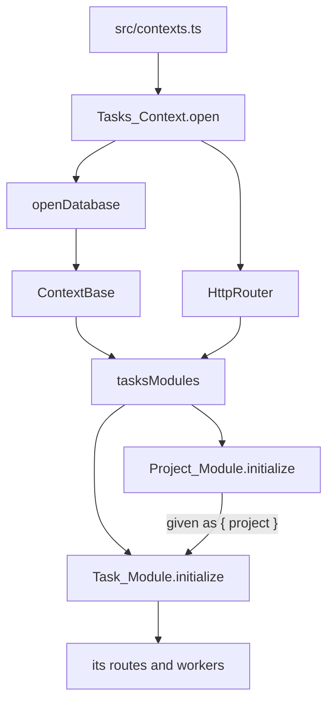

A context is one part of your app with its own database, its own routes and its own folder. A module is one kind of thing inside a context, such as a task or a project, with everything your app does with it.

newt splits a backend this way so each part stays small. You can read, test and change `chat` without opening `tasks`.

## Contexts

Newthub could have three contexts: `tasks`, `chat` and `docs`. Each one owns:

| What | Where, for the context `tasks` |
|---|---|
| Its folder | `src/contexts/tasks/` |
| Its database | `data/databases/tasks/tasks.sqlite`, or the path in `TASKS_DATABASE` |
| Its migrations | `src/contexts/tasks/migrations/` |
| Its routes | under `/tasks/api/` |
| Its files | its own storage |
| Its jobs | a queue kept in its own database |

See [Database and migrations](/concepts/database/), [Files](/concepts/files/) and [Jobs and workers](/concepts/jobs-and-workers/) for each one.

One context never reads another's tables. Elsewhere this idea is called a *bounded context*, which is why newt's class is named `BoundedContext`.

:::tip
Start with one context. Add a second when a part of the app has its own data and could live without the rest, as chat does next to tasks.
:::

## Modules

A module is one kind of thing in a context: `task` and `project` in `tasks`. It keeps one [entity](/concepts/entities/) and offers its [use cases](/concepts/use-cases/).

```txt
src/contexts/tasks/modules/task/
  task.module.ts       the use cases
  task.ts              the entity
  task.schema.ts       the DTOs and the filter
  task.repository.ts   how a task is read and saved
  task.routes.ts       its HTTP routes
  task.workers.ts      what it does when an event happens
  task.deps.ts         the other modules it uses
  events/  errors/  value-objects/  services/
```

The lint holds this shape: a module has only these files and folders (plus its tests and an optional `task-options.ts`), and one entity. A second entity is a module of its own. See [Project structure](/start/project-structure/) for every file.

## How modules talk to each other

Inside a context, a module reaches another in two ways:

- It calls the other's use cases, which it gets as a dependency. See [Services and dependencies](/concepts/services-and-deps/).
- It reacts to the other's events. See [Events and subscriptions](/concepts/events/).

That is a module's API, and all another module reaches of it. From another module it imports only types (`import type`) of its `*.module.ts`, its `*.schema.ts` (the DTOs) and its `events/`, and its `errors/` (to tell a known error apart). The lint rule `module-imports` refuses the rest: its schemas as values, its entity, value objects, repository, routes, workers and services.

## How contexts talk to each other

A context uses another when its `<name>.context.ts` imports it, to open it with that context. The lint rule `context-imports` lets a context import only the contexts its `.context.ts` imports, and never in a cycle: if `chat` uses `tasks`, `tasks` cannot use `chat`.

:::note
The CLI does not write this wiring yet. `newt add deps` only links modules of the same context.
:::

## How they are wired

This is what runs when the backend opens the `tasks` context:



The backend opens every context listed in `src/contexts.ts`:

```ts title="src/contexts.ts"
export async function openContexts(
  platform: Platform,
  stores: Stores,
): Promise<ContextToRun[]> {
  const contexts: ContextToRun[] = []
  contexts.push(await Tasks_Context.open(platform, stores))
  return contexts
}
```

Each context opens its database, makes its router and its `ContextBase`, and hands them to its modules:

```ts title="src/contexts/tasks/tasks.context.ts"
const MIGRATIONS_FOLDER = join(import.meta.dir, 'migrations')

export class Tasks_Context extends BoundedContext {
  private constructor(
    base: ContextBase,
    readonly modules: TasksModules,
  ) {
    super('tasks', base)
  }

  static async open(
    platform: Platform,
    stores: Stores,
  ): Promise<ContextToRun> {
    const database = await openDatabase(
      'tasks',
      MIGRATIONS_FOLDER,
      stores,
    )
    const router = new HttpRouter({ prefix: '/tasks/api', database })
    router.authenticateWith(authenticate)
    const host = Bun.env.TASKS_HOST
    const base = new ContextBase({
      name: 'tasks',
      platform,
      database,
      storage: await openStorage('tasks', router, stores, host),
    })
    return {
      context: new Tasks_Context(base, tasksModules(base, router)),
      router,
      host,
    }
  }
}
```

`tasks-modules.ts` builds the modules. A module that uses another gets it here, so the one it uses is built first:

```ts title="src/contexts/tasks/tasks-modules.ts"
export function tasksModules(base: ContextBase, router: HttpRouter) {
  const project = Project_Module.initialize(base, router)
  const task = Task_Module.initialize(base, router, { project })
  return {
    task,
    project,
  }
}
```

Each module's `initialize` makes its repository and the module, which registers its routes and keeps their groups in `routes`, then registers its workers:

```ts title="src/contexts/tasks/modules/task/task.module.ts"
export class Task_Module extends Module {
  static initialize(
    base: ContextBase,
    router: HttpRouter,
    deps: Task_Deps,
  ): Task_Module {
    const module = new Task_Module(
      base,
      new Task_Repository(base),
      router,
      deps,
    )
    registerTaskWorkers(module)
    return module
  }

  readonly routes

  private constructor(
    base: ContextBase,
    private readonly tasks: Task_Repository,
    router: HttpRouter,
    private readonly deps: Task_Deps,
  ) {
    super('task', base.useCaseRunner, deps)
    // ...
    this.routes = registerTaskRoutes(router, this, deps)
  }
}
```

:::note
`initialize` is a convention of the generated code, not a method of `Module`. You can change it freely.
:::

## The classes

You rarely touch these classes beyond what the CLI writes. This section lists what they offer.

### ContextBase

`ContextBase` holds what every module of a context shares. You make one per context.

| Option | Default | What it is |
|---|---|---|
| `name` | required | The context's name, without `:` |
| `platform` | required | What all contexts share |
| `database` | required | The context's database |
| `clock` | system clock | Where "now" comes from |
| `worker` | worker defaults | How its worker runs jobs |
| `writeRule` | `'error'` | `'off'`, `'warn'` or `'error'` |
| `guardRule` | `'error'` | `'off'`, `'warn'` or `'error'` |
| `conflictRetries` | see the list | Runs after a conflict |
| `storage` | none | Where its files go |

- `platform` is shared by every context of the backend: its cluster, logger and observability. See [Logs and observability](/concepts/logs/).
- `clock`: tests pass a clock they can move.
- `worker`: see [Jobs and workers](/concepts/jobs-and-workers/).
- `writeRule`: see [the write rule](/concepts/use-cases/#the-write-rule). `guardRule`: see [guards](/concepts/repositories/#save-hooks-and-guards).
- `conflictRetries` defaults to `{ times: 3, duplicates: 1, backoffMs: 10 }`. See [retries](/concepts/use-cases/#retries-on-a-conflict).
- `storage` is `{ private?, public? }`.

What a `ContextBase` gives its modules:

| Field | What it is |
|---|---|
| `name`, `platform`, `clock`, `database` | What you gave it |
| `transactions` | The database's transactions; modules never use them |
| `useCaseRunner` | Runs every use case of the context |
| `bus` | Publishes the context's [events](/concepts/events/) |
| `worker` | Runs the jobs of the context's queue |
| `schedules` | Its [scheduled tasks](/concepts/schedules/) |
| `rateLimits` | Its rate limits |
| `storage` | `storage.private` and `storage.public` |

Reading a `storage` that was not given throws.

### BoundedContext

`BoundedContext` is the context class you extend. It has a `name` and its `base`, and:

| Method | What it does |
|---|---|
| `start()` | Starts the worker and the scheduled tasks |
| `stopWorker(deadlineMs?)` | Stops them, waiting up to `deadlineMs` for running jobs |
| `close()` | Closes the database |
| `stop()` | `stopWorker()`, then `close()` |

`runContexts` (in `src/backend.ts`) calls these for you when the backend starts and stops.

### Module

`Module` is the class every module extends. Its constructor takes the module's name, the context's `useCaseRunner` and, optionally, its deps. It gives you:

- `name`: the module's name, `'task'`.
- `useCaseRunner`: the runner its use cases go through.
- `on(event, useCase, args?, options?)`: runs a use case when an event happens. See [Events and subscriptions](/concepts/events/).

## With the CLI

```sh
newt add context tasks
newt add module tasks/task
```

`newt add context` writes the context's folder, its `.context.ts`, its `-modules.ts`, its migrations folder and its line in `src/contexts.ts`. `newt add module` writes a module with its entity, its use cases, its routes, its table and its test. See [`newt add context`](/reference/cli/add-context/) and [`newt add module`](/reference/cli/add-module/).
