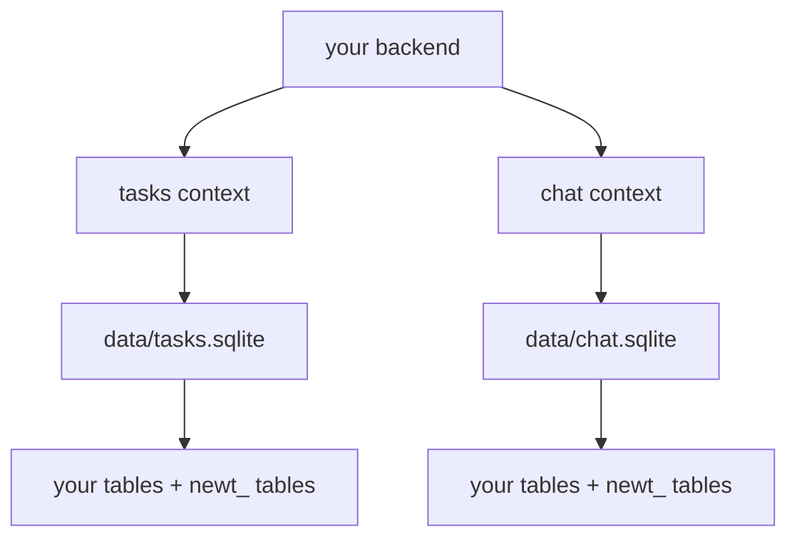
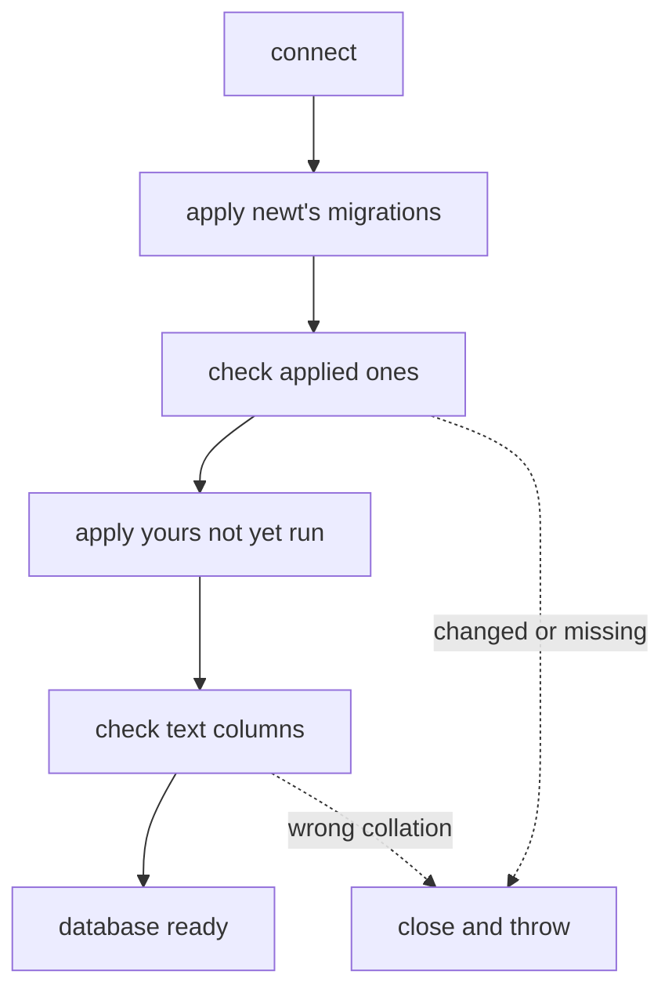

Each context keeps its data in its own database. You describe its tables with plain SQL files (*migrations*), and newt applies them when the context opens.

## One database per context

The `tasks` context has one database; a `chat` context would have another. No context reads another's tables, so you can change one context's tables without breaking the rest.



`src/stores.ts` opens each context's database. With SQLite, the default:

```ts title="src/stores.ts"
export async function openDatabase(
  context: string,
  migrations: string,
  stores: Stores,
): Promise<Database> {
  if (stores === 'memory') {
    return SqliteDatabase.open({ path: ':memory:', migrations })
  }
  return SqliteDatabase.open({
    path:
      Bun.env[`${envOf(context)}_DATABASE`] ?? `data/${context}.sqlite`,
    migrations,
  })
}
```

The context passes its own `migrations` folder:

```ts title="src/contexts/tasks/tasks.context.ts"
const MIGRATIONS_FOLDER = join(import.meta.dir, 'migrations')

// inside Tasks_Context.open()
const database = await openDatabase('tasks', MIGRATIONS_FOLDER, stores)
```

So the `tasks` context lives in `data/tasks.sqlite`, or wherever `TASKS_DATABASE` points. Tests open it with `stores: 'memory'`: a fresh SQLite database with the same migrations.

## SQLite options

`SqliteDatabase.open(options)`, from `@newt-js/core/database/sqlite`:

| Option | Type | Default |
|---|---|---|
| `path` | `string` | required |
| `migrations` | `string` | none |
| `waitTimeoutMs` | `number` | `30000` |

- `path`: the database file. Its folder is created if missing. `':memory:'` makes a temporary file that is removed on `close()`.
- `migrations`: the folder of your migrations. Without it, only newt's own tables are created.
- `waitTimeoutMs`: how long a transaction waits for its turn before it fails.

`open` connects, applies pending migrations, checks the tables, and returns the database. If any step fails, it closes the database and throws.

newt opens the file in WAL mode, with foreign keys on. Writes go through one connection, one transaction at a time; reads outside a transaction use a second, read-only connection, so they do not wait for writes.

## Migrations

A migration is a pair of SQL files: one that changes the database (`up`) and one that undoes it (`down`). They live in the context's `migrations/` folder:

```text
src/contexts/tasks/migrations/
  00001_task_up.sql
  00001_task_down.sql
  00002_project_up.sql
  00002_project_down.sql
```

```sql title="src/contexts/tasks/migrations/00001_task_up.sql"
CREATE TABLE "task" (
  id TEXT PRIMARY KEY,
  version INTEGER NOT NULL,
  name TEXT NOT NULL,
  created_at TEXT NOT NULL,
  updated_at TEXT NOT NULL
);
```

```sql title="src/contexts/tasks/migrations/00001_task_down.sql"
DROP TABLE "task";
```

### Naming

Files are named `NNNNN_name_up.sql` and `NNNNN_name_down.sql`:

- `NNNNN` is a five-digit number. Migrations run in its order.
- `name` is any name; both files of a pair share it.
- Every `up` has its `down`, and every number has one name.

Other files in the folder, such as `.gitkeep`, are ignored. A file that ends in `_up.sql` or `_down.sql` but does not follow the pattern stops the database from opening, so a typo never goes unnoticed.

### When they run

Every time a context's database opens, which is every time the backend starts. This is what `open` does:



1. newt applies its own migrations first (its `newt_` tables).
2. It checks yours that already ran: none changed, and the last one is still in the folder.
3. It applies the ones that have not run yet, in order, in one transaction.
4. It records each one in the `newt_migrations` table, with a checksum of its `up` file.

When several instances start at once on Postgres or MySQL, a lock makes only one apply them. A file can hold several statements, separated by `;`.

The database refuses to open when:

- an applied migration's `up` file has changed since it ran. Put it back as it was and write the change as a new migration.
- the last applied migration is no longer in the folder.

### Writing one by hand

To change a table, add the next pair. To give tasks a description:

```sql title="src/contexts/tasks/migrations/00003_task_description_up.sql"
ALTER TABLE "task" ADD COLUMN description TEXT;
```

```sql title="src/contexts/tasks/migrations/00003_task_description_down.sql"
ALTER TABLE "task" DROP COLUMN description;
```

Then add the field to the module's [schema](/concepts/schemas-and-dtos/). Restart the backend and the column is there.

:::tip
Number a new migration one above the highest in the folder, and name it after what it changes, such as `task_description`.
:::

:::caution
Never edit a migration that already ran somewhere. Write a new one.
:::

### Tables and columns

A module's entity is stored in a table named after the module, `task`. Every table a repository uses needs:

- `id`, the primary key, as text.
- `version`, an integer newt uses to detect two saves of the same row at once.

Field names become column names in snake case: `createdAt` is `created_at`, `teamId` is `team_id`. Dates are stored as ISO text.

How SQLite columns come back:

| Column declared as | You get |
|---|---|
| `TEXT` | a string |
| `INTEGER`, `REAL` | a number; an integer too big for a number comes back as a string |
| `BOOLEAN` | `true` or `false` (stored as `1` or `0`) |
| `JSON` | the parsed value (objects and arrays are stored as JSON text) |
| `NULL` value | `null` |

newt compares and sorts text by code point, the same on every database. A text column declared `COLLATE NOCASE` or `RTRIM` stops the database from opening. For a filter that ignores case, use the `ieq` operator of [filters](/concepts/repositories/).

Text that holds the NUL character, or a broken UTF-16 surrogate, cannot be saved: the save fails with the validation error `text_with_nul`.

### Undoing and checking

Each database class has a `migrations` object:

| Method | What it does |
|---|---|
| `migrations.up()` | applies pending migrations; returns their names |
| `migrations.down()` | undoes the last applied migration with its `down` file; returns its name, or `null` if none |
| `migrations.status()` | returns `{ applied, pending, changed }`, each a list of names |

`down()` undoes one migration per call, and only yours, never newt's.

## The tables newt owns

newt keeps its own tables in each context's database, all prefixed `newt_`. Do not write to them, and do not name your own tables with that prefix.

| Table | What it holds |
|---|---|
| `newt_migrations` | your applied migrations |
| `newt_framework_migrations` | newt's applied migrations |
| `newt_job` | jobs waiting or running: the [outbox](/concepts/jobs-and-workers/) |
| `newt_job_queue` | the queues workers have registered |
| `newt_schedule_tick` | the last run of each [scheduled task](/concepts/schedules/) |
| `newt_idempotency_key` | answers kept for [idempotent requests](/concepts/http/) |
| `newt_inbox` | the events this context's use cases have handled, so a job that runs again does not [write twice](/concepts/events/#what-happens-when-an-event-is-emitted) |

## The Database contract

Every database (SQLite, Postgres, MySQL, memory) offers the same `Database` interface, from `@newt-js/core/application`:

| Member | What it is |
|---|---|
| `records<Row>(table)` | the rows of a table, for a [repository](/concepts/repositories/) |
| `outbox` | the queue of jobs kept in this database |
| `run(fn)` | runs `fn` in a transaction |
| `save(fn)` | runs a save in a transaction; repositories use it |
| `guard(keys, { waitMs })` | inside a transaction, waits until no other transaction holds the same keys |
| `inTransaction` | `true` inside a transaction |
| `afterCommit(fn)` | runs `fn` once the current transaction commits, or now if there is none |
| `afterRollback(fn)` | runs `fn` if the current transaction rolls back |
| `close()` | waits for running transactions and closes the connections |

You do not call these from a module. Repositories, the event bus and the workers do.

### Records

`records(table)` returns the rows of one table: `find`, `count`, `countBy`, `insert`, `update`, `delete` and `deleteMany`. A [repository](/concepts/repositories/) turns them into entities:

```ts title="src/contexts/tasks/modules/task/task.repository.ts"
super(base, base.database.records<TaskRow>('task'), { scope: 'none' })
```

`update` and `delete` check the row's `version`. If someone saved it in the meantime, they throw `StaleVersion`. A unique constraint that fails throws `DuplicateValue`, with the fields involved. Both are [conflict errors](/concepts/errors/): by default newt runs the use case again (up to 3 times, once for a duplicate) and then answers `409`.

## Transactions

A transaction is a group of writes that the database keeps all together or not at all.

Each `persist` of a repository runs in one transaction. It writes the entities and, in the same transaction, the jobs for the [events](/concepts/events/) they emitted. Either both are saved or neither is.

A use case is not one transaction: two `persist` calls are two transactions. To save several entities together, pass them in one call:

```ts
await this.tasks.persist([first, second])
```

:::caution
Do not open a transaction yourself with `base.transactions.run` inside a module. The lint rule `module-transactions` refuses it: `persist` already runs the transaction, checks the write rule and saves the events.
:::

Rules that hold inside a transaction:

- **One module per transaction.** A transaction that saves `task` cannot also save `project`. Save the second from a [subscription](/concepts/events/) after the first commits.
- **Await every call inside it.** A call left running after the transaction ends fails.
- **A failed save spoils it.** If a save inside fails and you catch its error, the whole transaction still rolls back, with `TransactionSpoiled`.

With SQLite, write transactions run one at a time. A transaction waits for its turn up to `waitTimeoutMs`. Reads outside a transaction never wait.

## Postgres and MySQL

The model is the same: one database per context, the same migrations folder, the same `newt_` tables. What changes:

- **Options.** `PostgresDatabase.open` and `MysqlDatabase.open` take `{ url, migrations, connections, waitTimeoutMs }`. `connections` is the pool size, `10` by default. The generated `stores.ts` reads the URL from `TASKS_DATABASE_URL`.
- **SQL.** Migrations use each database's SQL. Text columns need a byte-order collation: `COLLATE "C"` on Postgres, `utf8mb4_0900_bin` on MySQL. `newt add module` writes them for you.
- **Concurrency.** Transactions run side by side. When two collide, newt throws `TransactionConflict` and the use case runs again. `guard` takes real locks.
- **Tests.** Module tests use a new database on the server of `TEST_DATABASE_URL`, or memory without it.

See [SQLite](/guides/databases/sqlite/), [Postgres](/guides/databases/postgres/), [MySQL](/guides/databases/mysql/) and [Switching databases](/guides/databases/switching/).

## With the CLI

[`newt add module`](/reference/cli/add-module/) writes the module's first migration pair, numbered one above the highest in the folder, in the SQL of the context's database. [`newt add context`](/reference/cli/add-context/) creates the empty `migrations/` folder. Later changes are migrations you write by hand.
