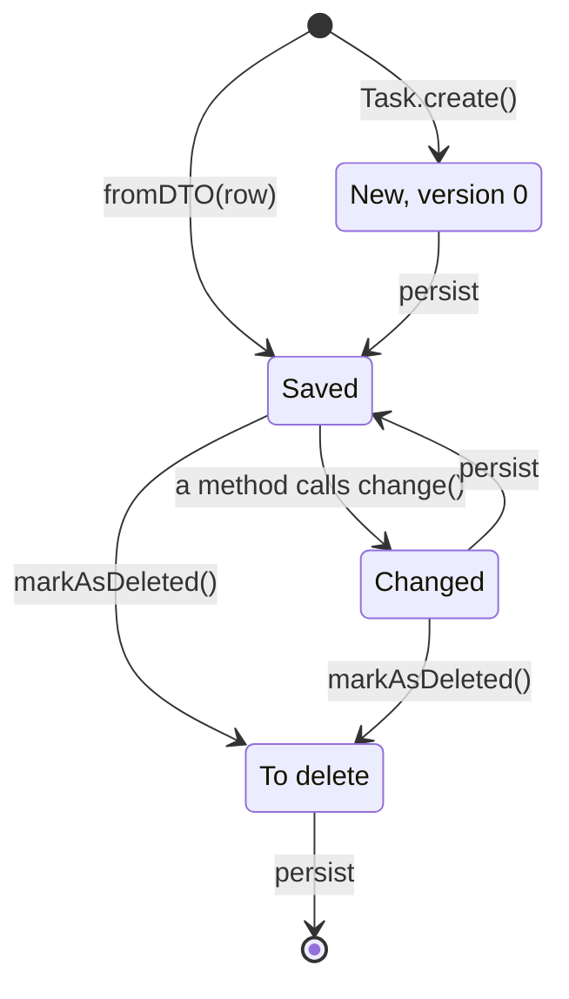

An entity is one thing your app keeps and changes over time, such as a task. It holds the task's data, checks it against its schema, and is the only place that changes it.

Keeping every change in one class means a task can never be saved in a state its rules forbid, wherever the change comes from.

## An entity

`newt add module tasks/task` writes this:

```ts title="src/contexts/tasks/modules/task/task.ts"
import { Entity }           from '@newt-js/core'
import type { EntityInput } from '@newt-js/core'
// --------------------------------------------------------
import { Task_Created }     from './events/task-created'
import type { TaskDTO }     from './task.schema'
import { TaskSchema }       from './task.schema'

export type TaskCreateProps = { name: string }

export class Task extends Entity<typeof TaskSchema> {

  private constructor(input: EntityInput<TaskDTO>, isNew: boolean) {
    super(TaskSchema, input, isNew)
  }

  static fromDTO(dto: TaskDTO & { version: number }): Task {
    return new Task(dto, false)
  }

  static create(props: TaskCreateProps): Task {
    const task = new Task(props, true)
    task.trackEvent(
      new Task_Created({ id: task.id, name: task.data.name }),
    )
    return task
  }

}
```

A module keeps exactly one entity, in `<module>.ts`. The lint rule `module-entity` refuses a second one: it is a module of its own, which this one refers to by its id.

## Making one

There are two ways in, both static:

- `Task.create(props)` makes a new task. Use cases call it.
- `Task.fromDTO(row)` rebuilds a saved task from its row. Only the repository calls it, and the row must carry its `version`.

Both go through the protected constructor of `Entity`:

```ts
super(schema, input, isNew, publicSchema?)
```

`input` is an `EntityInput<TaskDTO>`: the DTO's fields, with `id`, `createdAt` and `updatedAt` optional, plus an optional `version`.

When it builds the entity, the constructor:

1. Gives it a new id (a UUID v7) when `input` has none.
2. On a new entity, sets `createdAt` and `updatedAt` to now, from the context's clock.
3. Parses everything with the schema. If that fails, it throws `InvalidEntity`.
4. Sets `version` to `0` on a new entity, or to the row's version.

### What the schema needs

- It names `createdAt` and `updatedAt` (`z.string()`). newt stamps them on every entity.
- It is a `z.object` or `z.strictObject`. A schema that keeps unknown keys (`z.looseObject`, `.catchall`, `.passthrough`) is refused, or a row's other columns would end up in the entity.
- `version` and `deletedAt` are dropped from the data unless the schema names them.
- When a row is read back, a `null` in a field that accepts `undefined` but not `null` is left out.

## Reading it

| Member | What it is |
|---|---|
| `id` | The entity's id. |
| `data` | Its fields, parsed. Protected: only the entity's own methods read it. |
| `version` | How many times it has been saved. `0` until the first save. |
| `isNew` | `true` until its first save. |
| `isDeleted` | `true` once `markAsDeleted()` was called. |
| `hasPendingChanges` | `true` when a save would write something. |
| `toDTO()` | A copy of its fields, as the use case returns them. |

## Changing it

You change an entity through methods you write on it. Each one calls the protected `change(partial)`. Say you add `doneAt: z.string().nullable()` to `TaskSchema` (and its column, in a migration):

```ts title="src/contexts/tasks/modules/task/task.ts"
complete(): void {
  if (this.data.doneAt) {
    throw new AlreadyDone()
  }
  this.change({ doneAt: now().toISOString() })
  this.trackEvent(new Task_Completed({ id: this.id }))
}
```

`now` comes from `@newt-js/core` and reads the context's clock. `AlreadyDone` is an error made with `newt add error`, and `Task_Completed` an event made with `newt add event`. A use case calls `task.complete()` before `persist` (see [Use cases](/concepts/use-cases/#a-use-case)).

:::tip
Put the rule in the entity, not in the use case. `complete()` refuses a task already done wherever it is called from: a route, a worker or a test.
:::

`change` holds these rules:

- `id` is ignored.
- `createdAt` and `updatedAt` throw `UnknownEntityField`: newt keeps them.
- A field the schema does not have throws `UnknownEntityField`.
- The whole entity is parsed again. If it no longer passes, it throws `InvalidEntity` and nothing changes.
- `updatedAt` moves to now only when a value really changed.
- A deleted entity throws `DeletedEntityNotChangeable`.

To delete it, a method calls the protected `markAsDeleted()`. The repository deletes the row on the next save, or only stamps its `deletedAt` when the repository uses `softDelete` (see [Repositories](/concepts/repositories/)). An entity never saved throws `NewEntityNotDeletable`, and one already deleted throws `EntityAlreadyDeleted`.

A method of an entity takes its own words. The lint rule `entity-method-params` refuses a parameter typed with a DTO or an object written in place: declare `export type TaskRenameProps = { … }` next to the entity and take that. The constructor and `fromDTO` are the exceptions.

## Telling what happened

`trackEvent(event)` records an [event](/concepts/events/) on the entity. The repository publishes it when `persist` saves the entity, in the same transaction.

- Tracking a second event with the same name replaces the first.
- An event goes with a change. Saving an entity that tracked events but has nothing to save throws `EventWithoutChange`: change the field that says it happened (a status, a date) along with it.

## What changed

| Method | Returns |
|---|---|
| `getChanges()` | The fields changed since it was read, with their new values, or `null`. Always `null` for a new or deleted entity. |
| `getPrevious()` | The same fields with the values they had when read, or `null`. |
| `hasChanged(field)` | Whether that field changed. Always `true` for a new entity. |

`createdAt` and `updatedAt` are never part of the changes.

## Showing only some fields

By default `toDTO()` returns every field. To hide some, give the constructor a second schema with fewer fields:

```ts
const TaskPublicSchema = TaskSchema.omit({ internalNote: true })

export class Task extends Entity<
  typeof TaskSchema,
  typeof TaskPublicSchema
> {

  private constructor(input: EntityInput<TaskDTO>, isNew: boolean) {
    super(TaskSchema, input, isNew, TaskPublicSchema)
  }

}
```

Every field of the public schema must be in the main one, or the constructor throws.

## References to other modules

An order keeps the id of its customer, `customerId`, and each of its lines the id of its product, `productId`. Declare them as the order's references, next to its schema, each with the DTO of the entity it names:

```ts title="order.schema.ts"
import type { Resolved }    from '@newt-js/core'
// --------------------------------------------------------
import type { ProductDTO }  from '../../catalog'
import type { CustomerDTO } from '../../customers'

export const OrderSchema = z.object({
  id: OrderId.schema,
  customerId: CustomerId.schema,
  lines: z.array(z.object({
    productId: ProductId.schema,
    quantity: z.number().int().positive(),
  })).min(1),
  createdAt: z.string(),
  updatedAt: z.string(),
})

export type OrderReferences = {
  customerId: CustomerDTO,
  lines: { productId: ProductDTO },
}

/** { id, customer, lines: { product, quantity }[], createdAt, updatedAt } */
export type OrderDTO = Resolved<z.infer<typeof OrderSchema>, OrderReferences>
```

A reference is a field named `<name>Id`, and the entity shows it as `<name>`. An id of its own kind (a task's `parentId`) is no reference: leave it out.

The entity takes its references as its third type:

```ts title="order.ts"
export type OrderCreateProps = {
  customer: CustomerDTO,
  lines: { product: ProductDTO, quantity: number }[],
}
export type OrderChangeCustomerProps = { customer: CustomerDTO }

export class Order extends Entity<
  typeof OrderSchema,
  typeof OrderSchema,
  OrderReferences
> {

  private constructor(input: EntityInput<OrderDTO>, isNew: boolean) {
    super(OrderSchema, input, isNew)
  }

  static fromDTO(dto: OrderDTO & { version: number }): Order {
    return new Order(dto, false)
  }

  static create(props: OrderCreateProps): Order {
    return new Order(props, true)
  }

  changeCustomer({ customer }: OrderChangeCustomerProps): void {
    this.change({ customer })
  }

}
```

- It is given the entities, never their ids alone: `create` and `change` take `customer`, so an order never points to a customer nobody loaded.
- It keeps their ids: `this.data.customerId`, `getChanges()` and the row it is saved in.
- `toDTO()` shows the entities in place of their ids: whole, always.
- A nullable id takes `null`, and shows `null`.

Its repository loads them on every read: see [Repositories](/concepts/repositories/#references-to-other-modules).

## Its life

This is the life of a task, from the moment it is made or read until it is deleted:



Events tracked with `trackEvent` wait on the entity and go out with the next `persist`.

## Versions

Each save adds one to `version`. The repository updates a row only when its version in the database is still the one the entity read. If someone saved it in between, the save fails with `StaleVersion` and the [use case runs again](/concepts/use-cases/#retries-on-a-conflict). See [Repositories](/concepts/repositories/#versions-and-conflicts).

## After a failed save

When a save rolls back, the entity forgets that save: its `version` and `isNew` go back to what they were. It is also marked: saving it again throws `SaveRolledBack`.

:::caution
Do not catch a failed save and `persist` the same entity again. Read it again from the repository and save the new one.
:::

## Errors

These errors mean the code did something an entity does not allow. They extend `EntityError`, not `KnownError`, so HTTP answers them with `500`. To give a client a `400` for bad input, parse it with the schema in the use case first, as the generated code does.

| Error | When |
|---|---|
| `InvalidEntity` | Its data does not pass its schema. |
| `UnknownEntityField` | `change` got a field the schema lacks, or `createdAt`/`updatedAt`. |
| `DeletedEntityNotChangeable` | `change` on a deleted entity. |
| `NewEntityNotDeletable` | `markAsDeleted` on an entity never saved. |
| `EntityAlreadyDeleted` | `markAsDeleted` twice. |
| `EventWithoutChange` | A save of an entity with events but no change. |
| `SaveRolledBack` | A save of an entity whose last save rolled back. |

## With the CLI

There is no command for an entity alone: `newt add module` writes the entity with its module, schema, repository and table.

```sh
newt add module tasks/task
```

See [`newt add module`](/reference/cli/add-module/).
