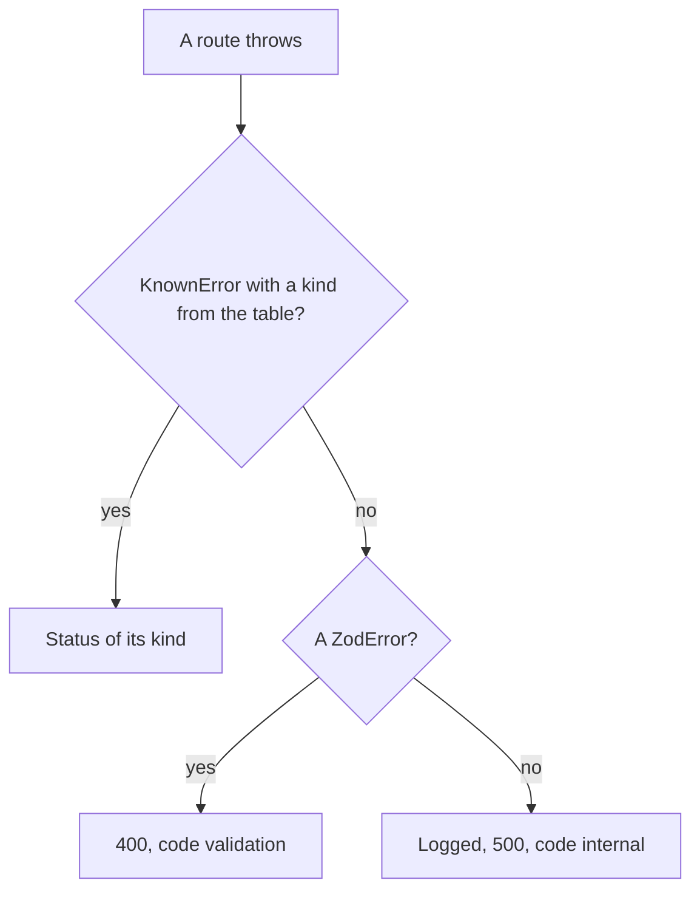

A known error is an error your app throws on purpose, such as "there is no such task". It carries a kind, a code and a message, and newt turns it into an HTTP answer with the right status.

It exists so the rules of your app can say *what* went wrong without knowing about HTTP. You throw it from anywhere: an entity, a value object, a use case. You never write status codes by hand.

## An error

```ts title="src/contexts/tasks/modules/task/errors/task-not-found.ts"
import { NotFoundError } from '@newt-js/core'

export class TaskNotFound extends NotFoundError {
  readonly code = 'task.not_found'

  constructor() {
    super('There is no such task')
  }
}
```

```ts
throw new TaskNotFound()
```

A client that asks for a task that does not exist gets:

```json
{ "error": "There is no such task", "code": "task.not_found" }
```

with the status `404`.

## What a known error carries

Every known error extends `KnownError`:

| Member | What it is |
|---|---|
| `kind` | What sort of failure it is. Sets the HTTP status. |
| `code` | A stable name a client can test, as `task.not_found`. |
| `message` | A sentence for people. |
| `params` | Optional details, as an object. |

Its constructor takes the message and the params: `super(message, params?)`.

```ts title="src/contexts/tasks/modules/task/errors/invalid-priority.ts"
import { ValidationError } from '@newt-js/core'

export class InvalidPriority extends ValidationError<{ value: string }> {
  readonly code = 'task.invalid_priority'

  constructor(value: string) {
    super(`'${value}' is not a valid priority`, { value })
  }
}
```

```json
{
  "error": "'' is not a valid priority",
  "code": "task.invalid_priority",
  "params": { "value": "" }
}
```

`params` appears in the body only when it has something in it.

:::tip
Clients should test `code`, never `message`. You can then reword the message without breaking anyone.
:::

## Kinds and HTTP statuses

You extend the class of the kind you want:

| Class | `kind` | HTTP |
|---|---|---|
| `ValidationError` | `validation` | `400` |
| `UnauthorizedError` | `unauthorized` | `401` |
| `ForbiddenError` | `forbidden` | `403` |
| `NotFoundError` | `not_found` | `404` |
| `ConflictError` | `conflict` | `409` |
| `ConcurrencyConflict` | `conflict` | `409` |

newt's own errors use a few more kinds:

| `kind` | HTTP |
|---|---|
| `method_not_allowed` | `405` |
| `too_large` | `413` |
| `unsupported_media_type` | `415` |
| `unprocessable` | `422` |
| `too_many_requests` | `429` |

A `too_many_requests` answer also carries a `Retry-After` header, in seconds. A `KnownError` with any other kind is answered as an unexpected error.

When to use each:

- **`ValidationError`**: the input breaks a rule. The client must change what it sends.
- **`UnauthorizedError`**: nobody is signed in, or the credentials are wrong.
- **`ForbiddenError`**: the caller is signed in but may not do this.
- **`NotFoundError`**: what was asked for does not exist.
- **`ConflictError`**: the request is valid, but the current state refuses it, as completing a task already done.
- **`ConcurrencyConflict`**: two saves collided. The use case [runs again](/concepts/use-cases/#retries-on-a-conflict) before the client sees it.

## How a thrown error becomes an answer

This is how newt picks the answer when a route throws:



A route's `onError` option replaces this with your own answer (see [HTTP and routes](/concepts/http/#route-options)).

| What was thrown | HTTP | Body |
|---|---|---|
| A `ZodError` | `400` | `code: "validation"`, with `issues` |
| Anything else | `500` | `code: "internal"` |

A schema that refuses the input gives:

```json
{
  "error": "The input is not valid",
  "code": "validation",
  "issues": [
    {
      "origin": "string",
      "code": "too_small",
      "minimum": 1,
      "inclusive": true,
      "path": ["name"],
      "message": "Too small: expected string to have >=1 characters"
    }
  ]
}
```

Any other error is logged and answered with:

```json
{ "error": "Something went wrong", "code": "internal" }
```

:::caution
The client never sees the message of an unexpected error, on purpose. If it needs to know what went wrong, throw a known error.
:::

The errors of an [entity](/concepts/entities/#errors), such as `InvalidEntity`, are not known errors: they mean the code broke a rule, so they become a `500`.

## newt's own errors

| Error | Kind | Code |
|---|---|---|
| `DuplicateValue` | `conflict` | `duplicate_value` |
| `StaleVersion` | `conflict` | `stale_version` |
| `TransactionConflict` | `conflict` | `transaction_conflict` |
| `ReferenceNotFound` | `validation` | `reference_not_found` |
| `TextWithNul` | `validation` | `text_with_nul` |
| `InvalidFilter` | `validation` | `invalid_filter` |
| `InvalidSort` | `validation` | `invalid_sort` |
| `TooManyRequests` | `too_many_requests` | `too_many_requests` |
| `UploadTooLarge` | `too_large` | `upload_too_large` |

Their details, in `params`:

- `DuplicateValue`: `{ fields }`, the fields whose value is taken, when the database says which.
- `ReferenceNotFound`: `{ resource, id }`.
- `InvalidFilter`, `InvalidSort`: `{ issues }`, each `{ path, message }`.
- `TooManyRequests`: `{ limit, retryAfterSeconds }`.
- `UploadTooLarge`: `{ maxBytes }`. See [Files](/concepts/files/#uploads-from-the-browser).

The built-in [value objects](/concepts/value-objects/#built-in-value-objects) throw `ValidationError`s: `invalid_email`, `invalid_key`, `invalid_search_text`, `invalid_secret_token` and `invalid_uuid`.

The HTTP layer has its own, from `@newt-js/core/http`:

| Error | HTTP | Code |
|---|---|---|
| `MalformedBody` | `400` | `malformed_body` |
| `NotSignedIn` | `401` | `not_signed_in` |
| `CrossOriginRefused` | `403` | `cross_origin_refused` |
| `RouteNotFound` | `404` | `route_not_found` |
| `MethodNotAllowed` | `405` | `method_not_allowed` |
| `IdempotencyKeyInUse` | `409` | `idempotency_key_in_use` |
| `IdempotencyAnswerNotKept` | `409` | `idempotency_answer_not_kept` |
| `PayloadTooLarge` | `413` | `payload_too_large` |
| `UnsupportedMediaType` | `415` | `unsupported_media_type` |
| `IdempotencyKeyReused` | `422` | `idempotency_key_reused` |

See [HTTP and routes](/concepts/http/) for when each one happens, and for a route's `onError` option, which answers errors your own way.

## With the CLI

```sh
newt add error tasks/task already-done --kind conflict
```

It writes `errors/already-done.ts`, a `ConflictError` with the code `task.already_done`. `--kind` is required: `validation`, `unauthorized`, `forbidden`, `not-found` or `conflict`. See [`newt add error`](/reference/cli/add-error/).

```ts title="src/contexts/tasks/modules/task/errors/already-done.ts"
import { ConflictError } from '@newt-js/core'

export class AlreadyDone extends ConflictError {
  readonly code = 'task.already_done'

  constructor() {
    super('Already done')
  }
}
```
