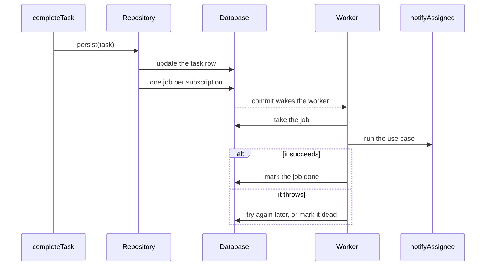

An event is a small record that says something happened in your app, such as "task completed". It lets other parts of the app react to it later, without the code that completed the task knowing about them.

## An event

You define an event with `defineEvent`: a name and a zod schema for what it carries (its *payload*).

```ts title="src/contexts/tasks/modules/task/events/task-completed.ts"
import { defineEvent } from '@newt-js/core'
// --------------------------------------------------------
import { TaskSchema }  from '../task.schema'

export const Task_Completed = defineEvent(
  'task.completed',
  TaskSchema.pick({ id: true }),
)
```

`defineEvent` returns a class. `new Task_Completed({ id })` checks the payload against the schema and throws `InvalidEvent` if it does not pass.

Every event carries:

| Field | What it is |
|---|---|
| `name` | the name you gave it, `task.completed` |
| `payload` | what the schema parsed |
| `occurredAt` | when it was made, an ISO date |

### Names

An event is named `<module>.<what happened>`, in camelCase: `task.completed`, `project.created`. The name is part of the queue of every subscription to it. If you rename an event, jobs already waiting under the old name have no worker left, and newt logs a warning about them.

### What a payload can hold

The payload is saved as JSON and read again later, so its schema must give back exactly what it takes:

- Only JSON values: strings, numbers, booleans, `null`, arrays and plain objects.
- No `.transform()` and no `.default()`.
- Brands only on strings and numbers, which is what [value objects](/concepts/value-objects/) use.

:::tip
Keep payloads small: the id of what changed, and little else. The use case that reacts reads the rest from the database, so it always sees the current data.
:::

## Emitting an event

An event goes out only when an entity records it, with `trackEvent`, in the method that makes the change. Say `TaskSchema` has a `doneAt` field (see [Entities](/concepts/entities/#changing-it)):

```ts title="src/contexts/tasks/modules/task/task.ts"
complete(): void {
  if (this.data.doneAt) {
    throw new AlreadyDone()
  }
  this.change({ doneAt: now().toISOString() })
  this.trackEvent(new Task_Completed({ id: this.id }))
}
```

A use case calls that method and saves the task:

```ts title="src/contexts/tasks/modules/task/task.module.ts"
@UseCase()
async completeTask(input: TaskCompleteTaskDTO): Promise<TaskDTO> {
  const { id } = TaskCompleteTaskSchema.parse(input)
  const [task] = await this.tasks.find(
    TaskFilter.toCriteria<TaskRow>({ id }),
    { limit: 1 },
  )
  if (!task) {
    throw new TaskNotFound()
  }
  task.complete()
  await this.tasks.persist(task)
  return task.toDTO()
}
```

:::caution[The CLI does not emit for you]
`newt add event` writes the event class, and `newt add use-case` writes a use case that reads and saves without changing anything. Until an entity method calls `trackEvent` and a use case calls that method, the event never happens and no subscription to it runs.
:::

The event goes out when the repository saves the entity:

- It is saved in the same transaction as the change. If the save fails, the event is gone too; if it succeeds, the event is kept.
- Tracking a second event with the same name, before the save, replaces the first.
- An event needs a change. Saving an entity that tracked an event but changed nothing throws `EventWithoutChange`.

Newt also records who emitted it: the `userId` of the current [actor](/concepts/actor-and-scope/), or `null`.

## Making events public: eventsOf

A module lists the events others may react to in its `events` field, with `eventsOf`:

```ts title="src/contexts/tasks/modules/task/task.module.ts"
readonly events

private constructor(
  base: ContextBase,
  private readonly tasks: Task_Repository,
  private readonly deps: Task_Deps,
) {
  super('task', base.useCaseRunner, deps)
  this.events = eventsOf(base.bus, {
    created: Task_Created,
    completed: Task_Completed,
  })
}
```

Each key becomes something you can subscribe to: `tasks.events.completed`.

## Subscriptions

A subscription runs a use case each time an event happens. You write it with `module.on(event, 'useCase', map)` in the module's `*.workers.ts`:

```ts title="src/contexts/tasks/modules/task/task.workers.ts"
import type { Task_Module } from './task.module'

export function registerTaskWorkers(tasks: Task_Module): void {
  tasks.on(tasks.events.completed, 'notifyAssignee', completed => [
    { id: completed.id },
  ])
}
```

- The first argument is the event, from `events`.
- The second is the name of a use case of this module. TypeScript checks it.
- The third turns the payload into the use case's arguments, as an array. Leave it out when the use case takes none.

The module's `initialize` calls `registerTaskWorkers(module)` once, when the context opens.

### The map's second argument

The map also gets `meta`, with what newt knows about the event:

| Field | What it is |
|---|---|
| `id` | the event's id |
| `name` | its name |
| `occurredAt` | when it happened |
| `actor` | the `userId` that emitted it, or `null` |
| `signal` | an `AbortSignal`, aborted when the worker stops |

```ts
tasks.on(
  tasks.events.completed,
  'notifyAssignee',
  (completed, meta) => [{ id: completed.id, completedBy: meta.actor }],
)
```

:::caution
The use case runs later, with no signed-in actor. Calling `currentActor()` inside it throws. Pass `meta.actor` as an argument instead.
:::

### Options

A fourth argument takes options:

| Option | What it does | Default |
|---|---|---|
| `when` | a function of the payload; the use case runs only when it returns `true` | always |
| `attempts` | how many times it is tried before the job is marked dead | `5` |
| `queue` | the queue's name | `<module>.<useCase>.on.<event>` |

```ts
tasks.on(
  tasks.events.completed,
  'notifyAssignee',
  completed => [{ id: completed.id }],
  { attempts: 3 },
)
```

`when` is checked when the event is emitted: if it returns `false`, no job is queued at all.

The queue name is how newt finds the jobs of a subscription. A custom `queue` must still read `<module>.<use case>.on.<event name>`. Two subscriptions cannot share a queue.

## What happens when an event is emitted

This is what happens, in order, when `completeTask` saves a task that tracked `task.completed`:



The jobs are written in the same transaction as the change, in the context's database (the [outbox](/concepts/jobs-and-workers/), the queue of jobs kept in your database). If the use case throws, the job is tried again later, up to `attempts` times; after the last failure it is marked dead.

So a subscription is never lost when the process crashes: the job is in the database.

Delivery is *at least once*: if a worker dies in the middle of a job, another one takes it again. What the use case saves is still written once. Its first save records the event in the `newt_inbox` table of its own context, in the same transaction as its writes. When the job runs again, newt finds the event there, skips the use case and marks the job done.

:::caution[What can run twice]
The inbox covers what the use case saves through its repositories. Anything it does outside the database, such as sending an email or calling an API, can run twice. So can a second save, if the use case saves in two transactions: the inbox goes with the first one. Make those steps safe to repeat.
:::

There is no order between jobs: two events can be handled in a different order than they happened.

## Reacting to another module's events

A module can subscribe to the events of another module of the same context. The use case that runs is still its own:

```ts
tasks.on(project.events.created, 'addFirstTask', created => [
  { projectId: created.id },
])
```

Its queue is `task.addFirstTask.on.project.created`.

`project` is the module `task` is given as a dependency (see [Services and dependencies](/concepts/services-and-deps/)): a module reaches another's events through it, never importing them. To name an event's type, import it as a type only, `import type { Project_Created } from '../project/events/project-created'`; the lint rule `module-imports` refuses it as a value, since only `project` publishes its events.

This is how one module changes another's data. A use case may write only to its own module; to change another module, emit an event and let that module react. See [the write rule](/concepts/use-cases/#the-write-rule).

:::note
Subscribing to the events of a module in another context is not covered here, because the CLI does not wire contexts together yet. See [Contexts and modules](/concepts/contexts-and-modules/#how-contexts-talk-to-each-other).
:::

## Listeners that are not saved

An event's `subscribe` method also takes a handler that runs in memory, right after the commit, on the same instance:

```ts
tasks.events.completed.subscribe(
  payload => console.log('completed', payload.id),
  { strategy: 'fire-and-forget' },
)
```

No job is saved. If the handler throws, newt logs the error and does nothing more. Use it only for things you can afford to lose; for real work, use `module.on`.

## In tests

The test context runs jobs in the background. `context.settle()` waits until every queued job is done:

```ts title="src/contexts/tasks/modules/task/task.module.test.ts"
test('notifyAssignee runs on task.created', async () => {
  await tasks.create({ name: 'First' })
  await context.settle()

  const queued = await context.base.database.outbox.list()
  expect(
    queued.find(
      each => each.queue === 'task.notifyAssignee.on.task.created',
    )?.status,
  ).toBe('done')
})
```

See [Testing](/guides/testing/).

## With the CLI

`newt add event` writes the event file:

```sh
newt add event tasks/task completed
```

It creates `events/task-completed.ts` with a payload of the entity's id. Track it from an entity method yourself. See [newt add event](/reference/cli/add-event/).

`newt add subscription` runs an existing use case on one of the module's own events:

```sh
newt add subscription tasks/task notify-assignee --on completed
```

It writes the line in `task.workers.ts`, adds the event to `eventsOf`, and calls `registerTaskWorkers` from `initialize`. For a `created` event it also writes a test. See [newt add subscription](/reference/cli/add-subscription/).
