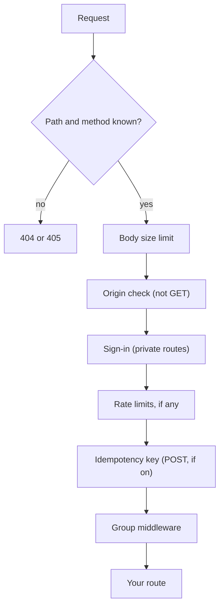

A route is a function that answers one HTTP method on one path, usually by calling a [use case](/concepts/use-cases/). Routes exist so the outside world can reach your app; the use cases stay free of HTTP.

Every option named here is listed with its type and default in the [HTTP API reference](/reference/http/).

## A route

Each module keeps its routes in `<module>.routes.ts`. This is the task module of a generated project:

```ts title="src/contexts/tasks/modules/task/task.routes.ts"
import {
  bodyOf,
  pageRequestFrom,
  type HttpRouter,
} from '@newt-js/core/http'
import type { Task_Module } from './task.module'
import { TaskId } from './value-objects/task-id'

export function registerTaskRoutes(
  router: HttpRouter,
  tasks: Task_Module,
) {
  router.post('/tasks/:id/complete-task', async request =>
    Response.json(
      await tasks.completeTask({ id: TaskId.from(request.params.id) }),
    ),
  )
  router.post('/tasks', async request =>
    Response.json(await tasks.create(await bodyOf(request)), {
      status: 201,
    }),
  )
  router.get('/tasks', async request =>
    Response.json(await tasks.paginate({}, pageRequestFrom(request))),
  )
  router.get('/tasks/:id', async request =>
    Response.json(
      await tasks.get({ id: TaskId.from(request.params.id) }),
    ),
  )
  return { one: router.group('/tasks/:taskId') }
}
```

A route takes the request and returns a standard `Response`. It does not catch errors: newt turns them into JSON answers (see [Errors](#errors)).

The function returns the module's groups: `one`, at `/tasks/:taskId`, is where the modules that use `task` hang their routes. See [Nested resources](/concepts/services-and-deps/#nested-resources).

## The router

Each context has one `HttpRouter`. The context creates it and hands it to every module:

```ts title="src/contexts/tasks/tasks.context.ts"
const router = new HttpRouter({ prefix: '/tasks/api', database })
router.authenticateWith(authenticate)
```

- **Prefix.** A context's router puts `/<context>/api` before every path: the route `/tasks` answers at `/tasks/api/tasks`. Since each context has its own prefix, two contexts never take the same path. A route never repeats its context's name (the [`route-context`](/reference/lint/#newtroute-context) rule checks it). Without a `prefix`, `HttpRouter` uses `/api`.
- **Database.** The router needs the context's database only for [idempotency keys](#idempotency-keys).
- **Defaults.** Any [route option](#route-options) given to the router applies to all its routes.

Methods: `get`, `post`, `put`, `patch`, `delete`. Registering the same method and path twice throws.

## Paths and params

| Segment | Matches | Example |
|---|---|---|
| `tasks` | that exact text | `/tasks` |
| `:id` | any one non-empty segment, kept in `request.params.id` | `/tasks/:id` |
| `*` | one or more segments; only at the end | `/files/*` |

`request.params` is typed from the path: on `'/tasks/:id'` TypeScript knows `request.params.id` is a `string`. Values arrive URL-decoded.

When several paths match, the more specific one wins: text beats `:param`, and `:param` beats `*`.

newt also answers these for you:

- `HEAD` on a path with a `GET` runs the `GET` and drops the body.
- `OPTIONS` on a path whose route has [CORS](#cors) answers the preflight with `204`.
- Another method on a known path answers `405` with an `Allow` header.
- An unknown path under the prefix answers `404` with code `route_not_found`.

## Reading the request

| Helper | Gives |
|---|---|
| `bodyOf(request)` | The JSON body, untyped. Validate it in the use case with its schema. |
| `queryOf(request)` | The query string as a plain object of strings, untyped. |
| `pageRequestFrom(request)` | A page request from `?size=` and `?cursor=`: `size` defaults to 20, kept between 1 and 100. |
| `request.params` | The path params. |
| `request.cookies` | The cookies, as a `Bun.CookieMap`. Cookies you `set` on it go out with the response. |

The body is checked before your code sees it:

- `bodyOf` (and `request.json()`) wants `content-type: application/json` (or `application/*+json`). Anything else answers `415`.
- A body that is not valid JSON, or a form that cannot be read, answers `400` with code `malformed_body`.
- A body over the route's limit answers `413` with code `payload_too_large`. The limit is 1 MiB by default; raise it per route with `maxBodyBytes`.

```ts
router.put('/files/*', request => storage.handler(request), {
  public: true,
  maxBodyBytes: 100 * 1024 * 1024,
})
```

:::tip
`bodyOf` does not validate. Parse the input with the use case's schema, as the generated use cases do, so every caller gets the same checks.
:::

## Who calls

Routes are private unless you say otherwise. Before a private route runs, the router asks its authenticator who is calling:

```ts title="src/auth.ts"
import type { Authenticator } from '@newt-js/core/http'

export const authenticate: Authenticator = async () => null
```

- If it returns an actor (`{ userId }`), the route runs as that [actor](/concepts/actor-and-scope/), and so do the use cases it calls.
- If it returns `null`, or the router has no authenticator, the route answers `401` with code `not_signed_in`.

The generated authenticator signs no one in, so every private route answers `401` until you write it. See [Authentication](/guides/authentication/) for session cookies and bearer tokens.

A route that anyone may call takes `public: true`:

```ts
router.get('/files/*', request => storage.handler(request), {
  public: true,
})
```

## Route options

The third argument of `get`, `post`, etc. Give the same options to the router or a group to make them the default.

| Option | What it does |
|---|---|
| `public` | Skips the authenticator. |
| `maxBodyBytes` | Body limit in bytes. 1 MiB by default. |
| `cors` | Lets pages of other origins call the route. See [CORS](#cors). |
| `crossOrigin` | `true` turns off the [origin check](#origin-check). |
| `rateLimit` | One or more [rate limits](#rate-limits), or `false` for none. |
| `idempotency` | `true` (or `{ ttlMs }`) keeps answers by [idempotency key](#idempotency-keys). `POST` only. |
| `onError` | Your own `(error, request) => Response` instead of the [default error answers](#errors). |

A route's options override its group's and router's. Rate limits add up instead (see [Rate limits](#rate-limits)).

## Groups and middleware

A group shares a path prefix and options, and its options can take a `middleware`. Without options, the group only puts its prefix before its routes.

```ts
const reports = router.group('/reports', {
  middleware: async (request, next) => {
    const started = performance.now()
    const response = await next()
    console.log(request.method, request.url, performance.now() - started)
    return response
  },
})

reports.get('/overdue', async () => Response.json(await tasks.find({})))
```

`/overdue` answers at `/tasks/api/reports/overdue`. The middleware runs after newt's own checks (sign-in, rate limits, idempotency key) and around the route: call `next()` to run it, or return your own `Response` to stop.

## What a request goes through

This is the order in which a request meets newt's checks before your route runs:



A check that fails stops the request there and answers its error, as described in the section "Errors". So a caller who is not signed in gets `401` before any rate limit counts it.

## Errors

When a route throws, newt answers JSON with a status that comes from the error's kind: `400` for `validation`, `404` for `not_found`, `409` for `conflict`, and so on. The body has the error's message and code, and its params if it has any:

```json
{ "error": "Already done", "code": "task.already_done" }
```

A zod error answers `400` with code `validation` and the zod `issues`. Anything else answers `500` with code `internal`; the real error goes to the [log](/concepts/logs/), never to the client. [Errors](/concepts/errors/) has the full table of kinds and statuses, newt's own errors, and how to write yours.

Every answer from the router also gets `cache-control: no-store` unless the route sets its own.

## Origin check

A browser sends cookies with every request to your site, even from a page on another site. To stop such a page from acting as your user, newt refuses `POST`, `PUT`, `PATCH` and `DELETE` requests that come from another origin, with `403` and code `cross_origin_refused`.

- Requests from your own pages pass.
- Requests with no `Origin` header (curl, other servers, mobile apps) pass.
- A request from another origin passes only if the route's [CORS](#cors) allows that origin **and** it carries no cookies.
- `crossOrigin: true` turns the check off for a route.

`GET` routes are never checked.

:::caution
A `GET` route must not change anything. Use `POST`, `PUT`, `PATCH` or `DELETE` for changes, so the origin check protects them.
:::

## CORS

To let pages on other origins call your API, give the router or the route a `cors` option:

```ts title="src/contexts/tasks/tasks.context.ts"
const router = new HttpRouter({
  prefix: '/tasks/api',
  database,
  cors: { origin: ['https://newthub.app'] },
})
```

| Field | Meaning | Default |
|---|---|---|
| `origin` | `'*'` or a list of allowed origins | required |
| `headers` | request headers the page may send | none |
| `expose` | response headers the page may read | none |
| `maxAge` | seconds the browser keeps the preflight answer | 86400 |

## Rate limits

A rate limit caps how many requests one caller makes in a time window. Define it on the context base, then give it to routes:

```ts
const creating = base.rateLimits.define('task.create', {
  limit: 20,
  windowMs: 60_000,
})

router.post(
  '/tasks',
  async request =>
    Response.json(await tasks.create(await bodyOf(request)), {
      status: 201,
    }),
  {
    rateLimit: { limit: creating },
  },
)
```

A limit is named `<module>.<name>` and takes `limit` (requests) and `windowMs` (the window). `by` says who "one caller" is:

| `by` | Counts per |
|---|---|
| `'actor'` (default) | signed-in user, or IP for who is not signed in |
| `'ip'` | client IP |
| `(request) => string \| null` | your own key; `null` skips the limit for that request |

- Over the limit, the route answers `429` with a `Retry-After` header.
- Under it, the answer carries `RateLimit-Limit` and `RateLimit-Remaining`.
- A route's limits add to its group's and router's; `rateLimit: false` removes them all.

The counters live in the platform's cluster, so they are shared by every instance when the cluster is shared. See [Jobs and workers](/concepts/jobs-and-workers/) for rate limits in general.

## Idempotency keys

A phone loses signal after sending "create task". Did it arrive? If the app sends it again, you get two tasks. An idempotency key fixes that: the client sends the same random `Idempotency-Key` header on every retry, and newt runs the request only once.

```ts
router.post(
  '/tasks',
  async request =>
    Response.json(await tasks.create(await bodyOf(request)), {
      status: 201,
    }),
  {
    idempotency: true,
  },
)
```

- The first answer is kept in the context's database (table `newt_idempotency_key`) for a day; change it with `{ ttlMs }`.
- A retry with the same key gets the kept answer, with the header `Idempotent-Replayed: true`.
- The same key with another body answers `422`, code `idempotency_key_reused`.
- A retry while the first is still running answers `409`, code `idempotency_key_in_use`.
- Errors and `5xx` answers are not kept: a retry runs again.
- Answers over 1 MiB and event streams are not kept: a retry answers `409`, code `idempotency_answer_not_kept`.

Rules: `POST` only, private routes only (keys are kept per signed-in user, so newt throws if the route is public), and the router needs its `database`. A request without the header runs as usual.

## Sessions

Two helpers write a session cookie on `request.cookies`, `httpOnly` and `sameSite: 'lax'`:

```ts
setSessionCookie(request, 'session', token, {
  secure: true,
  maxAgeSeconds: 60 * 60 * 24 * 30,
})
clearSessionCookie(request, 'session', { secure: true })
```

`path` defaults to `/`. For tokens in an `Authorization: Bearer` header, `bearerAuthenticator(verify)` builds an authenticator from your `verify(token)`. [Authentication](/guides/authentication/) puts them together.

## Running the server

`runContexts` opens one Bun server for every context's router, starts their workers, and stops it all cleanly on `SIGINT` or `SIGTERM`:

```ts title="src/backend.ts"
return runContexts(contexts, {
  platformWithoutContexts: platform,
  serve: { port, health: true },
})
```

The `serve` options you are most likely to touch:

| Option | What it does |
|---|---|
| `port` | The port. Required. |
| `health` | `true` answers `GET /health-check` for the whole backend, and `GET /<context>/health-check` for each context that serves routes, with `{ "status": "ok" }`; leave it out for no health route. It needs no sign-in. While stopping it answers `503` with `{ "status": "stopping" }`. |
| `drainMs` | On stop, keep serving this long first, so a load balancer sees the `503` and moves away. |
| `trustProxy` | How many proxies stand in front. With it, the client IP and host come from `X-Forwarded-For` and `X-Forwarded-Host`. Set it behind a proxy, or IP rate limits and the origin check see the proxy. |
| `maxBodyBytes` | Default body limit for the server. |
| `securityHeaders` | Headers added to every answer. By default `X-Content-Type-Options: nosniff`, `Referrer-Policy: strict-origin-when-cross-origin`, `X-Frame-Options: DENY`. `false` drops them; a `null` value drops one. |
| `hsts` | `true` adds `Strict-Transport-Security` for a year. |
| `csp`, `proxy` | The Content-Security-Policy of the contexts' built apps, and paths forwarded to another server. A context's app is served at `/<context>`: see [Adding a frontend](/guides/frontend/). |

:::danger
Set `trustProxy` only to the number of proxies you really have. With a higher number, a client can fake its IP in `X-Forwarded-For` and slip past IP rate limits.
:::

`runContexts` returns `{ server, servers, stop() }`. The stop runs in order: servers finish their requests, workers finish their jobs, contexts close.

The full list of `serve` and `runContexts` options is in the [HTTP API reference](/reference/http/).

## With the CLI

`newt add route` writes a route that calls an existing use case, and a test for it:

```sh
newt add route tasks/task complete-task
```

By default it is a `POST` on `/<context>/<module plural>/:id/<use case>`. Pick another with `--method` and `--path`. See [newt add route](/reference/cli/add-route/).
