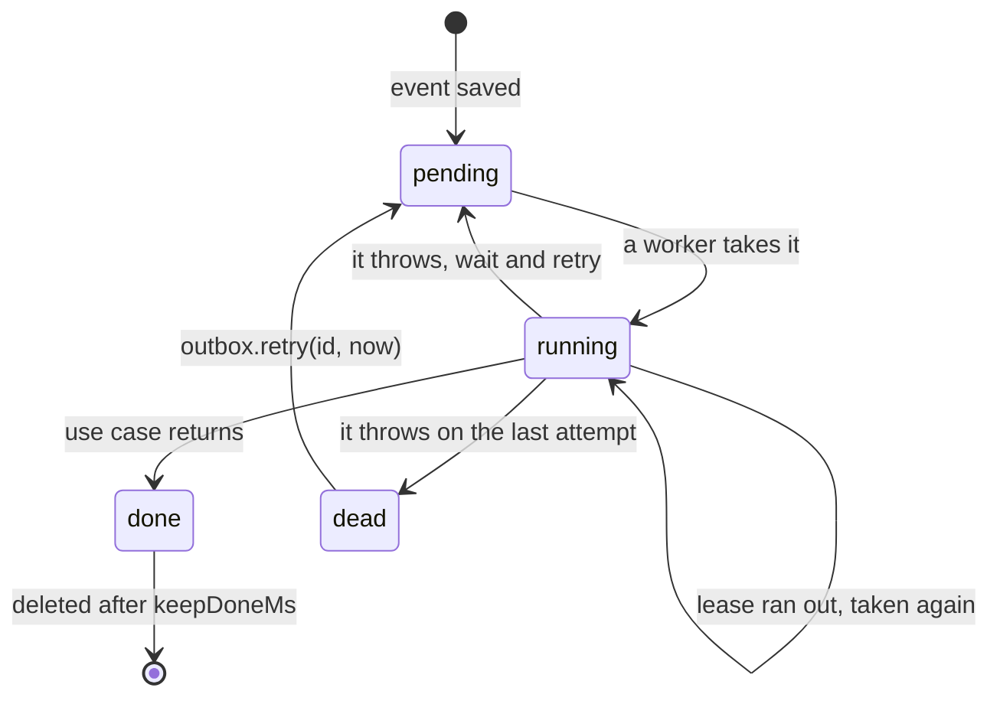

A job is a piece of work waiting to run: "call `notifyAssignee` for task 42". Jobs wait in a queue kept in your database (the *outbox*), and a worker inside your app runs them. They exist so that work triggered by a change is never lost, even if the process stops right after the change.

## The outbox

The outbox is a table, `newt_job`, in the context's database. When a use case saves an entity that emitted an [event](/concepts/events/), newt writes one job per [subscription](/concepts/events/#subscriptions) to that event in the same transaction as the change.

So either both are saved or neither is:

- The change is saved, and its jobs are waiting.
- The save fails, and no job exists.

There is no message broker to install. With SQLite, the queue is in the same file as your data.

## Jobs

A job holds the event as JSON and the queue it belongs to. Its fields:

| Field | What it is |
|---|---|
| `id` | the job's id |
| `queue` | `<module>.<use case>.on.<event>` |
| `event` | the event, as JSON |
| `status` | `pending`, `running`, `done` or `dead` |
| `attempts` | how many times it has been taken |
| `runAfter` | the earliest time it may run |
| `lockedBy`, `lockedUntil` | which worker holds it, and until when |
| `lastError` | the error of the last failed attempt |
| `createdAt`, `updatedAt` | when it was written and last changed |

### Queues

Each subscription has its own queue, named `<module>.<use case>.on.<event>`: `task.notifyAssignee.on.task.completed`. Two subscriptions to the same event get two jobs, one in each queue, and fail or succeed apart.

Workers record the queues they serve in `newt_job_queue`, with the time they last saw each one.

## The worker

Each context has one worker, `base.worker`, started by [`runContexts`](/concepts/http/#running-the-server) in every instance of your app. It runs inside the same process as your routes.

The worker:

1. Takes up to `concurrency` jobs that are due, from the queues it serves. Taking a job marks it `running`, adds one to `attempts`, and locks it for `leaseMs`.
2. Runs the subscribed use case for each, with no [actor](/concepts/actor-and-scope/).
3. On success, marks the job `done`.
4. On an error, puts it back as `pending`, to run again after a wait. After the last attempt, marks it `dead`.

It looks for jobs every `pollMs`, and also right after a transaction that queued jobs commits. With several instances, the other instances are told through the [cluster](/guides/scaling/), so they do not wait for their next poll.

### Leases

While a job runs, the worker renews its lock every third of `leaseMs`. If the process dies, the lock runs out and another worker takes the job again. This is why a job runs *at least once*, and may run twice.

:::caution
Write subscribed use cases so that running them twice does no harm. Check the current state before acting, as an entity method that throws `AlreadyDone` does.
:::

### Stopping

When the app gets `SIGINT` or `SIGTERM`, the worker stops taking jobs and waits for the running ones. If they outlive the deadline, it aborts them through `meta.signal`. A job aborted this way goes back to the queue without counting the attempt.

## Retries and dead jobs

These are the states a job goes through:



A failed job waits before its next attempt, twice as long each time:

```text
wait = min(backoffMs * 2 ^ (attempts - 1), maxBackoffMs)
```

With the defaults: 10 s, 20 s, 40 s, 80 s. A subscription is tried 5 times unless it sets `attempts` (see [subscription options](/concepts/events/#options)).

After the last attempt the job is `dead`. It stays in `newt_job` with its `lastError`, and is never run again on its own.

Done jobs are deleted after `keepDoneMs` (7 days by default). Dead jobs are kept.

:::tip
A use case that throws a [known error](/concepts/errors/), such as `TaskNotFound`, is retried too. If retrying cannot help, return without throwing instead.
:::

## Worker options

You pass them to the context base, as `worker`:

```ts title="src/contexts/tasks/tasks.context.ts"
const base = new ContextBase({
  name: 'tasks',
  platform,
  database,
  worker: { concurrency: 4 },
  storage: await openStorage('tasks', router, stores),
})
```

| Option | What it is | Default |
|---|---|---|
| `concurrency` | jobs run at the same time, a whole number from 1 | `10` |
| `pollMs` | time between looks for due jobs | `5000` |
| `leaseMs` | how long a taken job stays locked | `60000` |
| `backoffMs` | wait after the first failure | `10000` |
| `maxBackoffMs` | longest wait between attempts | `900000` (15 min) |
| `keepDoneMs` | how long done jobs are kept | `604800000` (7 days) |
| `seenEveryMs` | how often the worker records its queues | `60000` |
| `orphansCheckEveryMs` | how often it looks for queues nobody serves | same as `seenEveryMs` |

### Orphan queues

If jobs wait in a queue that no running worker serves, and no instance has seen it lately, the worker logs a warning. It usually means a subscription was renamed or removed while it still had jobs.

## Looking inside the queue

The worker and the outbox give you what you need to build an admin page or an alert:

| Call | Returns |
|---|---|
| `base.worker.state()` | each queue's depth: `ready`, `retrying`, `running`, `dead`, `oldestDueAt`, `lastSeenAt`, `orphan` |
| `base.worker.dead(after, limit)` | a page of dead jobs: id, queue, event name, attempts, last error, dates |
| `base.worker.onFlow(listener)` | calls `listener` each time a job is `delivered`, `redelivered` or `dead`, with its wait in ms |
| `base.database.outbox.retry(id, now)` | puts a dead job back as `pending` with its attempts at 0 |

`onFlow` returns a function that removes the listener. `retry` takes `now` as an ISO date and returns `false` if the job is not dead.

## Rate limits

A rate limit caps how many times something happens in a time window, per key: "20 tasks created per user per minute". You define it on the context base:

```ts
const creating = base.rateLimits.define('task.create', {
  limit: 20,
  windowMs: 60_000,
})
```

- The name is `<module>.<name>`, in camelCase, and is defined once per context.
- `limit` and `windowMs` are whole numbers from 1.

Give it to a route as its `rateLimit` option (see [rate limits in HTTP](/concepts/http/#rate-limits)), or call it yourself:

| Method | What it does |
|---|---|
| `take(key)` | counts one for `key`; over the limit, throws `TooManyRequests` |
| `forget(key)` | clears the count of `key`, as after a successful sign-in |

`take` returns `{ allowed, limit, remaining, retryAfterMs }`. `TooManyRequests` is a known error of kind `too_many_requests`, answered with a `429`, and carries `retryAfterSeconds`.

The window slides: the count of the previous window weighs less as the current one advances, so a burst at the edge of two windows does not double the limit.

:::note
The counts live in the platform's cluster. With `MemoryCluster` each instance counts on its own; with a shared cluster such as Valkey, all instances share the counts. See [Running several instances](/guides/scaling/).
:::

## Jobs with each database

- **SQLite, Postgres, MySQL**: jobs are rows in `newt_job`, and survive restarts. Several instances share them safely: taking jobs runs in a transaction.
- **Memory**: jobs live in the process and are lost when it stops. Use it for tests.

See [Database and migrations](/concepts/database/#the-tables-newt-owns) for the tables newt keeps.

## With the CLI

There is no command for jobs: you get them by subscribing a use case to an event or a schedule.

```sh
newt add subscription tasks/task notify-assignee --on completed
newt add schedule tasks/task remind-overdue --cron "0 9 * * *"
```

See [newt add subscription](/reference/cli/add-subscription/) and [newt add schedule](/reference/cli/add-schedule/).
