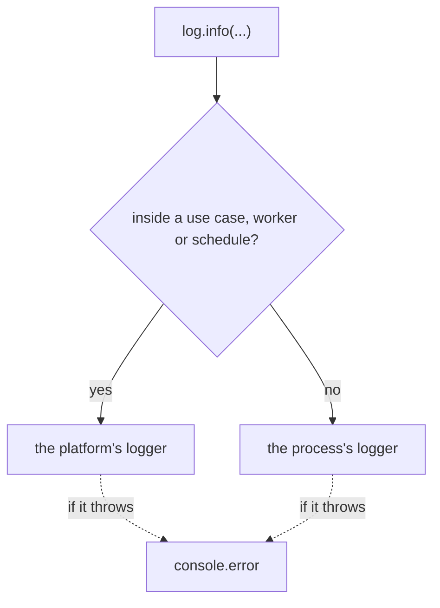

A log line is a short message your backend writes about what it is doing. newt writes its own lines (a job that failed, a lost connection) and gives you the same tool for yours, so all of them go to one place you choose.

You read them to find out what went wrong once the backend runs somewhere you cannot watch it.

## Writing a line

Import `log` and call one of its four levels:

```ts title="src/contexts/tasks/modules/task/task.module.ts"
import { log } from '@newt-js/core/application'

@UseCase()
async remindOverdue(): Promise<void> {
  log.info('reminders sent', { count: 3 })
}
```

| Level | For |
|---|---|
| `log.debug` | Detail you only want while developing |
| `log.info` | Things that happened |
| `log.warn` | Something odd that did not stop the work |
| `log.error` | Something failed |

Each takes a message and an optional object of fields. Put values in the fields, not in the message, so a log tool can search them.

With the default logger, that line prints:

```text
2026-11-17T09:00:00.000Z INFO [tasks] reminders sent { count: 3 }
```

## What a line holds

A logger receives a `LogLine`:

| Field | Type | Meaning |
|---|---|---|
| `at` | `string` | When, as an ISO date. Uses the context's clock, so a test clock moves it too |
| `level` | `'debug' \| 'info' \| 'warn' \| 'error'` | |
| `message` | `string` | |
| `fields` | `Record<string, unknown>` | `{}` when none were given |
| `context` | `string \| null` | The context whose use case was running, or `null` outside any use case |

## The console logger

`ConsoleLogger` is the default. It writes `error` lines with `console.error`, `warn` with `console.warn`, and the rest with `console.log`. The fields follow the message when there are any.

It drops `debug` lines unless you ask for them:

```ts
import { ConsoleLogger } from '@newt-js/core/application'

new ConsoleLogger({ debug: true })
```

## Your own logger

A logger is any object with a `write(line)` method. This one writes one JSON object per line, which most log services read:

```ts title="src/json-logger.ts"
import type { LogLine } from '@newt-js/core/application'
import type { Logger }  from '@newt-js/core/application'

export class JsonLogger implements Logger {

  write(line: LogLine): void {
    console.log(JSON.stringify(line))
  }

}
```

:::tip
newt puts the thrown error in an `error` field. `JSON.stringify` turns an `Error` into `{}`, so copy its `message` and `stack` yourself.
:::

A logger that throws never breaks your use case. The failure is printed with `console.error` and the work goes on. A line written while the logger is busy writing another also goes to `console.error`, so a logger that logs cannot loop forever.

## Where lines go

There are two loggers, and you usually set both to the same one. This is how newt picks one for each line:



| Logger | Set with | Gets lines written |
|---|---|---|
| The platform's | `new Platform({ logger })` or `platform.useLogger(logger)` | Inside use cases, workers, subscriptions, scheduled tasks, and while `runContexts` stops |
| The process's | `setLogger(logger)` | Everywhere else, such as the HTTP layer's `[http] unexpected error` |

:::caution
Setting only the platform's logger is a common mistake: errors from routes then still go to the console. Call `setLogger` with the same logger.
:::

Both start as a `ConsoleLogger`.

```ts title="src/backend.ts"
import { Platform }   from '@newt-js/core/application'
import { setLogger }  from '@newt-js/core/application'
// --------------------------------------------------------
import { JsonLogger } from './json-logger'

export async function startBackend(
  port: number,
  { stores = 'configured' }: { stores?: Stores } = {},
): Promise<RunningContexts> {
  const logger = new JsonLogger()
  setLogger(logger)
  const platform = new Platform({ logger })
  // ...
}
```

The platform is shared by every context of a backend. See [Running several instances](/guides/scaling/) for its `cluster`.

## Lines newt writes

newt's own lines start with a tag in brackets, so you can filter them:

| Tag | Examples |
|---|---|
| `[Worker]` | A job could not be closed; jobs wait in a queue no worker serves; jobs still running after the stop's deadline |
| `[EventBus]` | A handler failed; other instances could not be told about new jobs |
| `[database]` | Rolling back or ending a transaction failed |
| `[http]` | An unexpected error in a route (answered with `500`) |
| `[oauth]` | An unexpected error in an OAuth route |
| `[runContexts]` | A step of the stop failed, or the stop took too long |
| `[MemoryCluster]`, `[ValkeyCluster]` | A listener failed; a connection was lost |
| `[write rule]`, `[guard rule]` | A use case broke a rule set to `'warn'` |

## Logs in tests

`testContext` catches the platform's lines instead of printing them. Read them from `context.logs`:

```ts
expect(context.logs.said('warn')).toContain('...')
```

| Member | Meaning |
|---|---|
| `logs.lines` | Every `LogLine` caught, in order |
| `logs.said(level)` | The messages of one level |

See [Testing](/guides/testing/).

## Observability hooks

Logs tell you what happened. To measure use cases, such as how long each takes or how often it retries, give the platform an `Observability`:

```ts
interface Observability {
  useCase<T>(
    call: ObservedUseCase,
    run: (attempt: UseCaseAttempt) => Promise<T>,
  ): Promise<T>
  warn(message: string, fields: Record<string, unknown>): void
}
```

- `useCase` wraps every use case run, whether a route, a worker or another use case called it. `call` says which one: `{ name, module, context }`, for example `{ name: 'task.create', module: 'task', context: 'tasks' }`. You must call `run` and return what it returns.
- `run` takes an attempt with one method, `retrying(error, attempt)`. newt calls it each time the use case is retried after a conflict with another save, before it runs again. `attempt` is 1 for the first retry.
- `warn` receives the warnings of the write and guard rules when they are set to `'warn'`. newt also logs them, so use `warn` to send them somewhere else.

This one logs how long each use case takes:

```ts title="src/timing.ts"
import type { Observability } from '@newt-js/core'
import { log }                from '@newt-js/core/application'

export const timing: Observability = {
  async useCase(call, run) {
    const started = performance.now()
    try {
      return await run({
        retrying: (error, attempt) =>
          log.warn(`${call.name} retried`, { attempt }),
      })
    } finally {
      log.debug(`${call.name} took`, {
        ms: Math.round(performance.now() - started),
      })
    }
  },
  warn: () => {},
}
```

```ts
const platform = new Platform({
  logger,
  observability: timing,
})
```

You can also set it later with `platform.useObservability(timing)`. Without one, newt uses `noObservability`, which does nothing.

## Describing the application

`describeApplication` reads your contexts and returns their structure as plain data: modules, use cases, events, scheduled tasks, dependencies and subscriptions. It reads the code as it runs, so it is never out of date.

Use it in tests to check how things are wired, or to feed a tool that draws or checks your app. The test `newt add schedule` generates uses it:

```ts title="src/contexts/tasks/modules/task/task.module.test.ts"
test('remindOverdue runs at 0 9 * * *', async () => {
  const described = describeApplication([context.base]).contexts.find(
    each => each.name === 'tasks',
  )
  const events =
    described?.modules.find(each => each.name === 'task')?.events ?? []
  expect(events).toContainEqual(
    expect.objectContaining({
      name: 'task.remindOverdue',
      schedule: { cron: '0 9 * * *' },
    }),
  )
  // ...
})
```

It takes a list of contexts (each a `BoundedContext` or a `ContextBase`) and returns `{ version: 1, contexts }`. Part of what it returns for the demo's `tasks` context:

```json
{
  "name": "tasks",
  "uses": [],
  "modules": [
    {
      "id": "tasks/task",
      "context": "tasks",
      "name": "task",
      "className": "Task_Module",
      "useCases": [
        {
          "id": "tasks/task.create",
          "name": "task.create",
          "retryOnConflict": true
        }
      ],
      "events": [
        {
          "id": "tasks/task.completed",
          "name": "task.completed",
          "schedule": null
        },
        {
          "id": "tasks/task.remindOverdue",
          "name": "task.remindOverdue",
          "schedule": { "cron": "0 9 * * *" }
        }
      ],
      "deps": [
        {
          "name": "project",
          "kind": "module",
          "target": "tasks/project"
        }
      ]
    }
  ],
  "subscriptions": [
    {
      "event": "tasks/task.completed",
      "strategy": "handler",
      "queue": "task.notifyAssignee.on.task.completed",
      "handler": "task.notifyAssignee",
      "attempts": null,
      "filtered": false
    }
  ]
}
```

### Context

| Field | Meaning |
|---|---|
| `name` | The context's name |
| `uses` | The other contexts its modules depend on |
| `modules` | Its modules |
| `subscriptions` | Its [subscriptions](/concepts/events/) |

### Module

| Field | Meaning |
|---|---|
| `id` | `context/module` |
| `context`, `name`, `className` | |
| `useCases` | Each with `id`, `name` and `retryOnConflict` (whether it retries after a conflict) |
| `events` | The events the module emits, each with `id`, `name` and `schedule`: `{ cron }` for a [scheduled task](/concepts/schedules/), `null` for any other event |
| `deps` | Its [dependencies](/concepts/services-and-deps/) |

A dependency has a `name` and a `kind`:

| `kind` | Is | `target` |
|---|---|---|
| `'module'` | Another module | Its id |
| `'events'` | Events of another module, with their names in `events` | The module's id, or `null` if unknown |
| `'port'` | Anything else, such as a service | `null` |

### Subscription

| Field | Meaning |
|---|---|
| `event` | The event's id |
| `strategy` | `'handler'` (a use case run through a queue, as `module.on` sets up) or `'fire-and-forget'` (a function called through `base.bus.subscribe`) |
| `queue` | The queue its jobs go to |
| `handler` | The use case it runs |
| `attempts` | Its own number of attempts, or `null` for the default |
| `filtered` | Whether it only runs for some events |

For a `'fire-and-forget'` subscription, `queue`, `handler`, `attempts` and `filtered` are `null`.
