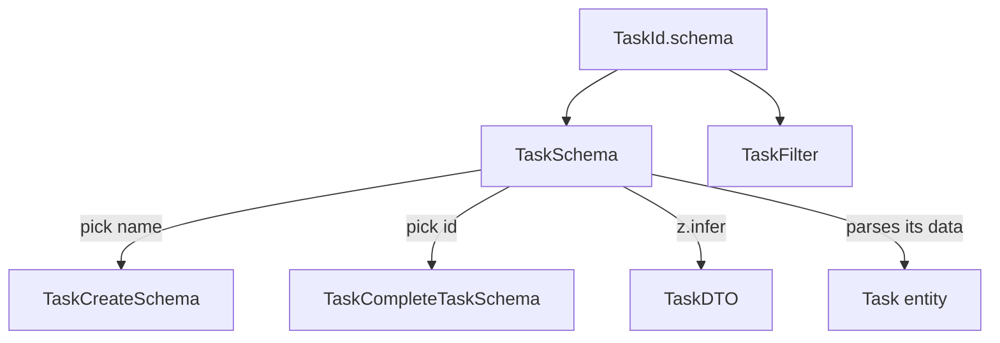

A schema is a [zod](https://zod.dev) description of your data: its fields and their rules. A DTO is the plain object a use case takes or returns, and its type comes from a schema.

Writing the rules once, in the schema, means the entity, the use cases, the routes and the client all agree on what a task is.

## The module's schema file

Each module keeps its schemas in `<module>.schema.ts`. It is the module's contract with the rest of the app:

```ts title="src/contexts/tasks/modules/task/task.schema.ts"
import { defineFilter } from '@newt-js/core'
import { z }            from 'zod'
// --------------------------------------------------------
import { TaskId }       from './value-objects/task-id'

export const TaskSchema = z.object({
  id: TaskId.schema,
  name: z.string().trim().min(1).max(100),
  createdAt: z.string(),
  updatedAt: z.string(),
})

export const TaskCreateSchema = TaskSchema.pick({ name: true })

export const TaskFilter = defineFilter(
  {
    id: { field: 'id', value: TaskId.schema, ops: ['eq', 'in'] },
    name: { field: 'name', value: z.string(), ops: ['eq', 'ieq'] },
  },
  { sort: ['name', 'createdAt'] },
)

export type TaskDTO = z.infer<typeof TaskSchema>
export type TaskCreateDTO = z.input<typeof TaskCreateSchema>
export type TaskFilterDTO = z.input<typeof TaskFilter.schema>
export type TaskSortDTO = z.input<typeof TaskFilter.sortSchema>

export const TaskCompleteTaskSchema = TaskSchema.pick({ id: true })
export type TaskCompleteTaskDTO = z.input<typeof TaskCompleteTaskSchema>
```

The lint rule `schema-imports` keeps it a contract. A schema file imports only `zod`, `@newt-js/core`, the module's own `value-objects/` and other modules' DTO types (`import type` from their `*.schema.ts`). Never the entity, the repository or the module, nor another module's schema as a value: a field that holds another module's id takes a value object of its own module (see [Value objects](/concepts/value-objects/)).

This is how everything in the file comes from `TaskSchema` and the id's value object:



## The entity's schema

`TaskSchema` describes a task as it is kept and returned. The [entity](/concepts/entities/) parses its data with it, and `toDTO()` returns its fields.

It always names `id`, `createdAt` and `updatedAt`. Each field matches a column of the module's table: `createdAt` in the schema is `created_at` in SQL.

:::caution
Adding a field to the schema does not add the column. Write a migration for it too (see [Database and migrations](/concepts/database/)).
:::

## Input schemas

A use case's input schema is picked from the entity's schema, so the rules stay in one place:

```ts
export const TaskCreateSchema = TaskSchema.pick({ name: true })
export const TaskCompleteTaskSchema = TaskSchema.pick({ id: true })
```

The use case parses its input with it before anything else:

```ts
const { id } = TaskCompleteTaskSchema.parse(input)
```

If the input does not pass, zod throws a `ZodError`, and HTTP answers `400` with the code `validation` and the list of issues (see [Errors](/concepts/errors/)).

The lint rule `use-case-params` checks that every parameter typed with an input DTO is parsed with its schema.

## DTO types: z.input and z.infer

A schema has two types: what it takes and what it gives back after parsing. They differ when the schema transforms values or fills in defaults.

| Type | Is | Use it for |
|---|---|---|
| `z.input<typeof S>` | What a caller may send, before parsing. | A use case's parameters. |
| `z.infer<typeof S>` | What parsing gives back. | What a use case returns. |

With `priority: z.string().default('normal')`, the input type has `priority?: string` and the output type has `priority: string`. A caller may leave it out; the use case always gets it.

That is why the generated code types `TaskCreateDTO` with `z.input` and `TaskDTO` with `z.infer`.

An entity that references others shows them in its DTO: `Resolved<z.infer<typeof OrderSchema>, OrderReferences>` puts `customer` in place of `customerId`. See [Entities](/concepts/entities/#references-to-other-modules).

## Filters

A filter says how clients may read a module: by which fields, with which operators, sorted by what. Anything else is refused.

```ts
defineFilter(fields, limits?)
```

Each entry of `fields` is a name clients use, with:

| Key | What it is |
|---|---|
| `field` | The entity's field it reads, as `'projectId'`. |
| `value` | The zod schema of a value, as `TaskId.schema`. |
| `ops` | The operators allowed on it. |

The name and the field can differ: `project: { field: 'projectId', value: ProjectId.schema, ops: ['eq'] }`.

### Operators

| Operator | Matches when the value is |
|---|---|
| `eq` | equal to it |
| `ne` | not equal to it |
| `in` | one of a list (at most 100 values) |
| `gt` / `gte` | greater than / greater than or equal to it |
| `lt` / `lte` | less than / less than or equal to it |
| `ieq` | equal to it, ignoring the case of the letters A to Z |

### Limits

| Option | Default | What it is |
|---|---|---|
| `sort` | none | The fields a list may be sorted by. |
| `maxDepth` | `3` | How deep `and` and `or` groups may nest. |
| `maxConditions` | `20` | How many conditions one filter may hold. |

### What clients send

A filter takes two shapes. The short one, for equality, lists values by name. Only fields with `eq` may appear:

```json
{ "name": "Write the docs" }
```

The full one is a tree of conditions, grouped with `and` and `or`. Each group holds at least one item:

```json
{
  "or": [
    { "field": "name", "op": "ieq", "value": "write the docs" },
    { "field": "id", "op": "in", "value": ["0190f5c2-...", "0190f5c3-..."] }
  ]
}
```

A sort is a list of at most three fields, each with an optional direction:

```json
[{ "field": "createdAt", "direction": "desc" }, { "field": "name" }]
```

### What a filter gives you

| Member | What it does |
|---|---|
| `schema` | The zod schema of a filter. |
| `sortSchema` | The zod schema of a sort. |
| `parse(input)` | Checks a filter, or throws `InvalidFilter`. |
| `parseSort(input)` | Checks a sort, or throws `InvalidSort`. |
| `toCriteria<Row>(filter)` | Turns a checked filter into repository criteria. |
| `toOrder<Row>(sort)` | Turns a checked sort into the repository's `orderBy`. |
| `fieldOf(name)` | The entity's field behind a name. |

The generated use cases call `TaskFilter.schema.parse`, which throws a `ZodError` (`400`, code `validation`). `TaskFilter.parse` throws `InvalidFilter` instead (`400`, code `invalid_filter`, with the issues in `params`). See [Repositories](/concepts/repositories/#criteria) for what the criteria do.

:::tip
List only the fields and operators clients need. A filter is also a limit on which queries your database has to answer.
:::

## With the CLI

No command writes a schema alone. `newt add module` writes the schema file with the entity's schema, its create schema and its filter. `newt add use-case` adds a picked input schema and its DTO type. See [`newt add module`](/reference/cli/add-module/) and [`newt add use-case`](/reference/cli/add-use-case/).
