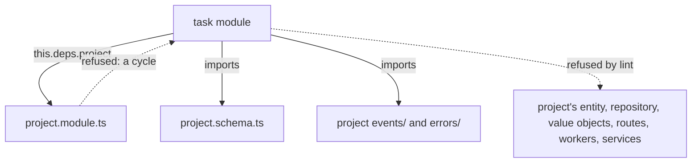

A service is a function that several use cases of one module share. A dependency is something a module gets from outside when it is built, most often another module of its context whose use cases it calls.

Both keep a module small without breaking its edges: a service stays inside the module, and a dependency is the only door to another one.

## Services

A service lives in the module's `services/` folder, one file each:

```ts title="src/contexts/tasks/modules/task/services/due-dates.ts"
import type { TaskDTO } from '../task.schema'

export function dueDates(task: TaskDTO): TaskDTO {
  return task
}
```

Use cases import it and call it:

```ts
import { dueDates } from './services/due-dates'
```

Write a service when two use cases repeat the same steps, such as a calculation or a check that needs several reads. A rule about one task belongs in the [entity](/concepts/entities/) instead, where every use case gets it.

:::tip
A service is a plain function. It needs no class, no decorator and no registration, and you test it by calling it.
:::

A service belongs to its module. The lint rule `module-imports` lets other modules import only a module's `*.module.ts`, `*.schema.ts`, `events/` and `errors/`, so no other module can import its services.

## Dependencies

A module that needs another module of its context gets it as a dependency. In Newthub, `task` uses `project`.

Its dependencies are a type in `<module>.deps.ts`:

```ts title="src/contexts/tasks/modules/task/task.deps.ts"
import type { Project_Module } from '../project/project.module'

export type Task_Deps = {
  project: Project_Module
}
```

The context's `-modules.ts` builds `project` first and hands it to `task`:

```ts title="src/contexts/tasks/tasks-modules.ts"
export function tasksModules(base: ContextBase, router: HttpRouter) {
  const project = Project_Module.initialize(base, router)
  const task = Task_Module.initialize(base, router, { project })
  return {
    task,
    project,
  }
}
```

The module keeps them and passes them to `Module`'s constructor:

```ts title="src/contexts/tasks/modules/task/task.module.ts"
private constructor(
  base: ContextBase,
  private readonly tasks: Task_Repository,
  private readonly deps: Task_Deps,
) {
  super('task', base.useCaseRunner, deps)
  // ...
}
```

A use case then calls the other module's use cases:

```ts
@UseCase()
async moveToProject(input: TaskMoveToProjectDTO): Promise<TaskDTO> {
  const { id, projectId } = TaskMoveToProjectSchema.parse(input)
  const project = await this.deps.project.get({ id: projectId })
  // ...
}
```

Passing `deps` to `super` lets newt describe the app: `describeApplication` lists, for each module, the modules it uses. A dependency may also be another module's events, or any object your module needs, such as a client for an outside service.

## What is allowed

- **Read through another module's use cases.** `this.deps.project.get(...)`, `find(...)` and `paginate(...)` are fine.
- **Do not save through them.** A use case saves only its own module: a use case of `project` that saves, called from `task`, breaks the [write rule](/concepts/use-cases/#the-write-rule) and throws. To change a project when something happens to a task, publish an event and let `project` react to it in a worker (see [Events and subscriptions](/concepts/events/)).
- **No cycles.** If `task` uses `project`, `project` cannot use `task`, even through a third module. `newt add deps` refuses a cycle.
- **Modules of the same context.** A module uses another context's modules only once its context is opened with that context, and the CLI does not write that yet. See [how contexts talk to each other](/concepts/contexts-and-modules/#how-contexts-talk-to-each-other).

This is what `task` may reach of `project`, and what the lint refuses:



What the lint checks:

| Rule | What it refuses |
|---|---|
| `module-imports` | Importing another module's entity, repository, value objects, routes, workers or services. |
| `module-files` | A file or folder a module does not have. `services/` and `<module>.deps.ts` are allowed. |
| `module-transactions` | A module opening a transaction of its own. |

:::caution
Do not import another module's repository to read its table "just this once". The lint refuses it: you would read its data behind its use cases, and a change to that module could break yours. Call its use case.
:::

:::note
An id a module keeps of another module's entity, such as `projectId` on a task, is a value object of its own module. See [Value objects](/concepts/value-objects/).
:::

## Nested resources

Some URLs put one resource inside another. Say a `notes` context has two modules, `folder` and `note`, and `note` uses `folder` to check that a folder exists before it puts a note in it:

```ts title="src/contexts/notes/notes-modules.ts"
export function notesModules(base: ContextBase, router: HttpRouter) {
  const folder = Folder_Module.initialize(base, router)
  const note = Note_Module.initialize(base, router, { folder })
  return {
    folder,
    note,
  }
}
```

The notes of a folder answer at `GET /api/notes/folders/:folderId/notes`. The URL starts with the folder, but `folder` cannot serve it: it would need `note`, and `note` already uses `folder`. That is a cycle, and `notesModules` could not even build them, since each one would have to be built first.

So newt follows two rules:

- **A nested route belongs to the module it reads or changes.** The notes of a folder are notes, so their routes live in `note`, the module that uses `folder`.
- **A parent learns about its children through events, never through dependencies.** When `folder` must react to its notes, or its notes to it, an event goes between them.

| Route | Module | Why |
|---|---|---|
| `GET /notes/folders/:id` | `folder` | It reads a folder. |
| `DELETE /notes/folders/:id` | `folder` | It deletes a folder. |
| `GET /notes/folders/:folderId/notes` | `note` | It reads notes. |
| `POST /notes/folders/:folderId/notes` | `note` | It creates a note. |

### The child owns the nested routes

`note` keeps the folder's id as a value object of its own, `value-objects/folder-id.ts` (see [Value objects](/concepts/value-objects/)), and registers the route in `note.routes.ts`:

```ts title="src/contexts/notes/modules/note/note.routes.ts"
router.get('/notes/folders/:folderId/notes', async request =>
  Response.json(
    await notes.paginateInFolder(
      FolderId.from(request.params.folderId),
      pageRequestFrom(request),
    ),
  ),
)
```

Its use case reads the folder through `folder`, so a folder that does not exist answers `404` instead of an empty list:

```ts title="src/contexts/notes/modules/note/note.module.ts"
@UseCase()
async paginateInFolder(
  folderId: FolderId,
  page: PageRequest,
): Promise<Page<NoteDTO>> {
  await this.deps.folder.get({ id: folderId })
  return this.paginate({ folderId }, page)
}
```

The path still starts with the context's name, whichever module registers it, as the lint rule `route-context` asks. Write this route by hand: `newt add route` passes only `:id` to a use case.

### The parent changes, the children follow

Deleting a folder should delete its notes. A use case of `folder` cannot do it: it would need `note`, and it may save only folders (see [the write rule](/concepts/use-cases/#the-write-rule)). So `folder` deletes the folder and emits `folder.deleted`:

```ts title="src/contexts/notes/modules/folder/folder.ts"
delete(): void {
  this.markAsDeleted()
  this.trackEvent(new Folder_Deleted({ id: this.id }))
}
```

`note` already has `folder` as a dependency, so it subscribes to its event. Its `initialize` hands its deps to its workers:

```ts title="src/contexts/notes/modules/note/note.module.ts"
static initialize(
  base: ContextBase,
  router: HttpRouter,
  deps: Note_Deps,
): Note_Module {
  const module = new Note_Module(base, new Note_Repository(base), deps)
  registerNoteRoutes(router, module)
  registerNoteWorkers(module, deps)
  return module
}
```

```ts title="src/contexts/notes/modules/note/note.workers.ts"
import type { Note_Deps } from './note.deps'
import type { Note_Module } from './note.module'

export function registerNoteWorkers(
  notes: Note_Module,
  { folder }: Note_Deps,
): void {
  notes.on(folder.events.deleted, 'deleteInFolder', deleted => [
    deleted.id,
  ])
}
```

```ts title="src/contexts/notes/modules/note/note.module.ts"
@UseCase()
async deleteInFolder(folderId: FolderId): Promise<void> {
  const notes = await this.notes.find(
    NoteFilter.toCriteria<NoteRow>(
      NoteFilter.schema.parse({ folderId }),
    ),
  )
  for (const note of notes) {
    note.delete()
  }
  await this.notes.persist(notes)
}
```

`DELETE /notes/folders/:id` stays in `folder`, and the notes go a moment later, in a job. In tests, `context.settle()` waits for it (see [Events and subscriptions](/concepts/events/#in-tests)).

### The children change, the parent keeps track

Say a folder shows how many notes it has. `folder` keeps a `notesCount` and adds one on every `note.created`, without using `note`: it imports only the event's class from note's `events/`, which [`module-imports`](/concepts/contexts-and-modules/#how-modules-talk-to-each-other) allows, and makes its own emitter for it with `eventsOf`:

```ts title="src/contexts/notes/modules/folder/folder.module.ts"
import { Note_Created } from '../note/events/note-created'

// in the constructor
this.events = eventsOf(base.bus, {
  created: Folder_Created,
  deleted: Folder_Deleted,
})
this.noteEvents = eventsOf(base.bus, { created: Note_Created })
```

```ts title="src/contexts/notes/modules/folder/folder.workers.ts"
import type { Folder_Module } from './folder.module'

export function registerFolderWorkers(folders: Folder_Module): void {
  folders.on(folders.noteEvents.created, 'countNote', created => [
    created.folderId,
  ])
}
```

For this, `note.created` carries the note's `folderId` in its payload. `countNote` is a use case of `folder` that reads the folder, adds one and saves it.

An event is matched by its name, so `folder` gets every `note.created` that `note` emits, and `notesModules` builds the two modules in the same order as before.

:::tip
Both directions are subscriptions, so `newt add subscription` cannot write them: it subscribes a module to its own events. Write the line in `<module>.workers.ts` by hand.
:::

## With the CLI

```sh
newt add service tasks/task due-dates
newt add deps tasks/task project
```

`newt add service` writes `services/due-dates.ts`, a function on the module's DTO. `newt add deps` writes `task.deps.ts` (or adds a line to it), passes `{ project }` in `tasks-modules.ts` and wires the module's constructor. It refuses a module of another context, a module using itself, and a cycle. See [`newt add service`](/reference/cli/add-service/) and [`newt add deps`](/reference/cli/add-deps/).
