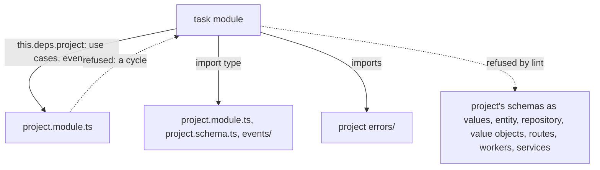

A service is a function that several use cases of one module share. A dependency is something a module gets from outside when it is built, most often another module of its context whose use cases it calls.

Both keep a module small without breaking its edges: a service stays inside the module, and a dependency is the only door to another one.

## Services

A service lives in the module's `services/` folder, one file each:

```ts title="src/contexts/tasks/modules/task/services/due-dates.ts"
import type { TaskDTO } from '../task.schema'

export function dueDates(task: TaskDTO): TaskDTO {
  return task
}
```

Use cases import it and call it:

```ts
import { dueDates } from './services/due-dates'
```

Write a service when two use cases repeat the same steps, such as a calculation or a check that needs several reads. A rule about one task belongs in the [entity](/concepts/entities/) instead, where every use case gets it.

:::tip
A service is a plain function. It needs no class, no decorator and no registration, and you test it by calling it.
:::

A service belongs to its module. The lint rule `module-imports` lets other modules import only the types of a module's `*.module.ts`, `*.schema.ts` and `events/`, and its `errors/`, so no other module can import its services.

## Dependencies

A module that needs another module of its context gets it as a dependency. In Newthub, `task` uses `project`.

Its dependencies are a type in `<module>.deps.ts`:

```ts title="src/contexts/tasks/modules/task/task.deps.ts"
import type { Project_Module } from '../project/project.module'

export type Task_Deps = {
  project: Project_Module
}
```

The context's `-modules.ts` builds `project` first and hands it to `task`:

```ts title="src/contexts/tasks/tasks-modules.ts"
export function tasksModules(base: ContextBase, router: HttpRouter) {
  const project = Project_Module.initialize(base, router)
  const task = Task_Module.initialize(base, router, { project })
  return {
    task,
    project,
  }
}
```

The module keeps them and passes them to `Module`'s constructor:

```ts title="src/contexts/tasks/modules/task/task.module.ts"
private constructor(
  base: ContextBase,
  private readonly tasks: Task_Repository,
  private readonly deps: Task_Deps,
) {
  super('task', base.useCaseRunner, deps)
  // ...
}
```

A use case then calls the other module's use cases:

```ts
@UseCase()
async moveToProject(input: TaskMoveToProjectDTO): Promise<TaskDTO> {
  const { id, projectId } = TaskMoveToProjectSchema.parse(input)
  const project = await this.deps.project.get(projectId)
  // ...
}
```

Passing `deps` to `super` lets newt describe the app: `describeApplication` lists, for each module, the modules it uses. A dependency may also be another module's events, or any object your module needs, such as a client for an outside service.

## What is allowed

- **Read through another module's use cases.** `this.deps.project.get(...)`, `find(...)` and `paginate(...)` are fine.
- **Do not save through them.** A use case saves only its own module: a use case of `project` that saves, called from `task`, breaks the [write rule](/concepts/use-cases/#the-write-rule) and throws. To change a project when something happens to a task, publish an event and let `project` react to it in a worker (see [Events and subscriptions](/concepts/events/)).
- **No cycles.** If `task` uses `project`, `project` cannot use `task`, even through a third module. `newt add deps` refuses a cycle.
- **Modules of the same context.** A module uses another context's modules only once its context is opened with that context, and the CLI does not write that yet. See [how contexts talk to each other](/concepts/contexts-and-modules/#how-contexts-talk-to-each-other).

This is what `task` may reach of `project`, and what the lint refuses:



What the lint checks:

| Rule | What it refuses |
|---|---|
| `module-imports` | Importing another module's entity, repository, value objects, routes, workers or services, or its module, schema or events as values (they come as `import type`). |
| `module-files` | A file or folder a module does not have. `services/` and `<module>.deps.ts` are allowed. |
| `module-transactions` | A module opening a transaction of its own. |

:::caution
Do not import another module's repository to read its table "just this once". The lint refuses it: you would read its data behind its use cases, and a change to that module could break yours. Call its use case.
:::

:::note
An id a module keeps of another module's entity, such as `projectId` on a task, is a value object of its own module. See [Value objects](/concepts/value-objects/).
:::

## Nested resources

Some URLs put one resource inside another: the notes of a folder answer at `/notes/api/folders/:folderId/notes`. Say a `notes` context has two modules, and `note` uses `folder` to check that a folder exists before it puts a note in it. `folder` cannot serve that URL: it would need `note`, and `note` already uses `folder`, a cycle.

So newt follows two rules:

- **A nested route belongs to the module it reads or changes**, and hangs under the group the parent exposes.
- **A parent never uses its children.** It emits events that they follow, and they tell it what it must know through their workers.

### The child hangs its routes under the parent's

Every module's routes function returns its groups, and the module keeps them in `routes`. `folder` exposes `one`, a group at `/folders/:folderId` that does nothing of its own:

```ts title="src/contexts/notes/modules/folder/folder.routes.ts"
return { one: router.group('/folders/:folderId') }
```

Once `note` uses `folder` (`newt add deps notes/note folder`), its routes function takes its deps, and registers the notes of a folder on that group. `request.params.folderId` is typed:

```ts title="src/contexts/notes/modules/note/note.routes.ts"
export function registerNoteRoutes(
  router: HttpRouter,
  notes: Note_Module,
  deps: Note_Deps,
) {
  deps.folder.routes.one.get('/notes', async request =>
    Response.json(
      await notes.paginateInFolder(
        FolderId.from(request.params.folderId),
        pageRequestFrom(request),
      ),
    ),
  )
  // ...
}
```

If `folder` moves its URL, its notes move with it. Its use case reads the folder through `folder`, so a folder that does not exist answers `404` instead of an empty list:

```ts title="src/contexts/notes/modules/note/note.module.ts"
@UseCase()
async paginateInFolder(
  folderId: FolderId,
  page: PageRequest,
): Promise<Page<NoteDTO>> {
  await this.deps.folder.get({ id: folderId })
  return this.paginate({ folderId }, page)
}
```

### Who may enter the parent

Say only the members of a folder may see what is inside it, and the members are a module, `folderMember`, that uses `folder`. `folder` cannot ask it, and no child should check for all the others. Who may enter is the context's to say, with a [guard](/concepts/http/#guards):

```ts title="src/contexts/notes/notes.context.ts"
router.guard('/folders/:folderId', async request => {
  await folderMember.current(request.params.folderId)
})
```

It covers the folder's own routes and those its children hang, without any module knowing of it.

### The parent changes, the children follow

Deleting a folder should delete its notes. `folder` deletes the folder and emits `folder.deleted`; `note` subscribes to it through its deps, which its `initialize` hands to `registerNoteWorkers(module, deps)`, and deletes the folder's notes in a job:

```ts title="src/contexts/notes/modules/note/note.workers.ts"
export function registerNoteWorkers(
  notes: Note_Module,
  { folder }: Note_Deps,
): void {
  notes.on(folder.events.deleted, 'deleteInFolder', deleted => [deleted.id])
}
```

### The children change, the parent keeps track

Say a folder shows how many notes it has. `folder` cannot listen to `note`, which it does not use. So `note` tells it: a worker of `note` follows its own `note.created` and calls a use case of `folder` through its deps:

```ts title="src/contexts/notes/modules/note/note.workers.ts"
notes.on(notes.events.created, 'countInFolder', created => [created.folderId])
```

```ts title="src/contexts/notes/modules/note/note.module.ts"
@UseCase()
async countInFolder(folderId: FolderId): Promise<void> {
  await this.deps.folder.countNote({ id: folderId })
}
```

Composing use cases of several modules is the workers' job: a route only reads and calls.

## With the CLI

```sh
newt add service tasks/task due-dates
newt add deps tasks/task project
```

`newt add service` writes `services/due-dates.ts`, a function on the module's DTO. `newt add deps` writes `task.deps.ts` (or adds a line to it), passes `{ project }` in `tasks-modules.ts` and wires the module's constructor. It refuses a module of another context, a module using itself, and a cycle. See [`newt add service`](/reference/cli/add-service/) and [`newt add deps`](/reference/cli/add-deps/).
