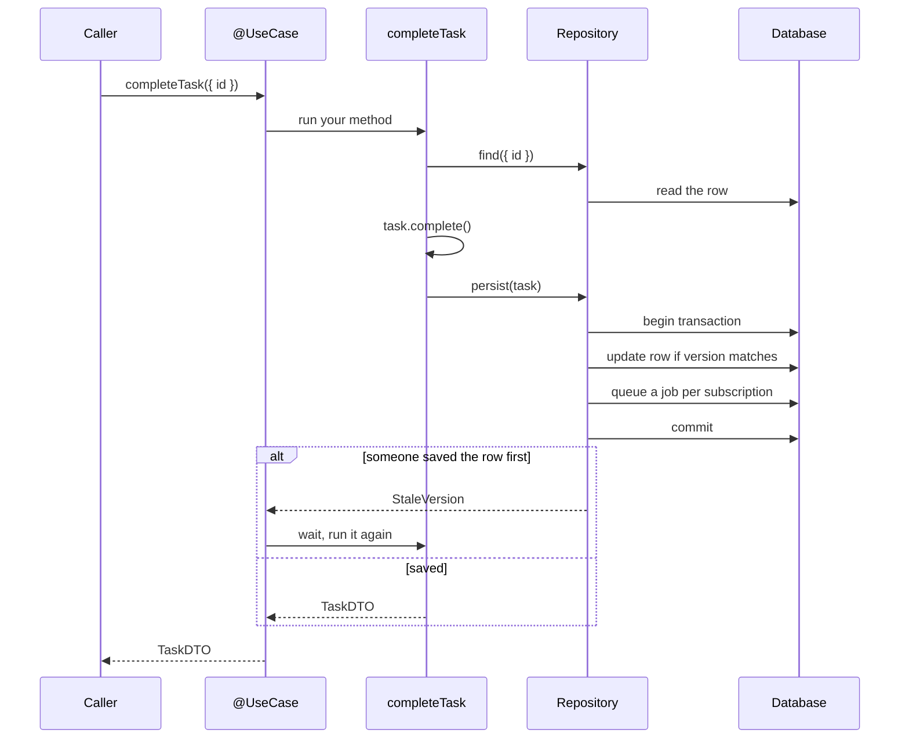

A use case is one thing your app does, such as creating a task or completing it. In code, it is a method of a module marked with `@UseCase()`.

Routes, workers, scheduled tasks and tests all call use cases. newt runs every call the same way, so retries, rules and traces work everywhere.

## A use case

`newt add use-case tasks/task complete-task` writes a method that reads the task and saves it. It changes nothing yet: the change is the line you add, here `task.complete()` (its code is in [Entities](/concepts/entities/#changing-it)).

```ts title="src/contexts/tasks/modules/task/task.module.ts"
@UseCase()
async completeTask(input: TaskCompleteTaskDTO): Promise<TaskDTO> {
  const { id } = TaskCompleteTaskSchema.parse(input)
  const [task] = await this.tasks.find(
    TaskFilter.toCriteria<TaskRow>({ id }),
    { limit: 1 },
  )
  if (!task) {
    throw new TaskNotFound()
  }
  task.complete()
  await this.tasks.persist(task)
  return task.toDTO()
}
```

:::caution
Until you add the change, the generated use case saves nothing and emits no event. Saving an entity that did not change writes nothing.
:::

The shape is always the same:

1. Check the input with its schema.
2. Read the entity through the repository.
3. Change it through its own methods.
4. Save it with `persist`.
5. Return a DTO, a plain object (see [Schemas and DTOs](/concepts/schemas-and-dtos/)).

## What happens on a call

This is what happens when a route, a worker or a test calls `completeTask`:



## What `@UseCase` does around your method

| What | How |
|---|---|
| Names it | `<module>.<method>`, as `task.completeTask`, and registers it, so `describeApplication` lists it. |
| Uses the context's clock | Every "now" inside it comes from the context's clock, which tests can move. |
| Observes it | Each run goes to the platform's observability: its trace, its time, its retries. See [Logs and observability](/concepts/logs/). |
| Retries it on a conflict | When two saves collide, it runs your method again. See [Retries on a conflict](#retries-on-a-conflict). |
| Checks the write rule | A use case saves only its own module. See [The write rule](#the-write-rule). |

`@UseCase` does **not** open a transaction. Each `persist` is one transaction, and the events the entity tracked are stored in that same transaction (see [Repositories](/concepts/repositories/#saving)). To save several entities of the module at once, pass them all to one `persist`.

:::tip
`persist([first, second])` saves both or neither. Two separate `persist` calls are two transactions: the first stays saved if the second fails.
:::

Who runs the use case, the *actor*, comes from the request or the event that started it, and every event it publishes records it. See [Actor and scope](/concepts/actor-and-scope/).

## Options

`@UseCase()` takes one option:

| Option | Default | What it does |
|---|---|---|
| `retryOnConflict` | `true` | `false` turns off the retries on a conflict, for this use case and for the whole call it is part of. |

```ts
@UseCase({ retryOnConflict: false })
async notifyAssignee(input: TaskNotifyAssigneeDTO): Promise<TaskDTO> {
  // ...
}
```

:::caution
A retry runs your whole method again. If it sends an email or calls another service before the save, that happens twice. Turn retries off for it, or do that work in a worker reacting to an event.
:::

## Retries on a conflict

Two requests can change the same task at once. The second save then fails with a *concurrency conflict*:

- `StaleVersion`: someone saved the row after you read it.
- `DuplicateValue`: a unique value was taken in the meantime.
- `TransactionConflict`: on Postgres or MySQL, the database refused the transaction because another got in the way.

The use case catches these, waits a little and runs your whole method again, which reads the row again. Any other error goes straight to the caller.

You set how in the context's `conflictRetries` option:

| Field | Default | What it is |
|---|---|---|
| `times` | `3` | Retries at most, after the first run. |
| `duplicates` | `1` | Of those, how many may follow a `DuplicateValue`. Never more than `times`. |
| `backoffMs` | `10` | Before retry *n*, it waits a random time up to `backoffMs × n` milliseconds. |

```ts
new ContextBase({
  name: 'tasks',
  platform,
  database,
  conflictRetries: { times: 5 },
})
```

Only the outermost use case retries. When one use case calls another, a conflict in the inner one goes up to the outer one, which runs again from the start.

When the retries run out, the conflict reaches the caller: HTTP answers it with `409` (see [Errors](/concepts/errors/)).

## The generated use cases

`newt add module` writes four use cases. Every module reads the same way:

| Use case | Takes | Returns | When nothing matches |
|---|---|---|---|
| `create(input)` | a `TaskCreateDTO` | the new `TaskDTO` | |
| `get(id)` | a `TaskId` | one `TaskDTO` | throws `TaskNotFound` |
| `find(criteria, sort?)` | a `TaskFilterDTO`, a `TaskSortDTO` | `TaskDTO[]` | `[]` |
| `paginate(criteria, page)` | a `TaskFilterDTO`, a `PageRequest` | `Page<TaskDTO>`, newest first | a page with no items |

```ts title="src/contexts/tasks/modules/task/task.module.ts"
@UseCase()
async create(input: TaskCreateDTO): Promise<TaskDTO> {
  const task = Task.create(TaskCreateSchema.parse(input))
  await this.tasks.persist(task)
  return task.toDTO()
}

@UseCase()
async get(id: TaskId): Promise<TaskDTO> {
  const [task] = await this.tasks.find({ id: TaskId.from(id) }, { limit: 1 })
  if (!task) {
    throw new TaskNotFound()
  }
  return task.toDTO()
}

@UseCase()
async find(
  criteria: TaskFilterDTO,
  sort?: TaskSortDTO,
): Promise<TaskDTO[]> {
  const orderBy = TaskFilter.toOrder<TaskRow>(
    sort === undefined ? undefined : TaskFilter.sortSchema.parse(sort),
  )
  const found = await this.tasks.find(
    TaskFilter.toCriteria<TaskRow>(TaskFilter.schema.parse(criteria)),
    { orderBy },
  )
  return found.map(each => each.toDTO())
}

@UseCase()
async paginate(
  criteria: TaskFilterDTO,
  page: PageRequest,
): Promise<Page<TaskDTO>> {
  const found = await this.tasks.paginate(
    TaskFilter.toCriteria<TaskRow>(TaskFilter.schema.parse(criteria)),
    page,
    { newestFirst: true },
  )
  return mapPage(found, each => each.toDTO())
}
```

A search by text has its own shape: `search(text, page)`, where `text` is a `SearchText` and `page` a `PageRequest`. `get` reads one by its id; to read one by any other field, use `find`. The lint rule `use-case-reads` keeps `find`, `get` and `paginate` free of text, and `search` to exactly those two parameters.

## Rules the lint holds

- **Every public method of a module is a use case** (`use-case-public-methods`). A method only the module calls is `private`.
- **Inputs say what they are** (`use-case-params`). A parameter is a DTO of the module's schema or a value object, never `unknown`, `any`, an object written in place, or a bare `string`, `number`, `boolean` or `bigint`. An input DTO (`z.input<typeof XSchema>`) is parsed with `XSchema` in the use case, or in a private method it hands it to.

## Calling one use case from another

From the same module, call it on `this`:

```ts
const task = await this.get(id)
```

From another module of the context, call it on the module you got as a dependency (see [Services and dependencies](/concepts/services-and-deps/)):

```ts
const project = await this.deps.project.get(projectId)
```

The inner call runs as part of the outer one: one trace, one retry loop.

### The write rule

A use case reads any module, but saves only its own. If `task.completeTask` calls a use case of `project` that saves, that save throws:

```txt
[write rule] task.completeTask writes to tasks.project outside a worker: write it from a worker reacting to an event
```

To change a project when a task is completed, publish an event from the task and let `project` react to it in a worker (see [Events and subscriptions](/concepts/events/)). Each module then saves in its own transaction, and a failure in one does not undo the other.

A second check holds even inside workers: one transaction saves one module. Saving two modules in one transaction throws `[write rule] … one module per transaction`.

The context's `writeRule` option sets what a broken rule does:

| Value | What happens |
|---|---|
| `'error'` (default) | The save throws. |
| `'warn'` | It logs a warning once per place, and goes on. |
| `'off'` | Nothing. |

## With the CLI

```sh
newt add use-case tasks/task complete-task
```

It adds the method to `task.module.ts`, its input schema to `task.schema.ts` and a test. It refuses the names `find`, `get`, `paginate` and `search`. To call it over HTTP, add a route with `newt add route`. See [`newt add use-case`](/reference/cli/add-use-case/) and [`newt add route`](/reference/cli/add-route/).

```ts title="src/contexts/tasks/modules/task/task.schema.ts"
export const TaskCompleteTaskSchema = TaskSchema.pick({ id: true })
export type TaskCompleteTaskDTO = z.input<typeof TaskCompleteTaskSchema>
```
