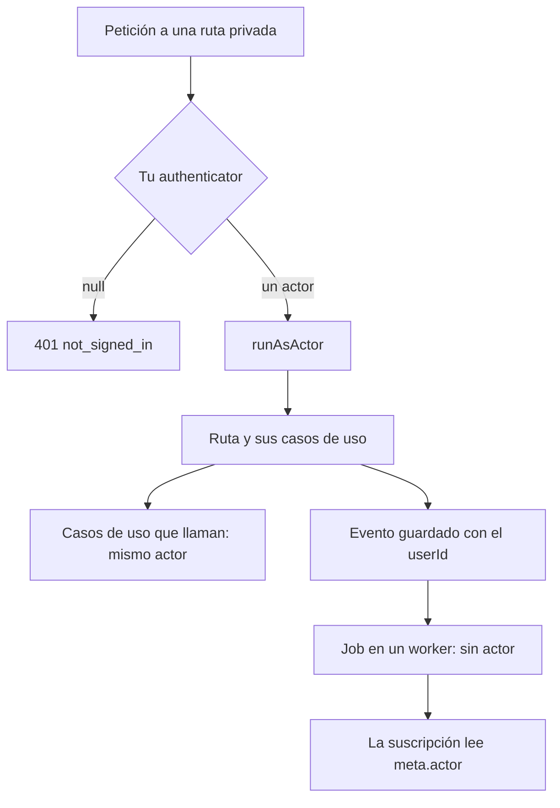

El *actor* es la persona que ejecuta un caso de uso: el usuario que ha iniciado sesión en la petición. Un *scope* es un valor que newt lleva a todo lo que llama un trozo de código, como el equipo para el que trabaja una petición. Juntos responden a "¿quién hace esto?" y "¿con los datos de quién?" sin pasarlos como argumento por todas partes.

## El actor

Un actor es un objeto pequeño con el id del usuario:

```ts
interface Actor {
  userId: string
}
```

Nunca lo creas a mano en una ruta. El router de cada contexto pregunta a tu *authenticator* quién llama y ejecuta la ruta como ese actor.

### De dónde sale el actor

`newt init` escribe `src/auth.ts`. El router de cada contexto lo usa:

```ts title="src/auth.ts"
import type { Authenticator } from '@newt-js/core/http'

export const authenticate: Authenticator = async () => null
```

```ts title="src/contexts/tasks/tasks.context.ts"
const router = new HttpRouter({ prefix: '/tasks/api', database })
router.authenticateWith(authenticate)
```

Un `Authenticator` recibe la petición y devuelve `{ userId }`, o `null` si nadie ha iniciado sesión. Tal como se genera devuelve `null`, así que toda ruta privada responde `401`. Lee ahí una cookie de sesión o un token bearer; [Autenticación](/es/guides/authentication/) explica cómo.

En cada ruta que no es `public`:

1. El router llama a tu authenticator.
2. Si devuelve `null`, la petición acaba con `401` y el código de error `not_signed_in`.
3. Si devuelve un actor, la ruta y todos los casos de uso que llama se ejecutan como ese actor.

Las rutas públicas (`{ public: true }`) se saltan el authenticator y se ejecutan sin actor. Consulta [HTTP y rutas](/es/concepts/http/).

### Leer el actor

Tres funciones de `@newt-js/core`:

| Función | Devuelve | Sin actor |
|---|---|---|
| `currentActor()` | el `Actor` | lanza `NoActor` |
| `findCurrentActor()` | el `Actor` o `undefined` | devuelve `undefined` |
| `runAsActor(actor, fn)` | lo que devuelve `fn` | ejecuta `fn` como `actor` |

Usa `currentActor()` dentro de un caso de uso que necesita a alguien con sesión:

```ts title="src/contexts/tasks/modules/task/task.module.ts"
import { currentActor, UseCase } from '@newt-js/core'

@UseCase()
async create(input: TaskCreateDTO): Promise<TaskDTO> {
  const { userId } = currentActor()
  const task = Task.create({
    ...TaskCreateSchema.parse(input),
    createdBy: userId,
  })
  await this.tasks.persist(task)
  return task.toDTO()
}
```

`NoActor` es un error de autorización con el código `not_signed_in`. Por HTTP se convierte en un `401`.

Usa `findCurrentActor()` cuando puede haber sesión o no, por ejemplo en una ruta pública.

### runAsActor

`runAsActor(actor, fn)` ejecuta `fn`, y todo lo que llama, como `actor`. El router lo usa por ti. Llámalo tú en un script o en un test que llama directamente a casos de uso:

```ts
import { runAsActor } from '@newt-js/core'

const task = await runAsActor({ userId: 'ana' }, () =>
  tasks.create({ name: 'Write the docs' }),
)
```

### El actor en eventos y jobs

Cuando se emite un evento, newt apunta quién lo emitió: el `userId` del actor actual, o `null`. Una suscripción lo lee en el segundo argumento, `meta`:

```ts title="src/contexts/tasks/modules/task/task.workers.ts"
tasks.on(
  tasks.events.completed,
  'notifyAssignee',
  (completed, meta) => [{ id: completed.id, completedBy: meta.actor }],
)
```

Un job se ejecuta más tarde, en un [worker](/es/concepts/jobs-and-workers/), **sin actor**, aunque el código que lo puso en la cola tuviera uno. Dentro de un caso de uso que ejecuta una suscripción o una [tarea programada](/es/concepts/schedules/), `currentActor()` lanza un error. Pasa lo que necesites desde `meta.actor` o desde el payload del evento.

Así viaja el actor desde una petición hasta todo lo que pone en marcha:



:::caution
Llamar a `currentActor()` en un caso de uso que ejecuta una suscripción es un error habitual: ahí siempre lanza un error. Lee `meta.actor` en la suscripción.
:::

## Scope

Un scope lleva un valor a todo lo que llama una función, también a través de los `await`, sin pasarlo como argumento. El actor es en sí un scope. Puedes crear los tuyos con `defineScope`:

```ts title="src/contexts/tasks/team.ts"
import { defineScope } from '@newt-js/core'

export const team = defineScope<string>('team')
```

Un scope tiene dos métodos:

| Método | Qué hace |
|---|---|
| `run(value, fn)` | ejecuta `fn` con `value` como valor del scope y devuelve lo que devuelve `fn` |
| `get()` | el valor del `run` más cercano que rodea a quien llama, o `undefined` fuera de cualquiera |

```ts
team.run('team-1', async () => {
  await somethingElse()
  team.get() // 'team-1'
})
team.get() // undefined
```

Cada scope guarda su propio valor; dos scopes nunca se mezclan.

### Fijar un scope por petición

Fíjalo en el middleware de un grupo de rutas. El middleware se ejecuta después del authenticator, así que ahí también conoces al actor:

```ts title="src/contexts/tasks/modules/task/task.routes.ts"
const teams = router.group('/teams/:teamId', {
  middleware: (request, next) => team.run(request.params.teamId, next),
})

teams.get('/tasks', async request =>
  Response.json(await tasks.paginate({}, pageRequestFrom(request))),
)
```

Comprueba que el actor pertenece al equipo antes de llamar a `next`, y responde `404` o `403` si no. newt no sabe quién pertenece a qué equipo.

:::danger
Un scope solo filtra por el valor que le das. Si el middleware no comprueba que el actor es miembro del equipo, cualquiera con sesión puede leer las tareas de cualquier equipo cambiando la URL.
:::

## Repositorios con scope

Un repositorio puede ceñirse a un scope: solo lee las filas del equipo actual y se niega a guardar las de otro. Así aíslas a distintos clientes, equipos o espacios de trabajo que comparten una base de datos.

Todo repositorio pasa sus opciones como tercer argumento. El generado no tiene scope:

```ts title="src/contexts/tasks/modules/task/task.repository.ts"
super(base, base.database.records<TaskRow>('task'), { scope: 'none' })
```

Para darle uno, indica el campo y cómo leer su valor actual:

```ts title="src/contexts/tasks/modules/task/task.repository.ts"
import { team } from '../../team'

export class Task_Repository extends Repository<Task, TaskRow> {
  constructor(base: ContextBase) {
    super(base, base.database.records<TaskRow>('task'), {
      scope: {
        field: 'teamId',
        current: () => {
          const id = team.get()
          if (!id) throw new Error('No team in scope')
          return id
        },
      },
    })
  }
}
```

El campo tiene que ser un campo de la fila: el schema de la entidad tiene `teamId` y la tabla, una columna `team_id`.

### Opciones del repositorio

| Opción | Tipo | Por defecto | Qué hace |
|---|---|---|---|
| `scope` | `{ field, current }` o `'none'` | obligatoria | ciñe el repositorio a un valor de `field` |
| `softDelete` | `boolean` | `false` | al eliminar una entidad se marca `deletedAt` en vez de borrar la fila; consulta [Repositorios](/es/concepts/repositories/) |

`field` es el nombre de un campo de la fila. `current` es una función que devuelve el valor actual, como string.

### Qué cambia un scope

- `find`, `count` y `paginate` añaden `field = current()` a todo filtro. Las filas de otros equipos no se ven.
- `persist` comprueba cada entidad: su `field`, y el valor con el que se cargó, tienen que ser iguales a `current()`. Si no, lanza un error y no guarda nada. Una entidad no puede pasar a otro equipo.
- `purge` ignora el scope: borra exactamente las filas que nombran sus criterios.

Para leer en todos los scopes (una página de administración, un informe nocturno), pasa `everyScope: true`:

```ts
const all = await this.tasks.find({}, { everyScope: true })
const total = await this.tasks.count({}, { everyScope: true })
const page = await this.tasks.paginate({}, request, { everyScope: true })
```

No hay `everyScope` para guardar.

### Scopes en jobs

Igual que el actor, un scope no viaja a un job. Un worker se ejecuta sin scope, así que un repositorio con scope no tiene ahí equipo actual. Pon el equipo en el payload del evento y fija el scope en el caso de uso:

```ts
@UseCase()
async notifyAssignee(input: TaskNotifyAssigneeDTO): Promise<void> {
  const { id, teamId } = TaskNotifyAssigneeSchema.parse(input)
  await team.run(teamId, async () => {
    const [task] = await this.tasks.find({ id }, { limit: 1 })
    // ...
  })
}
```

## Con el CLI

Ningún comando añade un actor o un scope. `newt init` y [`newt add backend`](/es/reference/cli/add-backend/) escriben `src/auth.ts`, y [`newt add module`](/es/reference/cli/add-module/) escribe un repositorio con `{ scope: 'none' }`.
