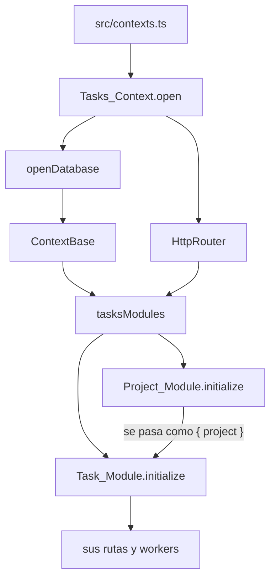

Un contexto es una parte de tu app con su propia base de datos, sus propias rutas y su propia carpeta. Un módulo es un tipo de cosa dentro de un contexto, como una tarea o un proyecto, con todo lo que tu app hace con ella.

newt divide un backend así para que cada parte siga siendo pequeña. Puedes leer, probar y cambiar `chat` sin abrir `tasks`.

## Contextos

Newthub podría tener tres contextos: `tasks`, `chat` y `docs`. Cada uno tiene lo suyo:

| Qué | Dónde, para el contexto `tasks` |
|---|---|
| Su carpeta | `src/contexts/tasks/` |
| Su base de datos | `data/tasks.sqlite`, o la ruta de `TASKS_DATABASE` |
| Sus migraciones | `src/contexts/tasks/migrations/` |
| Sus rutas | bajo `/tasks/api/` |
| Sus ficheros | su propio almacenamiento |
| Sus jobs | una cola que vive en su propia base de datos |

Ver [Base de datos y migraciones](/es/concepts/database/), [Ficheros](/es/concepts/files/) y [Jobs y workers](/es/concepts/jobs-and-workers/) para cada uno.

Un contexto nunca lee las tablas de otro. En otros sitios a esta idea la llaman *bounded context*, y por eso la clase de newt se llama `BoundedContext`.

:::tip
Empieza con un contexto. Añade un segundo cuando una parte de la app tenga sus propios datos y pueda vivir sin el resto, como chat junto a tasks.
:::

## Módulos

Un módulo es un tipo de cosa de un contexto: `task` y `project` en `tasks`. Guarda una [entidad](/es/concepts/entities/) y ofrece sus [casos de uso](/es/concepts/use-cases/).

```txt
src/contexts/tasks/modules/task/
  task.module.ts       los casos de uso
  task.ts              la entidad
  task.schema.ts       los DTO y el filtro
  task.repository.ts   cómo se lee y se guarda una tarea
  task.routes.ts       sus rutas HTTP
  task.workers.ts      qué hace cuando pasa un evento
  task.deps.ts         los otros módulos que usa
  events/  errors/  value-objects/  services/
```

El lint mantiene esta forma: un módulo tiene solo estos ficheros y carpetas (más sus tests y un `task-options.ts` opcional), y una entidad. Una segunda entidad es un módulo aparte. Ver [Estructura de un proyecto](/es/start/project-structure/) para cada fichero.

## Cómo hablan los módulos entre sí

Dentro de un contexto, un módulo llega a otro de dos formas:

- Llama a los casos de uso del otro, que recibe como dependencia. Ver [Servicios y dependencias](/es/concepts/services-and-deps/).
- Reacciona a los eventos del otro. Ver [Eventos y suscripciones](/es/concepts/events/).

Esa es la API de un módulo, y todo lo que otro módulo alcanza de él. De otro módulo importa solo tipos (`import type`) de su `*.module.ts`, su `*.schema.ts` (los DTOs) y sus `events/`, y sus `errors/` (para distinguir un error conocido). La regla de lint `module-imports` rechaza el resto: sus schemas como valores, su entidad, sus value objects, su repositorio, sus rutas, sus workers y sus servicios.

## Cómo hablan los contextos entre sí

Un contexto usa otro cuando su `<nombre>.context.ts` lo importa, para abrirlo con ese contexto. La regla de lint `context-imports` deja que un contexto importe solo los contextos que importa su `.context.ts`, y nunca en ciclo: si `chat` usa `tasks`, `tasks` no puede usar `chat`.

:::note
El CLI todavía no escribe esta conexión. `newt add deps` solo enlaza módulos del mismo contexto.
:::

## Cómo se conectan

Esto es lo que se ejecuta cuando el backend abre el contexto `tasks`:



El backend abre cada contexto que aparece en `src/contexts.ts`:

```ts title="src/contexts.ts"
export async function openContexts(
  platform: Platform,
  stores: Stores,
): Promise<ContextToRun[]> {
  const contexts: ContextToRun[] = []
  contexts.push(await Tasks_Context.open(platform, stores))
  return contexts
}
```

Cada contexto abre su base de datos, crea su router y su `ContextBase`, y se los pasa a sus módulos:

```ts title="src/contexts/tasks/tasks.context.ts"
const MIGRATIONS_FOLDER = join(import.meta.dir, 'migrations')

export class Tasks_Context extends BoundedContext {
  private constructor(
    base: ContextBase,
    readonly modules: TasksModules,
  ) {
    super('tasks', base)
  }

  static async open(
    platform: Platform,
    stores: Stores,
  ): Promise<ContextToRun> {
    const database = await openDatabase(
      'tasks',
      MIGRATIONS_FOLDER,
      stores,
    )
    const router = new HttpRouter({ prefix: '/tasks/api', database })
    router.authenticateWith(authenticate)
    const base = new ContextBase({
      name: 'tasks',
      platform,
      database,
      storage: await openStorage('tasks', router, stores),
    })
    return {
      context: new Tasks_Context(base, tasksModules(base, router)),
      router,
    }
  }
}
```

`tasks-modules.ts` construye los módulos. Un módulo que usa otro lo recibe aquí, así que el que usa se construye antes:

```ts title="src/contexts/tasks/tasks-modules.ts"
export function tasksModules(base: ContextBase, router: HttpRouter) {
  const project = Project_Module.initialize(base, router)
  const task = Task_Module.initialize(base, router, { project })
  return {
    task,
    project,
  }
}
```

El `initialize` de cada módulo crea su repositorio y el módulo, que registra sus rutas y guarda sus grupos en `routes`, y después registra sus workers:

```ts title="src/contexts/tasks/modules/task/task.module.ts"
export class Task_Module extends Module {
  static initialize(
    base: ContextBase,
    router: HttpRouter,
    deps: Task_Deps,
  ): Task_Module {
    const module = new Task_Module(
      base,
      new Task_Repository(base),
      router,
      deps,
    )
    registerTaskWorkers(module)
    return module
  }

  readonly routes

  private constructor(
    base: ContextBase,
    private readonly tasks: Task_Repository,
    router: HttpRouter,
    private readonly deps: Task_Deps,
  ) {
    super('task', base.useCaseRunner, deps)
    // ...
    this.routes = registerTaskRoutes(router, this, deps)
  }
}
```

:::note
`initialize` es una convención del código generado, no un método de `Module`. Puedes cambiarlo como quieras.
:::

## Las clases

Rara vez tocas estas clases más allá de lo que escribe el CLI. Esta sección lista lo que ofrecen.

### ContextBase

`ContextBase` guarda lo que comparten todos los módulos de un contexto. Creas uno por contexto.

| Opción | Por defecto | Qué es |
|---|---|---|
| `name` | obligatoria | El nombre del contexto, sin `:` |
| `platform` | obligatoria | Lo que comparten todos los contextos |
| `database` | obligatoria | La base de datos del contexto |
| `clock` | reloj del sistema | De dónde sale "ahora" |
| `worker` | la de por defecto | Cómo ejecuta su worker los jobs |
| `writeRule` | `'error'` | `'off'`, `'warn'` o `'error'` |
| `guardRule` | `'error'` | `'off'`, `'warn'` o `'error'` |
| `conflictRetries` | ver la lista | Repeticiones tras un conflicto |
| `storage` | ninguno | Dónde van sus ficheros |

- `platform` lo comparten todos los contextos del backend: su clúster, su logger y su observabilidad. Ver [Logs y observabilidad](/es/concepts/logs/).
- `clock`: los tests pasan un reloj que pueden mover.
- `worker`: ver [Jobs y workers](/es/concepts/jobs-and-workers/).
- `writeRule`: ver [la regla de escritura](/es/concepts/use-cases/#la-regla-de-escritura). `guardRule`: ver [guards](/es/concepts/repositories/#hooks-de-guardado-y-guards).
- `conflictRetries` vale por defecto `{ times: 3, duplicates: 1, backoffMs: 10 }`. Ver [reintentos](/es/concepts/use-cases/#reintentos-ante-un-conflicto).
- `storage` es `{ private?, public? }`.

Lo que un `ContextBase` da a sus módulos:

| Campo | Qué es |
|---|---|
| `name`, `platform`, `clock`, `database` | Lo que le diste |
| `transactions` | Las transacciones de la base de datos; los módulos no las usan |
| `useCaseRunner` | Ejecuta cada caso de uso del contexto |
| `bus` | Publica los [eventos](/es/concepts/events/) del contexto |
| `worker` | Ejecuta los jobs de la cola del contexto |
| `schedules` | Sus [tareas programadas](/es/concepts/schedules/) |
| `rateLimits` | Sus límites de peticiones |
| `storage` | `storage.private` y `storage.public` |

Leer un `storage` que no se configuró lanza un error.

### BoundedContext

`BoundedContext` es la clase de contexto que extiendes. Tiene un `name` y su `base`, y:

| Método | Qué hace |
|---|---|
| `start()` | Arranca el worker y las tareas programadas |
| `stopWorker(deadlineMs?)` | Los para, y espera hasta `deadlineMs` a los jobs en marcha |
| `close()` | Cierra la base de datos |
| `stop()` | `stopWorker()` y después `close()` |

`runContexts` (en `src/backend.ts`) los llama por ti cuando el backend arranca y se para.

### Module

`Module` es la clase que extiende cada módulo. Su constructor recibe el nombre del módulo, el `useCaseRunner` del contexto y, si quieres, sus dependencias. Te da:

- `name`: el nombre del módulo, `'task'`.
- `useCaseRunner`: el ejecutor por el que pasan sus casos de uso.
- `on(event, useCase, args?, options?)`: ejecuta un caso de uso cuando pasa un evento. Ver [Eventos y suscripciones](/es/concepts/events/).

## Con el CLI

```sh
newt add context tasks
newt add module tasks/task
```

`newt add context` escribe la carpeta del contexto, su `.context.ts`, su `-modules.ts`, su carpeta de migraciones y su línea en `src/contexts.ts`. `newt add module` escribe un módulo con su entidad, sus casos de uso, sus rutas, su tabla y su test. Ver [`newt add context`](/es/reference/cli/add-context/) y [`newt add module`](/es/reference/cli/add-module/).
