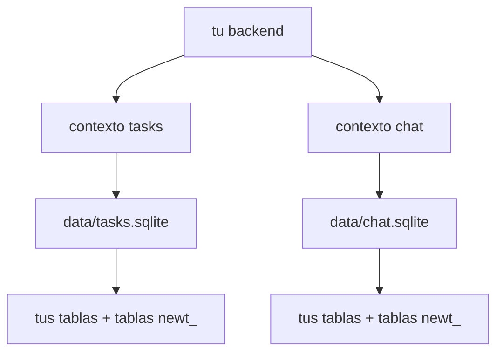
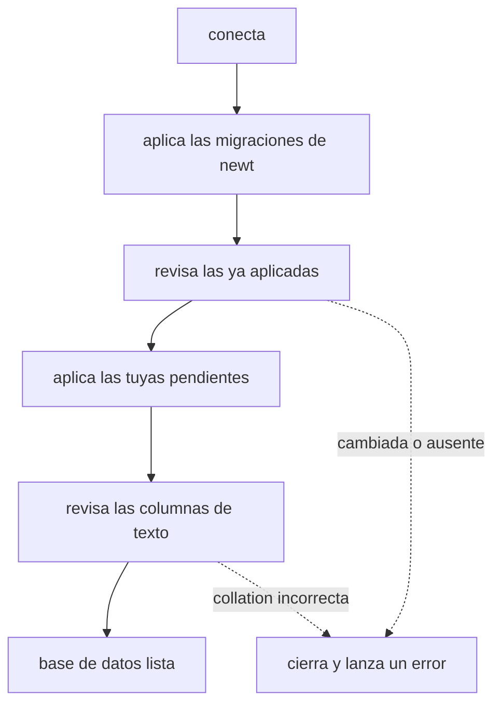

Cada contexto guarda sus datos en su propia base de datos. Describes sus tablas con ficheros SQL normales (*migraciones*) y newt las aplica al abrir el contexto.

## Una base de datos por contexto

El contexto `tasks` tiene una base de datos; un contexto `chat` tendría otra. Ningún contexto lee las tablas de otro, así que puedes cambiar las tablas de un contexto sin romper el resto.



`src/stores.ts` abre la base de datos de cada contexto. Con SQLite, la opción por defecto:

```ts title="src/stores.ts"
export async function openDatabase(
  context: string,
  migrations: string,
  stores: Stores,
): Promise<Database> {
  if (stores === 'memory') {
    return SqliteDatabase.open({ path: ':memory:', migrations })
  }
  return SqliteDatabase.open({
    path:
      Bun.env[`${envOf(context)}_DATABASE`] ?? `data/${context}.sqlite`,
    migrations,
  })
}
```

El contexto pasa su propia carpeta `migrations`:

```ts title="src/contexts/tasks/tasks.context.ts"
const database = await openDatabase(
  'tasks',
  join(import.meta.dir, 'migrations'),
  stores,
)
```

Así, el contexto `tasks` vive en `data/tasks.sqlite`, o donde indique `TASKS_DATABASE`. Los tests la abren con `stores: 'memory'`: una base de datos SQLite nueva con las mismas migraciones.

## Opciones de SQLite

`SqliteDatabase.open(options)`, de `@newt-js/core/database/sqlite`:

| Opción | Tipo | Por defecto |
|---|---|---|
| `path` | `string` | obligatoria |
| `migrations` | `string` | ninguna |
| `waitTimeoutMs` | `number` | `30000` |

- `path`: el fichero de la base de datos. Si su carpeta no existe, se crea. `':memory:'` crea un fichero temporal que se borra al llamar a `close()`.
- `migrations`: la carpeta de tus migraciones. Sin ella solo se crean las tablas propias de newt.
- `waitTimeoutMs`: cuánto espera una transacción su turno antes de fallar.

`open` se conecta, aplica las migraciones pendientes, revisa las tablas y devuelve la base de datos. Si falla algún paso, la cierra y lanza el error.

newt abre el fichero en modo WAL, con las claves foráneas activadas. Las escrituras pasan por una conexión, una transacción cada vez; las lecturas fuera de una transacción usan una segunda conexión de solo lectura, así que no esperan a las escrituras.

## Migraciones

Una migración es una pareja de ficheros SQL: uno que cambia la base de datos (`up`) y otro que lo deshace (`down`). Están en la carpeta `migrations/` del contexto:

```text
src/contexts/tasks/migrations/
  00001_task_up.sql
  00001_task_down.sql
  00002_project_up.sql
  00002_project_down.sql
```

```sql title="src/contexts/tasks/migrations/00001_task_up.sql"
CREATE TABLE "task" (
  id TEXT PRIMARY KEY,
  version INTEGER NOT NULL,
  name TEXT NOT NULL,
  created_at TEXT NOT NULL,
  updated_at TEXT NOT NULL
);
```

```sql title="src/contexts/tasks/migrations/00001_task_down.sql"
DROP TABLE "task";
```

### Nombres

Los ficheros se llaman `NNNNN_nombre_up.sql` y `NNNNN_nombre_down.sql`:

- `NNNNN` es un número de cinco cifras. Las migraciones se ejecutan en ese orden.
- `nombre` es cualquier nombre; los dos ficheros de una pareja lo comparten.
- Cada `up` tiene su `down`, y cada número tiene un solo nombre.

Los demás ficheros de la carpeta, como `.gitkeep`, se ignoran. Un fichero que acaba en `_up.sql` o `_down.sql` pero no sigue el patrón impide abrir la base de datos, así que una errata nunca pasa desapercibida.

### Cuándo se ejecutan

Cada vez que se abre la base de datos de un contexto, es decir, cada vez que arranca el backend. Esto es lo que hace `open`:



1. newt aplica primero sus propias migraciones (sus tablas `newt_`).
2. Revisa las tuyas que ya se ejecutaron: ninguna ha cambiado, y la última sigue en la carpeta.
3. Aplica las que aún no se han ejecutado, en orden, en una transacción.
4. Apunta cada una en la tabla `newt_migrations`, con un checksum de su fichero `up`.

Si arrancan varias instancias a la vez en Postgres o MySQL, un bloqueo hace que solo una las aplique. Un fichero puede contener varias sentencias separadas por `;`.

La base de datos no se abre cuando:

- el fichero `up` de una migración ya aplicada ha cambiado desde que se ejecutó. Déjalo como estaba y escribe el cambio como una migración nueva.
- la última migración aplicada ya no está en la carpeta.

### Escribir una a mano

Para cambiar una tabla, añade la siguiente pareja. Para dar una descripción a las tareas:

```sql title="src/contexts/tasks/migrations/00003_task_description_up.sql"
ALTER TABLE "task" ADD COLUMN description TEXT;
```

```sql title="src/contexts/tasks/migrations/00003_task_description_down.sql"
ALTER TABLE "task" DROP COLUMN description;
```

Después añade el campo al [schema](/es/concepts/schemas-and-dtos/) del módulo. Reinicia el backend y la columna ya está.

:::tip
Numera una migración nueva con el número siguiente al más alto de la carpeta y ponle el nombre de lo que cambia, como `task_description`.
:::

:::caution
Nunca edites una migración que ya se ha ejecutado en algún sitio. Escribe una nueva.
:::

### Tablas y columnas

La entidad de un módulo se guarda en una tabla con el nombre del módulo, `task`. Toda tabla que usa un repositorio necesita:

- `id`, la clave primaria, como texto.
- `version`, un entero que newt usa para detectar dos guardados de la misma fila a la vez.

Los nombres de los campos pasan a columnas en snake case: `createdAt` es `created_at`, `teamId` es `team_id`. Las fechas se guardan como texto ISO.

Cómo vuelven las columnas de SQLite:

| Columna declarada como | Recibes |
|---|---|
| `TEXT` | un string |
| `INTEGER`, `REAL` | un número; un entero demasiado grande para un número vuelve como string |
| `BOOLEAN` | `true` o `false` (guardado como `1` o `0`) |
| `JSON` | el valor ya parseado (los objetos y arrays se guardan como texto JSON) |
| valor `NULL` | `null` |

newt compara y ordena el texto por code point, igual en todas las bases de datos. Una columna de texto declarada `COLLATE NOCASE` o `RTRIM` impide abrir la base de datos. Para un filtro que ignora mayúsculas, usa el operador `ieq` de los [filtros](/es/concepts/repositories/).

El texto que contiene el carácter NUL, o un surrogate UTF-16 suelto, no se puede guardar: el guardado falla con el error de validación `text_with_nul`.

### Deshacer y revisar

Cada clase de base de datos tiene un objeto `migrations`:

| Método | Qué hace |
|---|---|
| `migrations.up()` | aplica las migraciones pendientes; devuelve sus nombres |
| `migrations.down()` | deshace la última migración aplicada con su fichero `down`; devuelve su nombre, o `null` si no hay ninguna |
| `migrations.status()` | devuelve `{ applied, pending, changed }`, cada uno una lista de nombres |

`down()` deshace una migración por llamada, y solo las tuyas, nunca las de newt.

## Las tablas de newt

newt guarda sus propias tablas en la base de datos de cada contexto, todas con el prefijo `newt_`. No escribas en ellas ni uses ese prefijo para tus tablas.

| Tabla | Qué contiene |
|---|---|
| `newt_migrations` | tus migraciones aplicadas |
| `newt_framework_migrations` | las migraciones aplicadas de newt |
| `newt_job` | los jobs pendientes o en marcha: el [outbox](/es/concepts/jobs-and-workers/) |
| `newt_job_queue` | las colas que han registrado los workers |
| `newt_schedule_tick` | la última ejecución de cada [tarea programada](/es/concepts/schedules/) |
| `newt_idempotency_key` | las respuestas guardadas de las [peticiones idempotentes](/es/concepts/http/) |
| `newt_inbox` | los eventos que ya han procesado los casos de uso del contexto, para que un job que se repite no [escriba dos veces](/es/concepts/events/#qué-pasa-al-emitir-un-evento) |

## El contrato Database

Todas las bases de datos (SQLite, Postgres, MySQL, memoria) ofrecen la misma interfaz `Database`, de `@newt-js/core/application`:

| Miembro | Qué es |
|---|---|
| `records<Row>(table)` | las filas de una tabla, para un [repositorio](/es/concepts/repositories/) |
| `outbox` | la cola de jobs que vive en esta base de datos |
| `run(fn)` | ejecuta `fn` en una transacción |
| `save(fn)` | ejecuta un guardado en una transacción; lo usan los repositorios |
| `guard(keys, { waitMs })` | dentro de una transacción, espera hasta que ninguna otra tenga las mismas claves |
| `inTransaction` | `true` dentro de una transacción |
| `afterCommit(fn)` | ejecuta `fn` cuando la transacción actual hace commit, o ya si no hay ninguna |
| `afterRollback(fn)` | ejecuta `fn` si la transacción actual hace rollback |
| `close()` | espera a las transacciones en marcha y cierra las conexiones |

No los llamas desde un módulo. Los usan los repositorios, el bus de eventos y los workers.

### Records

`records(table)` devuelve las filas de una tabla: `find`, `count`, `countBy`, `insert`, `update`, `delete` y `deleteMany`. Un [repositorio](/es/concepts/repositories/) las convierte en entidades:

```ts title="src/contexts/tasks/modules/task/task.repository.ts"
super(base, base.database.records<TaskRow>('task'), { scope: 'none' })
```

`update` y `delete` comprueban la `version` de la fila. Si alguien la ha guardado entretanto, lanzan `StaleVersion`. Una restricción unique que falla lanza `DuplicateValue`, con los campos afectados. Los dos son [errores de conflicto](/es/concepts/errors/): por defecto newt vuelve a ejecutar el caso de uso (hasta 3 veces, una para un duplicado) y después responde `409`.

## Transacciones

Una transacción es un grupo de escrituras que la base de datos guarda todas juntas o ninguna.

Cada `persist` de un repositorio se ejecuta en una transacción. Escribe las entidades y, en la misma transacción, los jobs de los [eventos](/es/concepts/events/) que han emitido. O se guardan ambos o ninguno.

Un caso de uso no es una transacción: dos llamadas a `persist` son dos transacciones. Para guardar varias entidades juntas, pásalas en una sola llamada:

```ts
await this.tasks.persist([first, second])
```

:::caution
No abras tú una transacción con `base.transactions.run` dentro de un módulo. La regla de lint `module-transactions` lo rechaza: `persist` ya ejecuta la transacción, comprueba la regla de escritura y guarda los eventos.
:::

Reglas que se cumplen dentro de una transacción:

- **Un módulo por transacción.** Una transacción que guarda `task` no puede guardar también `project`. Guarda el segundo desde una [suscripción](/es/concepts/events/) cuando el primero haya hecho commit.
- **Espera (`await`) cada llamada de dentro.** Una llamada que sigue en marcha cuando la transacción termina falla.
- **Un guardado fallido la estropea.** Si un guardado de dentro falla y capturas su error, la transacción entera hace rollback igualmente, con `TransactionSpoiled`.

Con SQLite, las transacciones de escritura se ejecutan de una en una. Una transacción espera su turno hasta `waitTimeoutMs`. Las lecturas fuera de una transacción nunca esperan.

## Postgres y MySQL

El modelo es el mismo: una base de datos por contexto, la misma carpeta de migraciones, las mismas tablas `newt_`. Lo que cambia:

- **Opciones.** `PostgresDatabase.open` y `MysqlDatabase.open` reciben `{ url, migrations, connections, waitTimeoutMs }`. `connections` es el tamaño del pool, `10` por defecto. El `stores.ts` generado lee la URL de `TASKS_DATABASE_URL`.
- **SQL.** Las migraciones usan el SQL de cada base de datos. Las columnas de texto necesitan una collation por bytes: `COLLATE "C"` en Postgres, `utf8mb4_0900_bin` en MySQL. `newt add module` las escribe por ti.
- **Concurrencia.** Las transacciones se ejecutan a la vez. Cuando dos chocan, newt lanza `TransactionConflict` y el caso de uso se vuelve a ejecutar. `guard` toma bloqueos de verdad.
- **Tests.** Los tests de módulo usan una base de datos nueva en el servidor de `TEST_DATABASE_URL`, o memoria si no está.

Consulta [SQLite](/es/guides/databases/sqlite/), [Postgres](/es/guides/databases/postgres/), [MySQL](/es/guides/databases/mysql/) y [Cambiar de base de datos](/es/guides/databases/switching/).

## Con el CLI

[`newt add module`](/es/reference/cli/add-module/) escribe la primera pareja de migraciones del módulo, con el número siguiente al más alto de la carpeta, en el SQL de la base de datos del contexto. [`newt add context`](/es/reference/cli/add-context/) crea la carpeta `migrations/` vacía. Los cambios posteriores son migraciones que escribes a mano.
