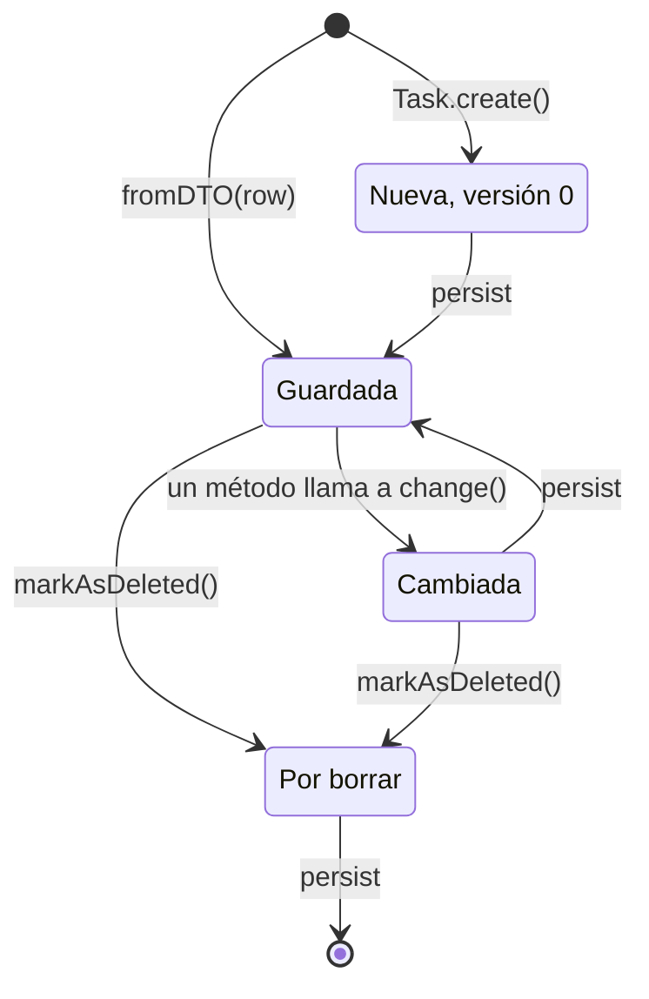

Una entidad es una cosa que tu app guarda y cambia con el tiempo, como una tarea. Guarda los datos de la tarea, los comprueba con su schema y es el único sitio donde cambian.

Tener cada cambio en una clase significa que una tarea nunca se guarda en un estado que sus reglas prohíben, venga de donde venga el cambio.

## Una entidad

`newt add module tasks/task` escribe esto:

```ts title="src/contexts/tasks/modules/task/task.ts"
import { Entity, type EntityInput } from '@newt-js/core'
import { Task_Created } from './events/task-created'
import { TaskSchema, type TaskDTO } from './task.schema'

/**
 * What `create` takes, already checked: the entity's own words,
 * never a DTO.
 */
export type TaskCreateProps = { name: string }

export class Task extends Entity<typeof TaskSchema> {
  private constructor(input: EntityInput<TaskDTO>, isNew: boolean) {
    super(TaskSchema, input, isNew)
  }

  static fromDTO(dto: TaskDTO & { version: number }): Task {
    return new Task(dto, false)
  }

  static create(props: TaskCreateProps): Task {
    const task = new Task(props, true)
    task.trackEvent(
      new Task_Created({ id: task.id, name: task.data.name }),
    )
    return task
  }
}
```

Un módulo guarda exactamente una entidad, en `<módulo>.ts`. La regla del lint `module-entity` rechaza una segunda: es un módulo aparte, al que este se refiere por su id.

## Crear una

Hay dos entradas, las dos estáticas:

- `Task.create(props)` crea una tarea nueva. La llaman los casos de uso.
- `Task.fromDTO(row)` reconstruye una tarea guardada a partir de su fila. Solo la llama el repositorio, y la fila tiene que traer su `version`.

Las dos pasan por el constructor protegido de `Entity`:

```ts
super(schema, input, isNew, publicSchema?)
```

`input` es un `EntityInput<TaskDTO>`: los campos del DTO, con `id`, `createdAt` y `updatedAt` opcionales, más una `version` opcional.

Al construir la entidad, el constructor:

1. Le da un id nuevo (un UUID v7) si `input` no trae uno.
2. En una entidad nueva, pone `createdAt` y `updatedAt` a ahora, según el reloj del contexto.
3. Valida todo con el schema. Si falla, lanza `InvalidEntity`.
4. Pone `version` a `0` en una entidad nueva, o a la versión de la fila.

### Lo que necesita el schema

- Nombra `createdAt` y `updatedAt` (`z.string()`). newt los pone en cada entidad.
- Es un `z.object` o un `z.strictObject`. Se rechaza un schema que guarda claves desconocidas (`z.looseObject`, `.catchall`, `.passthrough`), o las otras columnas de una fila acabarían en la entidad.
- `version` y `deletedAt` se quitan de los datos salvo que el schema los nombre.
- Al leer una fila, un `null` en un campo que acepta `undefined` pero no `null` se omite.

## Leerla

| Miembro | Qué es |
|---|---|
| `id` | El id de la entidad. |
| `data` | Sus campos, validados. Protegido: solo lo leen los métodos de la propia entidad. |
| `version` | Cuántas veces se ha guardado. `0` hasta el primer guardado. |
| `isNew` | `true` hasta su primer guardado. |
| `isDeleted` | `true` desde que se llamó a `markAsDeleted()`. |
| `hasPendingChanges` | `true` cuando un guardado escribiría algo. |
| `toDTO()` | Una copia de sus campos, tal como los devuelve el caso de uso. |

## Cambiarla

Cambias una entidad con métodos que escribes en ella. Cada uno llama al método protegido `change(partial)`. Supón que añades `doneAt: z.string().nullable()` a `TaskSchema` (y su columna, en una migración):

```ts title="src/contexts/tasks/modules/task/task.ts"
complete(): void {
  if (this.data.doneAt) {
    throw new AlreadyDone()
  }
  this.change({ doneAt: now().toISOString() })
  this.trackEvent(new Task_Completed({ id: this.id }))
}
```

`now` viene de `@newt-js/core` y lee el reloj del contexto. `AlreadyDone` es un error creado con `newt add error`, y `Task_Completed` un evento creado con `newt add event`. Un caso de uso llama a `task.complete()` antes de `persist` (ver [Casos de uso](/es/concepts/use-cases/#un-caso-de-uso)).

:::tip
Pon la regla en la entidad, no en el caso de uso. `complete()` rechaza una tarea ya hecha la llame quien la llame: una ruta, un worker o un test.
:::

`change` mantiene estas reglas:

- `id` se ignora.
- `createdAt` y `updatedAt` lanzan `UnknownEntityField`: los lleva newt.
- Un campo que el schema no tiene lanza `UnknownEntityField`.
- Se valida otra vez la entidad entera. Si ya no pasa, lanza `InvalidEntity` y no cambia nada.
- `updatedAt` pasa a ahora solo cuando un valor cambió de verdad.
- Una entidad borrada lanza `DeletedEntityNotChangeable`.

Para borrarla, un método llama al protegido `markAsDeleted()`. El repositorio borra la fila en el siguiente guardado, o solo rellena su `deletedAt` si el repositorio usa `softDelete` (ver [Repositorios](/es/concepts/repositories/)). Una entidad nunca guardada lanza `NewEntityNotDeletable`, y una ya borrada lanza `EntityAlreadyDeleted`.

Un método de una entidad recibe sus propias palabras. La regla del lint `entity-method-params` rechaza un parámetro con tipo de DTO o un objeto escrito en el sitio: declara `export type TaskRenameProps = { … }` junto a la entidad y recibe eso. El constructor y `fromDTO` son la excepción.

## Contar lo que pasó

`trackEvent(event)` registra un [evento](/es/concepts/events/) en la entidad. El repositorio lo publica cuando `persist` guarda la entidad, en la misma transacción.

- Registrar un segundo evento con el mismo nombre sustituye al primero.
- Un evento va con un cambio. Guardar una entidad que registró eventos pero no tiene nada que guardar lanza `EventWithoutChange`: cambia a la vez el campo que dice que pasó (un estado, una fecha).

## Qué cambió

| Método | Devuelve |
|---|---|
| `getChanges()` | Los campos cambiados desde que se leyó, con sus valores nuevos, o `null`. Siempre `null` en una entidad nueva o borrada. |
| `getPrevious()` | Los mismos campos con los valores que tenían al leerla, o `null`. |
| `hasChanged(field)` | Si ese campo cambió. Siempre `true` en una entidad nueva. |

`createdAt` y `updatedAt` nunca forman parte de los cambios.

## Mostrar solo algunos campos

Por defecto `toDTO()` devuelve todos los campos. Para ocultar algunos, pasa al constructor un segundo schema con menos campos:

```ts
const TaskPublicSchema = TaskSchema.omit({ internalNote: true })

export class Task extends Entity<
  typeof TaskSchema,
  typeof TaskPublicSchema
> {
  private constructor(input: EntityInput<TaskDTO>, isNew: boolean) {
    super(TaskSchema, input, isNew, TaskPublicSchema)
  }
}
```

Cada campo del schema público tiene que estar en el principal, o el constructor lanza un error.

## Su vida

Esta es la vida de una tarea, desde que se crea o se lee hasta que se borra:



Los eventos registrados con `trackEvent` esperan en la entidad y salen con el siguiente `persist`.

## Versiones

Cada guardado suma uno a `version`. El repositorio actualiza una fila solo si su versión en la base de datos sigue siendo la que leyó la entidad. Si alguien la guardó entre medias, el guardado falla con `StaleVersion` y el [caso de uso se ejecuta otra vez](/es/concepts/use-cases/#reintentos-ante-un-conflicto). Ver [Repositorios](/es/concepts/repositories/#versiones-y-conflictos).

## Tras un guardado fallido

Cuando un guardado se deshace, la entidad olvida ese guardado: su `version` y su `isNew` vuelven a lo que eran. Además queda marcada: guardarla otra vez lanza `SaveRolledBack`.

:::caution
No captures un guardado fallido para hacer `persist` de la misma entidad. Léela otra vez del repositorio y guarda la nueva.
:::

## Errores

Estos errores significan que el código hizo algo que una entidad no permite. Extienden `EntityError`, no `KnownError`, así que HTTP responde con `500`. Para dar a un cliente un `400` por una entrada mala, valídala antes con el schema en el caso de uso, como hace el código generado.

| Error | Cuándo |
|---|---|
| `InvalidEntity` | Sus datos no pasan su schema. |
| `UnknownEntityField` | `change` recibió un campo que el schema no tiene, o `createdAt`/`updatedAt`. |
| `DeletedEntityNotChangeable` | `change` sobre una entidad borrada. |
| `NewEntityNotDeletable` | `markAsDeleted` sobre una entidad nunca guardada. |
| `EntityAlreadyDeleted` | `markAsDeleted` dos veces. |
| `EventWithoutChange` | Guardar una entidad con eventos pero sin cambios. |
| `SaveRolledBack` | Guardar una entidad cuyo último guardado se deshizo. |

## Con el CLI

No hay un comando solo para una entidad: `newt add module` la escribe con su módulo, su schema, su repositorio y su tabla.

```sh
newt add module tasks/task
```

Ver [`newt add module`](/es/reference/cli/add-module/).
