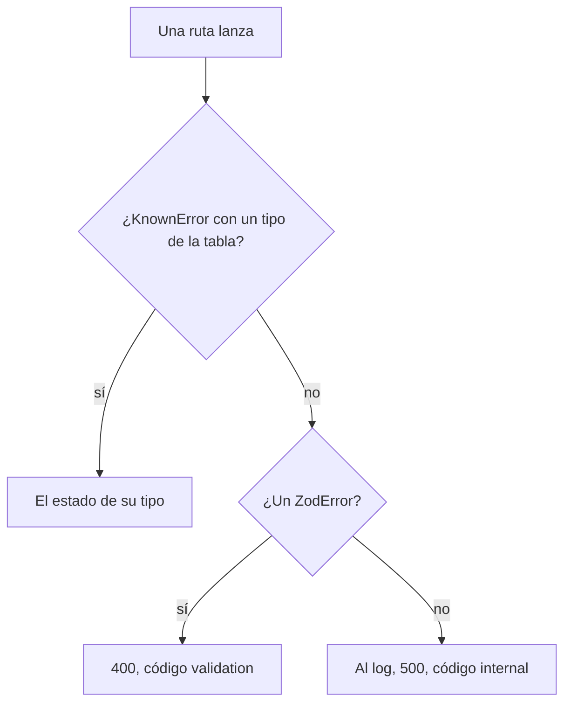

Un error conocido es un error que tu app lanza a propósito, como "no existe esa tarea". Lleva un tipo, un código y un mensaje, y newt lo convierte en una respuesta HTTP con el estado correcto.

Existe para que las reglas de tu app digan *qué* salió mal sin saber nada de HTTP. Lo lanzas desde cualquier sitio: una entidad, un value object, un caso de uso. Nunca escribes códigos de estado a mano.

## Un error

```ts title="src/contexts/tasks/modules/task/errors/task-not-found.ts"
import { NotFoundError } from '@newt-js/core'

export class TaskNotFound extends NotFoundError {
  readonly code = 'task.not_found'

  constructor() {
    super('There is no such task')
  }
}
```

```ts
throw new TaskNotFound()
```

Un cliente que pide una tarea que no existe recibe:

```json
{ "error": "There is no such task", "code": "task.not_found" }
```

con el estado `404`.

## Lo que lleva un error conocido

Todo error conocido extiende `KnownError`:

| Miembro | Qué es |
|---|---|
| `kind` | Qué tipo de fallo es. Decide el estado HTTP. |
| `code` | Un nombre estable que un cliente puede comprobar, como `task.not_found`. |
| `message` | Una frase para personas. |
| `params` | Detalles opcionales, como un objeto. |

Su constructor recibe el mensaje y los params: `super(message, params?)`.

```ts title="src/contexts/tasks/modules/task/errors/invalid-priority.ts"
import { ValidationError } from '@newt-js/core'

export class InvalidPriority extends ValidationError<{ value: string }> {
  readonly code = 'task.invalid_priority'

  constructor(value: string) {
    super(`'${value}' is not a valid priority`, { value })
  }
}
```

```json
{
  "error": "'' is not a valid priority",
  "code": "task.invalid_priority",
  "params": { "value": "" }
}
```

`params` aparece en el cuerpo solo cuando tiene algo.

:::tip
Los clientes deben comprobar `code`, nunca `message`. Así puedes cambiar el texto del mensaje sin romper a nadie.
:::

## Tipos y estados HTTP

Extiendes la clase del tipo que quieres:

| Clase | `kind` | HTTP |
|---|---|---|
| `ValidationError` | `validation` | `400` |
| `UnauthorizedError` | `unauthorized` | `401` |
| `ForbiddenError` | `forbidden` | `403` |
| `NotFoundError` | `not_found` | `404` |
| `ConflictError` | `conflict` | `409` |
| `ConcurrencyConflict` | `conflict` | `409` |

Los errores propios de newt usan algunos tipos más:

| `kind` | HTTP |
|---|---|
| `method_not_allowed` | `405` |
| `too_large` | `413` |
| `unsupported_media_type` | `415` |
| `unprocessable` | `422` |
| `too_many_requests` | `429` |

Una respuesta `too_many_requests` lleva además una cabecera `Retry-After`, en segundos. Un `KnownError` con cualquier otro tipo se responde como un error inesperado.

Cuándo usar cada uno:

- **`ValidationError`**: la entrada rompe una regla. El cliente tiene que cambiar lo que envía.
- **`UnauthorizedError`**: no hay nadie con sesión, o las credenciales son incorrectas.
- **`ForbiddenError`**: quien llama tiene sesión pero no puede hacer esto.
- **`NotFoundError`**: lo que se pidió no existe.
- **`ConflictError`**: la petición es válida, pero el estado actual la rechaza, como completar una tarea ya hecha.
- **`ConcurrencyConflict`**: dos guardados chocaron. El caso de uso [se ejecuta otra vez](/es/concepts/use-cases/#reintentos-ante-un-conflicto) antes de que lo vea el cliente.

## Cómo un error lanzado se convierte en respuesta

Así elige newt la respuesta cuando una ruta lanza un error:



La opción `onError` de una ruta cambia esto por tu propia respuesta (ver [HTTP y rutas](/es/concepts/http/#opciones-de-ruta)).

| Qué se lanzó | HTTP | Cuerpo |
|---|---|---|
| Un `ZodError` | `400` | `code: "validation"`, con `issues` |
| Cualquier otra cosa | `500` | `code: "internal"` |

Un schema que rechaza la entrada da:

```json
{
  "error": "The input is not valid",
  "code": "validation",
  "issues": [
    {
      "origin": "string",
      "code": "too_small",
      "minimum": 1,
      "inclusive": true,
      "path": ["name"],
      "message": "Too small: expected string to have >=1 characters"
    }
  ]
}
```

Cualquier otro error se escribe en el log y se responde con:

```json
{ "error": "Something went wrong", "code": "internal" }
```

:::caution
El cliente nunca ve el mensaje de un error inesperado, a propósito. Si necesita saber qué salió mal, lanza un error conocido.
:::

Los errores de una [entidad](/es/concepts/entities/#errores), como `InvalidEntity`, no son errores conocidos: significan que el código rompió una regla, así que se convierten en un `500`.

## Los errores propios de newt

| Error | Tipo | Código |
|---|---|---|
| `DuplicateValue` | `conflict` | `duplicate_value` |
| `StaleVersion` | `conflict` | `stale_version` |
| `TransactionConflict` | `conflict` | `transaction_conflict` |
| `ReferenceNotFound` | `validation` | `reference_not_found` |
| `TextWithNul` | `validation` | `text_with_nul` |
| `InvalidFilter` | `validation` | `invalid_filter` |
| `InvalidSort` | `validation` | `invalid_sort` |
| `TooManyRequests` | `too_many_requests` | `too_many_requests` |
| `UploadTooLarge` | `too_large` | `upload_too_large` |

Sus detalles, en `params`:

- `DuplicateValue`: `{ fields }`, los campos cuyo valor ya está ocupado, cuando la base de datos dice cuáles.
- `ReferenceNotFound`: `{ resource, id }`.
- `InvalidFilter`, `InvalidSort`: `{ issues }`, cada uno `{ path, message }`.
- `TooManyRequests`: `{ limit, retryAfterSeconds }`.
- `UploadTooLarge`: `{ maxBytes }`. Ver [Ficheros](/es/concepts/files/#subidas-desde-el-navegador).

Los [value objects incluidos](/es/concepts/value-objects/#value-objects-incluidos) lanzan `ValidationError`: `invalid_email`, `invalid_key`, `invalid_search_text`, `invalid_secret_token` e `invalid_uuid`.

La capa HTTP tiene los suyos, en `@newt-js/core/http`:

| Error | HTTP | Código |
|---|---|---|
| `MalformedBody` | `400` | `malformed_body` |
| `NotSignedIn` | `401` | `not_signed_in` |
| `CrossOriginRefused` | `403` | `cross_origin_refused` |
| `RouteNotFound` | `404` | `route_not_found` |
| `MethodNotAllowed` | `405` | `method_not_allowed` |
| `IdempotencyKeyInUse` | `409` | `idempotency_key_in_use` |
| `IdempotencyAnswerNotKept` | `409` | `idempotency_answer_not_kept` |
| `PayloadTooLarge` | `413` | `payload_too_large` |
| `UnsupportedMediaType` | `415` | `unsupported_media_type` |
| `IdempotencyKeyReused` | `422` | `idempotency_key_reused` |

Mira [HTTP y rutas](/es/concepts/http/) para saber cuándo pasa cada uno, y para la opción `onError` de una ruta, que responde a los errores a tu manera.

## Con el CLI

```sh
newt add error tasks/task already-done --kind conflict
```

Escribe `errors/already-done.ts`, un `ConflictError` con el código `task.already_done`. `--kind` es obligatorio: `validation`, `unauthorized`, `forbidden`, `not-found` o `conflict`. Ver [`newt add error`](/es/reference/cli/add-error/).

```ts title="src/contexts/tasks/modules/task/errors/already-done.ts"
import { ConflictError } from '@newt-js/core'

export class AlreadyDone extends ConflictError {
  readonly code = 'task.already_done'

  constructor() {
    super('Already done')
  }
}
```
