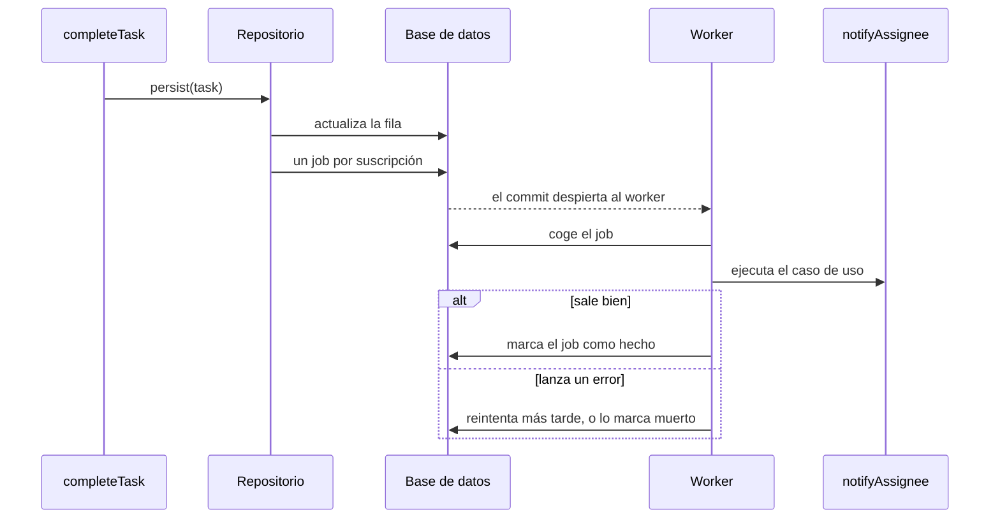

Un evento es un pequeño registro que dice que algo ha pasado en tu aplicación, como "tarea completada". Sirve para que otras partes de la aplicación reaccionen después, sin que el código que completó la tarea sepa nada de ellas.

## Un evento

Defines un evento con `defineEvent`: un nombre y un schema de zod para lo que lleva (su *payload*).

```ts title="src/contexts/tasks/modules/task/events/task-completed.ts"
import { defineEvent } from '@newt-js/core'
// --------------------------------------------------------
import { TaskSchema }  from '../task.schema'

export const Task_Completed = defineEvent(
  'task.completed',
  TaskSchema.pick({ id: true }),
)
```

`defineEvent` devuelve una clase. `new Task_Completed({ id })` comprueba el payload con el schema y lanza `InvalidEvent` si no lo cumple.

Todo evento lleva:

| Campo | Qué es |
|---|---|
| `name` | el nombre que le diste, `task.completed` |
| `payload` | lo que ha parseado el schema |
| `occurredAt` | cuándo se creó, como fecha ISO |

### Nombres

Un evento se llama `<módulo>.<lo que ha pasado>`, en camelCase: `task.completed`, `project.created`. El nombre forma parte de la cola de cada suscripción. Si renombras un evento, los jobs que ya esperaban con el nombre antiguo se quedan sin worker, y newt deja un aviso en el log.

### Qué puede llevar un payload

El payload se guarda como JSON y se vuelve a leer después, así que su schema debe devolver exactamente lo que recibe:

- Solo valores JSON: strings, números, booleanos, `null`, arrays y objetos planos.
- Sin `.transform()` ni `.default()`.
- Brands solo sobre strings y números, que es lo que usan los [value objects](/es/concepts/value-objects/).

:::tip
Mantén los payloads pequeños: el id de lo que ha cambiado y poco más. El caso de uso que reacciona lee el resto de la base de datos, y así siempre ve los datos actuales.
:::

## Emitir un evento

Un evento solo sale cuando una entidad lo registra, con `trackEvent`, en el método que hace el cambio. Supón que `TaskSchema` tiene un campo `doneAt` (mira [Entidades](/es/concepts/entities/#cambiarla)):

```ts title="src/contexts/tasks/modules/task/task.ts"
complete(): void {
  if (this.data.doneAt) {
    throw new AlreadyDone()
  }
  this.change({ doneAt: now().toISOString() })
  this.trackEvent(new Task_Completed({ id: this.id }))
}
```

Un caso de uso llama a ese método y guarda la tarea:

```ts title="src/contexts/tasks/modules/task/task.module.ts"
@UseCase()
async completeTask(input: TaskCompleteTaskDTO): Promise<TaskDTO> {
  const { id } = TaskCompleteTaskSchema.parse(input)
  const [task] = await this.tasks.find(
    TaskFilter.toCriteria<TaskRow>({ id }),
    { limit: 1 },
  )
  if (!task) {
    throw new TaskNotFound()
  }
  task.complete()
  await this.tasks.persist(task)
  return task.toDTO()
}
```

:::caution[El CLI no emite por ti]
`newt add event` escribe la clase del evento, y `newt add use-case` escribe un caso de uso que lee y guarda sin cambiar nada. Mientras ningún método de una entidad llame a `trackEvent` y ningún caso de uso llame a ese método, el evento no ocurre y ninguna suscripción a él se ejecuta.
:::

El evento sale cuando el repositorio guarda la entidad:

- Se guarda en la misma transacción que el cambio. Si el guardado falla, el evento desaparece con él; si sale bien, el evento queda guardado.
- Si registras un segundo evento con el mismo nombre antes de guardar, sustituye al primero.
- Un evento necesita un cambio. Guardar una entidad que registró un evento pero no cambió nada lanza `EventWithoutChange`.

Newt también apunta quién lo emitió: el `userId` del [actor](/es/concepts/actor-and-scope/) actual, o `null`.

## Hacer públicos los eventos: eventsOf

Un módulo declara los eventos a los que pueden reaccionar otros en su campo `events`, con `eventsOf`:

```ts title="src/contexts/tasks/modules/task/task.module.ts"
readonly events

private constructor(
  base: ContextBase,
  private readonly tasks: Task_Repository,
  private readonly deps: Task_Deps,
) {
  super('task', base.useCaseRunner, deps)
  this.events = eventsOf(base.bus, {
    created: Task_Created,
    completed: Task_Completed,
  })
}
```

Cada clave pasa a ser algo a lo que suscribirse: `tasks.events.completed`.

## Suscripciones

Una suscripción ejecuta un caso de uso cada vez que ocurre un evento. La escribes con `module.on(evento, 'casoDeUso', map)` en el `*.workers.ts` del módulo:

```ts title="src/contexts/tasks/modules/task/task.workers.ts"
import type { Task_Module } from './task.module'

export function registerTaskWorkers(tasks: Task_Module): void {
  tasks.on(tasks.events.completed, 'notifyAssignee', completed => [
    { id: completed.id },
  ])
}
```

- El primer argumento es el evento, sacado de `events`.
- El segundo es el nombre de un caso de uso de este módulo. TypeScript lo comprueba.
- El tercero convierte el payload en los argumentos del caso de uso, como array. Omítelo si el caso de uso no recibe ninguno.

El `initialize` del módulo llama a `registerTaskWorkers(module)` una vez, al abrir el contexto.

### El segundo argumento del map

El map recibe también `meta`, con lo que newt sabe del evento:

| Campo | Qué es |
|---|---|
| `id` | el id del evento |
| `name` | su nombre |
| `occurredAt` | cuándo ocurrió |
| `actor` | el `userId` que lo emitió, o `null` |
| `signal` | un `AbortSignal`, que se aborta cuando el worker se para |

```ts
tasks.on(
  tasks.events.completed,
  'notifyAssignee',
  (completed, meta) => [{ id: completed.id, completedBy: meta.actor }],
)
```

:::caution
El caso de uso se ejecuta más tarde, sin actor con sesión iniciada. Llamar a `currentActor()` dentro lanza un error. Pasa `meta.actor` como argumento.
:::

### Opciones

Un cuarto argumento recibe opciones:

| Opción | Qué hace | Por defecto |
|---|---|---|
| `when` | una función del payload; el caso de uso solo se ejecuta si devuelve `true` | siempre |
| `attempts` | cuántas veces se intenta antes de marcar el job como muerto | `5` |
| `queue` | el nombre de la cola | `<módulo>.<casoDeUso>.on.<evento>` |

```ts
tasks.on(
  tasks.events.completed,
  'notifyAssignee',
  completed => [{ id: completed.id }],
  { attempts: 3 },
)
```

`when` se comprueba al emitir el evento: si devuelve `false`, no se encola ningún job.

El nombre de la cola es como newt encuentra los jobs de una suscripción. Una `queue` propia debe seguir la forma `<módulo>.<caso de uso>.on.<nombre del evento>`. Dos suscripciones no pueden compartir cola.

## Qué pasa al emitir un evento

Esto es lo que pasa, en orden, cuando `completeTask` guarda una tarea que registró `task.completed`:



Los jobs se escriben en la misma transacción que el cambio, en la base de datos del contexto (el [outbox](/es/concepts/jobs-and-workers/), la cola de jobs que vive en tu base de datos). Si el caso de uso lanza un error, el job se reintenta más tarde, hasta `attempts` veces; tras el último fallo se marca como muerto.

Así, una suscripción nunca se pierde aunque el proceso se caiga: el job está en la base de datos.

La entrega es *al menos una vez*: si un worker muere a mitad de un job, otro lo vuelve a coger. Aun así, lo que guarda el caso de uso se escribe una sola vez. Su primer guardado apunta el evento en la tabla `newt_inbox` de su propio contexto, en la misma transacción que sus escrituras. Cuando el job vuelve a ejecutarse, newt encuentra ahí el evento, no ejecuta el caso de uso y da el job por terminado.

:::caution[Lo que puede ejecutarse dos veces]
El inbox cubre lo que el caso de uso guarda con sus repositorios. Lo que haga fuera de la base de datos, como mandar un correo o llamar a una API, puede ejecutarse dos veces. También un segundo guardado, si el caso de uso guarda en dos transacciones: el inbox va con la primera. Haz que esos pasos se puedan repetir sin daño.
:::

No hay orden entre jobs: dos eventos pueden procesarse en otro orden distinto al que ocurrieron.

## Reaccionar a eventos de otro módulo

Un módulo puede suscribirse a los eventos de otro módulo del mismo contexto. El caso de uso que se ejecuta sigue siendo suyo:

```ts
tasks.on(project.events.created, 'addFirstTask', created => [
  { projectId: created.id },
])
```

Su cola es `task.addFirstTask.on.project.created`.

`project` es el módulo que `task` recibe como dependencia (mira [Servicios y dependencias](/es/concepts/services-and-deps/)): un módulo alcanza los eventos de otro a través de él, sin importarlos. Para nombrar el tipo de un evento, impórtalo solo como tipo, `import type { Project_Created } from '../project/events/project-created'`; la regla del lint `module-imports` lo rechaza como valor, porque solo `project` publica sus eventos.

Así es como un módulo cambia los datos de otro. Un caso de uso solo puede escribir en su propio módulo; para cambiar otro, emite un evento y deja que ese módulo reaccione. Consulta [la regla de escritura](/es/concepts/use-cases/#la-regla-de-escritura).

:::note
Aquí no se explica cómo suscribirse a eventos de un módulo de otro contexto, porque el CLI todavía no conecta contextos entre sí. Consulta [Contextos y módulos](/es/concepts/contexts-and-modules/#cómo-hablan-los-contextos-entre-sí).
:::

## Oyentes que no se guardan

El método `subscribe` de un evento acepta también un handler que se ejecuta en memoria, justo después de confirmar, en la misma instancia:

```ts
tasks.events.completed.subscribe(
  payload => console.log('completed', payload.id),
  { strategy: 'fire-and-forget' },
)
```

No se guarda ningún job. Si el handler lanza un error, newt lo escribe en el log y no hace nada más. Úsalo solo para cosas que puedas permitirte perder; para trabajo real, usa `module.on`.

## En los tests

El contexto de test ejecuta los jobs en segundo plano. `context.settle()` espera hasta que todos los jobs encolados terminan:

```ts title="src/contexts/tasks/modules/task/task.module.test.ts"
test('notifyAssignee runs on task.created', async () => {
  await tasks.create({ name: 'First' })
  await context.settle()

  const queued = await context.base.database.outbox.list()
  expect(
    queued.find(
      each => each.queue === 'task.notifyAssignee.on.task.created',
    )?.status,
  ).toBe('done')
})
```

Consulta [Testing](/es/guides/testing/).

## Con el CLI

`newt add event` escribe el fichero del evento:

```sh
newt add event tasks/task completed
```

Crea `events/task-completed.ts` con el id de la entidad como payload. El `trackEvent` desde un método de la entidad lo escribes tú. Consulta [newt add event](/es/reference/cli/add-event/).

`newt add subscription` ejecuta un caso de uso existente con uno de los eventos del propio módulo:

```sh
newt add subscription tasks/task notify-assignee --on completed
```

Escribe la línea en `task.workers.ts`, añade el evento a `eventsOf` y llama a `registerTaskWorkers` desde `initialize`. Para un evento `created` escribe también un test. Consulta [newt add subscription](/es/reference/cli/add-subscription/).
