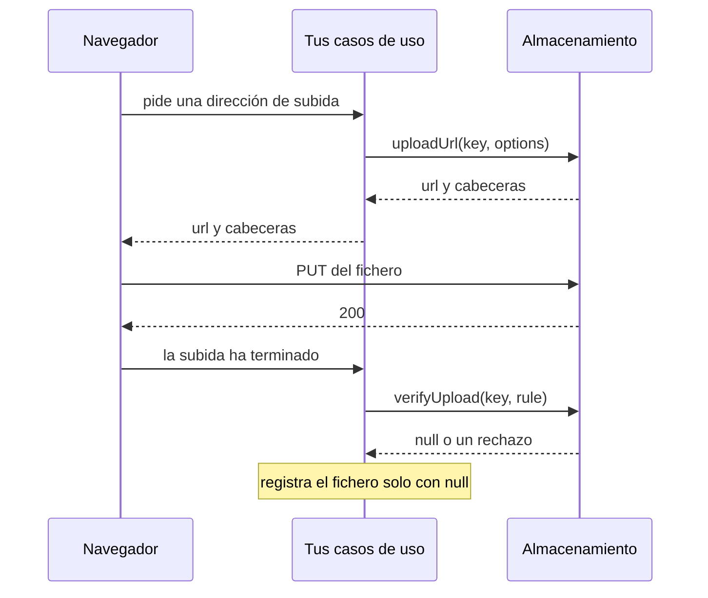

El almacenamiento de un contexto es el sitio donde guarda sus ficheros: adjuntos, avatares, exportaciones. Existe para que tus módulos guarden y sirvan ficheros sin preocuparse de si viven en disco, en S3 o en memoria.

## Ficheros privados y públicos

Cada contexto tiene dos tipos de almacenamiento. Le das uno, los dos o ninguno.

| Tipo | Quién lee un fichero | Cómo |
|---|---|---|
| `private` | Solo quien recibe un enlace de tu caso de uso | Un enlace firmado que caduca |
| `public` | Cualquiera que tenga la dirección | Una dirección fija y sin firmar |

Casi todos los ficheros son privados: adjuntos de tareas, documentos. El almacenamiento público sirve para ficheros pensados para todo el mundo, como el logo de un proyecto.

## Cómo recibe un contexto su almacenamiento

El contexto abre su almacenamiento en `src/stores.ts` y se lo pasa a `ContextBase` como `storage`. Esto es lo que genera `newt init` para ficheros locales:

```ts title="src/stores.ts"
export async function openStorage(
  context: string,
  router: HttpRouter,
  stores: Stores,
  host: string | undefined,
): Promise<StorageOptions> {
  if (stores === 'memory') {
    return { private: new MemoryStorage() }
  }
  const path = '/files'
  const storage = await LocalStorage.open({
    folder:
      Bun.env[`${envOf(context)}_FILES`] ?? `data/files/${context}`,
    baseUrl: `${publicUrlOf(router, host)}${path}`,
    secret: requiredEnv('FILES_SECRET'),
  })
  router.get(`${path}/*`, request => storage.handler(request), {
    public: true,
  })
  router.put(`${path}/*`, request => storage.handler(request), {
    public: true,
    maxBodyBytes: MAX_UPLOAD_BYTES,
  })
  return { private: storage }
}
```

`publicUrlOf(router, host)` es `PUBLIC_URL`, o el host del contexto cuando tiene uno, seguido del prefijo del router.

```ts title="src/contexts/tasks/tasks.context.ts"
const base = new ContextBase({
  name: 'tasks',
  platform,
  database,
  storage: await openStorage('tasks', router, stores, host),
})
```

`StorageOptions` tiene dos campos opcionales:

| Campo | Tipo |
|---|---|
| `private` | `StorageAdapter` |
| `public` | `PublicStorageAdapter` |

Un contexto arranca sin almacenamiento. Solo falla cuando un módulo pide un tipo que no recibió: `The context 'tasks' was given no private storage: ContextBaseOptions.storage.private`.

## Ficheros en un módulo

Un módulo toma su propia carpeta del almacenamiento del contexto con `in(nombre)`:

```ts title="src/contexts/tasks/modules/task/task.module.ts"
import type { PrivateFiles } from '@newt-js/core'

export class Task_Module extends Module {

  private readonly attachments: PrivateFiles

  private constructor(
    base: ContextBase,
    private readonly tasks: Task_Repository,
    private readonly deps: Task_Deps,
  ) {
    super('task', base.useCaseRunner, deps)
    this.attachments = base.storage.private.in('task')
    // ...
  }

}
```

Cada clave lleva delante el nombre del contexto y luego cada prefijo de `in`. `this.attachments.put('t1/report.pdf', ...)` se guarda como `tasks/task/t1/report.pdf`. Dos contextos que comparten un bucket o una carpeta nunca ven los ficheros del otro.

### Claves

Una clave es una ruta de nombres unidos por `/`.

- Cada nombre empieza por una letra o un dígito, y sigue con letras, dígitos, `.`, `_` o `-`.
- Cada nombre tiene 128 caracteres como máximo.
- La clave completa, con sus prefijos, tiene 900 caracteres como máximo.

Cualquier otra cosa lanza un error antes de llegar al adaptador, así que una clave como `../x` nunca sale de su sitio:

```text
'tasks/task/../x' is no storage key: names of letters, digits, '.', '_' and '-', joined by '/'
```

## Métodos

`PrivateFiles` y `PublicFiles` tienen estos:

| Método | Devuelve | Qué hace |
|---|---|---|
| `in(prefix)` | ficheros del mismo tipo | Una carpeta dentro de esta |
| `put(key, body, { contentType })` | `{ size, contentType }` | Guarda un `Blob`, `Uint8Array` o `string`, y sustituye lo que hubiera |
| `open(key)` | `{ size, contentType, stream }` o `null` | Lee un fichero como stream |
| `stat(key)` | `{ size, contentType }` o `null` | Dice cuánto ocupa un fichero y de qué tipo es |
| `delete(key)` | nada | Borra un fichero. Borrar uno que no existe no es un error, porque un job puede ejecutarse dos veces |
| `uploadUrl(key, options)` | `{ url, headers }` | Una dirección a la que un navegador sube un fichero |
| `verifyUpload(key, rule)` | `null` o un rechazo | Comprueba lo que subió el navegador |

Solo `PrivateFiles` tiene `signedUrl(key, options)`. Solo `PublicFiles` tiene `url(key)`.

Un fichero que no existe es `null`, nunca un error.

## Subidas desde el navegador

Los ficheros van directos del navegador al almacenamiento, sin pasar por tu caso de uso. Son tres pasos:

1. Un caso de uso pide una dirección de subida con `uploadUrl`.
2. El navegador envía allí el fichero con `PUT`, con las cabeceras que recibió.
3. Otro caso de uso comprueba la subida con `verifyUpload` y solo entonces la registra.

Esto es quién habla con quién; los bytes del fichero nunca pasan por tus casos de uso:



```ts title="src/contexts/tasks/modules/task/task.module.ts"
@UseCase()
async attachmentUploadUrl(input: {
  id: string
  size: number
}): Promise<UploadAddress> {
  return this.attachments.uploadUrl(`${input.id}/report.pdf`, {
    expiresIn: 600,
    contentType: 'application/pdf',
    size: input.size,
    maxBytes: 10 * 1024 * 1024,
  })
}
```

```ts
const { url, headers } = await api.attachmentUploadUrl({
  id,
  size: file.size,
})
await fetch(url, { method: 'PUT', headers, body: file })
```

Opciones de `uploadUrl`:

| Opción | Obligatoria | Significado |
|---|---|---|
| `expiresIn` | sí | Segundos que funciona la dirección |
| `contentType` | sí | El único tipo que acepta la dirección |
| `size` | sí | La longitud exacta en bytes que acepta la dirección |
| `maxBytes` | no | Lo máximo que puede ocupar el fichero. Por defecto: 1 MB (1.048.576 bytes) |

Si `size` supera `maxBytes`, `uploadUrl` lanza `UploadTooLarge` (kind `too_large`, code `upload_too_large`), que una ruta responde con `413`. Un `size` que no sea un número entero de 0 o más lanza un error normal.

La dirección solo acepta el tipo y la longitud con los que se firmó. Si el navegador envía otro tipo, más bytes o menos, se rechaza.

### Comprobar una subida

El navegador puede mentir, o no subir nada. Compruébalo antes de fiarte del fichero:

```ts
const refusal = await this.attachments.verifyUpload(
  `${id}/report.pdf`,
  { contentType: 'application/pdf', maxBytes: 10 * 1024 * 1024 },
)
if (refusal) {
  throw new AttachmentRefused(refusal)
}
```

`verifyUpload` recibe `contentType` y un `maxBytes` opcional (1 MB por defecto). Devuelve `null` si el fichero está bien, o uno de estos:

| Rechazo | Por qué |
|---|---|
| `'missing'` | No se subió nada con esa clave |
| `'too_large'` | El fichero ocupa más que `maxBytes` |
| `'wrong_type'` | El fichero se guardó con otro tipo, o sus bytes son de otro tipo |

Para detectar el último caso, newt lee los primeros 16 bytes y los compara con las firmas de tipos conocidos: PNG, JPEG, GIF, WebP, AVIF, HEIC/HEIF, QuickTime, MP4, M4A, WebM, PDF, ZIP y ficheros de Office, gzip, y ejecutables de Windows y Linux. Un fichero que dice ser PNG pero empieza como un ejecutable es `'wrong_type'`. Un tipo sin firma, como `text/csv`, pasa salvo que sus bytes parezcan de un tipo conocido. Un fichero vacío no pasa ningún tipo que tenga firma.

:::danger[Comprueba siempre]
Nunca registres un fichero subido sin `verifyUpload`. Hasta que devuelva `null`, el fichero puede no estar, ocupar demasiado o ser otra cosa de lo que dice.
:::

Los rechazos son valores, no errores. Lanza tu propio [error](/es/concepts/errors/) cuando lo necesites.

## Descargas

Un fichero privado se lee con un enlace firmado que caduca:

```ts
@UseCase()
async attachmentUrl(input: { id: string }): Promise<string> {
  return this.attachments.signedUrl(`${input.id}/report.pdf`, {
    expiresIn: 300,
    contentType: 'application/pdf',
    filename: 'Report.pdf',
    disposition: 'inline',
  })
}
```

| Opción | Obligatoria | Significado |
|---|---|---|
| `expiresIn` | sí | Segundos que funciona el enlace |
| `contentType` | sí | El tipo con el que se sirve el fichero |
| `filename` | no | El nombre con el que lo guarda el navegador |
| `disposition` | no | `'attachment'` (descargar, por defecto) o `'inline'` (mostrar en el navegador) |

El fichero se sirve con el tipo que dice tu caso de uso, sea cual sea el tipo con el que lo subió el navegador.

:::caution[Inline solo para tipos seguros]
`inline` solo funciona con PNG, JPEG, GIF, WebP, AVIF y PDF. Todo lo demás, como HTML o SVG, se descarga siempre, así que una página subida nunca puede ejecutarse en tu web.
:::

## Ficheros públicos

Los ficheros públicos tienen una dirección fija y no necesitan firma:

```ts
const logos = base.storage.public.in('project')
await logos.put(`${id}/logo.png`, bytes, { contentType: 'image/png' })
const address = logos.url(`${id}/logo.png`)
```

Las subidas al almacenamiento público usan los mismos `uploadUrl` y `verifyUpload` que las privadas.

El `src/stores.ts` generado solo prepara almacenamiento privado. Para añadir el público, abre un adaptador público (`LocalPublicStorage`, `S3PublicStorage` o `MemoryPublicStorage`) y devuélvelo como `public`.

## Adaptadores

### Local

Guarda los ficheros en una carpeta del disco del servidor. Es el que se usa por defecto.

```ts
import { LocalStorage } from '@newt-js/core/files/local'

const storage = await LocalStorage.open({
  folder: 'data/files/tasks',
  baseUrl: 'http://localhost:3000/tasks/api/files',
  secret: Bun.env.FILES_SECRET!,
})
```

| Opción | Obligatoria | Significado |
|---|---|---|
| `folder` | sí | Dónde viven los ficheros. Se crea si no existe |
| `baseUrl` | sí | La dirección pública de las rutas que sirven los ficheros |
| `secret` | sí | Firma los enlaces de subida y descarga. 32 caracteres o más |
| `clock` | no | El reloj que decide cuándo caducan los enlaces. Útil en tests |

:::caution
No subas `FILES_SECRET` a tu repositorio. Quien lo conozca puede firmar enlaces a cualquier fichero.
:::

Tu servidor sirve los ficheros él mismo, con `storage.handler`. Lo montas en dos rutas públicas, como hace el `stores.ts` generado de la sección «Cómo recibe un contexto su almacenamiento»: `GET` para descargas y `PUT` para subidas. `maxBodyBytes` en la ruta `PUT` limita cualquier subida (100 MB en el código generado). El handler responde:

| Estado | Cuándo |
|---|---|
| `200` | Subida guardada |
| `400` | La subida era más corta de lo firmado |
| `403` | La firma es incorrecta o ha caducado |
| `404` | No existe ese fichero |
| `413` | La subida era más larga de lo firmado |
| `415` | El tipo de la subida no es el firmado |

Un fichero solo aparece cuando está escrito entero. Una subida cortada no deja nada.

`LocalPublicStorage` recibe las mismas opciones. Además sirve ficheros sin firma, con caché de un día, y `url(key)` devuelve `baseUrl/key`.

### S3

Guarda los ficheros en un bucket de S3, o en cualquier servicio compatible con S3 (MinIO, Cloudflare R2 y otros).

```ts
import { S3Storage } from '@newt-js/core/files/s3'

const storage = await S3Storage.open({
  bucket: Bun.env.TASKS_S3_BUCKET!,
  accessKeyId: Bun.env.S3_ACCESS_KEY_ID!,
  secretAccessKey: Bun.env.S3_SECRET_ACCESS_KEY!,
  region: Bun.env.S3_REGION ?? 'us-east-1',
  endpoint: Bun.env.S3_ENDPOINT,
})
```

| Opción | Obligatoria | Significado |
|---|---|---|
| `bucket` | sí | El nombre del bucket |
| `accessKeyId` | sí | |
| `secretAccessKey` | sí | |
| `sessionToken` | no | Para credenciales temporales |
| `region` | no | |
| `endpoint` | no | La dirección del servicio, para lo que no sea AWS |
| `virtualHostedStyle` | no | Dirige el bucket como `bucket.host` en lugar de `host/bucket` |

`open` comprueba que se llega al bucket y, si no, lanza `The bucket '...' cannot be reached`. Los navegadores suben y descargan directamente del bucket, así que tu servidor nunca carga con los bytes.

`S3PublicStorage` recibe una opción más, `publicUrl`: la dirección desde la que se leen los ficheros públicos. `url(key)` devuelve `publicUrl/key`.

### Memoria

Guarda los ficheros en memoria y los olvida al terminar el proceso. Para tests y para probar cosas.

```ts
import { MemoryPublicStorage } from '@newt-js/core/files/memory'
import { MemoryStorage }       from '@newt-js/core/files/memory'

const storage = new MemoryStorage()
```

No recibe opciones. Sus direcciones empiezan por `memory://`, y `storage.send(url, init)` hace de navegador en un test:

```ts
const address = await files.uploadUrl('t1/report.pdf', {
  expiresIn: 600,
  contentType: 'application/pdf',
  size: 8,
})
await storage.send(address.url, {
  method: 'PUT',
  headers: address.headers,
  body: '%PDF-1.7',
})
expect(
  await files.verifyUpload('t1/report.pdf', {
    contentType: 'application/pdf',
  }),
).toBeNull()
```

## En los tests

Los tests generados abren el backend con `stores: 'memory'`, así que cada contexto recibe un `MemoryStorage` nuevo. Si usas `testContext`, pásale tú el almacenamiento:

```ts
context = testContext({
  name: 'tasks',
  cluster: new MemoryCluster(),
  database,
  storage: { private: new MemoryStorage() },
})
```

Mira [Testing](/es/guides/testing/).

## Con el CLI

No hay un comando `newt add` para ficheros. Eliges el almacenamiento al crear un backend, con `--files local` (por defecto), `--files s3` o `--files memory`:

```sh
newt init newthub --files s3
```

Mira [`newt init`](/es/reference/cli/init/) y [`newt add backend`](/es/reference/cli/add-backend/). Las variables de entorno que necesita cada opción están en [Configuración](/es/reference/configuration/).
