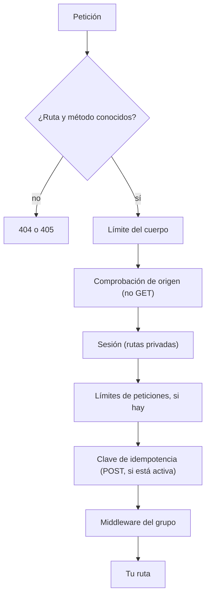

Una ruta es una función que responde a un método HTTP en una ruta de URL, casi siempre llamando a un [caso de uso](/es/concepts/use-cases/). Las rutas existen para que el mundo exterior llegue a tu app; los casos de uso no saben nada de HTTP.

Cada opción que aparece aquí está, con su tipo y su valor por defecto, en la [referencia de la API HTTP](/es/reference/http/).

## Una ruta

Cada módulo guarda sus rutas en `<módulo>.routes.ts`. Este es el del módulo de tareas de un proyecto generado:

```ts title="src/contexts/tasks/modules/task/task.routes.ts"
import {
  bodyOf,
  pageRequestFrom,
  type HttpRouter,
} from '@newt-js/core/http'
import type { Task_Module } from './task.module'
import { TaskId } from './value-objects/task-id'

export function registerTaskRoutes(
  router: HttpRouter,
  tasks: Task_Module,
) {
  router.post('/tasks/:id/complete-task', async request =>
    Response.json(
      await tasks.completeTask({ id: TaskId.from(request.params.id) }),
    ),
  )
  router.post('/tasks', async request =>
    Response.json(await tasks.create(await bodyOf(request)), {
      status: 201,
    }),
  )
  router.get('/tasks', async request =>
    Response.json(await tasks.paginate({}, pageRequestFrom(request))),
  )
  router.get('/tasks/:id', async request =>
    Response.json(
      await tasks.get(request.params.id),
    ),
  )
  return { one: router.group('/tasks/:taskId') }
}
```

Una ruta recibe la petición y devuelve un `Response` estándar. No captura errores: newt los convierte en respuestas JSON (mira [Errores](#errores)).

La función devuelve los grupos del módulo: `one`, en `/tasks/:taskId`, es donde los módulos que usan `task` cuelgan sus rutas. Mira [Recursos anidados](/es/concepts/services-and-deps/#recursos-anidados).

## El router

Cada contexto tiene un `HttpRouter`. El contexto lo crea y se lo pasa a cada módulo:

```ts title="src/contexts/tasks/tasks.context.ts"
const router = new HttpRouter({ prefix: '/tasks/api', database })
router.authenticateWith(authenticate)
```

- **Prefijo.** El router de un contexto pone `/<contexto>/api` delante de cada ruta: la ruta `/tasks` responde en `/tasks/api/tasks`. Como cada contexto tiene su prefijo, dos contextos nunca cogen la misma ruta. Una ruta nunca repite el nombre de su contexto (lo comprueba la regla [`route-context`](/es/reference/lint/#newtroute-context)). Sin `prefix`, `HttpRouter` usa `/api`, que `runContexts` rechaza para el router de un contexto: tiene que ser `/<contexto>/api`.
- **Base de datos.** El router solo necesita la base de datos del contexto para las [claves de idempotencia](#claves-de-idempotencia).
- **Valores por defecto.** Cualquier [opción de ruta](#opciones-de-ruta) que le des al router se aplica a todas sus rutas.

Métodos: `get`, `post`, `put`, `patch`, `delete`. Registrar dos veces el mismo método y ruta lanza un error.

## Rutas y parámetros

| Segmento | Encaja con | Ejemplo |
|---|---|---|
| `tasks` | ese texto exacto | `/tasks` |
| `:id` | un segmento cualquiera no vacío, en `request.params.id` | `/tasks/:id` |
| `*` | uno o más segmentos; solo al final | `/files/*` |

`request.params` tiene tipos sacados de la ruta: en `'/tasks/:id'` TypeScript sabe que `request.params.id` es un `string`. Los valores llegan ya decodificados.

Si encajan varias rutas, gana la más concreta: el texto gana a `:param`, y `:param` gana a `*`.

newt responde también esto por ti:

- `HEAD` en una ruta con `GET` ejecuta el `GET` y quita el cuerpo.
- `OPTIONS` en una ruta con [CORS](#cors) responde a la petición previa (*preflight*) con `204`.
- Otro método en una ruta conocida responde `405` con la cabecera `Allow`.
- Una ruta desconocida bajo el prefijo responde `404` con el código `route_not_found`.

## Leer la petición

| Ayuda | Da |
|---|---|
| `bodyOf(request)` | El cuerpo JSON, sin tipos. Valídalo en el caso de uso con su schema. |
| `queryOf(request)` | La query string como un objeto plano de strings, sin tipos. |
| `pageRequestFrom(request)` | Una petición de página desde `?size=` y `?cursor=`: `size` vale 20 por defecto, y siempre entre 1 y 100. |
| `request.params` | Los parámetros de la ruta. |
| `request.cookies` | Las cookies, como un `Bun.CookieMap`. Las que pongas con `set` salen con la respuesta. |

El cuerpo se comprueba antes de que tu código lo vea:

- `bodyOf` (y `request.json()`) quiere `content-type: application/json` (o `application/*+json`). Cualquier otro responde `415`.
- Un cuerpo que no es JSON válido, o un formulario que no se puede leer, responde `400` con el código `malformed_body`.
- Un cuerpo por encima del límite de la ruta responde `413` con el código `payload_too_large`. El límite es 1 MiB por defecto; súbelo por ruta con `maxBodyBytes`.

```ts
router.put('/files/*', request => storage.handler(request), {
  public: true,
  maxBodyBytes: 100 * 1024 * 1024,
})
```

:::tip
`bodyOf` no valida. Valida la entrada con el schema del caso de uso, como hacen los casos de uso generados, y así todo el que llame pasa por las mismas comprobaciones.
:::

## Quién llama

Las rutas son privadas salvo que digas lo contrario. Antes de ejecutar una ruta privada, el router pregunta a su autenticador quién llama:

```ts title="src/auth.ts"
import type { Authenticator } from '@newt-js/core/http'

export const authenticate: Authenticator = async () => null
```

- Si devuelve un actor (`{ userId }`), la ruta se ejecuta como ese [actor](/es/concepts/actor-and-scope/), y también los casos de uso a los que llama.
- Si devuelve `null`, o el router no tiene autenticador, la ruta responde `401` con el código `not_signed_in`.

El autenticador generado no reconoce a nadie, así que toda ruta privada responde `401` hasta que lo escribas. Mira [Autenticación](/es/guides/authentication/) para cookies de sesión y tokens *bearer*.

Una ruta a la que puede llamar cualquiera lleva `public: true`:

```ts
router.get('/files/*', request => storage.handler(request), {
  public: true,
})
```

## Opciones de ruta

El tercer argumento de `get`, `post`, etc. Dale las mismas opciones al router o a un grupo para que sean las de por defecto.

| Opción | Qué hace |
|---|---|
| `public` | Se salta el autenticador. |
| `maxBodyBytes` | Límite del cuerpo en bytes. 1 MiB por defecto. |
| `cors` | Deja que páginas de otros orígenes llamen a la ruta. Mira [CORS](#cors). |
| `crossOrigin` | `true` desactiva la [comprobación de origen](#comprobación-de-origen). |
| `rateLimit` | Uno o más [límites de peticiones](#límites-de-peticiones), o `false` para ninguno. |
| `idempotency` | `true` (o `{ ttlMs }`) guarda respuestas por [clave de idempotencia](#claves-de-idempotencia). Solo `POST`. |
| `onError` | Tu propio `(error, request) => Response` en vez de las [respuestas de error](#errores) por defecto. |

Las opciones de una ruta mandan sobre las de su grupo y su router. Los límites de peticiones, en cambio, se suman (mira [Límites de peticiones](#límites-de-peticiones)).

## Grupos y middleware

Un grupo comparte un prefijo y opciones, y sus opciones pueden llevar un `middleware`. Sin opciones, el grupo solo pone su prefijo delante de sus rutas.

```ts
const reports = router.group('/reports', {
  middleware: async (request, next) => {
    const started = performance.now()
    const response = await next()
    console.log(request.method, request.url, performance.now() - started)
    return response
  },
})

reports.get('/overdue', async () => Response.json(await tasks.find({})))
```

`/overdue` responde en `/tasks/api/reports/overdue`. El middleware se ejecuta después de las comprobaciones de newt (sesión, límites, clave de idempotencia) y alrededor de la ruta: llama a `next()` para ejecutarla, o devuelve tu propio `Response` para cortar.

## Por dónde pasa una petición

Este es el orden en que una petición pasa por las comprobaciones de newt antes de que se ejecute tu ruta:



Una comprobación que falla corta la petición ahí y responde con su error, como cuenta la sección "Errores". Así, quien no ha iniciado sesión recibe `401` antes de que ningún límite lo cuente.

## Errores

Cuando una ruta lanza un error, newt responde JSON con un estado que sale del tipo (*kind*) del error: `400` para `validation`, `404` para `not_found`, `409` para `conflict`, y así. El cuerpo lleva el mensaje y el código del error, y sus parámetros si los tiene:

```json
{ "error": "Already done", "code": "task.already_done" }
```

Un error de zod responde `400` con el código `validation` y los `issues` de zod. Cualquier otro responde `500` con el código `internal`; el error real va al [log](/es/concepts/logs/), nunca al cliente. En [Errores](/es/concepts/errors/) tienes la tabla completa de tipos y estados, los errores propios de newt y cómo escribir los tuyos.

Además, toda respuesta del router lleva `cache-control: no-store` salvo que la ruta ponga el suyo.

## Comprobación de origen

El navegador envía las cookies en cada petición a tu web, aunque salga de una página de otra web. Para que esa página no actúe en nombre de tu usuario, newt rechaza las peticiones `POST`, `PUT`, `PATCH` y `DELETE` que vienen de otro origen, con `403` y el código `cross_origin_refused`.

- Las peticiones desde tus propias páginas pasan.
- Las peticiones sin cabecera `Origin` (curl, otros servidores, apps móviles) pasan.
- Una petición de otro origen pasa solo si el [CORS](#cors) de la ruta permite ese origen **y** no lleva cookies.
- `crossOrigin: true` desactiva la comprobación en una ruta.

Las rutas `GET` nunca se comprueban.

:::caution
Una ruta `GET` no debe cambiar nada. Usa `POST`, `PUT`, `PATCH` o `DELETE` para los cambios, así la comprobación de origen los protege.
:::

## CORS

Para que páginas de otros orígenes llamen a tu API, dale al router o a la ruta la opción `cors`:

```ts title="src/contexts/tasks/tasks.context.ts"
const router = new HttpRouter({
  prefix: '/tasks/api',
  database,
  cors: { origin: ['https://newthub.app'] },
})
```

| Campo | Significado | Por defecto |
|---|---|---|
| `origin` | `'*'` o una lista de orígenes permitidos | obligatorio |
| `headers` | cabeceras que la página puede enviar | ninguna |
| `expose` | cabeceras de respuesta que la página puede leer | ninguna |
| `maxAge` | segundos que el navegador guarda la respuesta previa | 86400 |

## Límites de peticiones

Un límite de peticiones (*rate limit*) pone un tope a cuántas peticiones hace quien llama en una ventana de tiempo. Defínelo en la base del contexto y dáselo a las rutas:

```ts
const creating = base.rateLimits.define('task.create', {
  limit: 20,
  windowMs: 60_000,
})

router.post(
  '/tasks',
  async request =>
    Response.json(await tasks.create(await bodyOf(request)), {
      status: 201,
    }),
  {
    rateLimit: { limit: creating },
  },
)
```

Un límite se llama `<módulo>.<nombre>` y recibe `limit` (peticiones) y `windowMs` (la ventana). `by` dice quién es "quien llama":

| `by` | Cuenta por |
|---|---|
| `'actor'` (por defecto) | usuario con sesión, o IP si no la tiene |
| `'ip'` | IP del cliente |
| `(request) => string \| null` | tu propia clave; `null` salta el límite en esa petición |

- Por encima del límite, la ruta responde `429` con la cabecera `Retry-After`.
- Por debajo, la respuesta lleva `RateLimit-Limit` y `RateLimit-Remaining`.
- Los límites de una ruta se suman a los de su grupo y su router; `rateLimit: false` los quita todos.

Los contadores viven en el clúster de la plataforma, así que todas las instancias los comparten cuando el clúster es compartido. Mira [Jobs y workers](/es/concepts/jobs-and-workers/) para los límites en general.

## Claves de idempotencia

Un móvil pierde la cobertura justo después de enviar "crear tarea". ¿Llegó? Si la app la reenvía, tienes dos tareas. Una clave de idempotencia lo arregla: el cliente envía la misma cabecera aleatoria `Idempotency-Key` en cada reintento, y newt ejecuta la petición una sola vez.

```ts
router.post(
  '/tasks',
  async request =>
    Response.json(await tasks.create(await bodyOf(request)), {
      status: 201,
    }),
  {
    idempotency: true,
  },
)
```

- La primera respuesta se guarda en la base de datos del contexto (tabla `newt_idempotency_key`) durante un día; cámbialo con `{ ttlMs }`.
- Un reintento con la misma clave recibe la respuesta guardada, con la cabecera `Idempotent-Replayed: true`.
- La misma clave con otro cuerpo responde `422`, código `idempotency_key_reused`.
- Un reintento mientras la primera sigue en marcha responde `409`, código `idempotency_key_in_use`.
- Los errores y las respuestas `5xx` no se guardan: un reintento se ejecuta otra vez.
- Las respuestas de más de 1 MiB y los *event streams* no se guardan: un reintento responde `409`, código `idempotency_answer_not_kept`.

Reglas: solo `POST`, solo rutas privadas (las claves se guardan por usuario con sesión, así que newt lanza un error si la ruta es pública), y el router necesita su `database`. Una petición sin la cabecera se ejecuta como siempre.

## Sesiones

Dos ayudas escriben una cookie de sesión en `request.cookies`, `httpOnly` y `sameSite: 'lax'`:

```ts
setSessionCookie(request, 'session', token, {
  secure: true,
  maxAgeSeconds: 60 * 60 * 24 * 30,
})
clearSessionCookie(request, 'session', { secure: true })
```

`path` vale `/` por defecto. Para tokens en una cabecera `Authorization: Bearer`, `bearerAuthenticator(verify)` monta un autenticador a partir de tu `verify(token)`. [Autenticación](/es/guides/authentication/) lo junta todo.

## Arrancar el servidor

`runContexts` abre un servidor de Bun para los routers de todos los contextos, arranca sus workers y lo para todo limpiamente con `SIGINT` o `SIGTERM`:

```ts title="src/backend.ts"
return runContexts(contexts, {
  platformWithoutContexts: platform,
  serve: { port },
})
```

Las opciones de `serve` que más vas a tocar:

| Opción | Qué hace |
|---|---|
| `port` | El puerto. Obligatorio. |
| `health` | Encendido salvo con `false`: responde `GET /health-check` para todo el backend, y `GET /<contexto>/health-check` para cada contexto que sirve rutas, con `{ "status": "ok" }`. No pide sesión. Mientras para, responde `503` con `{ "status": "stopping" }`. |
| `drainMs` | Al parar, sigue sirviendo este tiempo antes, para que el balanceador vea el `503` y deje de enviar tráfico. |
| `trustProxy` | Cuántos proxies hay delante. Con él, la IP y el host del cliente salen de `X-Forwarded-For` y `X-Forwarded-Host`. Ponlo detrás de un proxy, o los límites por IP y la comprobación de origen verán el proxy. |
| `maxBodyBytes` | Límite del cuerpo por defecto del servidor. |
| `securityHeaders` | Cabeceras que se añaden a toda respuesta. Por defecto `X-Content-Type-Options: nosniff`, `Referrer-Policy: strict-origin-when-cross-origin` y `X-Frame-Options: DENY`. `false` las quita; un valor `null` quita una. |
| `hsts` | `true` añade `Strict-Transport-Security` durante un año. |
| `csp`, `proxy` | La Content-Security-Policy de las apps compiladas de los contextos, y los caminos que se reenvían a otro servidor. La app de un contexto se sirve en `/<contexto>`: mira [Añadir una app](/es/guides/app/). |

:::danger
Pon en `trustProxy` solo el número de proxies que tienes de verdad. Con un número mayor, un cliente puede falsear su IP en `X-Forwarded-For` y saltarse los límites por IP.
:::

`runContexts` devuelve `{ server, stop() }`. La parada va en orden: el servidor termina sus peticiones, los workers terminan sus jobs y los contextos se cierran.

La lista completa de opciones de `serve` y `runContexts` está en la [referencia de la API HTTP](/es/reference/http/).

## Con el CLI

`newt add route` escribe una ruta que llama a un caso de uso que ya existe, y un test para ella:

```sh
newt add route tasks/task complete-task
```

Por defecto es un `POST` en `/<contexto>/<plural del módulo>/:id/<caso de uso>`. Elige otro con `--method` y `--path`. Mira [newt add route](/es/reference/cli/add-route/).
