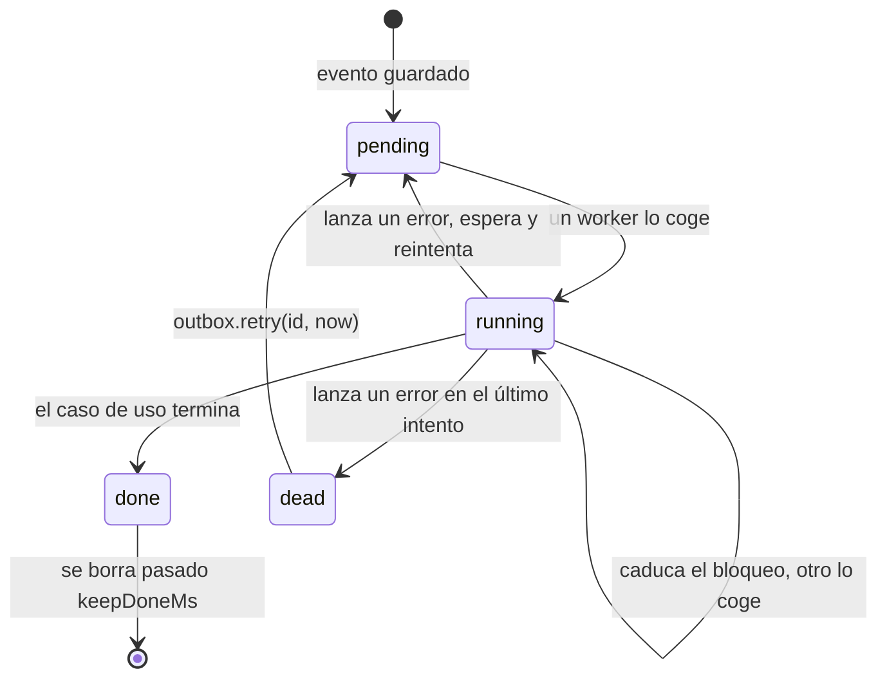

Un job es un trabajo pendiente en la cola: "llama a `notifyAssignee` para la tarea 42". Los jobs esperan en una cola que vive en tu base de datos (el *outbox*), y un worker dentro de tu aplicación los ejecuta. Existen para que el trabajo que provoca un cambio no se pierda nunca, aunque el proceso se pare justo después del cambio.

## El outbox

El outbox es una tabla, `newt_job`, en la base de datos del contexto. Cuando un caso de uso guarda una entidad que emitió un [evento](/es/concepts/events/), newt escribe un job por cada [suscripción](/es/concepts/events/#suscripciones) a ese evento, en la misma transacción que el cambio.

Así se guardan los dos o ninguno:

- El cambio se guarda, y sus jobs quedan esperando.
- El guardado falla, y no existe ningún job.

No hay que instalar ningún broker de mensajes. Con SQLite, la cola está en el mismo fichero que tus datos.

## Jobs

Un job guarda el evento como JSON y la cola a la que pertenece. Sus campos:

| Campo | Qué es |
|---|---|
| `id` | el id del job |
| `queue` | `<módulo>.<caso de uso>.on.<evento>` |
| `event` | el evento, como JSON |
| `status` | `pending`, `running`, `done` o `dead` |
| `attempts` | cuántas veces se ha cogido |
| `runAfter` | la hora más temprana a la que puede ejecutarse |
| `lockedBy`, `lockedUntil` | qué worker lo tiene, y hasta cuándo |
| `lastError` | el error del último intento fallido |
| `createdAt`, `updatedAt` | cuándo se escribió y cuándo cambió por última vez |

### Colas

Cada suscripción tiene su propia cola, llamada `<módulo>.<caso de uso>.on.<evento>`: `task.notifyAssignee.on.task.completed`. Dos suscripciones al mismo evento generan dos jobs, uno en cada cola, que fallan o salen bien por separado.

Los workers apuntan las colas que atienden en `newt_job_queue`, con la última vez que vieron cada una.

## El worker

Cada contexto tiene un worker, `base.worker`, que [`runContexts`](/es/concepts/http/#arrancar-el-servidor) arranca en cada instancia de tu aplicación. Se ejecuta en el mismo proceso que tus rutas.

El worker:

1. Coge hasta `concurrency` jobs que ya tocan, de las colas que atiende. Coger un job lo marca como `running`, suma uno a `attempts` y lo bloquea durante `leaseMs`.
2. Ejecuta el caso de uso suscrito de cada uno, sin [actor](/es/concepts/actor-and-scope/).
3. Si sale bien, marca el job como `done`.
4. Si hay un error, lo devuelve a `pending` para ejecutarlo tras una espera. Tras el último intento, lo marca como `dead`.

Busca jobs cada `pollMs`, y también justo después de que se confirme una transacción que encoló jobs. Con varias instancias, las demás se enteran por el [clúster](/es/guides/scaling/), así que no esperan a su siguiente búsqueda.

### Bloqueos

Mientras un job se ejecuta, el worker renueva su bloqueo cada tercio de `leaseMs`. Si el proceso muere, el bloqueo caduca y otro worker vuelve a coger el job. Por eso un job se ejecuta *al menos una vez*, y puede ejecutarse dos.

:::caution
Escribe los casos de uso suscritos para que ejecutarlos dos veces no haga daño. Comprueba el estado actual antes de actuar, como hace un método de entidad que lanza `AlreadyDone`.
:::

### Parada

Cuando la aplicación recibe `SIGINT` o `SIGTERM`, el worker deja de coger jobs y espera a los que están en marcha. Si pasan del plazo, los aborta a través de `meta.signal`. Un job abortado así vuelve a la cola sin contar el intento.

## Reintentos y jobs muertos

Estos son los estados por los que pasa un job:



Un job fallido espera antes del siguiente intento, el doble cada vez:

```text
espera = min(backoffMs * 2 ^ (attempts - 1), maxBackoffMs)
```

Con los valores por defecto: 10 s, 20 s, 40 s, 80 s. Una suscripción se intenta 5 veces salvo que fije `attempts` (consulta las [opciones de una suscripción](/es/concepts/events/#opciones)).

Tras el último intento, el job queda `dead`. Se queda en `newt_job` con su `lastError` y no vuelve a ejecutarse solo.

Los jobs terminados se borran pasado `keepDoneMs` (7 días por defecto). Los muertos se conservan.

:::tip
Un caso de uso que lanza un [error conocido](/es/concepts/errors/), como `TaskNotFound`, también se reintenta. Si reintentar no sirve de nada, termina sin lanzar el error.
:::

## Opciones del worker

Se pasan a la base del contexto, como `worker`:

```ts title="src/contexts/tasks/tasks.context.ts"
const base = new ContextBase({
  name: 'tasks',
  platform,
  database,
  worker: { concurrency: 4 },
  storage: await openStorage('tasks', router, stores),
})
```

| Opción | Qué es | Por defecto |
|---|---|---|
| `concurrency` | jobs a la vez, un número entero desde 1 | `10` |
| `pollMs` | tiempo entre búsquedas de jobs | `5000` |
| `leaseMs` | cuánto tiempo queda bloqueado un job cogido | `60000` |
| `backoffMs` | espera tras el primer fallo | `10000` |
| `maxBackoffMs` | espera más larga entre intentos | `900000` (15 min) |
| `keepDoneMs` | cuánto se conservan los jobs terminados | `604800000` (7 días) |
| `seenEveryMs` | cada cuánto apunta el worker sus colas | `60000` |
| `orphansCheckEveryMs` | cada cuánto busca colas que nadie atiende | igual que `seenEveryMs` |

### Colas huérfanas

Si hay jobs esperando en una cola que ningún worker en marcha atiende, y ninguna instancia la ha visto últimamente, el worker deja un aviso en el log. Suele significar que una suscripción se renombró o se quitó cuando aún tenía jobs.

## Mirar dentro de la cola

El worker y el outbox te dan lo necesario para montar una página de administración o una alerta:

| Llamada | Devuelve |
|---|---|
| `base.worker.state()` | la profundidad de cada cola: `ready`, `retrying`, `running`, `dead`, `oldestDueAt`, `lastSeenAt`, `orphan` |
| `base.worker.dead(after, limit)` | una página de jobs muertos: id, cola, nombre del evento, intentos, último error, fechas |
| `base.worker.onFlow(listener)` | llama a `listener` cada vez que un job queda `delivered`, `redelivered` o `dead`, con su espera en ms |
| `base.database.outbox.retry(id, now)` | devuelve un job muerto a `pending` con sus intentos a 0 |

`onFlow` devuelve una función que quita el listener. `retry` recibe `now` como fecha ISO y devuelve `false` si el job no está muerto.

## Límites de frecuencia

Un límite de frecuencia pone un tope a cuántas veces pasa algo en una ventana de tiempo, por clave: "20 tareas creadas por usuario y minuto". Lo defines en la base del contexto:

```ts
const creating = base.rateLimits.define('task.create', {
  limit: 20,
  windowMs: 60_000,
})
```

- El nombre es `<módulo>.<nombre>`, en camelCase, y se define una vez por contexto.
- `limit` y `windowMs` son números enteros desde 1.

Pásalo a una ruta en su opción `rateLimit` (consulta [límites de peticiones en HTTP](/es/concepts/http/#límites-de-peticiones)), o llámalo tú:

| Método | Qué hace |
|---|---|
| `take(key)` | cuenta uno para `key`; si pasa del límite, lanza `TooManyRequests` |
| `forget(key)` | borra la cuenta de `key`, como tras un inicio de sesión correcto |

`take` devuelve `{ allowed, limit, remaining, retryAfterMs }`. `TooManyRequests` es un error conocido de tipo `too_many_requests`, que se responde con un `429` y lleva `retryAfterSeconds`.

La ventana se desliza: la cuenta de la ventana anterior pesa menos a medida que avanza la actual, así que una ráfaga en el borde de dos ventanas no duplica el límite.

:::note
Las cuentas viven en el clúster de la plataforma. Con `MemoryCluster`, cada instancia cuenta por su lado; con un clúster compartido como Valkey, todas comparten las cuentas. Consulta [Varias instancias](/es/guides/scaling/).
:::

## Jobs con cada base de datos

- **SQLite, Postgres, MySQL**: los jobs son filas de `newt_job` y sobreviven a los reinicios. Varias instancias los comparten sin problema: coger jobs se hace en una transacción.
- **Memoria**: los jobs viven en el proceso y se pierden al pararlo. Úsala para tests.

Consulta [Base de datos y migraciones](/es/concepts/database/#las-tablas-de-newt) para ver las tablas que mantiene newt.

## Con el CLI

No hay un comando para jobs: los obtienes al suscribir un caso de uso a un evento o a una tarea programada.

```sh
newt add subscription tasks/task notify-assignee --on completed
newt add schedule tasks/task remind-overdue --cron "0 9 * * *"
```

Consulta [newt add subscription](/es/reference/cli/add-subscription/) y [newt add schedule](/es/reference/cli/add-schedule/).
