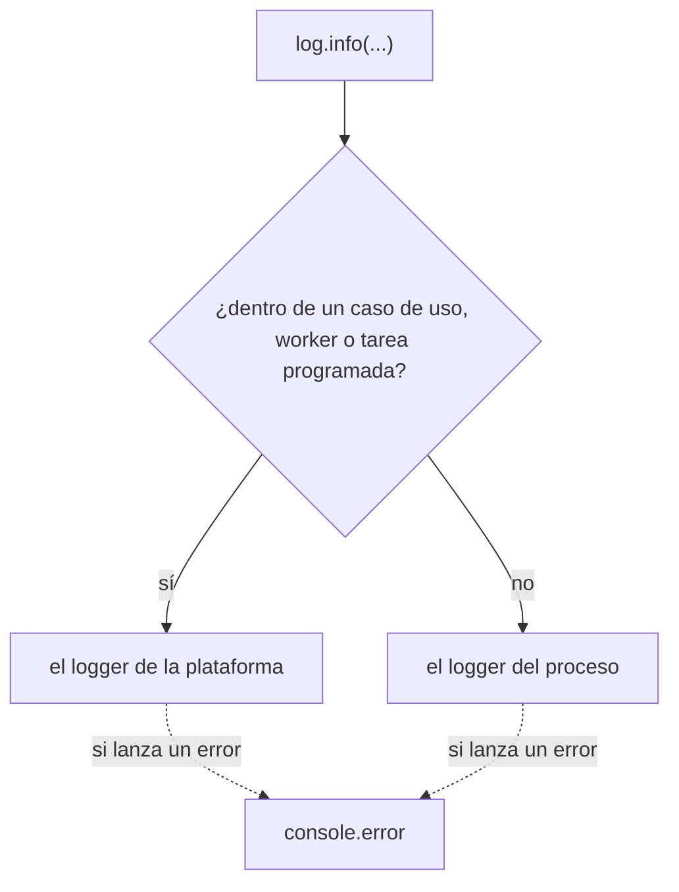

Una línea de log es un mensaje corto que tu backend escribe sobre lo que está haciendo. newt escribe las suyas (un job que falló, una conexión perdida) y te da la misma herramienta para las tuyas, así que todas van a un único sitio que eliges tú.

Las lees para saber qué ha fallado cuando el backend corre en un sitio donde no puedes mirarlo.

## Escribir una línea

Importa `log` y llama a uno de sus cuatro niveles:

```ts title="src/contexts/tasks/modules/task/task.module.ts"
import { log } from '@newt-js/core/application'

@UseCase()
async remindOverdue(): Promise<void> {
  log.info('reminders sent', { count: 3 })
}
```

| Nivel | Para |
|---|---|
| `log.debug` | Detalle que solo quieres mientras desarrollas |
| `log.info` | Cosas que han pasado |
| `log.warn` | Algo raro que no paró el trabajo |
| `log.error` | Algo falló |

Cada uno recibe un mensaje y un objeto opcional de campos. Pon los valores en los campos, no en el mensaje, para que una herramienta de logs pueda buscarlos.

Con el logger por defecto, esa línea imprime:

```text
2026-11-17T09:00:00.000Z INFO [tasks] reminders sent { count: 3 }
```

## Qué contiene una línea

Un logger recibe un `LogLine`:

| Campo | Tipo | Significado |
|---|---|---|
| `at` | `string` | Cuándo, como fecha ISO. Usa el reloj del contexto, así que un reloj de test también lo mueve |
| `level` | `'debug' \| 'info' \| 'warn' \| 'error'` | |
| `message` | `string` | |
| `fields` | `Record<string, unknown>` | `{}` si no se dieron |
| `context` | `string \| null` | El contexto cuyo caso de uso se estaba ejecutando, o `null` fuera de cualquier caso de uso |

## El logger de consola

`ConsoleLogger` es el que se usa por defecto. Escribe las líneas `error` con `console.error`, las `warn` con `console.warn` y el resto con `console.log`. Los campos van detrás del mensaje cuando los hay.

Descarta las líneas `debug` salvo que las pidas:

```ts
import { ConsoleLogger } from '@newt-js/core/application'

new ConsoleLogger({ debug: true })
```

## Tu propio logger

Un logger es cualquier objeto con un método `write(line)`. Este escribe un objeto JSON por línea, que es lo que leen la mayoría de servicios de logs:

```ts title="src/json-logger.ts"
import type { LogLine } from '@newt-js/core/application'
import type { Logger }  from '@newt-js/core/application'

export class JsonLogger implements Logger {

  write(line: LogLine): void {
    console.log(JSON.stringify(line))
  }

}
```

:::tip
newt pone el error lanzado en un campo `error`. `JSON.stringify` convierte un `Error` en `{}`, así que copia tú su `message` y su `stack`.
:::

Un logger que lanza un error nunca rompe tu caso de uso. El fallo se imprime con `console.error` y el trabajo sigue. Una línea escrita mientras el logger está escribiendo otra también va a `console.error`, así que un logger que escribe logs no puede entrar en un bucle infinito.

## Adónde van las líneas

Hay dos loggers, y normalmente pones el mismo en los dos. Así elige newt uno para cada línea:



| Logger | Se pone con | Recibe las líneas escritas |
|---|---|---|
| El de la plataforma | `new Platform({ logger })` o `platform.useLogger(logger)` | Dentro de casos de uso, workers, suscripciones, tareas programadas, y mientras `runContexts` se detiene |
| El del proceso | `setLogger(logger)` | En cualquier otro sitio, como el `[http] unexpected error` de la capa HTTP |

:::caution
Un error habitual es poner solo el logger de la plataforma: los errores de las rutas siguen yendo a la consola. Llama a `setLogger` con el mismo logger.
:::

Los dos empiezan siendo un `ConsoleLogger`.

```ts title="src/backend.ts"
import { Platform }   from '@newt-js/core/application'
import { setLogger }  from '@newt-js/core/application'
// --------------------------------------------------------
import { JsonLogger } from './json-logger'

export async function startBackend(
  port: number,
  { stores = 'configured' }: { stores?: Stores } = {},
): Promise<RunningContexts> {
  const logger = new JsonLogger()
  setLogger(logger)
  const platform = new Platform({ logger })
  // ...
}
```

La plataforma la comparten todos los contextos de un backend. Mira [Varias instancias](/es/guides/scaling/) para su `cluster`.

## Las líneas que escribe newt

Las líneas de newt empiezan con una etiqueta entre corchetes, para que puedas filtrarlas:

| Etiqueta | Ejemplos |
|---|---|
| `[Worker]` | No se pudo cerrar un job; hay jobs esperando en una cola que ningún worker atiende; quedan jobs en marcha pasado el plazo de parada |
| `[EventBus]` | Un handler falló; no se pudo avisar a otras instancias de jobs nuevos |
| `[database]` | Falló deshacer o terminar una transacción |
| `[http]` | Un error inesperado en una ruta (respondido con `500`) |
| `[oauth]` | Un error inesperado en una ruta OAuth |
| `[runContexts]` | Falló un paso de la parada, o la parada tardó demasiado |
| `[MemoryCluster]`, `[ValkeyCluster]` | Un listener falló; se perdió una conexión |
| `[write rule]`, `[guard rule]` | Un caso de uso incumplió una regla puesta en `'warn'` |

## Logs en los tests

`testContext` captura las líneas de la plataforma en lugar de imprimirlas. Léelas en `context.logs`:

```ts
expect(context.logs.said('warn')).toContain('...')
```

| Miembro | Significado |
|---|---|
| `logs.lines` | Cada `LogLine` capturada, en orden |
| `logs.said(level)` | Los mensajes de un nivel |

Mira [Testing](/es/guides/testing/).

## Ganchos de observabilidad

Los logs cuentan lo que pasó. Para medir casos de uso, como cuánto tarda cada uno o cuántas veces se reintenta, dale a la plataforma un `Observability`:

```ts
interface Observability {
  useCase<T>(
    call: ObservedUseCase,
    run: (attempt: UseCaseAttempt) => Promise<T>,
  ): Promise<T>
  warn(message: string, fields: Record<string, unknown>): void
}
```

- `useCase` envuelve cada ejecución de un caso de uso, la lance una ruta, un worker u otro caso de uso. `call` dice cuál es: `{ name, module, context }`, por ejemplo `{ name: 'task.create', module: 'task', context: 'tasks' }`. Tienes que llamar a `run` y devolver lo que devuelva.
- `run` recibe un intento con un método, `retrying(error, attempt)`. newt lo llama cada vez que reintenta el caso de uso tras un conflicto con otro guardado, antes de volver a ejecutarlo. `attempt` vale 1 en el primer reintento.
- `warn` recibe los avisos de las reglas de escritura y de guarda cuando están en `'warn'`. newt también los escribe en el log, así que usa `warn` para enviarlos a otro sitio.

Este registra cuánto tarda cada caso de uso:

```ts title="src/timing.ts"
import type { Observability } from '@newt-js/core'
import { log }                from '@newt-js/core/application'

export const timing: Observability = {
  async useCase(call, run) {
    const started = performance.now()
    try {
      return await run({
        retrying: (error, attempt) =>
          log.warn(`${call.name} retried`, { attempt }),
      })
    } finally {
      log.debug(`${call.name} took`, {
        ms: Math.round(performance.now() - started),
      })
    }
  },
  warn: () => {},
}
```

```ts
const platform = new Platform({
  logger,
  observability: timing,
})
```

También puedes ponerlo después con `platform.useObservability(timing)`. Si no das ninguno, newt usa `noObservability`, que no hace nada.

## Describir la aplicación

`describeApplication` lee tus contextos y devuelve su estructura como datos: módulos, casos de uso, eventos, tareas programadas, dependencias y suscripciones. Lee el código tal como se ejecuta, así que nunca está desactualizado.

Úsalo en tests para comprobar cómo está todo conectado, o para alimentar una herramienta que dibuje o revise tu aplicación. El test que genera `newt add schedule` lo usa:

```ts title="src/contexts/tasks/modules/task/task.module.test.ts"
test('remindOverdue runs at 0 9 * * *', async () => {
  const described = describeApplication([context.base]).contexts.find(
    each => each.name === 'tasks',
  )
  const events =
    described?.modules.find(each => each.name === 'task')?.events ?? []
  expect(events).toContainEqual(
    expect.objectContaining({
      name: 'task.remindOverdue',
      schedule: { cron: '0 9 * * *' },
    }),
  )
  // ...
})
```

Recibe una lista de contextos (cada uno un `BoundedContext` o un `ContextBase`) y devuelve `{ version: 1, contexts }`. Parte de lo que devuelve para el contexto `tasks` del proyecto de ejemplo:

```json
{
  "name": "tasks",
  "uses": [],
  "modules": [
    {
      "id": "tasks/task",
      "context": "tasks",
      "name": "task",
      "className": "Task_Module",
      "useCases": [
        {
          "id": "tasks/task.create",
          "name": "task.create",
          "retryOnConflict": true
        }
      ],
      "events": [
        {
          "id": "tasks/task.completed",
          "name": "task.completed",
          "schedule": null
        },
        {
          "id": "tasks/task.remindOverdue",
          "name": "task.remindOverdue",
          "schedule": { "cron": "0 9 * * *" }
        }
      ],
      "deps": [
        {
          "name": "project",
          "kind": "module",
          "target": "tasks/project"
        }
      ]
    }
  ],
  "subscriptions": [
    {
      "event": "tasks/task.completed",
      "strategy": "handler",
      "queue": "task.notifyAssignee.on.task.completed",
      "handler": "task.notifyAssignee",
      "attempts": null,
      "filtered": false
    }
  ]
}
```

### Contexto

| Campo | Significado |
|---|---|
| `name` | El nombre del contexto |
| `uses` | Los otros contextos de los que dependen sus módulos |
| `modules` | Sus módulos |
| `subscriptions` | Sus [suscripciones](/es/concepts/events/) |

### Módulo

| Campo | Significado |
|---|---|
| `id` | `contexto/módulo` |
| `context`, `name`, `className` | |
| `useCases` | Cada uno con `id`, `name` y `retryOnConflict` (si se reintenta tras un conflicto) |
| `events` | Los eventos que emite el módulo, cada uno con `id`, `name` y `schedule`: `{ cron }` para una [tarea programada](/es/concepts/schedules/), `null` para cualquier otro evento |
| `deps` | Sus [dependencias](/es/concepts/services-and-deps/) |

Una dependencia tiene un `name` y un `kind`:

| `kind` | Es | `target` |
|---|---|---|
| `'module'` | Otro módulo | Su id |
| `'events'` | Eventos de otro módulo, con sus nombres en `events` | El id del módulo, o `null` si no se sabe |
| `'port'` | Cualquier otra cosa, como un servicio | `null` |

### Suscripción

| Campo | Significado |
|---|---|
| `event` | El id del evento |
| `strategy` | `'handler'` (un caso de uso ejecutado a través de una cola, como lo prepara `module.on`) o `'fire-and-forget'` (una función llamada a través de `base.bus.subscribe`) |
| `queue` | La cola a la que van sus jobs |
| `handler` | El caso de uso que ejecuta |
| `attempts` | Su propio número de intentos, o `null` para el valor por defecto |
| `filtered` | Si solo se ejecuta para algunos eventos |

En una suscripción `'fire-and-forget'`, `queue`, `handler`, `attempts` y `filtered` son `null`.
