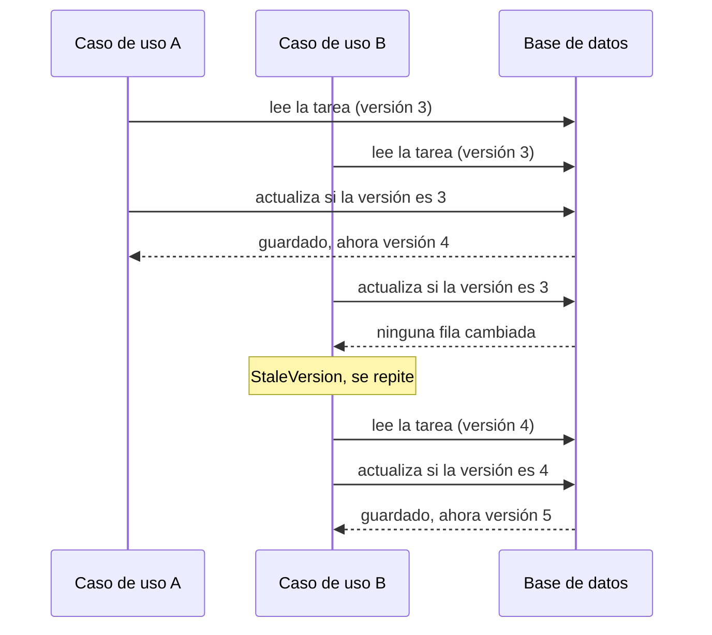

Un repositorio es la clase que lee las entidades de un módulo de su tabla y las vuelve a guardar. Existe para que tus casos de uso nunca escriban SQL: le piden entidades con criterios, las cambian y se las devuelven para guardarlas.

El `Repository` de newt ya sabe leer, guardar, comprobar versiones y publicar eventos. Tu repositorio solo dice qué tabla usa y cómo una fila se convierte en entidad.

## Un repositorio

```ts title="src/contexts/tasks/modules/task/task.repository.ts"
import { Repository, type ResolvedRow } from '@newt-js/core'
import type { ContextBase } from '@newt-js/core/application'
import type { z } from 'zod'
import { Task } from './task'
import type { TaskSchema } from './task.schema'

/** What its table keeps: the ids of what it references, never the entities. */
export type TaskRow = z.infer<typeof TaskSchema> & { version: number }

export class Task_Repository extends Repository<Task, TaskRow> {
  constructor(base: ContextBase) {
    super(base, base.database.records<TaskRow>('task'), { scope: 'none' })
  }

  protected toEntity(row: ResolvedRow<TaskRow, Task>): Task {
    return Task.fromDTO(row)
  }
}
```

El constructor recibe:

- La base del contexto, por sus transacciones, sus eventos y su ejecutor de casos de uso.
- `base.database.records<TaskRow>('task')`: las filas de la tabla `task`.
- Opciones: `scope` (obligatoria, `'none'` o un scope), `softDelete` (por defecto `false`) y, cuando su entidad referencia otras, `references`. Ver las secciones Scope, Borrado lógico y [Referencias a otros módulos](#referencias-a-otros-módulos).

Un repositorio no tiene métodos públicos propios. La regla del lint `repository-public-methods` los rechaza: lo que decide un módulo va en sus casos de uso y en su entidad.

## Leer

| Método | Devuelve |
|---|---|
| `find(criteria?, options?)` | Las entidades que coinciden. |
| `count(criteria?, options?)` | Cuántas coinciden. |
| `count(criteria, { by })` | Cuántas coinciden, por cada valor de los campos de `by`. |
| `paginate(criteria, page, options?)` | Una página de entidades que coinciden. |

Opciones de `find`:

- `limit`: como mucho estas.
- `orderBy`: una lista de `{ field, direction? }`, con `direction` `'asc'` (por defecto) o `'desc'`. Sin ella, las filas llegan por id, ascendente. Los ids son UUID v7, que crecen con el tiempo, así que eso es de la más antigua a la más nueva.
- `everyScope`: `true` lee más allá del scope del repositorio.

```ts
const [task] = await this.tasks.find({ id }, { limit: 1 })
const open = await this.tasks.count({ doneAt: null })
const perProject = await this.tasks.count({}, { by: ['projectId'] })
// [{ projectId: '0190…', count: 4 }, …]
```

## Criterios

Los criterios dicen qué filas leer. Son un objeto plano, con los campos de la fila como claves:

```ts
{ name: 'Write the docs' }                       // igual a
{ name: { ieq: 'write the docs' } }              // con un operador
// varios, deben cumplirse todos
{ createdAt: { gte: '2026-01-01', lt: '2026-02-01' } }
{ doneAt: null }                                 // el campo está vacío
{ or: [{ name: 'A' }, { name: 'B' }] }           // cualquiera de
{ and: [{ projectId }, { doneAt: null }] }       // todos
```

Los operadores son los de los [filtros](/es/concepts/schemas-and-dtos/#operadores):

| Operador | Coincide cuando el valor es |
|---|---|
| `eq` | igual |
| `ne` | distinto |
| `in` | uno de una lista |
| `gt` / `gte` | mayor / mayor o igual |
| `lt` / `lte` | menor / menor o igual |
| `ieq` | igual, sin distinguir mayúsculas de la A a la Z |

Un campo con `undefined` se ignora, así que puedes escribir criterios opcionales en línea. Un `{}` vacío coincide con todas las filas.

Los casos de uso rara vez escriben criterios a mano: `TaskFilter.toCriteria(filter)` convierte lo que envió un cliente en criterios.

Dos utilidades:

- `allOf(a, b)` devuelve criterios que cumplen los dos.
- `matches(row, criteria)` comprueba un objeto contra unos criterios, en memoria.

## Páginas

Una lista que puede crecer se lee página a página.

```ts
type PageRequest = { size: number, cursor?: string }
type Page<T> = { items: T[], nextCursor?: string, total?: number }
```

`paginate(criteria, page, options?)` devuelve hasta `page.size` entidades después de `page.cursor`, y:

- `nextCursor`: el id del último elemento, solo si hay más. Envíalo como el siguiente `cursor`.
- `total`: cuántas coinciden con los criterios en total.

Sus opciones son `newestFirst` (`true` lee por id, descendente) y `everyScope`.

Por HTTP, `pageRequestFrom(request)` lee `?size=` y `?cursor=` de la URL (ver [HTTP y rutas](/es/concepts/http/)).

Utilidades para páginas:

| Función | Qué hace |
|---|---|
| `mapPage(page, fn)` | Una página con cada elemento transformado. Los que se transforman en `undefined` se quitan. |
| `toPage(rows, { size, cursor, total? })` | Construye una página con hasta `size + 1` filas: la fila de más dice que hay otra página. |
| `allPages(read, size?)` | Llama a `read` página tras página, de 100 en 100 por defecto, y devuelve todos los elementos. |

```ts
const found = await this.tasks.paginate(criteria, page, {
  newestFirst: true,
})
return mapPage(found, each => each.toDTO())
```

:::tip
Un cursor es mejor que "página 3": las filas que se añaden mientras alguien lee no le mueven las páginas.
:::

## Guardar

```ts
await this.tasks.persist(task)
await this.tasks.persist([task, another])
```

`persist(entities, hooks?)` guarda una entidad o una lista, todo en una transacción:

1. Comprueba la [regla de escritura](/es/concepts/use-cases/#la-regla-de-escritura).
2. Escribe cada entidad que tenga algo que guardar. Una nueva se inserta. Una cambiada actualiza solo sus campos cambiados, `updatedAt` y `version`. Una borrada se borra.
3. Publica los eventos que registró cada entidad guardada en la cola de jobs que vive en tu base de datos (el *outbox*), en la misma transacción. Ver [Eventos y suscripciones](/es/concepts/events/).

Las entidades sin nada que guardar se saltan. Si falla alguna escritura, la transacción se deshace y no se guarda nada.

`purge(criteria)` borra de golpe todas las filas que coinciden y devuelve cuántas. No construye entidades, no comprueba versiones ni publica eventos: déjalo para jobs de limpieza.

## Hooks de guardado y guards

`persist` recibe hooks opcionales, que se ejecutan dentro de su transacción:

| Hook | Se ejecuta |
|---|---|
| `before` | Antes de las escrituras. |
| `after` | Después de las escrituras, antes de los eventos. Necesita `guard`. |
| `guard` | Nombra lo que protegen los hooks, como una lista de claves. |

Un hook que lee tiene que nombrar un guard. Supón que un proyecto admite como mucho 100 tareas abiertas:

```ts
await this.tasks.persist(task, {
  guard: [`project:${projectId}`],
  before: async () => {
    if (await this.tasks.count({ projectId, doneAt: null }) >= 100) {
      throw new ProjectFull()
    }
  },
})
```

En Postgres y MySQL, el guard bloquea esas claves hasta que acaba la transacción, así que dos guardados del mismo proyecto se turnan. Un guardado espera una clave hasta 30 segundos y después falla con `GuardTimeout`. En SQLite, las escrituras ya se hacen de una en una.

:::caution
Un guardado cuyos hooks leen sin guard lanza `[guard rule] … reads task in a save that guards nothing`, en cualquier base de datos. Sin él, en Postgres otro guardado podría cambiar lo que leyó el hook antes de confirmar. La opción `guardRule` del contexto (`'error'`, `'warn'` u `'off'`) dice qué pasa.
:::

## Transacciones

Cada `persist` es una transacción. Un módulo nunca abre una por su cuenta: la regla del lint `module-transactions` rechaza cualquier uso de las `transactions` de la base en un módulo. Para guardar varias entidades juntas, pásalas a un solo `persist`.

Si un guardado falla dentro de una transacción que abrió otro guardado, se deshace la transacción entera, aunque tu código capture el error. newt lanza entonces `TransactionSpoiled`, para que nunca se confirme un guardado a medias.

## Versiones y conflictos

Dos personas pueden cambiar la misma tarea a la vez. Sin una comprobación, el segundo guardado pisaría al primero sin avisar. newt lo evita con un número en cada fila, su `version`:

- Una inserción escribe `version` 1.
- Una actualización o un borrado solo se hace si la versión de la fila sigue siendo la que leyó la entidad, y le suma uno.
- Si la fila cambió entretanto, no se escribe nada y el guardado lanza `StaleVersion`.

Esto es lo que pasa cuando dos casos de uso completan la misma tarea a la vez:



Los errores que puede lanzar un guardado cuando choca con otro:

| Error | Cuándo | HTTP |
|---|---|---|
| `StaleVersion` | Alguien guardó o borró la fila desde que la leíste. | `409` |
| `DuplicateValue` | Un índice único rechazó un valor. | `409` |
| `TransactionConflict` | Postgres o MySQL rechazó la transacción (un interbloqueo, un fallo de serialización). | `409` |

Los tres son `ConcurrencyConflict`, así que el [caso de uso se ejecuta otra vez](/es/concepts/use-cases/#reintentos-ante-un-conflicto), hasta tres veces por defecto, antes de que el error llegue al cliente. `DuplicateValue` lista los campos en `params.fields` cuando la base de datos dice cuáles.

:::note
De los reintentos, como mucho uno sigue a un `DuplicateValue` por defecto (`conflictRetries.duplicates`). Un valor que guarda otro suele seguir ocupado en la siguiente ejecución.
:::

## Referencias a otros módulos

Cuando su entidad referencia entidades de otros módulos (ver [Entidades](/es/concepts/entities/#referencias-a-otros-módulos)), un repositorio recibe en sus opciones cómo se carga cada una: el `find` del otro módulo, por id. Cada lectura las resuelve antes de construir las entidades:

```ts title="order.repository.ts"
export class Order_Repository extends Repository<Order, OrderRow> {
  constructor(base: ContextBase, references: Loads<OrderReferences>) {
    super(base, base.database.records<OrderRow>('orders$order'), { scope: 'none', references })
  }

  protected toEntity(row: ResolvedRow<OrderRow, Order>): Order {
    return Order.fromDTO(row)   // { customer, lines: [{ product, quantity }], version, ... }
  }
}
```

El módulo se las da en `initialize`, donde tiene sus dependencias:

```ts title="order.module.ts"
static initialize(base: ContextBase, router: HttpRouter, deps: Order_Deps): Order_Module {
  const orders = new Order_Repository(base, {
    customerId: ids => deps.customers.customer.find({ field: 'id', op: 'in', value: ids }),
    lines: { productId: ids => deps.catalog.product.find({ field: 'id', op: 'in', value: ids }) },
  })
  const module = new Order_Module(base, orders, router, deps)
  // ...
}
```

- Una lectura carga cada referencia una vez, para todas las filas y todas sus líneas: sus ids distintos, de 100 en 100, todas las referencias a la vez. 50 pedidos de 20 clientes con 200 líneas de 30 productos son dos llamadas.
- Lee el otro módulo solo a través de su caso de uso, nunca de su tabla: `module-imports` se sigue cumpliendo.
- La fila guarda los ids, `customerId` y `lines[].productId`: un guardado guarda esos, nunca las entidades.
- Un repositorio cuya entidad tiene referencias no compila sin `references`.
- Toda lectura las paga, también las de una escritura y las de un worker, y el otro módulo resuelve a su vez las suyas. Una lectura demasiado frecuente para eso guarda su propia copia de lo que necesita, alimentada por los eventos del otro módulo: un read model.

`ReferenceNotFound` (`400`, código `reference_not_found`) dice que un id no apunta a nada: `The customer 0190… does not exist`. Una lectura lo lanza cuando un id que guarda ya no nombra nada: mantén vivos los ids siguiendo los eventos del otro módulo. `referenced` también lo lanza cuando un caso de uso toma del otro módulo lo que nombra su entrada (ver [Casos de uso](/es/concepts/use-cases/#referencias-a-otros-módulos)).

## Texto que la base de datos no puede guardar

Un string con el carácter NUL o con un surrogate suelto no se puede guardar como texto. Guardarlo lanza `TextWithNul` (`400`, código `text_with_nul`). `holdsNul(value)` comprueba un valor antes, mirando dentro de strings, arrays y objetos.

## Scope

Un scope limita un repositorio a las filas de un dueño, como el espacio de trabajo actual:

```ts
super(base, base.database.records<TaskRow>('task'), {
  scope: { field: 'workspaceId', current: () => currentWorkspaceId() },
})
```

- Cada lectura añade `workspaceId = current()` a sus criterios, salvo que pase `everyScope: true`.
- `persist` rechaza una entidad de otro scope, antes de escribir.

Mira [Actor y scope](/es/concepts/actor-and-scope/) para ver de dónde sale el valor actual.

## Borrado lógico

Con `softDelete: true`, una entidad borrada conserva su fila: el guardado pone `deletedAt` (y `updatedAt`) en vez de borrarla, y cada lectura se salta las filas con `deletedAt`. La tabla necesita una columna `deleted_at` que admita nulos.

## Filas y entidades

Un repositorio convierte filas en entidades y al revés con tres métodos protegidos:

| Método | Por defecto |
|---|---|
| `toEntity(row)` | Ninguno: lo escribes tú. La fila llega con las entidades que referencia su entidad en lugar de sus ids. |
| `toRow(entity)` | Los campos de la entidad, para un insert. |
| `toChanges(entity)` | Los campos cambiados y `updatedAt`, para un update. |

Sobrescribe `toRow` y `toChanges` cuando la tabla y la entidad no coinciden. `this.records` da la tabla en sí: `find`, `count`, `countBy`, `insert`, `update`, `delete` y `deleteMany`.

## Con el CLI

`newt add module` escribe el repositorio con su módulo, su entidad y su tabla:

```sh
newt add module tasks/task
```

Ver [`newt add module`](/es/reference/cli/add-module/).
