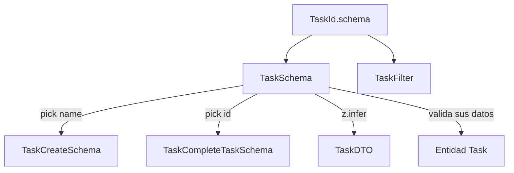

Un schema es una descripción en [zod](https://zod.dev) de tus datos: sus campos y sus reglas. Un DTO es el objeto plano que un caso de uso recibe o devuelve, y su tipo sale de un schema.

Escribir las reglas una vez, en el schema, hace que la entidad, los casos de uso, las rutas y el cliente estén de acuerdo en qué es una tarea.

## El fichero de schemas del módulo

Cada módulo guarda sus schemas en `<módulo>.schema.ts`. Es el contrato del módulo con el resto de la app:

```ts title="src/contexts/tasks/modules/task/task.schema.ts"
import { defineFilter } from '@newt-js/core'
import { z } from 'zod'
import { TaskId } from './value-objects/task-id'

/** A task, as its module keeps it and tells it: its public contract. */
export const TaskSchema = z.object({
  id: TaskId.schema,
  name: z.string().trim().min(1).max(100),
  createdAt: z.string(),
  updatedAt: z.string(),
})

/** What a client sends to create one: the entity's own rules, picked. */
export const TaskCreateSchema = TaskSchema.pick({ name: true })

/**
 * What they are read by: these fields and operators, nothing else;
 * and what a list may be sorted by.
 */
export const TaskFilter = defineFilter(
  {
    id: { field: 'id', value: TaskId.schema, ops: ['eq', 'in'] },
    name: { field: 'name', value: z.string(), ops: ['eq', 'ieq'] },
  },
  { sort: ['name', 'createdAt'] },
)

export type TaskDTO = z.infer<typeof TaskSchema>
export type TaskCreateDTO = z.input<typeof TaskCreateSchema>
export type TaskFilterDTO = z.input<typeof TaskFilter.schema>
export type TaskSortDTO = z.input<typeof TaskFilter.sortSchema>

export const TaskCompleteTaskSchema = TaskSchema.pick({ id: true })
export type TaskCompleteTaskDTO = z.input<typeof TaskCompleteTaskSchema>
```

La regla del lint `schema-imports` lo mantiene como contrato. Un fichero de schemas importa solo `zod`, `@newt-js/core`, los `value-objects/` del propio módulo y los tipos de los DTOs de otros módulos (`import type` de sus `*.schema.ts`). Nunca la entidad, el repositorio ni el módulo, ni el schema de otro módulo como valor: un campo que guarda el id de otro módulo usa un value object del propio módulo (mira [Value objects](/es/concepts/value-objects/)).

Así sale todo lo del fichero de `TaskSchema` y del value object del id:



## El schema de la entidad

`TaskSchema` describe una tarea tal como se guarda y se devuelve. La [entidad](/es/concepts/entities/) valida sus datos con él, y `toDTO()` devuelve sus campos.

Siempre nombra `id`, `createdAt` y `updatedAt`. Cada campo corresponde a una columna de la tabla del módulo: `createdAt` en el schema es `created_at` en SQL.

:::caution
Añadir un campo al schema no añade la columna. Escribe también una migración (ver [Base de datos y migraciones](/es/concepts/database/)).
:::

## Schemas de entrada

El schema de entrada de un caso de uso se elige del schema de la entidad, así las reglas siguen en un solo sitio:

```ts
export const TaskCreateSchema = TaskSchema.pick({ name: true })
export const TaskCompleteTaskSchema = TaskSchema.pick({ id: true })
```

El caso de uso valida su entrada con él antes que nada:

```ts
const { id } = TaskCompleteTaskSchema.parse(input)
```

Si la entrada no pasa, zod lanza un `ZodError`, y HTTP responde `400` con el código `validation` y la lista de problemas (ver [Errores](/es/concepts/errors/)).

La regla del lint `use-case-params` comprueba que cada parámetro con tipo de DTO de entrada se valida con su schema.

## Tipos de DTO: z.input y z.infer

Un schema tiene dos tipos: lo que recibe y lo que devuelve tras validar. Son distintos cuando el schema transforma valores o rellena valores por defecto.

| Tipo | Es | Úsalo para |
|---|---|---|
| `z.input<typeof S>` | Lo que puede enviar quien llama, antes de validar. | Los parámetros de un caso de uso. |
| `z.infer<typeof S>` | Lo que devuelve la validación. | Lo que devuelve un caso de uso. |

Con `priority: z.string().default('normal')`, el tipo de entrada tiene `priority?: string` y el de salida `priority: string`. Quien llama puede omitirlo; el caso de uso siempre lo recibe.

Por eso el código generado declara `TaskCreateDTO` con `z.input` y `TaskDTO` con `z.infer`.

## Filtros

Un filtro dice cómo pueden leer un módulo los clientes: por qué campos, con qué operadores y ordenado por qué. Todo lo demás se rechaza.

```ts
defineFilter(fields, limits?)
```

Cada entrada de `fields` es un nombre que usan los clientes, con:

| Clave | Qué es |
|---|---|
| `field` | El campo de la entidad que lee, como `'projectId'`. |
| `value` | El schema de zod de un valor, como `TaskId.schema`. |
| `ops` | Los operadores permitidos. |

El nombre y el campo pueden ser distintos: `project: { field: 'projectId', value: ProjectId.schema, ops: ['eq'] }`.

### Operadores

| Operador | Coincide cuando el valor es |
|---|---|
| `eq` | igual |
| `ne` | distinto |
| `in` | uno de una lista (100 valores como mucho) |
| `gt` / `gte` | mayor / mayor o igual |
| `lt` / `lte` | menor / menor o igual |
| `ieq` | igual, sin distinguir mayúsculas de la A a la Z |

### Límites

| Opción | Por defecto | Qué es |
|---|---|---|
| `sort` | ninguno | Los campos por los que se puede ordenar una lista. |
| `maxDepth` | `3` | Cuántos niveles pueden anidarse los grupos `and` y `or`. |
| `maxConditions` | `20` | Cuántas condiciones caben en un filtro. |

### Lo que envían los clientes

Un filtro tiene dos formas. La corta, para igualdad, da valores por nombre. Solo pueden aparecer campos con `eq`:

```json
{ "name": "Write the docs" }
```

La completa es un árbol de condiciones, agrupadas con `and` y `or`. Cada grupo tiene al menos un elemento:

```json
{
  "or": [
    { "field": "name", "op": "ieq", "value": "write the docs" },
    { "field": "id", "op": "in", "value": ["0190f5c2-...", "0190f5c3-..."] }
  ]
}
```

Un orden es una lista de tres campos como mucho, cada uno con una dirección opcional:

```json
[{ "field": "createdAt", "direction": "desc" }, { "field": "name" }]
```

### Lo que te da un filtro

| Miembro | Qué hace |
|---|---|
| `schema` | El schema de zod de un filtro. |
| `sortSchema` | El schema de zod de un orden. |
| `parse(input)` | Comprueba un filtro, o lanza `InvalidFilter`. |
| `parseSort(input)` | Comprueba un orden, o lanza `InvalidSort`. |
| `toCriteria<Row>(filter)` | Convierte un filtro comprobado en criterios del repositorio. |
| `toOrder<Row>(sort)` | Convierte un orden comprobado en el `orderBy` del repositorio. |
| `fieldOf(name)` | El campo de la entidad que hay detrás de un nombre. |

Los casos de uso generados llaman a `TaskFilter.schema.parse`, que lanza un `ZodError` (`400`, código `validation`). `TaskFilter.parse` lanza en cambio `InvalidFilter` (`400`, código `invalid_filter`, con los problemas en `params`). Mira [Repositorios](/es/concepts/repositories/#criterios) para ver qué hacen los criterios.

:::tip
Lista solo los campos y operadores que necesitan los clientes. Un filtro también limita qué consultas tiene que responder tu base de datos.
:::

## Con el CLI

Ningún comando escribe un schema suelto. `newt add module` escribe el fichero de schemas con el schema de la entidad, su schema de creación y su filtro. `newt add use-case` añade un schema de entrada elegido y su tipo de DTO. Ver [`newt add module`](/es/reference/cli/add-module/) y [`newt add use-case`](/es/reference/cli/add-use-case/).
