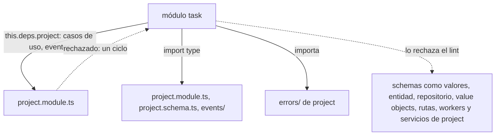

Un servicio es una función que comparten varios casos de uso de un módulo. Una dependencia es algo que un módulo recibe de fuera al construirse, casi siempre otro módulo de su contexto cuyos casos de uso llama.

Los dos mantienen pequeño un módulo sin romper sus bordes: un servicio se queda dentro del módulo, y una dependencia es la única puerta hacia otro.

## Servicios

Un servicio vive en la carpeta `services/` del módulo, un fichero cada uno:

```ts title="src/contexts/tasks/modules/task/services/due-dates.ts"
import type { TaskDTO } from '../task.schema'

export function dueDates(task: TaskDTO): TaskDTO {
  return task
}
```

Los casos de uso lo importan y lo llaman:

```ts
import { dueDates } from './services/due-dates'
```

Escribe un servicio cuando dos casos de uso repiten los mismos pasos, como un cálculo o una comprobación que necesita varias lecturas. Una regla sobre una tarea va en la [entidad](/es/concepts/entities/), donde la reciben todos los casos de uso.

:::tip
Un servicio es una función normal. No necesita clase, ni decorador, ni registro, y lo pruebas llamándolo.
:::

Un servicio pertenece a su módulo. La regla del lint `module-imports` deja que otros módulos importen solo los tipos del `*.module.ts`, el `*.schema.ts` y los `events/` de un módulo, y sus `errors/`, así que ningún otro puede importar sus servicios.

## Dependencias

Un módulo que necesita otro módulo de su contexto lo recibe como dependencia. En Newthub, `task` usa `project`.

Sus dependencias son un tipo en `<módulo>.deps.ts`:

```ts title="src/contexts/tasks/modules/task/task.deps.ts"
import type { Project_Module } from '../project/project.module'

export type Task_Deps = {
  project: Project_Module
}
```

El `-modules.ts` del contexto construye primero `project` y se lo pasa a `task`:

```ts title="src/contexts/tasks/tasks-modules.ts"
export function tasksModules(base: ContextBase, router: HttpRouter) {
  const project = Project_Module.initialize(base, router)
  const task = Task_Module.initialize(base, router, { project })
  return {
    task,
    project,
  }
}
```

El módulo las guarda y se las pasa al constructor de `Module`:

```ts title="src/contexts/tasks/modules/task/task.module.ts"
private constructor(
  base: ContextBase,
  private readonly tasks: Task_Repository,
  private readonly deps: Task_Deps,
) {
  super('task', base.useCaseRunner, deps)
  // ...
}
```

Un caso de uso llama entonces a los casos de uso del otro módulo:

```ts
@UseCase()
async moveToProject(input: TaskMoveToProjectDTO): Promise<TaskDTO> {
  const { id, projectId } = TaskMoveToProjectSchema.parse(input)
  const project = await this.deps.project.get({ id: projectId })
  // ...
}
```

Pasar `deps` a `super` permite a newt describir la app: `describeApplication` lista, para cada módulo, los módulos que usa. Una dependencia también puede ser los eventos de otro módulo, o cualquier objeto que tu módulo necesite, como un cliente de un servicio externo.

## Lo que se permite

- **Leer a través de los casos de uso de otro módulo.** `this.deps.project.get(...)`, `find(...)` y `paginate(...)` están bien.
- **No guardar a través de ellos.** Un caso de uso solo guarda su propio módulo: un caso de uso de `project` que guarda, llamado desde `task`, rompe la [regla de escritura](/es/concepts/use-cases/#la-regla-de-escritura) y lanza un error. Para cambiar un proyecto cuando le pasa algo a una tarea, publica un evento y deja que `project` reaccione en un worker (ver [Eventos y suscripciones](/es/concepts/events/)).
- **Sin ciclos.** Si `task` usa `project`, `project` no puede usar `task`, ni siquiera a través de un tercer módulo. `newt add deps` rechaza un ciclo.
- **Módulos del mismo contexto.** Un módulo usa los módulos de otro contexto solo cuando su contexto se abre con ese contexto, y el CLI todavía no lo escribe. Ver [cómo hablan los contextos entre sí](/es/concepts/contexts-and-modules/#cómo-hablan-los-contextos-entre-sí).

Esto es lo que `task` puede alcanzar de `project`, y lo que rechaza el lint:



Lo que comprueba el lint:

| Regla | Qué rechaza |
|---|---|
| `module-imports` | Importar la entidad, el repositorio, los value objects, las rutas, los workers o los servicios de otro módulo, o su módulo, su schema o sus eventos como valores (llegan con `import type`). |
| `module-files` | Un fichero o carpeta que un módulo no tiene. `services/` y `<módulo>.deps.ts` están permitidos. |
| `module-transactions` | Que un módulo abra una transacción propia. |

:::caution
No importes el repositorio de otro módulo para leer su tabla "solo esta vez". El lint lo rechaza: leerías sus datos por detrás de sus casos de uso, y un cambio en ese módulo podría romper el tuyo. Llama a su caso de uso.
:::

:::note
El id que un módulo guarda de la entidad de otro, como el `projectId` de una tarea, es un value object de su propio módulo. Ver [Value objects](/es/concepts/value-objects/).
:::

## Recursos anidados

Algunas URLs ponen un recurso dentro de otro: las notas de una carpeta responden en `/notes/api/folders/:folderId/notes`. Supón que un contexto `notes` tiene dos módulos, y `note` usa `folder` para comprobar que una carpeta existe antes de meter una nota en ella. `folder` no puede servir esa URL: necesitaría `note`, y `note` ya usa `folder`, un ciclo.

Así que newt sigue dos reglas:

- **Una ruta anidada es del módulo que lee o cambia**, y cuelga del grupo que expone el padre.
- **Un padre nunca usa a sus hijos.** Emite eventos que ellos siguen, y ellos le cuentan lo que tiene que saber por sus workers.

### El hijo cuelga sus rutas de las del padre

La función de rutas de cada módulo devuelve sus grupos, y el módulo los guarda en `routes`. `folder` expone `one`, un grupo en `/folders/:folderId` que no hace nada por sí mismo:

```ts title="src/contexts/notes/modules/folder/folder.routes.ts"
return { one: router.group('/folders/:folderId') }
```

Cuando `note` usa `folder` (`newt add deps notes/note folder`), su función de rutas recibe sus deps, y registra las notas de una carpeta en ese grupo. `request.params.folderId` tiene tipo:

```ts title="src/contexts/notes/modules/note/note.routes.ts"
export function registerNoteRoutes(
  router: HttpRouter,
  notes: Note_Module,
  deps: Note_Deps,
) {
  deps.folder.routes.one.get('/notes', async request =>
    Response.json(
      await notes.paginateInFolder(
        FolderId.from(request.params.folderId),
        pageRequestFrom(request),
      ),
    ),
  )
  // ...
}
```

Si `folder` cambia su URL, sus notas se mueven con ella. Su caso de uso lee la carpeta a través de `folder`, así que una carpeta que no existe responde `404` en lugar de una lista vacía:

```ts title="src/contexts/notes/modules/note/note.module.ts"
@UseCase()
async paginateInFolder(folderId: FolderId, page: PageRequest): Promise<Page<NoteDTO>> {
  await this.deps.folder.get({ id: folderId })
  return this.paginate({ folderId }, page)
}
```

### El padre cambia, los hijos le siguen

Borrar una carpeta debería borrar sus notas. `folder` borra la carpeta y emite `folder.deleted`; `note` se suscribe a él a través de sus deps, que su `initialize` pasa a `registerNoteWorkers(module, deps)`, y borra las notas de la carpeta en un job:

```ts title="src/contexts/notes/modules/note/note.workers.ts"
export function registerNoteWorkers(notes: Note_Module, { folder }: Note_Deps): void {
  notes.on(folder.events.deleted, 'deleteInFolder', deleted => [deleted.id])
}
```

### Los hijos cambian, el padre lleva la cuenta

Supón que una carpeta muestra cuántas notas tiene. `folder` no puede escuchar a `note`, que no usa. Así que `note` se lo cuenta: un worker de `note` sigue su propio `note.created` y llama a un caso de uso de `folder` a través de sus deps:

```ts title="src/contexts/notes/modules/note/note.workers.ts"
notes.on(notes.events.created, 'countInFolder', created => [created.folderId])
```

```ts title="src/contexts/notes/modules/note/note.module.ts"
@UseCase()
async countInFolder(folderId: FolderId): Promise<void> {
  await this.deps.folder.countNote({ id: folderId })
}
```

Componer casos de uso de varios módulos es cosa de los workers: una ruta solo lee y llama.

## Con el CLI

```sh
newt add service tasks/task due-dates
newt add deps tasks/task project
```

`newt add service` escribe `services/due-dates.ts`, una función sobre el DTO del módulo. `newt add deps` escribe `task.deps.ts` (o le añade una línea), pasa `{ project }` en `tasks-modules.ts` y conecta el constructor del módulo. Rechaza un módulo de otro contexto, un módulo que se usa a sí mismo y un ciclo. Ver [`newt add service`](/es/reference/cli/add-service/) y [`newt add deps`](/es/reference/cli/add-deps/).
