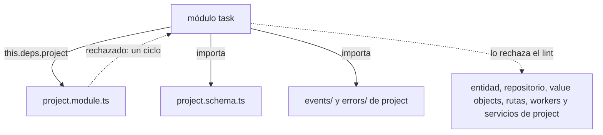

Un servicio es una función que comparten varios casos de uso de un módulo. Una dependencia es algo que un módulo recibe de fuera al construirse, casi siempre otro módulo de su contexto cuyos casos de uso llama.

Los dos mantienen pequeño un módulo sin romper sus bordes: un servicio se queda dentro del módulo, y una dependencia es la única puerta hacia otro.

## Servicios

Un servicio vive en la carpeta `services/` del módulo, un fichero cada uno:

```ts title="src/contexts/tasks/modules/task/services/due-dates.ts"
import type { TaskDTO } from '../task.schema'

export function dueDates(task: TaskDTO): TaskDTO {
  return task
}
```

Los casos de uso lo importan y lo llaman:

```ts
import { dueDates } from './services/due-dates'
```

Escribe un servicio cuando dos casos de uso repiten los mismos pasos, como un cálculo o una comprobación que necesita varias lecturas. Una regla sobre una tarea va en la [entidad](/es/concepts/entities/), donde la reciben todos los casos de uso.

:::tip
Un servicio es una función normal. No necesita clase, ni decorador, ni registro, y lo pruebas llamándolo.
:::

Un servicio pertenece a su módulo. La regla del lint `module-imports` deja que otros módulos importen solo el `*.module.ts`, el `*.schema.ts`, los `events/` y los `errors/` de un módulo, así que ningún otro puede importar sus servicios.

## Dependencias

Un módulo que necesita otro módulo de su contexto lo recibe como dependencia. En Newthub, `task` usa `project`.

Sus dependencias son un tipo en `<módulo>.deps.ts`:

```ts title="src/contexts/tasks/modules/task/task.deps.ts"
import type { Project_Module } from '../project/project.module'

export type Task_Deps = {
  project: Project_Module
}
```

El `-modules.ts` del contexto construye primero `project` y se lo pasa a `task`:

```ts title="src/contexts/tasks/tasks-modules.ts"
export function tasksModules(base: ContextBase, router: HttpRouter) {
  const project = Project_Module.initialize(base, router)
  const task = Task_Module.initialize(base, router, { project })
  return {
    task,
    project,
  }
}
```

El módulo las guarda y se las pasa al constructor de `Module`:

```ts title="src/contexts/tasks/modules/task/task.module.ts"
private constructor(
  base: ContextBase,
  private readonly tasks: Task_Repository,
  private readonly deps: Task_Deps,
) {
  super('task', base.useCaseRunner, deps)
  // ...
}
```

Un caso de uso llama entonces a los casos de uso del otro módulo:

```ts
@UseCase()
async moveToProject(input: TaskMoveToProjectDTO): Promise<TaskDTO> {
  const { id, projectId } = TaskMoveToProjectSchema.parse(input)
  const project = await this.deps.project.get({ id: projectId })
  // ...
}
```

Pasar `deps` a `super` permite a newt describir la app: `describeApplication` lista, para cada módulo, los módulos que usa. Una dependencia también puede ser los eventos de otro módulo, o cualquier objeto que tu módulo necesite, como un cliente de un servicio externo.

## Lo que se permite

- **Leer a través de los casos de uso de otro módulo.** `this.deps.project.get(...)`, `find(...)` y `paginate(...)` están bien.
- **No guardar a través de ellos.** Un caso de uso solo guarda su propio módulo: un caso de uso de `project` que guarda, llamado desde `task`, rompe la [regla de escritura](/es/concepts/use-cases/#la-regla-de-escritura) y lanza un error. Para cambiar un proyecto cuando le pasa algo a una tarea, publica un evento y deja que `project` reaccione en un worker (ver [Eventos y suscripciones](/es/concepts/events/)).
- **Sin ciclos.** Si `task` usa `project`, `project` no puede usar `task`, ni siquiera a través de un tercer módulo. `newt add deps` rechaza un ciclo.
- **Módulos del mismo contexto.** Un módulo usa los módulos de otro contexto solo cuando su contexto se abre con ese contexto, y el CLI todavía no lo escribe. Ver [cómo hablan los contextos entre sí](/es/concepts/contexts-and-modules/#cómo-hablan-los-contextos-entre-sí).

Esto es lo que `task` puede alcanzar de `project`, y lo que rechaza el lint:



Lo que comprueba el lint:

| Regla | Qué rechaza |
|---|---|
| `module-imports` | Importar la entidad, el repositorio, los value objects, las rutas, los workers o los servicios de otro módulo. |
| `module-files` | Un fichero o carpeta que un módulo no tiene. `services/` y `<módulo>.deps.ts` están permitidos. |
| `module-transactions` | Que un módulo abra una transacción propia. |

:::caution
No importes el repositorio de otro módulo para leer su tabla "solo esta vez". El lint lo rechaza: leerías sus datos por detrás de sus casos de uso, y un cambio en ese módulo podría romper el tuyo. Llama a su caso de uso.
:::

:::note
El id que un módulo guarda de la entidad de otro, como el `projectId` de una tarea, es un value object de su propio módulo. Ver [Value objects](/es/concepts/value-objects/).
:::

## Recursos anidados

Algunas URLs meten un recurso dentro de otro. Imagina un contexto `notes` con dos módulos, `folder` y `note`, en el que `note` usa `folder` para comprobar que una carpeta existe antes de meter una nota en ella:

```ts title="src/contexts/notes/notes-modules.ts"
export function notesModules(base: ContextBase, router: HttpRouter) {
  const folder = Folder_Module.initialize(base, router)
  const note = Note_Module.initialize(base, router, { folder })
  return {
    folder,
    note,
  }
}
```

Las notas de una carpeta responden en `GET /api/notes/folders/:folderId/notes`. La URL empieza por la carpeta, pero `folder` no puede servirla: necesitaría `note`, y `note` ya usa `folder`. Eso es un ciclo, y `notesModules` ni siquiera podría construirlos, porque cada uno tendría que construirse primero.

Por eso newt sigue dos reglas:

- **Una ruta anidada pertenece al módulo que lee o cambia.** Las notas de una carpeta son notas, así que sus rutas viven en `note`, el módulo que usa `folder`.
- **Un padre se entera de sus hijos por eventos, nunca por dependencias.** Cuando `folder` tiene que reaccionar a sus notas, o sus notas a ella, entre ellos va un evento.

| Ruta | Módulo | Por qué |
|---|---|---|
| `GET /notes/folders/:id` | `folder` | Lee una carpeta. |
| `DELETE /notes/folders/:id` | `folder` | Borra una carpeta. |
| `GET /notes/folders/:folderId/notes` | `note` | Lee notas. |
| `POST /notes/folders/:folderId/notes` | `note` | Crea una nota. |

### El hijo tiene las rutas anidadas

`note` guarda el id de la carpeta como un value object propio, `value-objects/folder-id.ts` (ver [Value objects](/es/concepts/value-objects/)), y registra la ruta en `note.routes.ts`:

```ts title="src/contexts/notes/modules/note/note.routes.ts"
router.get('/notes/folders/:folderId/notes', async request =>
  Response.json(
    await notes.paginateInFolder(
      FolderId.from(request.params.folderId),
      pageRequestFrom(request),
    ),
  ),
)
```

Su caso de uso lee la carpeta a través de `folder`, así una carpeta que no existe responde `404` en vez de una lista vacía:

```ts title="src/contexts/notes/modules/note/note.module.ts"
@UseCase()
async paginateInFolder(
  folderId: FolderId,
  page: PageRequest,
): Promise<Page<NoteDTO>> {
  await this.deps.folder.get({ id: folderId })
  return this.paginate({ folderId }, page)
}
```

La ruta sigue empezando por el nombre del contexto, sea cual sea el módulo que la registra, como pide la regla del lint `route-context`. Escribe esta ruta a mano: `newt add route` solo le pasa `:id` a un caso de uso.

### El padre cambia, los hijos le siguen

Borrar una carpeta debería borrar sus notas. Un caso de uso de `folder` no puede hacerlo: necesitaría `note`, y solo puede guardar carpetas (ver [la regla de escritura](/es/concepts/use-cases/#la-regla-de-escritura)). Así que `folder` borra la carpeta y emite `folder.deleted`:

```ts title="src/contexts/notes/modules/folder/folder.ts"
delete(): void {
  this.markAsDeleted()
  this.trackEvent(new Folder_Deleted({ id: this.id }))
}
```

`note` ya tiene `folder` como dependencia, así que se suscribe a su evento. Su `initialize` le pasa sus deps a sus workers:

```ts title="src/contexts/notes/modules/note/note.module.ts"
static initialize(
  base: ContextBase,
  router: HttpRouter,
  deps: Note_Deps,
): Note_Module {
  const module = new Note_Module(base, new Note_Repository(base), deps)
  registerNoteRoutes(router, module)
  registerNoteWorkers(module, deps)
  return module
}
```

```ts title="src/contexts/notes/modules/note/note.workers.ts"
import type { Note_Deps } from './note.deps'
import type { Note_Module } from './note.module'

export function registerNoteWorkers(
  notes: Note_Module,
  { folder }: Note_Deps,
): void {
  notes.on(folder.events.deleted, 'deleteInFolder', deleted => [
    deleted.id,
  ])
}
```

```ts title="src/contexts/notes/modules/note/note.module.ts"
@UseCase()
async deleteInFolder(folderId: FolderId): Promise<void> {
  const notes = await this.notes.find(
    NoteFilter.toCriteria<NoteRow>(
      NoteFilter.schema.parse({ folderId }),
    ),
  )
  for (const note of notes) {
    note.delete()
  }
  await this.notes.persist(notes)
}
```

`DELETE /notes/folders/:id` se queda en `folder`, y las notas se van un momento después, en un job. En los tests, `context.settle()` lo espera (ver [Eventos y suscripciones](/es/concepts/events/#en-los-tests)).

### Los hijos cambian, el padre lleva la cuenta

Imagina que una carpeta muestra cuántas notas tiene. `folder` guarda un `notesCount` y le suma uno con cada `note.created`, sin usar `note`: importa solo la clase del evento de la carpeta `events/` de note, que [`module-imports`](/es/concepts/contexts-and-modules/#cómo-hablan-los-módulos-entre-sí) permite, y se hace su propio emisor con `eventsOf`:

```ts title="src/contexts/notes/modules/folder/folder.module.ts"
import { Note_Created } from '../note/events/note-created'

// en el constructor
this.events = eventsOf(base.bus, {
  created: Folder_Created,
  deleted: Folder_Deleted,
})
this.noteEvents = eventsOf(base.bus, { created: Note_Created })
```

```ts title="src/contexts/notes/modules/folder/folder.workers.ts"
import type { Folder_Module } from './folder.module'

export function registerFolderWorkers(folders: Folder_Module): void {
  folders.on(folders.noteEvents.created, 'countNote', created => [
    created.folderId,
  ])
}
```

Para esto, `note.created` lleva el `folderId` de la nota en su payload. `countNote` es un caso de uso de `folder` que lee la carpeta, le suma uno y la guarda.

Un evento se reconoce por su nombre, así que `folder` recibe cada `note.created` que emite `note`, y `notesModules` construye los dos módulos en el mismo orden que antes.

:::tip
Las dos direcciones son suscripciones, así que `newt add subscription` no puede escribirlas: suscribe un módulo a sus propios eventos. Escribe la línea en `<módulo>.workers.ts` a mano.
:::

## Con el CLI

```sh
newt add service tasks/task due-dates
newt add deps tasks/task project
```

`newt add service` escribe `services/due-dates.ts`, una función sobre el DTO del módulo. `newt add deps` escribe `task.deps.ts` (o le añade una línea), pasa `{ project }` en `tasks-modules.ts` y conecta el constructor del módulo. Rechaza un módulo de otro contexto, un módulo que se usa a sí mismo y un ciclo. Ver [`newt add service`](/es/reference/cli/add-service/) y [`newt add deps`](/es/reference/cli/add-deps/).
