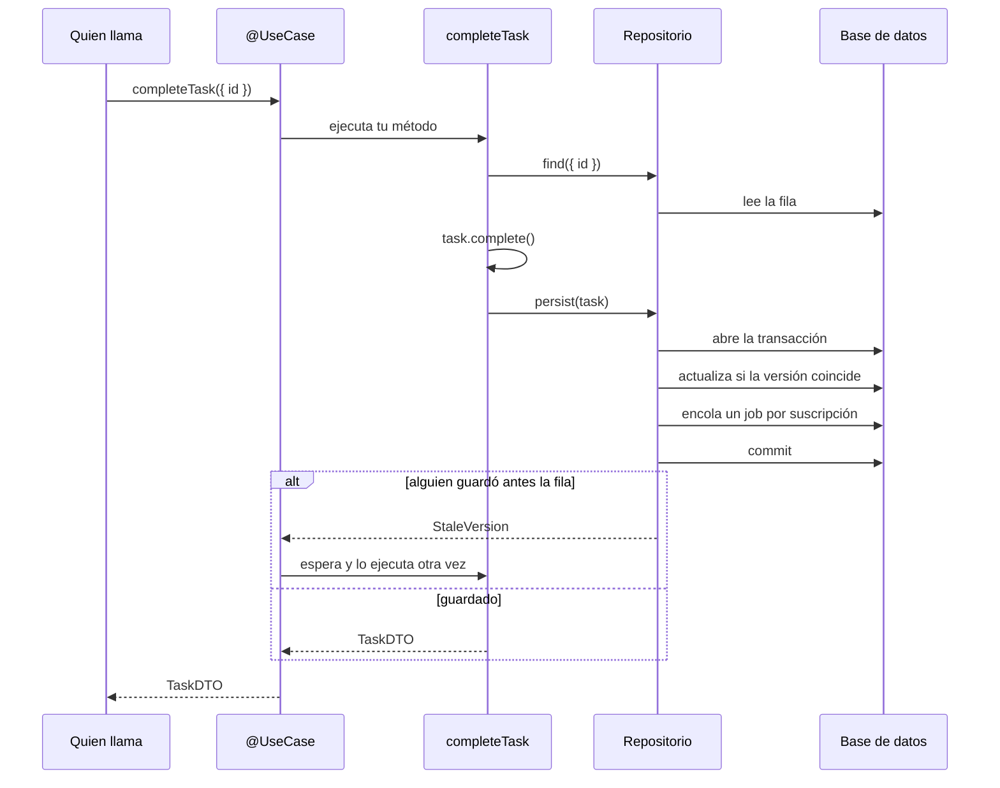

Un caso de uso es una cosa que hace tu app, como crear una tarea o completarla. En código, es un método de un módulo marcado con `@UseCase()`.

Las rutas, los workers, las tareas programadas y los tests llaman a casos de uso. newt ejecuta cada llamada de la misma forma, así que los reintentos, las reglas y las trazas funcionan en todas partes.

## Un caso de uso

`newt add use-case tasks/task complete-task` escribe un método que lee la tarea y la guarda. Todavía no cambia nada: el cambio es la línea que añades tú, aquí `task.complete()` (su código está en [Entidades](/es/concepts/entities/#cambiarla)).

```ts title="src/contexts/tasks/modules/task/task.module.ts"
@UseCase()
async completeTask(input: TaskCompleteTaskDTO): Promise<TaskDTO> {
  const { id } = TaskCompleteTaskSchema.parse(input)
  const [task] = await this.tasks.find(
    TaskFilter.toCriteria<TaskRow>({ id }),
    { limit: 1 },
  )
  if (!task) {
    throw new TaskNotFound()
  }
  task.complete()
  await this.tasks.persist(task)
  return task.toDTO()
}
```

:::caution
Hasta que añadas el cambio, el caso de uso generado no guarda nada ni emite ningún evento. Guardar una entidad que no cambió no escribe nada.
:::

La forma es siempre la misma:

1. Comprueba la entrada con su schema.
2. Lee la entidad a través del repositorio.
3. La cambia con sus propios métodos.
4. La guarda con `persist`.
5. Devuelve un DTO, un objeto plano (ver [Schemas y DTOs](/es/concepts/schemas-and-dtos/)).

## Qué pasa en una llamada

Esto es lo que pasa cuando una ruta, un worker o un test llama a `completeTask`:



## Lo que `@UseCase` hace alrededor de tu método

| Qué | Cómo |
|---|---|
| Le da nombre | `<módulo>.<método>`, como `task.completeTask`, y lo registra, así que `describeApplication` lo lista. |
| Usa el reloj del contexto | Cada "ahora" dentro de él sale del reloj del contexto, que los tests pueden mover. |
| Lo observa | Cada ejecución va a la observabilidad de la plataforma: su traza, su tiempo, sus reintentos. Ver [Logs y observabilidad](/es/concepts/logs/). |
| Lo reintenta ante un conflicto | Cuando dos guardados chocan, ejecuta tu método otra vez. Ver [Reintentos ante un conflicto](#reintentos-ante-un-conflicto). |
| Comprueba la regla de escritura | Un caso de uso guarda solo su propio módulo. Ver [La regla de escritura](#la-regla-de-escritura). |

`@UseCase` **no** abre una transacción. Cada `persist` es una transacción, y los eventos que registró la entidad se guardan en esa misma transacción (ver [Repositorios](/es/concepts/repositories/#guardar)). Para guardar varias entidades del módulo a la vez, pásalas todas a un solo `persist`.

:::tip
`persist([first, second])` guarda las dos o ninguna. Dos llamadas a `persist` son dos transacciones: la primera queda guardada aunque falle la segunda.
:::

Quién ejecuta el caso de uso, el *actor*, sale de la petición o del evento que lo lanzó, y cada evento que publica lo registra. Ver [Actor y scope](/es/concepts/actor-and-scope/).

## Opciones

`@UseCase()` recibe una opción:

| Opción | Por defecto | Qué hace |
|---|---|---|
| `retryOnConflict` | `true` | `false` desactiva los reintentos ante un conflicto, para este caso de uso y para toda la llamada de la que forma parte. |

```ts
@UseCase({ retryOnConflict: false })
async notifyAssignee(input: TaskNotifyAssigneeDTO): Promise<TaskDTO> {
  // ...
}
```

:::caution
Un reintento ejecuta tu método entero otra vez. Si envía un email o llama a otro servicio antes de guardar, eso pasa dos veces. Desactiva los reintentos, o haz ese trabajo en un worker que reaccione a un evento.
:::

## Reintentos ante un conflicto

Dos peticiones pueden cambiar la misma tarea a la vez. El segundo guardado falla entonces con un *conflicto de concurrencia*:

- `StaleVersion`: alguien guardó la fila después de que la leyeras.
- `DuplicateValue`: alguien ocupó mientras tanto un valor único.
- `TransactionConflict`: en Postgres o MySQL, la base de datos rechazó la transacción porque otra se cruzó.

El caso de uso los captura, espera un poco y ejecuta tu método entero otra vez, que vuelve a leer la fila. Cualquier otro error llega directamente a quien llamó.

Lo configuras en la opción `conflictRetries` del contexto:

| Campo | Por defecto | Qué es |
|---|---|---|
| `times` | `3` | Reintentos como máximo, después de la primera ejecución. |
| `duplicates` | `1` | De esos, cuántos pueden seguir a un `DuplicateValue`. Nunca más que `times`. |
| `backoffMs` | `10` | Antes del reintento *n*, espera un tiempo aleatorio de hasta `backoffMs × n` milisegundos. |

```ts
new ContextBase({
  name: 'tasks',
  platform,
  database,
  conflictRetries: { times: 5 },
})
```

Solo reintenta el caso de uso más externo. Cuando un caso de uso llama a otro, un conflicto en el interno sube al externo, que vuelve a empezar desde el principio.

Cuando se acaban los reintentos, el conflicto llega a quien llamó: HTTP responde con `409` (ver [Errores](/es/concepts/errors/)).

## Los casos de uso generados

`newt add module` escribe cuatro casos de uso. Todos los módulos leen igual:

| Caso de uso | Recibe | Devuelve | Si nada coincide |
|---|---|---|---|
| `create(input)` | un `TaskCreateDTO` | el nuevo `TaskDTO` | |
| `get(id)` | un `string`, el id | un `TaskDTO` | lanza `TaskNotFound` |
| `find(criteria, sort?)` | un `TaskFilterDTO`, un `TaskSortDTO` | `TaskDTO[]` | `[]` |
| `paginate(criteria, page)` | un `TaskFilterDTO`, un `PageRequest` | `Page<TaskDTO>`, los más nuevos primero | una página sin elementos |

```ts title="src/contexts/tasks/modules/task/task.module.ts"
@UseCase()
async create(input: TaskCreateDTO): Promise<TaskDTO> {
  const task = Task.create(TaskCreateSchema.parse(input))
  await this.tasks.persist(task)
  return task.toDTO()
}

@UseCase()
async get(id: string): Promise<TaskDTO> {
  const [task] = await this.tasks.find({ id: TaskId.from(id) }, { limit: 1 })
  if (!task) {
    throw new TaskNotFound()
  }
  return task.toDTO()
}

@UseCase()
async find(
  criteria: TaskFilterDTO,
  sort?: TaskSortDTO,
): Promise<TaskDTO[]> {
  const orderBy = TaskFilter.toOrder<TaskRow>(
    sort === undefined ? undefined : TaskFilter.sortSchema.parse(sort),
  )
  const found = await this.tasks.find(
    TaskFilter.toCriteria<TaskRow>(TaskFilter.schema.parse(criteria)),
    { orderBy },
  )
  return found.map(each => each.toDTO())
}

@UseCase()
async paginate(
  criteria: TaskFilterDTO,
  page: PageRequest,
): Promise<Page<TaskDTO>> {
  const found = await this.tasks.paginate(
    TaskFilter.toCriteria<TaskRow>(TaskFilter.schema.parse(criteria)),
    page,
    { newestFirst: true },
  )
  return mapPage(found, each => each.toDTO())
}
```

Una búsqueda por texto tiene su propia forma: `search(text, page)`, donde `text` es un `SearchText` y `page` un `PageRequest`. `get` lee uno por su id; para leer uno por cualquier otro campo, usa `find`. La regla del lint `use-case-reads` mantiene `find`, `get` y `paginate` libres de texto, y `search` con exactamente esos dos parámetros.

## Reglas que mantiene el lint

- **Cada método público de un módulo es un caso de uso** (`use-case-public-methods`). Un método que solo llama el propio módulo es `private`.
- **Las entradas dicen lo que son** (`use-case-params`). Un parámetro es un DTO del schema del módulo o un value object, nunca `unknown`, `any`, un objeto escrito en el sitio, ni un `string`, `number`, `boolean` o `bigint` a secas. Un DTO de entrada (`z.input<typeof XSchema>`) se valida con `XSchema` en el caso de uso, o en un método privado al que se lo pase.

## Llamar a un caso de uso desde otro

Desde el mismo módulo, llámalo sobre `this`:

```ts
const task = await this.get(id)
```

Desde otro módulo del contexto, llámalo sobre el módulo que recibiste como dependencia (ver [Servicios y dependencias](/es/concepts/services-and-deps/)):

```ts
const project = await this.deps.project.get(projectId)
```

La llamada interna forma parte de la externa: una traza, un bucle de reintentos.

### La regla de escritura

Un caso de uso lee cualquier módulo, pero solo guarda el suyo. Si `task.completeTask` llama a un caso de uso de `project` que guarda, ese guardado lanza:

```txt
[write rule] task.completeTask writes to tasks.project outside a worker: write it from a worker reacting to an event
```

Para cambiar un proyecto cuando se completa una tarea, publica un evento desde la tarea y deja que `project` reaccione en un worker (ver [Eventos y suscripciones](/es/concepts/events/)). Así cada módulo guarda en su propia transacción, y un fallo en uno no deshace el otro.

Hay una segunda comprobación que vale también dentro de los workers: una transacción guarda un solo módulo. Guardar dos módulos en una transacción lanza `[write rule] … one module per transaction`.

La opción `writeRule` del contexto dice qué pasa cuando se rompe la regla:

| Valor | Qué pasa |
|---|---|
| `'error'` (por defecto) | El guardado lanza un error. |
| `'warn'` | Escribe un aviso en el log una vez por sitio, y sigue. |
| `'off'` | Nada. |

## Con el CLI

```sh
newt add use-case tasks/task complete-task
```

Añade el método a `task.module.ts`, su schema de entrada a `task.schema.ts` y un test. Rechaza los nombres `find`, `get`, `paginate` y `search`. Para llamarlo por HTTP, añade una ruta con `newt add route`. Ver [`newt add use-case`](/es/reference/cli/add-use-case/) y [`newt add route`](/es/reference/cli/add-route/).

```ts title="src/contexts/tasks/modules/task/task.schema.ts"
export const TaskCompleteTaskSchema = TaskSchema.pick({ id: true })
export type TaskCompleteTaskDTO = z.input<typeof TaskCompleteTaskSchema>
```
