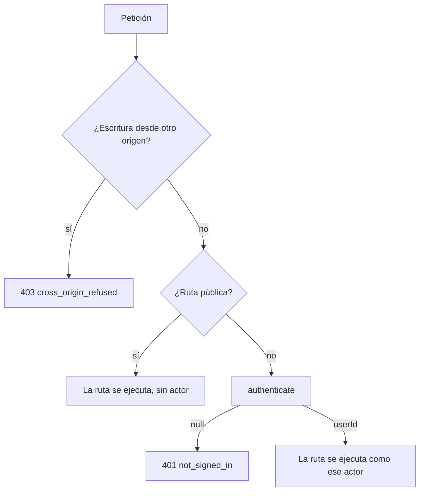

La autenticación es cómo sabe el backend quién envía una petición. En newt es una función, el autenticador de `src/auth.ts`: lee la petición y devuelve el usuario, o `null`.

## El autenticador

`newt init` escribe `src/auth.ts`:

```ts title="src/auth.ts"
import type { Authenticator } from '@newt-js/core/http'

export const authenticate: Authenticator = async () => null
```

Su tipo, de `@newt-js/core/http`:

```ts
type Authenticator = (request: HttpRequest) => Promise<Actor | null>

interface Actor {
  userId: string
}
```

- Devuelve `{ userId }` cuando la petición viene de alguien que reconoces.
- Devuelve `null` cuando no.
- `request` es una `Request` con `request.cookies` (un `Bun.CookieMap`) y `request.params`.

El que se genera devuelve `null`, así que todas las rutas privadas responden 401 hasta que lo escribas.

## Dónde se usa

Cada contexto se lo da a su router, en su `<contexto>.context.ts`:

```ts title="src/contexts/tasks/tasks.context.ts"
const router = new HttpRouter({ database })
router.authenticateWith(authenticate)
```

Todos los contextos importan el mismo `authenticate`, así que una función cubre todo el backend. Un contexto puede llamar a `authenticateWith` con otra.

## Rutas privadas y públicas

Esto es lo que hace el router con cada petición antes de ejecutar tu ruta:



Todas las rutas son privadas por defecto. Antes de ejecutar una ruta privada, el router llama al autenticador:

- Devuelve `{ userId }`: la ruta se ejecuta, con ese usuario como [actor](/es/concepts/actor-and-scope/).
- Devuelve `null`, o no hay autenticador: la ruta no se ejecuta, y la respuesta es un 401.

```json
{"error":"Sign in first","code":"not_signed_in"}
```

Marca una ruta como pública para saltarte el autenticador:

```ts
router.post('/tasks/sign-in', signIn, { public: true })
```

`public` funciona allí donde van las opciones de una ruta:

| Dónde | Se aplica a |
|---|---|
| `router.get(path, route, { public: true })` | una ruta |
| `router.group(prefix, middleware, { public: true })` | todas las rutas del grupo |
| `new HttpRouter({ public: true })` | todas las rutas del router |

- Una ruta pública no tiene actor. `currentActor()` lanza un error ahí; `findCurrentActor()` devuelve `undefined`.
- Una ruta pública no puede ser idempotente: el router lanza un error si registras una con `idempotency`.

:::note
Las rutas de ficheros de `src/stores.ts` son públicas. Sus URLs van firmadas con `FILES_SECRET`, y eso es lo que las deja pasar. Consulta [ficheros](/es/concepts/files/).
:::

## Tokens bearer

`bearerAuthenticator` lee la cabecera `Authorization: Bearer <token>` y pasa el token a tu función:

```ts title="src/auth.ts"
import { bearerAuthenticator } from '@newt-js/core/http'
import { verifyToken } from './verify-token'

export const authenticate = bearerAuthenticator(async token => {
  const userId = await verifyToken(token)
  return userId ? { userId } : null
})
```

- `verifyToken` es tuya: comprueba el token y devuelve el id del usuario, o `null`.
- Sin la cabecera, o con otro esquema, devuelve `null` sin llamar a tu función.
- La palabra `Bearer` se reconoce en mayúsculas o minúsculas.

## Cookies de sesión

Una cookie de sesión encaja con un frontend servido por el mismo backend. Dos funciones la escriben:

```ts
setSessionCookie(request, name, value, { secure, maxAgeSeconds, path })
clearSessionCookie(request, name, { secure, path })
```

| Opción | Significado | Por defecto |
|---|---|---|
| `secure` | enviarla solo por HTTPS | obligatoria |
| `maxAgeSeconds` | cuánto dura | obligatoria |
| `path` | dónde la envía el navegador | `/` |

- La cookie siempre es `HttpOnly` y `SameSite=Lax`.
- `clearSessionCookie` escribe una cookie vacía con una duración de 0.
- Las dos ponen la cookie en `request.cookies`. El router la añade a la respuesta por ti.

Una ruta de inicio de sesión pone la cookie, y el autenticador la lee:

```ts title="src/auth.ts"
import type { Authenticator } from '@newt-js/core/http'
import { userOfSession } from './user-of-session'

export const SESSION_COOKIE = 'session'

export const authenticate: Authenticator = async request => {
  const session = request.cookies.get(SESSION_COOKIE)
  const userId = session ? await userOfSession(session) : null
  return userId ? { userId } : null
}
```

```ts
import { bodyOf, setSessionCookie } from '@newt-js/core/http'

router.post(
  '/tasks/sign-in',
  async request => {
    const session = await signIn(await bodyOf(request))
    setSessionCookie(request, SESSION_COOKIE, session, {
      secure: Bun.env.NODE_ENV === 'production',
      maxAgeSeconds: 60 * 60 * 24 * 30,
    })
    return new Response(null, { status: 204 })
  },
  { public: true },
)
```

`userOfSession` y `signIn` representan tu propio código: cómo compruebas una contraseña o una sesión lo decides tú.

:::caution
Una petición que no sea `GET` desde una página de otro origen se rechaza con un 403 (`cross_origin_refused`), salvo que el `cors` de la ruta permita ese origen y la petición no lleve cookies. Las páginas servidas por el mismo backend no se ven afectadas. Una ruta con `crossOrigin: true` se salta esta comprobación.
:::

## El actor en tu código

Mientras se ejecuta una ruta privada, el usuario que devolvió el autenticador es el actor actual. Sigue siéndolo en cada `await` y en cada caso de uso que llame la ruta.

| Función | Devuelve |
|---|---|
| `currentActor()` | el actor, o lanza `NoActor` (401) |
| `findCurrentActor()` | el actor, o `undefined` |
| `runAsActor(actor, fn)` | ejecuta `fn` como ese actor |

Las tres vienen de `@newt-js/core`.

- El `userId` del actor se guarda con cada evento que emite la petición.
- Los límites de peticiones cuentan por actor por defecto, y por IP cuando no hay.
- Las claves de idempotencia se guardan por actor.

Consulta [actor y scope](/es/concepts/actor-and-scope/).

## Errores

| Error | Estado | `code` | Cuándo |
|---|---|---|---|
| `NotSignedIn` | 401 | `not_signed_in` | ruta privada sin sesión |
| `NoActor` | 401 | `not_signed_in` | `currentActor()` sin actor |
| `CrossOriginRefused` | 403 | `cross_origin_refused` | una escritura desde otro origen |

## En los tests

Los tests de módulo generados dan al router su propio autenticador, que apagan para comprobar el 401:

```ts title="src/contexts/tasks/modules/task/task.module.test.ts"
router = new HttpRouter({ database })
signedIn = true
router.authenticateWith(async () => signedIn ? { userId: 'tester' } : null)
```

Así los tests pasan haga lo que haga `src/auth.ts`. Consulta [testing](/es/guides/testing/).

:::danger
Nunca despliegues un autenticador que acepte un token fijo o a cualquier usuario. Comprueba cada token o sesión contra lo que ha emitido tu backend.
:::
