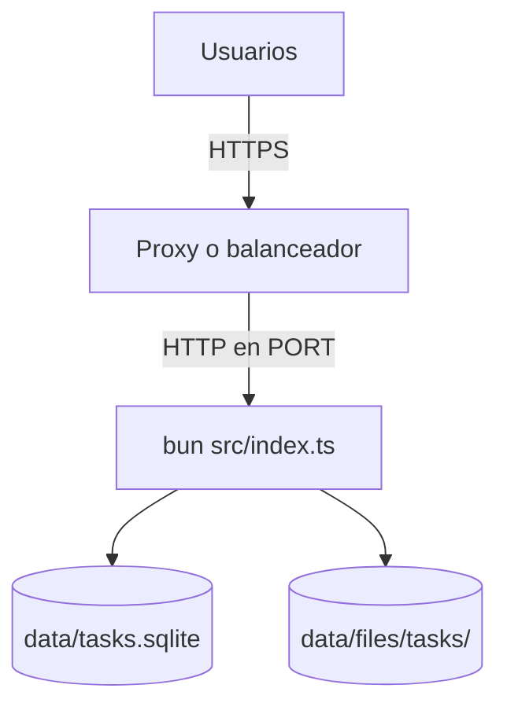

Desplegar un backend de newt consiste en ejecutar `bun src/index.ts` en un servidor, con las variables de entorno correctas y, en SQLite, un disco que sobreviva a los reinicios. No hay paso de compilación: Bun ejecuta tu TypeScript directamente.

## Qué necesitas

- Bun 1.4 o posterior en el servidor, o una imagen de contenedor que lo tenga.
- El código de tu proyecto y sus dependencias (`bun install`).
- Las variables de entorno que necesitan tus almacenes.
- En SQLite o con ficheros locales: una carpeta persistente para `data/`.

Un backend en una sola máquina, con SQLite y ficheros locales, tiene esta forma:



Todo lo que hay en `data/` vive en un volumen persistente.

## 1. Arranca el backend

El `package.json` generado tiene un script `start`:

```json title="package.json"
"scripts": {
  "start": "bun src/index.ts"
}
```

En el servidor:

```sh
bun install --production
bun run start
```

`--production` omite las dependencias de desarrollo (`@newt-js/cli`, el lint, TypeScript): el backend no las necesita para funcionar.

Al arrancar, el backend:

1. Abre la base de datos de cada contexto y ejecuta sus [migraciones](/es/concepts/database/) pendientes. Si una falla, el backend se detiene con el error y no sirve nada.
2. Sirve HTTP en `PORT`.
3. Pone en marcha el worker y las tareas programadas de cada contexto.

:::note
Las migraciones se ejecutan en cada arranque, antes de que el backend sirva. No las ejecutas como un paso aparte.
:::

## 2. Define las variables de entorno

Bun lee `.env` de la carpeta desde la que arrancas, pero en producción lo normal es definir variables de entorno reales en tu proveedor. Un backend con SQLite y ficheros locales necesita:

| Variable | Ejemplo | Qué es |
|---|---|---|
| `PORT` | `3000` | El puerto HTTP; `3000` si no está definida |
| `PUBLIC_URL` | `https://newthub.example.com` | La dirección a la que llegan los usuarios |
| `FILES_SECRET` | 64 caracteres hexadecimales | Firma los enlaces a ficheros |
| `TASKS_DATABASE` | `/app/data/tasks.sqlite` | Una por contexto |
| `TASKS_FILES` | `/app/data/files/tasks` | Una por contexto |

- `PUBLIC_URL` y `FILES_SECRET` son obligatorias con ficheros locales; sin ellas el backend no arranca. `PUBLIC_URL` construye los enlaces a los ficheros subidos, así que debe ser la dirección pública, con `https`.
- `FILES_SECRET` debe tener al menos 32 caracteres. Genera uno con `openssl rand -hex 32`.
- `TASKS_DATABASE` y `TASKS_FILES` valen por defecto `data/tasks.sqlite` y `data/files/tasks`, relativas a la carpeta desde la que arrancas.

Otras configuraciones añaden o cambian variables:

- Postgres o MySQL: `<CONTEXT>_DATABASE_URL` por contexto, obligatoria. Consulta [Postgres](/es/guides/databases/postgres/) y [MySQL](/es/guides/databases/mysql/).
- Ficheros en S3: `S3_ACCESS_KEY_ID`, `S3_SECRET_ACCESS_KEY`, `S3_REGION`, `S3_ENDPOINT` y `<CONTEXT>_S3_BUCKET` por contexto. Consulta [Ficheros](/es/concepts/files/).
- Clúster en Valkey: `VALKEY_URL`. Consulta [Varias instancias](/es/guides/scaling/).

`.env.example` lista todas las variables que lee tu proyecto. [Configuración y variables de entorno](/es/reference/configuration/) explica cada una.

:::danger
Nunca subas `.env` a git ni reutilices en producción el `FILES_SECRET` de desarrollo. Quien tenga el secreto puede firmar enlaces a tus ficheros.
:::

## 3. Guarda data/ en un disco persistente

Con SQLite y ficheros locales, todo lo que guarda tu backend vive en `data/`: un fichero `.sqlite` por contexto (más sus ficheros `-wal` y `-shm`) y `data/files/`. Monta ahí un volumen persistente.

Si tu proveedor da un disco nuevo en cada despliegue, pierdes esos datos en cada despliegue. Usa un volumen, o pasa a [Postgres](/es/guides/databases/postgres/) y ficheros en S3.

Haz copia de seguridad de la carpeta: [SQLite](/es/guides/databases/sqlite/#copia-de-seguridad-en-caliente) explica cómo copiar una base de datos en uso sin riesgo.

## 4. Comprueba la salud

El backend generado sirve una ruta de salud:

```sh
curl https://newthub.example.com/health-check
```

| Estado | Código | Cuerpo |
|---|---|---|
| En marcha | `200` | `{"status":"ok"}` |
| Parándose | `503` | `{"status":"stopping"}` |

Apunta a `/health-check` la comprobación de salud de tu proveedor o de tu balanceador. Cada contexto que sirve rutas responde además la suya, como `/tasks/health-check`.

## 5. Para sin cortar nada

Con `SIGTERM` o `SIGINT` el backend se detiene en orden:

1. La ruta de salud responde `503` y el servidor deja de aceptar conexiones nuevas.
2. Las peticiones en curso terminan, durante hasta 8 segundos.
3. Los workers terminan los jobs en curso, durante hasta 8 segundos. Un job que no acaba a tiempo vuelve a la cola y se ejecuta más tarde.
4. Cada contexto cierra su base de datos.

Tu proveedor solo tiene que enviar `SIGTERM` y esperar unos 30 segundos antes de matar el proceso.

## Un Dockerfile mínimo

```dockerfile title="Dockerfile"
FROM oven/bun:1
WORKDIR /app

COPY package.json bun.lock ./
RUN bun install --frozen-lockfile --production

COPY . .

ENV PORT=3000
EXPOSE 3000
VOLUME /app/data

HEALTHCHECK CMD bun -e "fetch('http://localhost:3000/health-check') \
  .then(r => process.exit(r.ok ? 0 : 1), () => process.exit(1))"

CMD ["bun", "run", "start"]
```

```text title=".dockerignore"
node_modules
data
.env
```

Constrúyelo y ejecútalo con un volumen con nombre para `data/` y las variables en un fichero guardado en el servidor (`production.env`, fuera de git):

```sh
docker build -t newthub .
docker run -d -p 3000:3000 -v newthub-data:/app/data \
  --env-file production.env newthub
```

:::caution
Genera `FILES_SECRET` una vez y guárdalo en la configuración de secretos de tu proveedor. Un secreto nuevo en cada arranque rompe todos los enlaces a ficheros emitidos antes.
:::

## Detrás de un proxy inverso

La mayoría de proveedores ponen un proxy o un balanceador delante de tu backend, que se encarga de HTTPS. Entonces importan estas opciones de `serve` en `src/backend.ts`:

```ts title="src/backend.ts"
return runContexts(contexts, {
  platformWithoutContexts: platform,
  serve: { port, health: true, trustProxy: 1, drainMs: 5000 },
})
```

- `trustProxy`: cuántos proxies hay delante del backend. Con `1`, newt toma la IP de quien llama de `X-Forwarded-For` y el host de `X-Forwarded-Host`. Sin ella, todas las peticiones parecen venir del proxy, y los [límites de peticiones](/es/concepts/http/) por IP cuentan a todo el mundo junto. `0` por defecto.
- `drainMs`: al parar, cuánto tiempo seguir sirviendo mientras la ruta de salud ya responde `503`, para que el balanceador deje de enviar tráfico antes. `0` por defecto.
- `hsts`: `true` añade la cabecera `Strict-Transport-Security` (un año). Úsala cuando tu sitio se sirva solo por HTTPS.

:::caution
Pon en `trustProxy` solo el número de proxies que tienes de verdad. Si es mayor, quien llama puede falsear su IP con su propia cabecera `X-Forwarded-For`.
:::

## Un contexto en su propio host

Cada contexto responde bajo su nombre en la dirección del backend: `https://midominio.com/backoffice/api/…`. Dale un host a un contexto, y responderá ahí, en sus propias rutas:

```sh
BACKOFFICE_HOST=backoffice.midominio.com
```

| URL | Quién responde |
|---|---|
| `https://backoffice.midominio.com/api/orders` | la API de `backoffice` |
| `https://backoffice.midominio.com/orders/12` | la app de `backoffice` |
| `https://backoffice.midominio.com/health-check` | la salud de `backoffice` |
| `https://midominio.com/shop/api/products` | `shop`, que no tiene host |
| `https://midominio.com/backoffice/api/orders` | nadie: `404` |
| `https://midominio.com/health-check` | la salud de todo el backend |

- Un contexto responde en su host o bajo su nombre, nunca en los dos.
- Apunta el DNS del host al mismo servidor. Detrás de un proxy, define `trustProxy`: newt lee el host de `X-Forwarded-Host`.
- Dos contextos en el mismo host paran el backend antes de arrancar.
- Con ficheros locales, sus enlaces se firman en su host, con el protocolo de `PUBLIC_URL`.
- Su app generada (`app/base.ts`) encuentra su base sola. Una app compilada aparte se compila para `/` en lugar de `/<contexto>/`.
- Apunta la comprobación de salud del balanceador a una dirección que no sea el host de un contexto, como la del propio servidor.

El `<contexto>.context.ts` generado lee la variable y la entrega para ejecutarse, junto a su router: `host: Bun.env.BACKOFFICE_HOST`.

## Frontends

Un backend sirve las apps de sus contextos desde el mismo proceso. Cómo se construye y se sirve cada uno está en [Añadir un frontend](/es/guides/frontend/).
