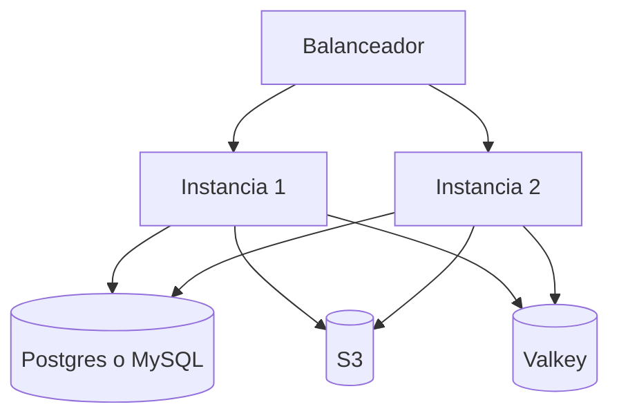
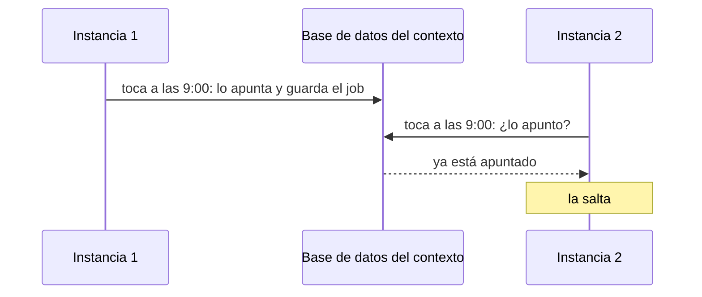

Ejecutar varias instancias consiste en arrancar el mismo backend más de una vez, normalmente en máquinas distintas detrás de un balanceador. Te da más capacidad y mantiene la aplicación en pie cuando cae una máquina, siempre que todas las instancias vean los mismos datos.

## Qué hay que compartir

Todas las instancias ejecutan el mismo código y llegan a los mismos tres servicios:



| Qué | Una instancia | Varias instancias |
|---|---|---|
| Base de datos | SQLite | Postgres o MySQL |
| Ficheros | Carpeta local | S3 |
| Clúster | `MemoryCluster` | `ValkeyCluster` |

- Base de datos: todas las instancias deben leer y escribir la misma base de datos. Un fichero SQLite vive en el disco de una máquina, así que usa [Postgres](/es/guides/databases/postgres/) o [MySQL](/es/guides/databases/mysql/).
- Ficheros: un fichero subido a través de una instancia debe poder leerse desde las demás. Una carpeta local está en un solo disco; usa S3 o un servicio que hable su API. Consulta [Ficheros](/es/concepts/files/).
- Clúster: el pequeño estado compartido que permite a las instancias hablar entre sí. Usa Valkey, como se explica en [El clúster](#el-clúster).

:::tip
Puedes empezar en una máquina con SQLite y cambiar más tarde. [Cambiar de base de datos](/es/guides/databases/switching/) explica la parte de la base de datos.
:::

## Crear un backend preparado para varias instancias

Pasa las tres opciones a `newt init`:

```sh
newt init newthub --db postgres --files s3 --cluster valkey
```

| Opción | Valores | Por defecto |
|---|---|---|
| `--db` | `sqlite`, `postgres`, `mysql`, `memory` | `sqlite` |
| `--files` | `local`, `s3`, `memory` | `local` |
| `--cluster` | `memory`, `valkey` | `memory` |

`newt add backend` acepta las mismas opciones.

## El clúster

El clúster es lo que comparten las instancias de un backend fuera de la base de datos. newt lo usa para dos cosas:

1. Despertar workers. Cuando un caso de uso guarda jobs nuevos, la instancia avisa a las demás a través del clúster, y sus workers buscan trabajo al momento.
2. Límites de peticiones. Cada [límite de peticiones](/es/concepts/http/) cuenta en el clúster, así que el límite se cumple entre todas las instancias.

newt ofrece dos clústeres:

| Clúster | Import | Para |
|---|---|---|
| `MemoryCluster` | `@newt-js/core/cluster/memory` | Una instancia, y tests |
| `ValkeyCluster` | `@newt-js/core/cluster/valkey` | Varias instancias |

Una `Platform` sin clúster usa un `MemoryCluster`, así que `new Platform()` es un backend de una sola instancia.

Con `MemoryCluster` en varias instancias no se rompe nada, pero:

- Cada instancia cuenta sus propios límites: con 3 instancias, un límite de 10 deja pasar hasta 30 peticiones.
- La instancia que guarda jobs nuevos los ejecuta al momento, pero las demás solo los ven en su siguiente vistazo, cada 5 segundos.

### Usar Valkey

Valkey es un almacén en memoria muy rápido que habla el protocolo de Redis. `--cluster valkey` escribe esto en `src/backend.ts`:

```ts title="src/backend.ts"
import { MemoryCluster } from '@newt-js/core/cluster/memory'
import { ValkeyCluster } from '@newt-js/core/cluster/valkey'

export async function startBackend(
  port: number,
  { stores = 'configured' }: { stores?: Stores } = {},
): Promise<RunningContexts> {
  const platform = new Platform({
    cluster:
      stores === 'memory'
        ? new MemoryCluster()
        : new ValkeyCluster(Bun.env.VALKEY_URL),
  })
  const contexts = await openContexts(platform, stores)
  return runContexts(contexts, {
    platformWithoutContexts: platform,
    serve: { port, health: true },
  })
}
```

Y esto en `.env`:

```sh title=".env"
VALKEY_URL=redis://localhost:6379
```

- `new ValkeyCluster(url?, options?)` recibe la URL del servidor y, si quieres, las opciones del cliente de Redis de Bun.
- Si se cae la conexión, vuelve a conectar solo y deja un aviso en el log.
- Los tests siguen con `MemoryCluster`: `stores: 'memory'` nunca necesita Valkey.

Para añadir Valkey a un backend que ya existe, cambia `src/backend.ts` como se muestra y añade `VALKEY_URL` a `.env` y a `.env.example`.

:::note
El clúster no guarda datos que necesites conservar: contadores que caducan y mensajes para despertar workers. Perder el servidor Valkey no te hace perder ningún dato.
:::

## Qué mantiene newt correcto entre instancias

Esto funciona sin nada más, siempre que las instancias compartan la base de datos:

- Cada job se ejecuta en una sola instancia. Un worker toma un job con un plazo de reserva (60 segundos, renovado mientras se ejecuta). Si una instancia muere a mitad de un job, otra lo toma cuando vence el plazo.
- Cada tarea programada se ejecuta una vez por cada hora que le toca. Antes de lanzarla, una instancia apunta esa hora en la base de datos del contexto; las demás ven que ya está tomada y la saltan.
- Las migraciones se ejecutan una vez. Todas las instancias las ejecutan al arrancar, pero newt toma un bloqueo mientras migra, así que solo la primera las aplica.
- Las claves de idempotencia se guardan en la base de datos, así que una petición repetida se reconoce llegue a la instancia que llegue.

Así se ponen de acuerdo dos instancias con una tarea programada para las 9:00:



:::caution
Una tarea programada se ejecuta una sola vez solo si todas las instancias usan la misma base de datos. Instancias con sus propios ficheros SQLite la ejecutarían cada una.
:::

## Lista de comprobación

1. Cada contexto en Postgres o MySQL, con el mismo `<CONTEXT>_DATABASE_URL` en todas las instancias.
2. Ficheros en S3, con las mismas variables del bucket en todas las instancias.
3. `ValkeyCluster`, con el mismo `VALKEY_URL` en todas las instancias.
4. Las mismas variables restantes y los mismos secretos en todas las instancias.
5. Un balanceador que compruebe `/api/health`, y `trustProxy` definido en `src/backend.ts`. Consulta [Desplegar](/es/guides/deploy/#detrás-de-un-proxy-inverso).
