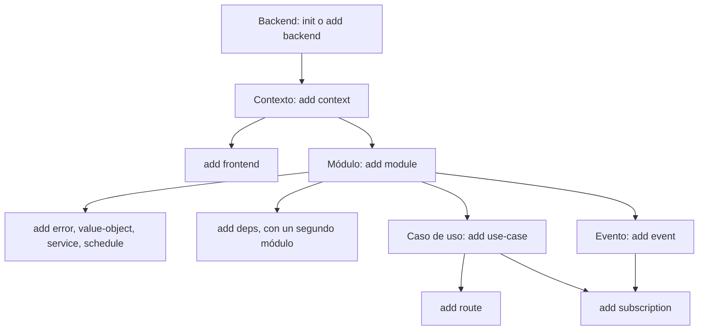

`newt` es la línea de comandos que crea un proyecto y le añade piezas: contextos, módulos, casos de uso, rutas, eventos y más. Lo usas cada vez que añades una pieza, y escribe el código tal como lo espera el lint de newt.

## Cómo ejecutarlo

| Dónde estás | Comando |
|---|---|
| Aún sin proyecto | `bun create newt <nombre>` o `bunx @newt-js/cli init <nombre>` |
| Dentro de un proyecto, tras `bun install` | `bunx newt <comando>` |

`bun create newt <nombre>` ejecuta `newt init <nombre>` con los mismos flags. Todo proyecto tiene `@newt-js/cli` como devDependency, así que `bunx newt` ejecuta la versión que instaló el proyecto.

:::caution
Fuera de un proyecto, usa `bunx @newt-js/cli`, no `bunx newt`: el paquete de npm llamado `newt` es otro distinto.
:::

Cuando un `newt` de otro sitio se ejecuta dentro de un proyecto que tiene `node_modules/@newt-js/cli`, le pasa el comando a la copia del proyecto. Si esa copia no puede ejecutarse, avisa y se ejecuta él.

Estas páginas escriben `newt <comando>` para abreviar.

## Comandos

| Comando | Qué hace |
|---|---|
| [`newt init`](/es/reference/cli/init/) | Crea un backend, o un monorepo con un primer backend |
| [`newt add backend`](/es/reference/cli/add-backend/) | Añade un backend a un monorepo |
| [`newt add context`](/es/reference/cli/add-context/) | Añade un contexto, con su propia base de datos y sus ficheros |
| [`newt add module`](/es/reference/cli/add-module/) | Añade un módulo: entidad, casos de uso, rutas, tabla, test |
| [`newt add use-case`](/es/reference/cli/add-use-case/) | Añade un caso de uso a un módulo |
| [`newt add route`](/es/reference/cli/add-route/) | Añade una ruta que llama a un caso de uso |
| [`newt add event`](/es/reference/cli/add-event/) | Añade un evento a un módulo |
| [`newt add subscription`](/es/reference/cli/add-subscription/) | Ejecuta un caso de uso cuando ocurre un evento |
| [`newt add schedule`](/es/reference/cli/add-schedule/) | Ejecuta un caso de uso según un cron |
| [`newt add error`](/es/reference/cli/add-error/) | Añade un error con su estado HTTP |
| [`newt add value-object`](/es/reference/cli/add-value-object/) | Añade un value object, su error y su test |
| [`newt add service`](/es/reference/cli/add-service/) | Añade una función que comparten los casos de uso |
| [`newt add deps`](/es/reference/cli/add-deps/) | Deja que un módulo use otro módulo de su contexto |
| [`newt add frontend`](/es/reference/cli/add-frontend/) | Añade un frontend React servido en `/<contexto>` |

### Qué necesita cada comando antes

Cada flecha va de lo que un comando necesita a ese comando. Un módulo nuevo ya trae algunos casos de uso (`create`, `get`…) y el evento `created`, así que `add route` y `add subscription` pueden no necesitar `add use-case` ni `add event` antes.



## Flags globales

| Flag | Dónde | Qué hace |
|---|---|---|
| `-h`, `--help` | en cualquier sitio | Imprime la ayuda: la general, la del comando si va tras él, o la de un grupo tras su primera palabra (`newt add --help`) |
| `-v`, `--version` | sin comando | Imprime la versión |
| `--json` | cualquier comando | Imprime el resultado en JSON y nunca pregunta |
| `--dry-run` | cualquier comando | Dice qué cambiaría, sin escribir nada |

- `--json` y `--dry-run` también pueden ir antes del comando: `newt --json add module tasks/task`.
- Todas las opciones se comprueban: una desconocida, o una repetida, es un error.
- Un comando que no recibe argumentos rechaza los que le des.

## Qué imprime un comando

Un comando lista cada fichero que tocó, y luego sus avisos y sus siguientes pasos:

```text
  created  src/contexts/chat/chat.context.ts
  created  src/contexts/chat/chat-modules.ts
  created  src/contexts/chat/migrations/.gitkeep
  skipped  src/auth.ts (already exists)
  updated  .env
  updated  .env.example
  updated  src/contexts.ts

Next steps:
  bun run dev
```

| Estado | Con `--dry-run` | Significa |
|---|---|---|
| `created` | `will create` | Un fichero nuevo |
| `updated` | `will update` | Un fichero que cambió |
| `removed` | `will remove` | Un fichero que se quitó |
| `skipped` | `will skip` | Se dejó como estaba, con una nota del porqué |

Con `--dry-run` la lista empieza por `Dry run: nothing was written.` Si no hay nada que cambiar, imprime `Nothing to do.`

## La salida de `--json`

Si todo va bien, en stdout:

```json
{
  "dryRun": false,
  "files": [
    { "path": "src/contexts/chat/chat.context.ts", "status": "created" },
    { "path": "src/auth.ts", "status": "skipped", "note": "already exists" }
  ],
  "warnings": [],
  "nextSteps": ["bun run dev"]
}
```

Si falla, también en stdout, con código de salida 1:

```json
{
  "error": "The backend has no context chat: add it with newt add context chat"
}
```

- Las rutas son relativas a la carpeta donde ejecutas el comando.
- `note` solo aparece cuando el comando tiene una: `already exists`, `up to date`…
- `newt --json --version` imprime `{ "version": "<versión>" }`, y `newt --json --help` imprime `{ "help": "<texto>" }`.

## Códigos de salida

| Código | Significa |
|---|---|
| `0` | Hecho, o ayuda o versión impresas |
| `1` | Rechazado o fallido: no se escribió nada |

Sin `--json`, el mensaje de un fallo va a stderr.

## Reglas que siguen todos los comandos

- **Todo o nada.** Un comando prepara primero todos los cambios en memoria. Si uno no se puede hacer, o dejaría un fichero con errores de sintaxis, no escribe nada y dice por qué.
- **Nunca sobrescribe.** Un fichero que ya existe se salta (`already exists`). Una variable que ya está en `.env` conserva su valor. Ejecutar un comando dos veces no cambia nada la segunda.
- **Solo pregunta en una terminal.** Solo `newt init` sin nombre hace preguntas, y solo en una terminal interactiva y sin `--json`.
- **Encuentra el backend.** Los comandos trabajan sobre el backend en el que estás. En la raíz de un monorepo con un backend, usan ese; con varios, añade `--backend <carpeta>`.

Un backend es una carpeta cuyo `package.json` depende de `@newt-js/core` y que tiene `src/backend.ts`. Si no encuentra ninguno, el comando se detiene y lo dice:

- `This is not a newt backend` — no hay backend aquí ni en una carpeta superior; crea uno con `newt init`.
- `This monorepo has no newt backend` — añade uno con `newt add backend`.
- `Which backend?` — el monorepo tiene varios; añade `--backend`.
- `<folder> is not a newt backend` — la carpeta que diste a `--backend` no lo es.
- `package.json is not JSON` — arréglalo y vuelve a ejecutar el comando.

:::tip
Ejecuta cualquier comando primero con `--dry-run` para ver qué ficheros tocaría.
:::
