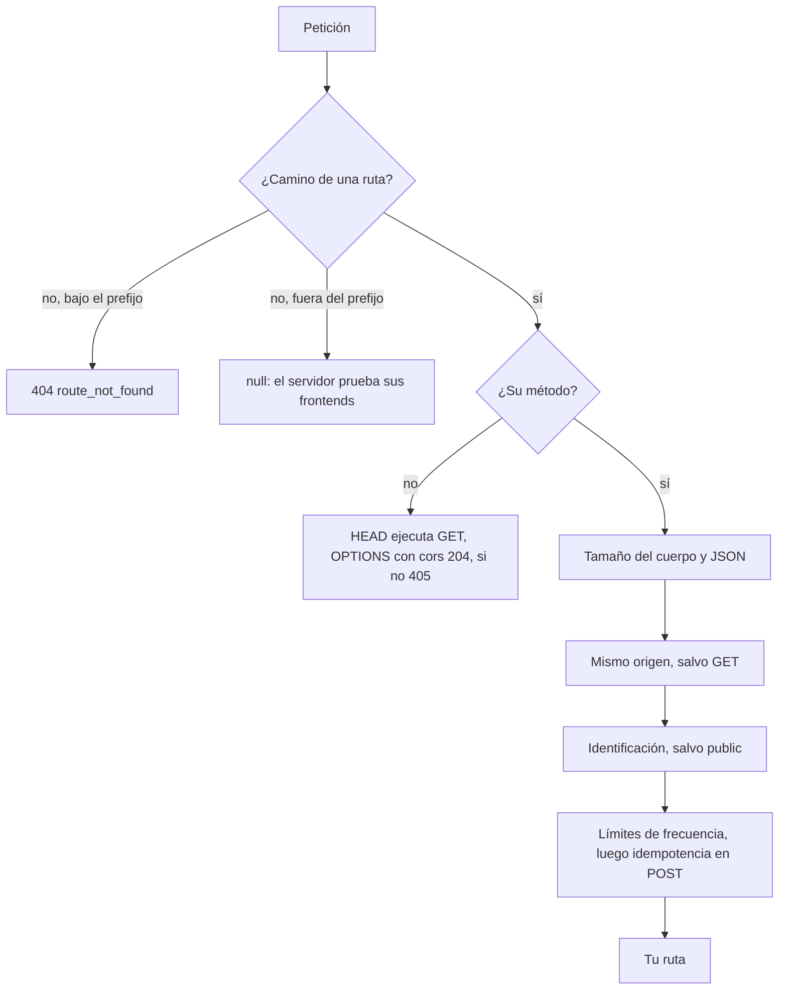

`@newt-js/core/http` es la parte de newt que convierte peticiones HTTP en llamadas a tus casos de uso y ejecuta tus contextos en un servidor de Bun. Te sirve cuando escribes rutas o cambias cómo arranca el servidor. Para las ideas que hay detrás, lee [HTTP y rutas](/es/concepts/http/).

```ts
import {
  HttpRouter,
  bodyOf,
  pageRequestFrom,
  runContexts,
} from '@newt-js/core/http'
```

## HttpRouter

Las rutas de un contexto. Cada contexto tiene su propio router.

```ts title="src/contexts/tasks/tasks.context.ts"
const router = new HttpRouter({ prefix: '/tasks/api', database })
router.authenticateWith(authenticate)
```

### Opciones del constructor

`new HttpRouter(options?: HttpRouterOptions)`. `HttpRouterOptions` son todas las [opciones de ruta](#opciones-de-ruta) (valen como valor por defecto de cada ruta) y además:

| Opción | Tipo | Por defecto | Qué hace |
|---|---|---|---|
| `prefix` | `string` | `'/api'` | Va delante de cada ruta. El router de un contexto lleva `/<contexto>/api`. `''` para ninguno. |
| `database` | `Pick<Database, 'records'>` | ninguna | Guarda las respuestas de las rutas idempotentes (tabla `newt_idempotency_key`). Obligatoria si alguna ruta es idempotente. |
| `clock` | `Clock` | reloj del sistema | La hora con la que caducan las claves de idempotencia. |

### Métodos

| Miembro | Firma | Qué hace |
|---|---|---|
| `prefix` | `readonly string` | El prefijo dado, o `'/api'`. |
| `authenticateWith` | `(authenticator: Authenticator) => void` | Indica quién identifica las peticiones. Sin él, toda ruta privada responde 401. |
| `get` `post` `put` `patch` `delete` | `(path, route: HttpRoute<Path>, options?: RouteOptions) => void` | Registra una ruta. Lanza un error si el mismo método y ruta se registran dos veces. |
| `group` | `(prefix, middleware: Middleware<Prefix>, options?: RouteOptions) => HttpGroup<Prefix>` | Rutas bajo un mismo camino que comparten middleware y opciones. |
| `answer` | `(request: Request) => Promise<Response> \| null` | Responde a una petición. `null` si ninguna ruta coincide y el camino está fuera del prefijo. |
| `match` | `(request: Request) => PathPattern \| null` | El patrón de la ruta a la que llegaría una petición. |
| `paths` | `() => string[]` | Todos los caminos registrados, más el prefijo y `prefijo/*`. |
| `largestBody` | `() => number` | El mayor `maxBodyBytes` de sus rutas. |

Con `answer` también llaman los tests de módulo a las rutas sin servidor:

```ts
const response = await router.answer(
  new Request(`http://backend.test/tasks/api/tasks/${id}`),
)
```

### Caminos

| Pieza | Ejemplo | Coincide con |
|---|---|---|
| Fija | `/tasks` | Ese segmento exacto. |
| Parámetro | `/tasks/:id` | Un segmento no vacío, que lees en `request.params.id` (ya decodificado). |
| Resto | `/files/*` | Uno o más segmentos. Solo al final. |

Un camino empieza por `/` (o es `''`). Si coinciden varias rutas, gana el segmento fijo sobre el parámetro, y el parámetro sobre `*`.

Lo que el router responde por su cuenta:

| Caso | Respuesta |
|---|---|
| Camino bajo el prefijo sin ruta | 404, código `route_not_found` |
| Camino conocido, método no registrado | 405, código `method_not_allowed`, con cabecera `Allow` |
| `HEAD` en un camino con `GET` | La respuesta del `GET` sin cuerpo |
| `OPTIONS` en una ruta con `cors` | 204 con las cabeceras CORS de la petición previa (*preflight*) |

Este es el orden de las comprobaciones por las que pasa una petición, del router a tu ruta:



Cualquier error lanzado por el camino se convierte en respuesta con el `onError` de la ruta. [Lo que hace cada ruta](#lo-que-hace-cada-ruta) lista cada paso.

### HttpGroup

`router.group(prefix, options?)` devuelve un `HttpGroup` con `get`, `post`, `put`, `patch` y `delete`, con las mismas firmas que el router. Cada camino es el prefijo del grupo más el suyo. Sus opciones son las [de sus rutas](#opciones-de-ruta) más `middleware`, que se ejecuta después de identificar al usuario y antes de la ruta:

```ts
const reports = router.group('/reports', {
  middleware: async (request, next) => {
    const response = await next()
    return response
  },
  maxBodyBytes: 64 * 1024,
})
reports.get('/overdue', async () => Response.json({ items: [] }))
```

`Middleware<Prefix> = (request: HttpRequest<Prefix>, next: () => Promise<Response>) => Response | Promise<Response>`.

## Opciones de ruta

Las `RouteOptions` van en una ruta, un grupo o el router. Las de la ruta ganan a las del grupo, y las del grupo a las del router. Los límites de frecuencia, en cambio, se suman: mira [`rateLimit`](#límites-de-frecuencia).

| Opción | Tipo | Por defecto | Qué hace |
|---|---|---|---|
| `public` | `boolean` | `false` | Cualquiera puede llamarla: no pide identificarse. |
| `maxBodyBytes` | `number` | `1048576` (1 MiB) | Cuerpo más grande que acepta. Más largo → 413. |
| `rateLimit` | `HttpRateLimit \| HttpRateLimit[] \| false` | ninguno | Limita cuántas veces se llama. `false` quita los del router y el grupo. |
| `idempotency` | `true \| { ttlMs?: number } \| false` | `false` | Un `POST` enviado dos veces con la misma `Idempotency-Key` se ejecuta una vez. |
| `cors` | `Cors` | ninguno | Deja que páginas de otros orígenes la llamen. |
| `crossOrigin` | `boolean` | `false` | Desactiva la comprobación de mismo origen en esta ruta. |
| `onError` | `ErrorHandler` | `toErrorResponse` | Convierte un error lanzado en una respuesta. |

```ts
router.put(`${path}/*`, request => storage.handler(request), {
  public: true,
  maxBodyBytes: 100 * 1024 * 1024,
})
```

### Lo que hace cada ruta

Cada ruta registrada se envuelve, de fuera hacia dentro:

1. Pone `cache-control: no-store` si la respuesta no trae `cache-control`.
2. Añade a la respuesta las cookies puestas en `request.cookies`.
3. Añade las cabeceras CORS (si hay `cors`).
4. Comprueba el tamaño del cuerpo, lee el JSON y convierte los errores en respuestas.
5. Comprobación de mismo origen, en todos los métodos menos `GET` (salvo con `crossOrigin`).
6. Identificación, salvo con `public`.
7. Límites de frecuencia.
8. Idempotencia, solo en `POST`.

### Comprobación de mismo origen

Una petición que cambia algo (`POST`, `PUT`, `PATCH`, `DELETE`) se rechaza con 403 `cross_origin_refused` si viene de una página de otro origen, salvo que el `cors` de la ruta permita ese origen y la petición no lleve cookies. Cuenta como mismo origen si `Sec-Fetch-Site` es `same-origin` o `none`, si no trae cabecera `Origin`, o si el host de `Origin` es el host de la petición.

### Cors

```ts
type Cors = {
  origin: '*' | string[]
  headers?: string[]
  expose?: string[]
  maxAge?: number
}
```

| Campo | Por defecto | Qué hace |
|---|---|---|
| `origin` | — | `'*'` o los orígenes permitidos. Con una lista, las respuestas llevan `Vary: origin`. |
| `headers` | ninguno | Cabeceras de petición permitidas (`Access-Control-Allow-Headers`). |
| `expose` | ninguno | Cabeceras de respuesta que la página puede leer (`Access-Control-Expose-Headers`). |
| `maxAge` | `86400` | Segundos que el navegador guarda la respuesta previa. |

### Límites de frecuencia

```ts
type HttpRateLimit = {
  limit: RateLimit
  by?: 'actor' | 'ip' | ((request: HttpRequest) => string | null)
}
```

| `by` | Cuenta por |
|---|---|
| `'actor'` (por defecto) | Usuario identificado; la IP del cliente si no hay nadie. |
| `'ip'` | IP del cliente (mira `trustProxy` en las [opciones de serve](#opciones-de-serve)). |
| función | La clave que devuelve; `null` se salta este límite. |

Un `RateLimit` se crea con `base.rateLimits.define('<módulo>.<nombre>', { limit, windowMs })` (mira [@newt-js/core](/es/reference/core/)). Se aplican los límites del router, del grupo y de la ruta; uno con el mismo nombre cuenta una vez. Las respuestas llevan `ratelimit-limit` y `ratelimit-remaining` del límite más cercano a agotarse. Al pasarse → 429 `too_many_requests` con cabecera `retry-after` en segundos.

```ts
const create = base.rateLimits.define('task.create', {
  limit: 10,
  windowMs: 60_000,
})
router.post('/tasks', route, { rateLimit: { limit: create } })
```

### Idempotencia

Con `idempotency` en una ruta `POST`, el cliente puede enviar la cabecera `Idempotency-Key`. Se guarda la primera respuesta y se devuelve igual a cada reintento con la misma clave.

| Regla | Valor |
|---|---|
| Se aplica a | Rutas `POST`, con cabecera `Idempotency-Key`, de un usuario identificado. Si no, la ruta se ejecuta como siempre. |
| La clave es por | Usuario + camino + clave. |
| Se guarda durante | `ttlMs`, 24 horas por defecto. |
| Respuesta repetida | Mismo estado, cuerpo y cabeceras principales, más `idempotent-replayed: true`. |
| No se guardan | Las 5xx (la clave queda libre para reintentar). |
| Se guardan sin cuerpo | Las de más de 1 MiB o `text/event-stream`: un reintento recibe 409 `idempotency_answer_not_kept`. |
| Misma clave, otro cuerpo | 422 `idempotency_key_reused`. |
| Misma clave, la primera aún en curso | 409 `idempotency_key_in_use`. |

:::caution
Registrar una ruta idempotente lanza un error si el router no tiene `database` o si la ruta es `public`. Pasa `database` a `new HttpRouter` antes de activar `idempotency`.
:::

## Peticiones

### HttpRequest

```ts
type HttpRequest<Path extends string = string> = Request & {
  readonly params: ParamsOf<Path>
  readonly cookies: Bun.CookieMap
}
```

`params` toma su tipo del camino: `'/tasks/:id'` da `{ id: string }`. `HttpRoute<Path> = (request: HttpRequest<Path>) => Response | Promise<Response>`. `HttpMethod = 'GET' | 'POST' | 'PUT' | 'PATCH' | 'DELETE'`.

Dentro de una ruta, `request.json()` lanza 415 `unsupported_media_type` si el `content-type` no es JSON (`application/json` o `application/*+json`), y 400 `malformed_body` si el JSON no se puede leer. `request.formData()` lanza 400 `malformed_body` si no se puede leer.

### Ayudas para la entrada

| Función | Firma | Devuelve |
|---|---|---|
| `bodyOf` | `(request: Request) => Promise<Unchecked>` | El cuerpo JSON, sin comprobar: lo comprueba el schema de tu caso de uso. |
| `queryOf` | `(request: Request) => Unchecked` | La query string como objeto plano. |
| `pageRequestFrom` | `(request: Request) => PageRequest` | `{ size, cursor }` a partir de `?size=&cursor=`. `size` vale 20 por defecto y se queda entre 1 y 100. |
| `clientIp` | `(request: Request) => string \| null` | La IP del cliente, tal como la vio el servidor (mira `trustProxy`). |
| `requestHost` | `(request: Request) => string \| null` | El host pedido, en minúsculas (`X-Forwarded-Host` si es de confianza). |

`Unchecked` es `any`.

```ts title="src/contexts/tasks/modules/task/task.routes.ts"
router.post('/tasks', async request =>
  Response.json(await tasks.create(await bodyOf(request)), {
    status: 201,
  }),
)
router.get('/tasks', async request =>
  Response.json(await tasks.paginate({}, pageRequestFrom(request))),
)
```

## Identificación

| Export | Firma | Qué hace |
|---|---|---|
| `Authenticator` | `(request: HttpRequest) => Promise<Actor \| null>` | Dice quién llama. `null` es nadie: las rutas privadas responden 401 `not_signed_in`. |
| `bearerAuthenticator` | `(verify: (token: string) => Promise<Actor \| null>) => Authenticator` | Lee `Authorization: Bearer <token>` y pasa el token a `verify`. |
| `setSessionCookie` | `(request, name, value, { secure, maxAgeSeconds, path?, domain? }) => void` | Pone una cookie `HttpOnly` y `SameSite=Lax`. `path` vale `/` por defecto. |
| `clearSessionCookie` | `(request, name, { secure, path? }) => void` | Borra esa cookie. |
| `SessionCookieOptions` | `{ secure: boolean, maxAgeSeconds: number, path?: string, domain?: string | undefined }` | |

```ts title="src/auth.ts"
export const authenticate: Authenticator = async () => null
```

:::note
El `authenticate` que `newt init` escribe en `src/auth.ts` devuelve `null` hasta que lo completas, así que toda ruta que no sea `public` responde 401.
:::

Mira [Autenticación](/es/guides/authentication/).

## Errores y códigos de estado

Un error lanzado se convierte en una respuesta JSON según su `kind`:

| `kind` | Estado | Lo lanzan (ejemplos) |
|---|---|---|
| `validation` | 400 | `ValidationError`, `MalformedBody` |
| `unauthorized` | 401 | `UnauthorizedError`, `NotSignedIn` |
| `forbidden` | 403 | `ForbiddenError`, `CrossOriginRefused` |
| `not_found` | 404 | `NotFoundError`, `RouteNotFound` |
| `method_not_allowed` | 405 | `MethodNotAllowed` |
| `conflict` | 409 | `ConflictError`, `IdempotencyKeyInUse`, `IdempotencyAnswerNotKept` |
| `too_large` | 413 | `PayloadTooLarge` |
| `unsupported_media_type` | 415 | `UnsupportedMediaType` |
| `unprocessable` | 422 | `IdempotencyKeyReused` |
| `too_many_requests` | 429 | `TooManyRequests` (añade `retry-after`) |

Un error de zod (`ZodError`) responde 400 con código `validation` y sus `issues`. Cualquier otro error responde 500 `{ "error": "Something went wrong", "code": "internal" }` y queda en el log.

```ts
type ErrorBody = {
  error: string
  code: string
  params?: Record<string, unknown>
  issues?: unknown[]
}
```

```json
{ "error": "There is no such task", "code": "task.not_found" }
```

### Errores de este paquete

| Clase | Estado | `code` | `params` |
|---|---|---|---|
| `MalformedBody` | 400 | `malformed_body` | |
| `NotSignedIn` | 401 | `not_signed_in` | |
| `CrossOriginRefused` | 403 | `cross_origin_refused` | |
| `RouteNotFound` | 404 | `route_not_found` | `method`, `path` |
| `MethodNotAllowed` | 405 | `method_not_allowed` | `method`, `path` |
| `IdempotencyKeyInUse` | 409 | `idempotency_key_in_use` | |
| `IdempotencyAnswerNotKept` | 409 | `idempotency_answer_not_kept` | `status` |
| `PayloadTooLarge` | 413 | `payload_too_large` | `maxBytes` |
| `UnsupportedMediaType` | 415 | `unsupported_media_type` | |
| `IdempotencyKeyReused` | 422 | `idempotency_key_reused` | |

### Funciones de errores

| Export | Firma | Qué hace |
|---|---|---|
| `toErrorResponse` | `(error: unknown) => Response` | El `onError` por defecto, con la correspondencia de [Errores y códigos de estado](#errores-y-códigos-de-estado). |
| `toOauthErrorResponse` | `(error, fallback: string, codes?: Record<string, string>) => Response` | La misma correspondencia, pero con cuerpo OAuth `{ error, error_description }` y `cache-control: no-store`. `codes` traduce tus códigos a los de OAuth; si no está, usa `fallback`. |
| `statusOf` | `(kind: string) => number \| null` | El estado de un `kind`, o `null`. |
| `ErrorHandler` | `(error: unknown, request: Request) => Response \| Promise<Response>` | El tipo de `onError`. |
| `handle` | `(route, onError?, maxBodyBytes?) => HttpRoute` | Envuelve una ruta con las comprobaciones del cuerpo y el manejo de errores. El router ya lo hace por ti. |

## Ejecutar contextos

### runContexts

`runContexts(contexts: ContextToRun[], options?: RunContextsOptions): RunningContexts` arranca tus contextos: sus servidores, workers y tareas programadas.

```ts title="src/backend.ts"
return runContexts(contexts, {
  platformWithoutContexts: platform,
  serve: { port },
})
```

`ContextToRun` es lo que devuelve el `open` de cada contexto:

| Campo | Tipo | Qué es |
|---|---|---|
| `context` | `BoundedContext` | El contexto. |
| `router` | `HttpRouter` | Sus rutas, servidas por el servidor compartido (`options.serve`). Su prefijo tiene que ser `/<contexto>/api`, o `runContexts` lanza un error antes de arrancar nada. |
| `app` | `string \| Bun.HTMLBundle` | Su app, servida por el servidor compartido en `/<contexto>`: una carpeta compilada o un import de HTML. |
| `host` | `string \| undefined` | El host en el que responde, en sus propias rutas, en lugar de bajo `/<contexto>`. Dos contextos en el mismo host lanzan un error. |

`RunContextsOptions`:

| Opción | Tipo | Por defecto | Qué hace |
|---|---|---|---|
| `serve` | `Omit<ServeOptions, 'routers'>` | ninguno | Un servidor para los routers de todos los contextos. |
| `signals` | `boolean` | `true` | Con `SIGINT` o `SIGTERM`, para y termina el proceso (código 1 si algún paso falló). |
| `stopTimeoutMs` | `number` | `8000` | Tiempo que tienen servidores y workers para acabar antes de forzarlos. |
| `platformWithoutContexts` | `Platform` | ninguna | La plataforma a usar mientras no hay contextos. Si los hay, tiene que ser la suya. |

`RunningContexts`:

| Miembro | Tipo | Qué es |
|---|---|---|
| `server` | `Bun.Server` | El servidor compartido, si se dio `serve`. |
| `stop` | `() => Promise<void>` | Para los servidores, luego los workers, y cierra los contextos (el último primero). Lanza un `AggregateError` si falló algún paso; los demás se ejecutan igual. |

### Opciones de serve

`ServeOptions`, que usan `runContexts` y `serve(options): Bun.Server`:

| Opción | Tipo | Por defecto | Qué hace |
|---|---|---|---|
| `port` | `number` | — (obligatoria) | Puerto en el que escucha. `0` elige uno libre. |
| `routers` | `HttpRouter[]` | `[]` | Routers a servir. `runContexts` lo rellena. |
| `routes` | `Bun.Serve.Routes` | ninguna | Rutas de Bun adicionales. |
| `frontend` | `string \| Bun.HTMLBundle \| FrontendMount[]` | ninguno | Una carpeta compilada, un import de HTML o varios frontends por camino. |
| `publicFolder` | `string` | ninguna | Ficheros servidos tal cual junto a un frontend de import de HTML. |
| `proxy` | `Record<string, string>` | ninguno | Camino → URL a la que reenviar (por ejemplo, un servidor de desarrollo). |
| `development` | `boolean` | `false` | Modo desarrollo de Bun (HMR para imports de HTML, errores detallados). |
| `health` | `boolean` | encendido en `runContexts`, apagado en `serve` | Sirve `GET /health-check` para todo el backend, y `GET /<contexto>/health-check` para cada contexto que sirve rutas. Público. Responde `{"status":"ok"}`, o 503 `{"status":"stopping"}` mientras se para. |
| `drainMs` | `number` | `0` | Al parar, sigue respondiendo este tiempo antes (health ya dice `stopping`). |
| `trustProxy` | `number` | `0` | Cuántos proxies delante son de confianza para `X-Forwarded-For` y `X-Forwarded-Host`. |
| `securityHeaders` | `Record<string, string \| null> \| false` | `SECURITY_HEADERS` | Cabeceras añadidas a cada respuesta que no las tenga. `null` quita una; `false` las quita todas. |
| `hsts` | `boolean \| { maxAgeSeconds?, includeSubDomains?, preload? }` | desactivado | Añade `Strict-Transport-Security`. `true` = un año. |
| `csp` | `Record<string, string[] \| null> \| false` | `CONTENT_SECURITY_POLICY` | Content-Security-Policy de los frontends de carpeta compilada. |
| `maxBodyBytes` | `number` | `1048576` | Cuerpo más grande que acepta el servidor; sube al de la ruta que más acepte. |
| `idleTimeoutSeconds` | `number` | el de Bun | Cierra las conexiones inactivas pasado este tiempo. |

:::tip
Detrás de un proxy o balanceador, pon en `trustProxy` cuántos proxies hay delante. Con `0`, `clientIp` es la dirección del proxy y todos los clientes comparten los mismos límites por IP.
:::

Cabeceras de seguridad por defecto (`SECURITY_HEADERS`):

| Cabecera | Valor |
|---|---|
| `x-content-type-options` | `nosniff` |
| `referrer-policy` | `strict-origin-when-cross-origin` |
| `x-frame-options` | `DENY` |

### Frontends

```ts
type FrontendMount = {
  path: string
  app: string | Bun.HTMLBundle
  publicFolder?: string
}
```

La `app` de un contexto (mira [runContexts](#runcontexts)) se sirve como un `FrontendMount` en `/<contexto>`; el `frontend` de `serve` monta otros.

| `app` | Se sirve como |
|---|---|
| `Bun.HTMLBundle` (un `import x from './index.html'`) | Bun lo empaqueta. Todo camino bajo `path` recibe la página; los ficheros de `publicFolder` se sirven en su propio camino. |
| `string` (una carpeta compilada) | Los ficheros de la carpeta. Un camino sin fichero recibe `index.html`. Los ficheros que empiezan por punto nunca se sirven. Sin `index.html` → 503. |

Los caminos empiezan por `/`; dos frontends en el mismo camino lanzan un error. Las rutas de los routers ganan a los frontends, y un camino bajo el prefijo de un router que no coge ninguna ruta da 404. Mira [Añadir un frontend](/es/guides/frontend/).

Las páginas HTML de una carpeta compilada llevan `x-frame-options: DENY` y una Content-Security-Policy. Esta es la de por defecto (`CONTENT_SECURITY_POLICY`); `csp` añade o reemplaza directivas (`null` quita una), y los hashes de los scripts en línea se añaden a `script-src`:

| Directiva | Orígenes |
|---|---|
| `default-src` | `'self'` |
| `script-src` | `'self'` |
| `style-src` | `'self' 'unsafe-inline'` |
| `img-src` | `'self' data: blob:` |
| `font-src` | `'self' data:` |
| `connect-src` | `'self'` |
| `object-src` | `'none'` |
| `base-uri` | `'self'` |
| `frame-ancestors` | `'none'` |

`csp: false` envía solo `frame-ancestors 'none'`.

## Otros exports

| Export | Firma | Qué hace |
|---|---|---|
| `serve` | `(options: ServeOptions) => Bun.Server` | Un servidor, sin contextos. |
| `serveFrontend` | `(folder: string, csp?, base?) => (request: Request) => Promise<Response>` | Sirve una carpeta compilada, como en [Frontends](#frontends). |
| `proxyTo` | `(target: string) => (request, server) => Promise<Response>` | Reenvía una petición a `target`, añadiendo `X-Forwarded-Host`, `-Proto` y `-For`. |
| `withHeadersSet` | `(response, headers: Record<string, string \| null>) => Response` | Una copia de la respuesta con esas cabeceras (`null` borra). |
| `MAX_BODY_BYTES` | `1048576` | El límite de cuerpo por defecto. |
| `SECURITY_HEADERS`, `CONTENT_SECURITY_POLICY` | constantes | Los valores por defecto de [Opciones de serve](#opciones-de-serve) y [Frontends](#frontends). |
| `KeptAnswer` | tipo | Una fila de `newt_idempotency_key`. |

El paquete exporta también los tipos de cada sección: `Cors`, `Idempotency`, `HttpRateLimit`, `HttpRouterOptions`, `RouteOptions`, `ParamsOf`, `Middleware`, `ErrorBody`, `Hsts`, `SecurityHeaders`, `ContentSecurityPolicy`, `FrontendMount`, `ServeOptions`, `RunContextsOptions`, `ContextToRun`, `RunningContexts`, `Unchecked`.
