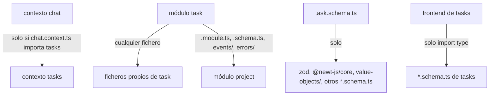

`@newt-js/lint` es un preset de ESLint que mantiene todos los módulos de tu app construidos igual. Existe para que quien escriba el código, una persona o un agente de IA, vaya por los mismos raíles: los mismos ficheros, los mismos imports, y escrituras solo a través del repositorio.

## Configuración

`newt init` escribe este fichero en la raíz del backend:

```ts title="eslint.config.ts"
import { newt } from '@newt-js/lint'

export default newt({
  root: import.meta.dirname,
  contexts: { folder: 'src/contexts' },
})
```

Se ejecuta con el script `lint`, que lanza ESLint con Bun para que cargue el TypeScript del paquete tal cual:

```sh
bun run lint   # bun --bun eslint
```

### Opciones de `newt()`

| Opción | Significado | Por defecto |
|---|---|---|
| `root` | La carpeta de la configuración. Los globs y las carpetas se leen desde ella. | La carpeta de trabajo de ESLint |
| `files` | Globs de los ficheros que revisa. | `['**/*.ts']` |
| `contexts` | `{ folder, uses? }`: la carpeta de los contextos y, si quieres, qué contextos usa cada uno (`{ tasks: [], chat: ['tasks'] }`). Sin `uses`, el `<nombre>.context.ts` de cada contexto lo dice con lo que importa. | ninguno: las reglas de contextos no se aplican |

`uses` debe listar todos los contextos, cada uno con los que usa (`[]` si ninguno), y nunca en ciclo; si no, `newt()` lanza un error al cargar ESLint la configuración.

Todas las reglas son `error`: un aviso no detiene a un agente. Se ignoran `**/dist/**` y `**/node_modules/**`.

:::caution
Si pasas `uses`, lista todos los contextos, también los que no usan ninguno (`[]`). Un contexto que falte o un ciclo hace que no cargue la configuración entera.
:::

### Qué exporta el paquete

| Export | Qué es |
|---|---|
| `newt(options?)` | El preset: un array de configuraciones de ESLint. |
| `plugin` | El plugin de ESLint con las reglas de newt, registrado como `newt`. |
| `parser` | El parser de TypeScript con el que lee el preset, para tus propias configuraciones. |
| `tseslint` | El `typescript-eslint` que trae el paquete. Toma sus configuraciones de aquí: ESLint rechaza dos plugins con el mismo nombre. |
| `STYLE` | Las reglas `curly` y `brace-style` que activa el preset. |

## Dónde se aplica cada regla

| Ficheros | Reglas |
|---|---|
| Todos los ficheros revisados | `use-case-public-methods`, `use-case-params`, `use-case-reads`, `route-body-unchecked`, `framework-tables`, `repository-public-methods`, `no-disable` y las reglas de otros plugins |
| Los ficheros de un módulo (`**/modules/<módulo>/**`) | `module-entity`, `module-files`, `module-imports`, `entity-method-params`, `reaction-queue`, `schema-imports`, `use-case-files`, `module-transactions` |
| Ficheros en la carpeta de contextos (con `contexts`) | `context-imports`, `route-context`; `module-imports` para los ficheros fuera de los módulos |
| El frontend de un contexto (`<contexto>/frontend/**/*.{ts,tsx}`, con `contexts`) | `frontend-imports`, `no-disable` |

Sin `contexts`, `route-context` se sigue aplicando a los ficheros de los módulos.

## Qué puede importar qué

Esto es lo que permiten las reglas de imports (`context-imports`, `module-imports`, `schema-imports`, `frontend-imports`), con los contextos `tasks` y `chat` como ejemplo:



Cada regla se describe en las secciones siguientes.

## Módulos y contextos

### newt/module-files

Un módulo solo tiene sus propios ficheros, con su nombre.

Permitidos en `modules/task/`: `task.module.ts`, `task.ts`, `task.schema.ts`, `task.repository.ts`, `task.routes.ts`, `task.workers.ts`, `task.deps.ts`, `task-options.ts`, cualquier `*.test.ts`, y las carpetas `events/`, `errors/`, `value-objects/` y `services/`. El fichero de un evento empieza por el nombre del módulo.

```txt
modules/task/helpers.ts                 mal: no es un fichero de módulo
modules/task/utils/dates.ts             mal: no es una carpeta de módulo
modules/task/events/completed.ts        mal: llámalo task-completed.ts
modules/task/services/due-dates.ts      bien
```

Por qué: quien abre un módulo sabe dónde está cada cosa.

### newt/module-entity

Un módulo guarda una sola entidad: solo su `<módulo>.ts` declara una clase que extiende `Entity`, y solo una, aunque pase por clases base tuyas.

```ts
// modules/task/task.ts
export class Task extends Entity<typeof TaskSchema> {
  /* ... */
}
export class Comment extends Entity<typeof CommentSchema> {
  /* ... */
} // mal: una segunda entidad
```

Bien: haz de `comment` un módulo propio (`newt add module tasks/comment`) y guarda su id en la tarea.

Por qué: cada módulo protege una cosa; otra entidad es otro módulo, al que se hace referencia por su id.

### newt/module-imports

Un módulo importa de otro módulo solo su `.module.ts`, su `.schema.ts`, sus `events/` y sus `errors/`.

```ts
// modules/task/task.module.ts
// mal
import { Project_Repository } from '../project/project.repository'
// bien
import { ProjectNotFound } from '../project/errors/project-not-found'
```

Un fichero fuera de los módulos (como `tasks-modules.ts`) puede importar lo que compone, pero solo reexporta lo que un módulo ofrece.

Por qué: a través de la entidad o el repositorio de otro módulo, un módulo leería o escribiría sus datos a sus espaldas.

### newt/context-imports

Un contexto importa solo los contextos que dice usar, nunca en ciclo.

Lo que usa un contexto lo dice la opción `uses` o, sin ella, los contextos que importa su `<nombre>.context.ts`. Un fichero directamente en la carpeta de contextos no pertenece a ninguno: ningún contexto lo importa y él no importa ningún contexto.

```ts
// src/contexts/chat/modules/message/message.module.ts
import type { Task_Module } from '../../../tasks/modules/task/task.module'
// mal, salvo que chat.context.ts importe tasks
// (o uses diga chat: ['tasks'])
```

Por qué: los contextos dependen unos de otros en un solo sentido, así cada uno se puede leer, probar y mover por separado.

### newt/schema-imports

El `<módulo>.schema.ts` de un módulo importa solo `zod`, `@newt-js/core` (su raíz), los `value-objects/` del propio módulo y los `*.schema.ts` de otros módulos.

```ts
// modules/task/task.schema.ts
import { Task } from './task'                            // mal
import { ProjectSchema } from '../project/project.schema' // bien
import { Priority } from './value-objects/priority'      // bien
```

Por qué: el schema es el contrato del módulo; dice qué son los datos, no cómo funciona el módulo.

### newt/frontend-imports

El frontend de un contexto importa sus propios ficheros y, solo como tipos, los schemas de su contexto. Nunca código del servidor: ni módulos, ni repositorios, ni otros contextos, y `@newt-js/*`, `bun`, `bun:*` y los módulos de Node solo como tipos.

```tsx
// src/contexts/tasks/frontend/app.tsx
import { TaskSchema } from '../modules/task/task.schema'          // mal
import type { TaskDTO } from '../modules/task/task.schema'        // bien
```

Por qué: el código del servidor nunca debe llegar al navegador.

## Casos de uso

### newt/use-case-public-methods

En un `*.module.ts`, cada método público de una clase que extiende `Module` lleva `@UseCase()`. También se rechaza una función pública en un campo o en un parámetro público del constructor.

```ts
async archive(input: TaskArchiveDTO) { /* ... */ } // mal
@UseCase()
async archive(input: TaskArchiveDTO) { /* ... */ } // bien
private toRow(task: Task) { /* ... */ }            // bien: privado
```

Por qué: `@UseCase` es lo que ejecuta un método como caso de uso (regla de escritura, reintento ante conflicto, traza).

### newt/use-case-params

Los parámetros de un caso de uso son value objects o DTOs del schema del módulo, y cada DTO de entrada se valida con su schema.

Se rechazan: `unknown` o `any`, un tipo objeto escrito en el sitio, un `string`, `number`, `boolean` o `bigint` sueltos (también en una unión o un array), y un DTO de entrada (`z.input<typeof XSchema>`) que nada valida con `XSchema.parse` (en el caso de uso o en un método privado al que se lo pasa).

```ts
@UseCase()
async completeTask(id: string) { /* ... */ }       // mal: string suelto

@UseCase()
async completeTask(input: TaskCompleteTaskDTO): Promise<TaskDTO> {
  const { id } = TaskCompleteTaskSchema.parse(input) // bien
  // ...
}
```

Por qué: un tipo no comprueba nada en ejecución; el schema sí.

### newt/use-case-reads

En un `*.module.ts`, `find`, `get` y `paginate` leen por criterios, nunca por texto; `search` recibe exactamente `(text, page)`.

```ts
async find(text: SearchText) { /* ... */ }                      // mal
async search(text: SearchText, page: PageRequest) { /* ... */ } // bien
```

Por qué: todos los módulos leen de las mismas cuatro formas: `find(criteria, sort?)`, `get(criteria)`, `paginate(criteria, page, sort?)`, `search(text, page)`.

### newt/use-case-files

Lo que un módulo hace con sus ficheros lo hacen casos de uso con nombre fijo: `uploadUrl` lo llama `uploadStart`, `verifyUpload` lo llama `uploadConfirm`, `signedUrl` lo llama `downloadUrl`, cada uno un método del propio módulo. Y cada uno de esos casos de uso hace su llamada. Un prefijo distingue varios tipos de fichero (`avatarUploadStart`).

```ts
@UseCase()
async attach(input: DocumentAttachDTO) {
  await this.files.uploadUrl(/* ... */) // mal: llámalo desde uploadStart
}
```

Por qué: todos los módulos se leen igual, y una subida nunca se confirma sin verificarla.

## Entidad, repositorio, rutas y reacciones

### newt/entity-method-params

En el `<módulo>.ts` de un módulo, ningún método no privado de la entidad recibe un DTO (un tipo cuyo nombre acaba en `DTO`) ni un tipo objeto escrito en el sitio. Recibe `<Entidad><Método>Props`, declarado a su lado. El constructor y `fromDTO` son la excepción.

```ts
static create(input: TaskCreateDTO): Task { /* ... */ }        // mal
static create(input: { name: string }): Task { /* ... */ }      // mal

export type TaskCreateProps = { name: string }
static create(props: TaskCreateProps): Task { /* ... */ }      // bien
```

Por qué: la entidad habla con sus propias palabras, así un cambio en el contrato de la API no la cambia.

### newt/repository-public-methods

Una clase que extiende `Repository` (o `BaseRepository`) no declara métodos públicos ni sobrescribe ninguno: `persist`, `find`, `count`, `paginate` y `purge` es todo lo que tiene. Solo dice cómo se leen y escriben las filas, en los protegidos `toEntity`, `toRow` y `toChanges`.

```ts
export class Task_Repository extends Repository<Task, TaskRow> {
  async findOverdue() { /* ... */ }                             // mal
  protected toEntity(row: TaskRow): Task {                      // bien
    return Task.fromDTO(row)
  }
}
```

Por qué: las decisiones viven en los casos de uso y en las entidades, no en el repositorio.

### newt/route-context

Ninguna ruta que registra un contexto, en su router o en un grupo de él, empieza por el nombre del contexto: el router ya pone `/<contexto>/api` delante de cada ruta.

```ts
// src/contexts/tasks/modules/task/task.routes.ts
router.get('/tasks/tasks/:id', handle) // mal: responde en /tasks/api/tasks/tasks/:id
router.get('/tasks/:id', handle)       // bien: responde en /tasks/api/tasks/:id
router.group('/reports', middleware).get('/overdue', handle) // bien
```

Las rutas se leen a través de constantes, plantillas y el prefijo de un grupo. Una ruta que la regla no puede leer se deja pasar. Los ficheros de test no se revisan.

Por qué: el prefijo del contexto ya separa dos contextos, así que su nombre en la ruta solo lo repetiría.

### newt/route-body-unchecked

En un `*.routes.ts`, el cuerpo de la petición nunca recibe un tipo antes de que algo lo valide: nada de `await request.json() as X`, `<X>` o `const body: X = await request.json()`.

```ts
router.post('/tasks', async request =>
  Response.json(
    await tasks.create((await request.json()) as TaskCreateDTO),
  ),
) // mal

router.post('/tasks', async request =>
  Response.json(await tasks.create(await bodyOf(request)), {
    status: 201,
  }),
) // bien
```

Por qué: el caso de uso valida el cuerpo con su schema; un cast escondería que falta esa validación.

### newt/reaction-queue

La cola de una suscripción es `<módulo>.<casoDeUso>.on.<módulo>.<evento>`. En los ficheros de un módulo, empieza por ese módulo, su callback llama a ese caso de uso del módulo y acaba con el evento al que se suscribe. `Module.on` se llama sobre el módulo en cuyos ficheros está.

```ts
// modules/task/task.workers.ts
tasks.events.completed.subscribe(
  c => tasks.notifyAssignee({ id: c.id }),
  { strategy: 'handler', queue: 'project.notify.on.task.completed' },
) // mal

tasks.on(tasks.events.completed, 'notifyAssignee', completed => [
  { id: completed.id },
]) // bien
```

Por qué: el nombre de la cola dice quién reacciona a qué, y no puede mentir. `Module.on` lo pone por ti.

### newt/module-transactions

Un módulo nunca abre una transacción con el `transactions` de su base: escribe con el `persist` de su repositorio. Un campo tuyo llamado `transactions` (por ejemplo, un repositorio) no cuenta; la regla los distingue por el tipo.

```ts
await base.transactions.run(async () => { /* ... */ })       // mal
await this.tasks.persist(task)                               // bien
```

Por qué: `persist` ejecuta la transacción, comprueba la regla de escritura y publica los eventos.

### newt/framework-tables

Ningún código nombra una tabla que empiece por `newt_`, ni en `records('…')` ni en SQL (tras `FROM`, `INTO`, `UPDATE`, `JOIN`, `TABLE` u `ON`).

```ts
base.database.records('newt_job')            // mal
db.query('SELECT * FROM newt_job')           // mal
base.database.records<TaskRow>('task')       // bien
```

Por qué: las tablas `newt_…` son de newt (jobs, ejecuciones de tareas programadas, claves de idempotencia, migraciones aplicadas) y pueden cambiar en cualquier versión.

## La disciplina del propio lint

### newt/no-disable

Ningún comentario desactiva, para un tramo de código, una regla `newt/…` o una que active el preset, ni la cambia. Se puede eximir una sola línea con `eslint-disable-next-line` o `eslint-disable-line` si el comentario nombra la regla y da un motivo tras `--`.

```ts
/* eslint-disable newt/module-imports */ // mal
/* eslint newt/module-imports: "off" */ // mal
// eslint-disable-next-line curly // mal: sin motivo
// eslint-disable-next-line       // mal: no nombra regla
// eslint-disable-next-line curly -- generated by a tool, no braces
if (a) b() // bien
```

Un `/* eslint-disable */` a secas también se señala: el procesador del preset impide que silencie esta regla.

Por qué: un agente que no consigue que el código pase haría pasar el lint en su lugar.

## De otros plugins

| Regla | Exige |
|---|---|
| `@typescript-eslint/no-floating-promises` | Cada promesa se espera o se gestiona. |
| `@typescript-eslint/no-misused-promises` | Ninguna función async donde nadie la espera (un `setInterval`, un evento, un `forEach`). |
| `curly` (`all`) | Todo `if`, `else` y bucle lleva llaves. Se corrige sola. |
| `brace-style` (`1tbs`, sin una sola línea) | Cada cuerpo va en sus propias líneas. Se corrige sola. |

:::tip
`bun run lint --fix` corrige por ti los errores de `curly` y `brace-style`.
:::

El preset también fija `reportUnusedDisableDirectives: 'error'`: un comentario de desactivación que no desactiva nada es un error.
