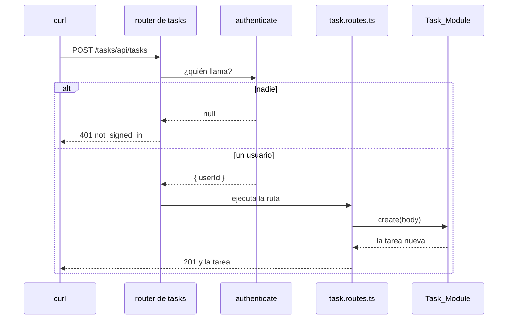

Esta página te lleva de cero a un backend que guarda tareas en SQLite y responde por HTTP. Te llevará unos diez minutos.

Necesitas Bun 1.4.0 o posterior. Consulta [instalación](/es/start/installation/).

## Crea el proyecto

```sh
bun create newt newthub
```

```txt
  created  newthub/package.json
  created  newthub/tsconfig.json
  created  newthub/eslint.config.ts
  created  newthub/AGENTS.md
  created  newthub/src/backend.ts
  created  newthub/src/stores.ts
  created  newthub/src/env.ts
  created  newthub/src/backend.test.ts
  created  newthub/src/contexts.ts
  created  newthub/src/index.ts
  created  newthub/src/auth.ts
  created  newthub/.env
  created  newthub/.env.example
  created  newthub/.gitignore
  created  newthub/CLAUDE.md

Next steps:
  cd newthub
  bun install
  bun run dev
```

Cada fichero se explica en [estructura de un proyecto](/es/start/project-structure/).

## Instálalo y arráncalo

```sh
cd newthub
bun install
bun run dev
```

```txt
$ bun --watch src/index.ts
Listening on http://localhost:3000/
```

`bun run dev` reinicia el backend cada vez que guardas un fichero. Déjalo en marcha en su propio terminal.

## Comprueba su salud

Todo backend responde a `GET /health-check`:

```sh
curl localhost:3000/health-check
```

```json
{"status":"ok"}
```

Mientras el backend se está parando, responde `503` con `{"status":"stopping"}`, para que un balanceador de carga deje de enviarle peticiones.

## Añade un contexto

Un contexto es una parte de tu aplicación con su propia base de datos. Newthub empieza por las tareas:

```sh
bunx newt add context tasks
```

```txt
  created  src/contexts/tasks/tasks.context.ts
  created  src/contexts/tasks/tasks-modules.ts
  created  src/contexts/tasks/migrations/.gitkeep
  skipped  src/auth.ts (already exists)
  updated  .env
  updated  .env.example
  updated  src/contexts.ts

Next steps:
  bun run dev
```

El contexto abre su base de datos SQLite en `data/tasks.sqlite`, que se crea en el siguiente arranque. `.env` ahora lo indica:

```sh title=".env"
TASKS_DATABASE=data/tasks.sqlite
TASKS_FILES=data/files/tasks
```

Consulta [contextos y módulos](/es/concepts/contexts-and-modules/).

## Añade un módulo

Un módulo es una clase de cosa dentro de un contexto. Añade las tareas al contexto tasks:

```sh
bunx newt add module tasks/task
```

```txt
  created  src/contexts/tasks/modules/task/value-objects/task-id.ts
  created  src/contexts/tasks/modules/task/task.schema.ts
  created  src/contexts/tasks/modules/task/events/task-created.ts
  created  src/contexts/tasks/modules/task/errors/task-not-found.ts
  created  src/contexts/tasks/modules/task/task.ts
  created  src/contexts/tasks/modules/task/task.repository.ts
  created  src/contexts/tasks/modules/task/task.module.ts
  created  src/contexts/tasks/modules/task/task.routes.ts
  created  src/contexts/tasks/modules/task/task.module.test.ts
  created  src/contexts/tasks/migrations/00001_task_up.sql
  created  src/contexts/tasks/migrations/00001_task_down.sql
  updated  src/contexts/tasks/tasks-modules.ts

Next steps:
  bun test src/contexts/tasks/modules/task
  its routes ask for a session: write authenticate in src/auth.ts to call them from outside the tests
```

El módulo trae cuatro casos de uso (`create`, `get`, `find`, `paginate`), una tabla y tres rutas:

```ts title="src/contexts/tasks/modules/task/task.routes.ts"
export function registerTaskRoutes(
  router: HttpRouter,
  tasks: Task_Module,
) {
  router.post('/tasks', async request =>
    Response.json(await tasks.create(await bodyOf(request)), {
      status: 201,
    }),
  )
  router.get('/tasks', async request =>
    Response.json(await tasks.paginate({}, pageRequestFrom(request))),
  )
  router.get('/tasks/:id', async request =>
    Response.json(
      await tasks.get(request.params.id),
    ),
  )
  return { one: router.group('/tasks/:taskId') }
}
```

La dirección de una ruta es el contexto, luego `/api` y luego el plural del módulo: `POST /tasks/api/tasks`.

## Llama a una ruta: el 401

Intenta crear una tarea:

```sh
curl -i -X POST localhost:3000/tasks/api/tasks \
  -H 'content-type: application/json' \
  -d '{"name":"Write the docs"}'
```

```txt
HTTP/1.1 401 Unauthorized
...

{"error":"Sign in first","code":"not_signed_in"}
```

Es intencionado. Todas las rutas son privadas salvo que las marques con `{ public: true }`, y una ruta privada necesita saber quién llama. `src/auth.ts` responde a esa pregunta, y el que se genera responde "nadie":

```ts title="src/auth.ts"
import type { Authenticator } from '@newt-js/core/http'

export const authenticate: Authenticator = async () => null
```

Este es el camino que sigue toda petición a una ruta privada:



## Inicia sesión para probar en local

Para probar la API en tu ordenador, deja que un token fijo de `.env` te identifique:

```ts title="src/auth.ts"
import { bearerAuthenticator } from '@newt-js/core/http'

export const authenticate = bearerAuthenticator(async token =>
  token === Bun.env.DEV_TOKEN ? { userId: 'dev' } : null,
)
```

```sh title=".env"
DEV_TOKEN=let-me-in
```

:::danger
Esto deja entrar a cualquiera que conozca el token. Úsalo solo en tu ordenador, y escribe un autenticador de verdad antes de desplegar. Consulta [autenticación](/es/guides/authentication/).
:::

Reinicia `bun run dev` para que lea el nuevo `.env` y llama a la ruta con el token:

```sh
curl -X POST localhost:3000/tasks/api/tasks \
  -H 'authorization: Bearer let-me-in' \
  -H 'content-type: application/json' \
  -d '{"name":"Write the docs"}'
```

```json
{
  "id": "01a1e8be-dbae-7142-8f59-770eb529979d",
  "name": "Write the docs",
  "createdAt": "2026-11-17T09:03:04.622Z",
  "updatedAt": "2026-11-17T09:03:04.622Z"
}
```

Lista las tareas:

```sh
curl localhost:3000/tasks/api/tasks -H 'authorization: Bearer let-me-in'
```

```json
{
  "items": [
    {
      "id": "01a1e8be-dbae-7142-8f59-770eb529979d",
      "name": "Write the docs",
      "createdAt": "2026-11-17T09:03:04.622Z",
      "updatedAt": "2026-11-17T09:03:04.622Z"
    }
  ],
  "total": 1
}
```

## Cuando algo falla

Los errores vuelven en JSON con un estado, un mensaje y un `code` que tu frontend puede comprobar:

| Petición | Estado | `code` |
|---|---|---|
| sin sesión | 401 | `not_signed_in` |
| `{"name":"  "}` | 400 | `validation` |
| `GET /tasks/api/tasks/nope` | 400 | `invalid_uuid` |
| un id que no existe | 404 | `task.not_found` |

Un error `validation` también lista en `issues` lo que ha fallado. Consulta [errores](/es/concepts/errors/).

## Ejecuta los tests

```sh
bun run test
```

```txt
$ bun test
bun test v1.4.4

 9 pass
 0 fail
 16 expect() calls
Ran 9 tests across 2 files.
```

Los tests usan una base de datos SQLite en memoria con las migraciones del contexto, así que nunca tocan `data/`. Inician sesión por su cuenta, así que pasan diga lo que diga `src/auth.ts`. Consulta [testing](/es/guides/testing/).

Otras dos comprobaciones van con los tests:

```sh
bun run typecheck   # tipos
bun run lint        # las reglas de newt
```

:::tip
Ejecuta las tres después de cada cambio. La lint te avisa cuando un trozo de código está en el sitio equivocado, y así newt mantiene la forma del backend.
:::

## Siguientes pasos

- Mira cada fichero que tienes ahora en [estructura de un proyecto](/es/start/project-structure/).
- Añade tu propio caso de uso con `newt add use-case`. Consulta [casos de uso](/es/concepts/use-cases/).
- Sigue el [tutorial](/es/tutorial/) para construir Newthub paso a paso.
