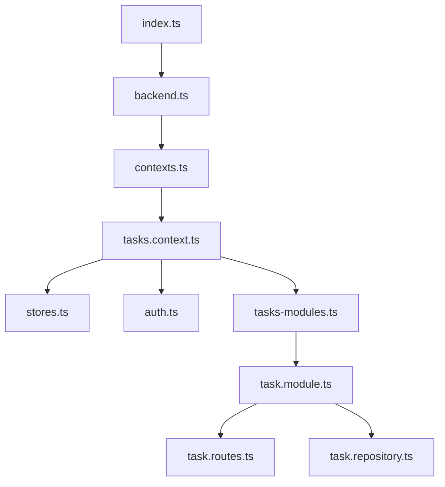

Un proyecto de newt tiene siempre la misma distribución: unos pocos ficheros en la raíz, la conexión del backend en `src/`, y una carpeta por contexto en `src/contexts/`. Esta página los recorre todos.

El árbol es de un proyecto con un contexto, `tasks`, dos módulos, `task` y `project`, y una pieza de cada tipo que puede añadir el CLI.

## El árbol

```txt
newthub/
├── .env
├── .env.example
├── .gitignore
├── AGENTS.md
├── CLAUDE.md
├── eslint.config.ts
├── package.json
├── tsconfig.json
├── data/                              se crea en el primer arranque
│   ├── tasks.sqlite
│   └── files/tasks/
└── src/
    ├── index.ts
    ├── backend.ts
    ├── backend.test.ts
    ├── contexts.ts
    ├── stores.ts
    ├── auth.ts
    ├── env.ts
    └── contexts/
        └── tasks/
            ├── tasks.context.ts
            ├── tasks-modules.ts
            ├── migrations/
            │   ├── 00001_task_up.sql
            │   ├── 00001_task_down.sql
            │   ├── 00002_project_up.sql
            │   └── 00002_project_down.sql
            ├── app/
            │   ├── index.html
            │   ├── main.tsx
            │   ├── app.tsx
            │   ├── base.ts
            │   └── tsconfig.json
            └── modules/
                ├── project/
                │   └── …
                └── task/
                    ├── task.ts
                    ├── task.schema.ts
                    ├── task.repository.ts
                    ├── task.module.ts
                    ├── task.module.test.ts
                    ├── task.routes.ts
                    ├── task.deps.ts
                    ├── task.workers.ts
                    ├── events/
                    │   ├── task-created.ts
                    │   └── task-completed.ts
                    ├── errors/
                    │   ├── task-not-found.ts
                    │   ├── already-done.ts
                    │   └── invalid-priority.ts
                    ├── value-objects/
                    │   ├── task-id.ts
                    │   ├── priority.ts
                    │   └── priority.test.ts
                    └── services/
                        └── due-dates.ts
```

## Cómo se conectan los ficheros

Cada fichero abre el siguiente, desde `index.ts` hasta los módulos:



- `index.ts` llama a `startBackend` con `PORT`.
- `backend.ts` elige el clúster, abre todos los contextos con `openContexts` y los sirve con `runContexts`.
- `contexts.ts` abre cada contexto, una línea por contexto.
- `tasks.context.ts` abre la base de datos y los ficheros (`stores.ts`), crea el router con `authenticate` (`auth.ts`) y crea los módulos.
- `tasks-modules.ts` crea cada módulo. Un módulo registra sus rutas y sus workers al crearse.

## Ficheros de la raíz

| Fichero | Para qué sirve |
|---|---|
| `package.json` | dependencias y scripts |
| `tsconfig.json` | configuración de TypeScript |
| `eslint.config.ts` | las reglas de la lint de newt |
| `.env` | tu configuración local y tus secretos |
| `.env.example` | las mismas claves, sin secretos |
| `.gitignore` | deja `node_modules`, `.env` y `data` fuera de git |
| `AGENTS.md` | cómo funciona el proyecto, para agentes de IA |
| `CLAUDE.md` | apunta a `AGENTS.md` |

Los scripts de `package.json`:

| Script | Ejecuta |
|---|---|
| `bun run dev` | el backend, reiniciado en cada cambio |
| `bun run start` | el backend, una vez |
| `bun run test` | los tests |
| `bun run typecheck` | la comprobación de tipos (`bun check -b`) |
| `bun run lint` | la lint de newt |

`.env` guarda `PORT`, `PUBLIC_URL`, `FILES_SECRET`, y dos líneas por contexto: `<CONTEXTO>_DATABASE` y `<CONTEXTO>_FILES`. `newt init` escribe un `FILES_SECRET` aleatorio. Consulta [configuración](/es/reference/configuration/).

:::danger
`.env` guarda secretos y no se sube al repositorio. Sube `.env.example`, con sus secretos vacíos.
:::

## `data/`

Donde el backend guarda sus datos en tu ordenador. Aparece en el primer arranque.

- `data/<contexto>.sqlite`: la base de datos SQLite de cada contexto. Los ficheros `-shm` y `-wal` que la acompañan son de SQLite.
- `data/files/<contexto>/`: los ficheros subidos de cada contexto.

Borra `data/` para empezar de nuevo con las bases de datos vacías. Los tests nunca la usan: funcionan en memoria.

## `src/`

| Fichero | Para qué sirve |
|---|---|
| `index.ts` | arranca el backend en `PORT` |
| `backend.ts` | `startBackend`: abre los contextos y los sirve |
| `backend.test.ts` | comprueba que `/health-check` responde |
| `contexts.ts` | la lista de contextos que abre el backend |
| `stores.ts` | abre la base de datos y los ficheros de cada contexto |
| `auth.ts` | `authenticate`: quién llama |
| `env.ts` | `requiredEnv`, para las variables que necesita el backend |

- `backend.ts` también elige el clúster, que es lo que comparten varias instancias del backend. Consulta [varias instancias](/es/guides/scaling/).
- `stores.ts` tiene un modo `memory` para los tests: una base de datos en memoria con las migraciones, y ficheros en memoria.
- `auth.ts` se explica en [autenticación](/es/guides/authentication/).

## Un contexto: `src/contexts/<contexto>/`

| Ruta | Para qué sirve |
|---|---|
| `<contexto>.context.ts` | abre el contexto: base de datos, router, ficheros, módulos |
| `<contexto>-modules.ts` | crea los módulos y da a cada uno los que usa |
| `migrations/` | ficheros SQL que crean y cambian las tablas |
| `app/` | la aplicación React del contexto, si tiene, servida en `/<contexto>` |
| `modules/` | una carpeta por módulo |

- Las migraciones van por parejas: `<número>_<tabla>_up.sql` hace el cambio y `<número>_<tabla>_down.sql` lo deshace. El backend ejecuta las pendientes al abrir la base de datos. Consulta [base de datos y migraciones](/es/concepts/database/).
- Las rutas del contexto viven bajo `/<contexto>/api/`, y su app en `/<contexto>`.

## Un módulo: `modules/<módulo>/`

### Los ficheros que tiene todo módulo

| Fichero | Para qué sirve |
|---|---|
| `<módulo>.ts` | la entidad: una tarea y sus reglas |
| `<módulo>.schema.ts` | la forma de una tarea, lo que recibe cada caso de uso, los filtros |
| `<módulo>.repository.ts` | guarda y carga tareas |
| `<módulo>.module.ts` | la clase del módulo: sus casos de uso |
| `<módulo>.routes.ts` | las rutas HTTP, cada una llama a un caso de uso |
| `<módulo>.module.test.ts` | los tests del módulo |

Consulta [entidades](/es/concepts/entities/), [schemas y DTOs](/es/concepts/schemas-and-dtos/), [repositorios](/es/concepts/repositories/), [casos de uso](/es/concepts/use-cases/) y [HTTP y rutas](/es/concepts/http/).

### Ficheros que aparecen cuando los necesitas

| Fichero | Lo añade | Para qué sirve |
|---|---|---|
| `<módulo>.deps.ts` | `newt add deps` | los otros módulos que usa este |
| `<módulo>.workers.ts` | `newt add subscription`, `newt add schedule` | lo que se ejecuta con un evento o un cron |

Consulta [servicios y dependencias](/es/concepts/services-and-deps/), [eventos y suscripciones](/es/concepts/events/) y [tareas programadas](/es/concepts/schedules/).

### Carpetas

| Carpeta | Qué guarda |
|---|---|
| `events/` | un fichero por evento, como `task.completed` |
| `errors/` | un fichero por error que lanza el módulo |
| `value-objects/` | valores con reglas, como un id o una prioridad |
| `services/` | lógica que comparten varios casos de uso |

- Todo módulo empieza con un value object para su id (`task-id.ts`), un evento `created` y un error `not-found`.
- Un value object viene con su test y su propio error, como `priority.test.ts` e `invalid-priority.ts`.

Consulta [eventos](/es/concepts/events/), [errores](/es/concepts/errors/), [value objects](/es/concepts/value-objects/) y [servicios](/es/concepts/services-and-deps/).

:::tip
Casi nunca creas estos ficheros a mano. `newt add` escribe cada uno en su sitio, y la lint te avisa cuando algo está en otro.
:::
