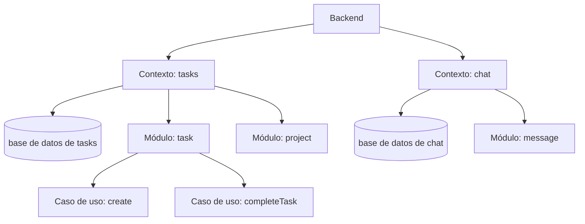
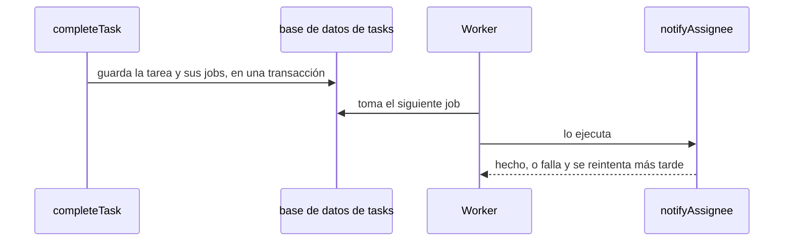

newt es un framework de backend para Bun. Da a todos los backends la misma forma, para que entiendas un cambio por sus piezas sin leer cada línea.

## El problema que resuelve

Escribir código ya es barato, lo escribas tú o un agente de IA. Leerlo no. Una pull request de cuarenta ficheros compila y pasa los tests, y la apruebas sin saber qué ha cambiado en tu sistema.

newt responde con una forma fija. Cada trozo de código tiene un sitio y una función, y una lint comprueba que siga así. Cuando la forma es la misma en todas partes, un cambio se lee como "un caso de uso nuevo en el módulo task, que emite un evento" y no como cuarenta ficheros de código.

:::note
Las ideas de fondo están en la página de [principios](/es/principios/).
:::

## La forma de un backend

Un backend de newt se compone de unas pocas clases de piezas, una dentro de otra. Este es Newthub con dos contextos:

- **Backend**: el programa que ejecutas. Sirve HTTP y hace el trabajo en segundo plano.
- **Contexto**: una parte de tu aplicación, como las tareas o el chat. Cada contexto tiene su propia base de datos y sus propios ficheros.
- **Módulo**: una clase de cosa dentro de un contexto, como una tarea o un proyecto.
- **Caso de uso**: una cosa que hace tu aplicación, como "crear una tarea" o "completar una tarea". Es un método de su módulo.

Todo lo demás cuelga de un módulo. Una **entidad** guarda las reglas de una tarea. Un **repositorio** guarda y carga tareas. Una **ruta** convierte una petición HTTP en una llamada a un caso de uso, y nunca toca la base de datos.

Consulta [contextos y módulos](/es/concepts/contexts-and-modules/) y [casos de uso](/es/concepts/use-cases/).

## Eventos, jobs y tareas programadas

Los módulos se hablan mediante **eventos**: hechos breves como `task.completed`. Un módulo al que le interesa uno se suscribe y ejecuta uno de sus propios casos de uso.

Un evento se guarda en la misma transacción que el cambio que lo provocó, como un job por cada suscripción. Los jobs esperan en el *outbox*, la cola de jobs que vive en tu base de datos, hasta que un **worker** los ejecuta. Esto es lo que pasa cuando se completa una tarea y `notifyAssignee` está suscrito a `task.completed`:

Un job que falla se reintenta, así que una reacción no se pierde aunque el proceso se pare a medias.

Una **tarea programada** ejecuta un caso de uso según un cron, como "todos los días a las 9:00", con el mismo tipo de job.

Consulta [eventos y suscripciones](/es/concepts/events/), [jobs y workers](/es/concepts/jobs-and-workers/) y [tareas programadas](/es/concepts/schedules/).

## Una base de datos por contexto

Cada contexto abre su propia base de datos. Las tablas de tareas viven en `tasks`; las del chat, en `chat`. Un módulo nunca lee las tablas de otro contexto: pregunta mediante un caso de uso, o escucha sus eventos.

SQLite es la base de datos por defecto, y sirve para producción. También se admiten Postgres y MySQL. Consulta [base de datos y migraciones](/es/concepts/database/).

:::tip
Empieza con un contexto. Añade un segundo cuando una parte de tu aplicación tenga sus propios datos y sus propias palabras, como el chat junto a las tareas.
:::

## Lo que trae

- **`@newt-js/core`**: el framework. Módulos, entidades, casos de uso, eventos, jobs, tareas programadas, ficheros, HTTP, y adaptadores para SQLite, Postgres y MySQL.
- **`@newt-js/cli`**: el comando `newt`. Crea un proyecto y añade contextos, módulos, casos de uso, rutas, eventos y lo demás, cada cosa en su sitio.
- **`@newt-js/lint`**: las reglas de ESLint que sostienen la forma. Se ejecuta con `bun run lint`, y en tu editor mediante su extensión de ESLint.

## Siguientes pasos

- [Instala](/es/start/installation/) lo que necesitas.
- Construye [tu primer proyecto](/es/start/first-project/).
