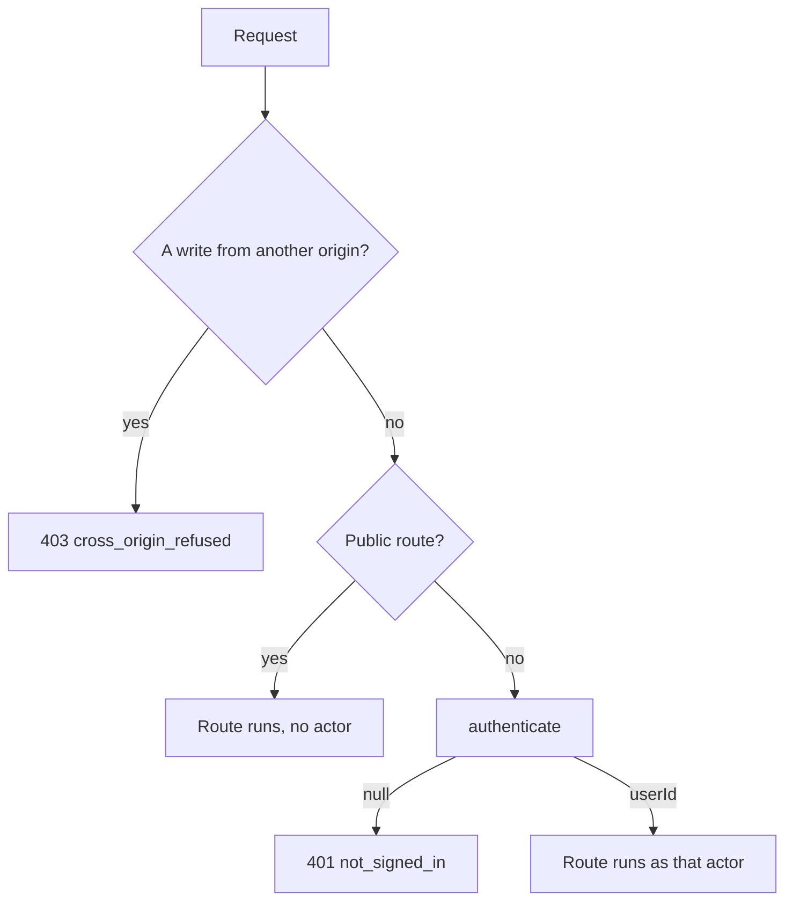

Authentication is how the backend knows who sends a request. In newt it is one function, the authenticator in `src/auth.ts`: it reads the request and returns the user, or `null`.

## The authenticator

`newt init` writes `src/auth.ts`:

```ts title="src/auth.ts"
import type { Authenticator } from '@newt-js/core/http'

export const authenticate: Authenticator = async () => null
```

Its type, from `@newt-js/core/http`:

```ts
type Authenticator = (request: HttpRequest) => Promise<Actor | null>

interface Actor {
  userId: string
}
```

- Return `{ userId }` when the request comes from someone you recognise.
- Return `null` when it does not.
- `request` is a `Request` with `request.cookies` (a `Bun.CookieMap`) and `request.params`.

The generated one returns `null`, so every private route answers 401 until you write it.

## Where it is used

Each context gives it to its router, in its `<context>.context.ts`:

```ts title="src/contexts/tasks/tasks.context.ts"
const router = new HttpRouter({ database })
router.authenticateWith(authenticate)
```

Every context imports the same `authenticate`, so one function covers the whole backend. A context may call `authenticateWith` with a different one.

## Private and public routes

This is what the router does with each request before your route runs:



Every route is private by default. Before a private route runs, the router calls the authenticator:

- It returns `{ userId }`: the route runs, with that user as the [actor](/concepts/actor-and-scope/).
- It returns `null`, or there is no authenticator: the route does not run, and the answer is a 401.

```json
{"error":"Sign in first","code":"not_signed_in"}
```

Mark a route public to skip the authenticator:

```ts
router.post('/tasks/sign-in', signIn, { public: true })
```

`public` works wherever route options go:

| Where | Applies to |
|---|---|
| `router.get(path, route, { public: true })` | one route |
| `router.group(prefix, middleware, { public: true })` | every route of the group |
| `new HttpRouter({ public: true })` | every route of the router |

- A public route has no actor. `currentActor()` throws there; `findCurrentActor()` returns `undefined`.
- A public route cannot be idempotent: the router throws when you register one with `idempotency`.

:::note
The file routes in `src/stores.ts` are public. Their URLs are signed with `FILES_SECRET`, which is what lets them through. See [files](/concepts/files/).
:::

## Bearer tokens

`bearerAuthenticator` reads the `Authorization: Bearer <token>` header and hands the token to your function:

```ts title="src/auth.ts"
import { bearerAuthenticator } from '@newt-js/core/http'
import { verifyToken } from './verify-token'

export const authenticate = bearerAuthenticator(async token => {
  const userId = await verifyToken(token)
  return userId ? { userId } : null
})
```

- `verifyToken` is yours: it checks the token and returns the user's id, or `null`.
- Without the header, or with another scheme, it returns `null` without calling your function.
- The word `Bearer` is matched in any case.

## Session cookies

A session cookie suits a frontend served by the same backend. Two helpers write it:

```ts
setSessionCookie(request, name, value, { secure, maxAgeSeconds, path })
clearSessionCookie(request, name, { secure, path })
```

| Option | Meaning | Default |
|---|---|---|
| `secure` | send it over HTTPS only | required |
| `maxAgeSeconds` | how long it lasts | required |
| `path` | where the browser sends it | `/` |

- The cookie is always `HttpOnly` and `SameSite=Lax`.
- `clearSessionCookie` writes an empty cookie with a max age of 0.
- Both set the cookie on `request.cookies`. The router adds it to the response for you.

A sign-in route sets the cookie, and the authenticator reads it:

```ts title="src/auth.ts"
import type { Authenticator } from '@newt-js/core/http'
import { userOfSession } from './user-of-session'

export const SESSION_COOKIE = 'session'

export const authenticate: Authenticator = async request => {
  const session = request.cookies.get(SESSION_COOKIE)
  const userId = session ? await userOfSession(session) : null
  return userId ? { userId } : null
}
```

```ts
import { bodyOf, setSessionCookie } from '@newt-js/core/http'

router.post(
  '/tasks/sign-in',
  async request => {
    const session = await signIn(await bodyOf(request))
    setSessionCookie(request, SESSION_COOKIE, session, {
      secure: Bun.env.NODE_ENV === 'production',
      maxAgeSeconds: 60 * 60 * 24 * 30,
    })
    return new Response(null, { status: 204 })
  },
  { public: true },
)
```

`userOfSession` and `signIn` stand for your own code: how you check a password or a session is up to you.

:::caution
A request other than `GET` from a page of another origin is refused with a 403 (`cross_origin_refused`), unless the route's `cors` allows that origin and the request carries no cookie. Pages served by the same backend are not affected. A route with `crossOrigin: true` skips this check.
:::

## The actor in your code

While a private route runs, the user the authenticator returned is the current actor. It stays the actor through every `await` and every use case the route calls.

| Function | Returns |
|---|---|
| `currentActor()` | the actor, or throws `NoActor` (401) |
| `findCurrentActor()` | the actor, or `undefined` |
| `runAsActor(actor, fn)` | runs `fn` as that actor |

All three come from `@newt-js/core`.

- The actor's `userId` is saved with every event the request emits.
- Rate limits count by actor by default, and by IP when there is none.
- Idempotency keys are kept per actor.

See [actor and scope](/concepts/actor-and-scope/).

## Errors

| Error | Status | `code` | When |
|---|---|---|---|
| `NotSignedIn` | 401 | `not_signed_in` | a private route, nobody signed in |
| `NoActor` | 401 | `not_signed_in` | `currentActor()` with no actor |
| `CrossOriginRefused` | 403 | `cross_origin_refused` | a write from another origin |

## In tests

The generated module tests give the router an authenticator of their own, which they switch off to check the 401:

```ts title="src/contexts/tasks/modules/task/task.module.test.ts"
router = new HttpRouter({ database })
signedIn = true
router.authenticateWith(async () => signedIn ? { userId: 'tester' } : null)
```

So the tests pass whatever `src/auth.ts` does. See [testing](/guides/testing/).

:::danger
Never ship an authenticator that accepts a fixed token or any user. Check every token or session against what your backend issued.
:::
