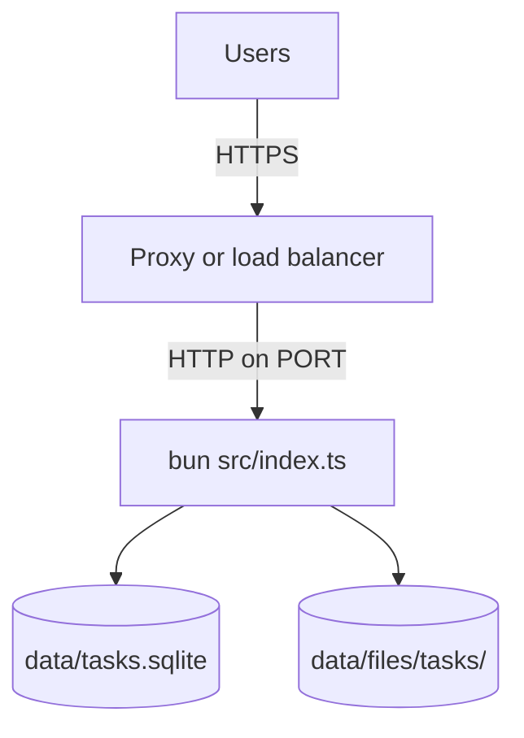

Deploying a newt backend means running `bun src/index.ts` on a server, with the right environment variables and, on SQLite, a disk that survives restarts. There is no build step: Bun runs your TypeScript directly.

## What you need

- Bun 1.4 or later on the server, or a container image with it.
- Your project's code and its dependencies (`bun install`).
- The environment variables your stores need.
- On SQLite or local files: a persistent folder for `data/`.

A backend on one machine, with SQLite and local files, looks like this:



Everything under `data/` lives on a persistent volume.

## 1. Start the backend

The generated `package.json` has a `start` script:

```json title="package.json"
"scripts": {
  "start": "bun src/index.ts"
}
```

On the server:

```sh
bun install --production
bun run start
```

`--production` skips the dev dependencies (`@newt-js/cli`, lint, TypeScript): the backend does not need them to run.

On start, the backend:

1. Opens each context's database and runs its pending [migrations](/concepts/database/). If one fails, the backend stops with the error and serves nothing.
2. Serves HTTP on `PORT`.
3. Starts each context's worker and scheduled tasks.

:::note
Migrations run on every start, before the backend serves. You do not run them as a separate step.
:::

## 2. Set the environment variables

Bun reads `.env` from the folder you start in, but in production you usually set real environment variables in your host instead. A SQLite backend with local files needs:

| Variable | Example | What it is |
|---|---|---|
| `PORT` | `3000` | The HTTP port; `3000` if unset |
| `PUBLIC_URL` | `https://newthub.example.com` | The address users reach |
| `FILES_SECRET` | 64 hex characters | Signs file links |
| `TASKS_DATABASE` | `/app/data/tasks.sqlite` | One per context |
| `TASKS_FILES` | `/app/data/files/tasks` | One per context |

- `PUBLIC_URL` and `FILES_SECRET` are required with local files; the backend does not start without them. `PUBLIC_URL` builds the links to uploaded files, so it must be the public address, with `https`.
- `FILES_SECRET` must have at least 32 characters. Generate one with `openssl rand -hex 32`.
- `TASKS_DATABASE` and `TASKS_FILES` fall back to `data/tasks.sqlite` and `data/files/tasks`, relative to the folder you start in.

Other setups add or replace variables:

- Postgres or MySQL: `<CONTEXT>_DATABASE_URL` per context, required. See [Postgres](/guides/databases/postgres/) and [MySQL](/guides/databases/mysql/).
- Files on S3: `S3_ACCESS_KEY_ID`, `S3_SECRET_ACCESS_KEY`, `S3_REGION`, `S3_ENDPOINT`, and `<CONTEXT>_S3_BUCKET` per context. See [Files](/concepts/files/).
- Valkey cluster: `VALKEY_URL`. See [Running several instances](/guides/scaling/).

`.env.example` lists every variable your project reads. [Configuration and environment variables](/reference/configuration/) explains each one.

:::danger
Never commit `.env` or reuse the development `FILES_SECRET` in production. Anyone with the secret can sign links to your files.
:::

## 3. Keep data/ on a persistent disk

With SQLite and local files, everything your backend stores lives in `data/`: one `.sqlite` file per context (plus its `-wal` and `-shm` files) and `data/files/`. Mount a persistent volume there.

If your host gives each deploy a fresh disk, you lose that data on every deploy. Use a volume, or move to [Postgres](/guides/databases/postgres/) and files on S3.

Back the folder up: [SQLite](/guides/databases/sqlite/#back-up-a-live-database) shows how to copy a live database safely.

## 4. Check health

The generated backend serves a health route:

```sh
curl https://newthub.example.com/health-check
```

| State | Status | Body |
|---|---|---|
| Running | `200` | `{"status":"ok"}` |
| Stopping | `503` | `{"status":"stopping"}` |

Point your host's or load balancer's health check at `/health-check`. Each context that serves routes also answers its own, as `/tasks/health-check`.

## 5. Stop gracefully

On `SIGTERM` or `SIGINT` the backend stops in order:

1. The health route answers `503`, and the server stops taking new connections.
2. Requests in progress finish, for up to 8 seconds.
3. Workers finish their running jobs, for up to 8 seconds. A job that does not finish in time goes back to the queue and runs again later.
4. Each context closes its database.

Your host only needs to send `SIGTERM` and wait about 30 seconds before it kills the process.

## A minimal Dockerfile

```dockerfile title="Dockerfile"
FROM oven/bun:1
WORKDIR /app

COPY package.json bun.lock ./
RUN bun install --frozen-lockfile --production

COPY . .

ENV PORT=3000
EXPOSE 3000
VOLUME /app/data

HEALTHCHECK CMD bun -e "fetch('http://localhost:3000/health-check') \
  .then(r => process.exit(r.ok ? 0 : 1), () => process.exit(1))"

CMD ["bun", "run", "start"]
```

```text title=".dockerignore"
node_modules
data
.env
```

Build and run it with a named volume for `data/`, and the variables in a file kept on the server (`production.env`, outside git):

```sh
docker build -t newthub .
docker run -d -p 3000:3000 -v newthub-data:/app/data \
  --env-file production.env newthub
```

:::caution
Generate `FILES_SECRET` once and keep it in your host's secret settings. A new secret on every start breaks every file link issued before.
:::

## Behind a reverse proxy

Most hosts put a proxy or load balancer in front of your backend, which handles HTTPS. These serve options in `src/backend.ts` matter then:

```ts title="src/backend.ts"
return runContexts(contexts, {
  platformWithoutContexts: platform,
  serve: { port, health: true, trustProxy: 1, drainMs: 5000 },
})
```

- `trustProxy`: how many proxies stand in front of the backend. With `1`, newt takes the caller's IP from `X-Forwarded-For` and the host from `X-Forwarded-Host`. Without it, every request seems to come from the proxy, and [rate limits](/concepts/http/) by IP count everyone together. `0` by default.
- `drainMs`: on stop, how long to keep serving while the health route already answers `503`, so the load balancer stops sending traffic first. `0` by default.
- `hsts`: `true` adds a `Strict-Transport-Security` header (one year). Use it once your site is served only over HTTPS.

:::caution
Set `trustProxy` only to the number of proxies you really have. Too high, and a caller can fake their IP with their own `X-Forwarded-For` header.
:::

## A context on its own host

Each context answers under its name on the backend's address: `https://midominio.com/backoffice/api/…`. Give a context a host, and it answers there instead, at its own paths:

```sh
BACKOFFICE_HOST=backoffice.midominio.com
```

| URL | Answered by |
|---|---|
| `https://backoffice.midominio.com/api/orders` | `backoffice`'s API |
| `https://backoffice.midominio.com/orders/12` | `backoffice`'s app |
| `https://backoffice.midominio.com/health-check` | `backoffice`'s health |
| `https://backoffice.midominio.com/backoffice/api/orders` | `backoffice`'s API too |
| `https://midominio.com/shop/api/products` | `shop`, which has no host |
| `https://midominio.com/backoffice/api/orders` | nothing: `404` |
| `https://midominio.com/health-check` | the whole backend's health |

- At its host, a path that starts with its name keeps working, so a link built for `/backoffice` still lands. On any other host, its name is a `404`, however the path is written.
- Point the host's DNS at the same server. Behind a proxy, set `trustProxy`: newt reads the host from `X-Forwarded-Host`.
- Two contexts at one host stop the backend before it starts.
- With local files, its file links are signed at its host, with the protocol of `PUBLIC_URL`.
- Its generated app (`app/base.ts`) finds its base by itself, and an app built elsewhere for `/<context>/` works as it is.
- Point the load balancer's health check at an address that is not a context's host, such as the server's own.

The generated `<context>.context.ts` reads the variable and hands it to run, next to its router: `host: Bun.env.BACKOFFICE_HOST`.

## Frontends

A backend serves its contexts' apps from the same process. How each one is built and served is in [Adding a frontend](/guides/frontend/).
