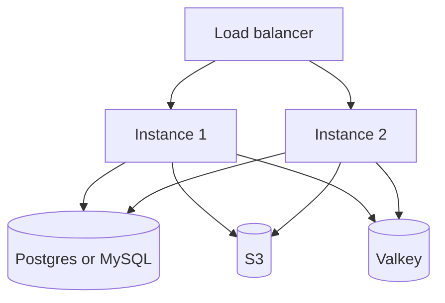
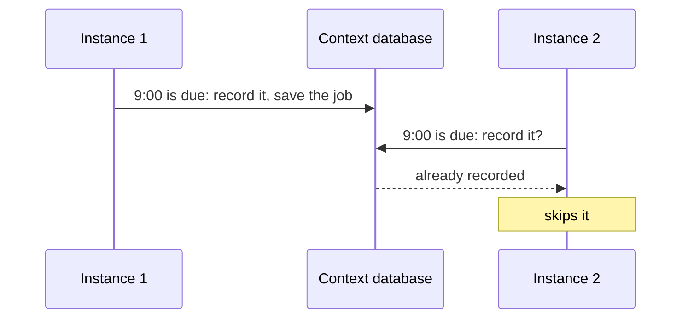

Running several instances means starting the same backend more than once, usually on different machines behind a load balancer. It gives you more capacity and keeps the app up when one machine goes down, as long as every instance sees the same data.

## What must be shared

Every instance runs the same code and reaches the same three services:



| What | One instance | Several instances |
|---|---|---|
| Database | SQLite | Postgres or MySQL |
| Files | Local folder | S3 |
| Cluster | `MemoryCluster` | `ValkeyCluster` |

- Database: every instance must read and write the same database. A SQLite file lives on one machine's disk, so use [Postgres](/guides/databases/postgres/) or [MySQL](/guides/databases/mysql/).
- Files: a file uploaded through one instance must be readable from the others. A local folder is on one disk; use S3 or a service that speaks its API. See [Files](/concepts/files/).
- Cluster: the small piece of shared state that lets instances talk to each other. Use Valkey, as explained in [The cluster](#the-cluster).

:::tip
You can start on one machine with SQLite and move later. [Switching databases](/guides/databases/switching/) explains the database part.
:::

## Create a backend ready for several instances

Pass all three choices to `newt init`:

```sh
newt init newthub --db postgres --files s3 --cluster valkey
```

| Flag | Values | Default |
|---|---|---|
| `--db` | `sqlite`, `postgres`, `mysql`, `memory` | `sqlite` |
| `--files` | `local`, `s3`, `memory` | `local` |
| `--cluster` | `memory`, `valkey` | `memory` |

`newt add backend` takes the same flags.

## The cluster

The cluster is what the instances of one backend share outside the database. newt uses it for two things:

1. Waking workers. When a use case saves new jobs, the instance tells the others through the cluster, and their workers look for work at once.
2. Rate limits. Each [rate limit](/concepts/http/) counts requests in the cluster, so the limit holds across all instances.

newt offers two clusters:

| Cluster | Import | For |
|---|---|---|
| `MemoryCluster` | `@newt-js/core/cluster/memory` | One instance, and tests |
| `ValkeyCluster` | `@newt-js/core/cluster/valkey` | Several instances |

With `MemoryCluster` on several instances, nothing breaks, but:

- Each instance counts its own rate limits: with 3 instances, a limit of 10 lets up to 30 requests through.
- The instance that saves new jobs still runs them at once, but the other instances only notice them at their next look, every 5 seconds.

### Use Valkey

Valkey is a fast in-memory store that speaks the Redis protocol. `--cluster valkey` writes this in `src/backend.ts`:

```ts title="src/backend.ts"
import { MemoryCluster } from '@newt-js/core/cluster/memory'
import { ValkeyCluster } from '@newt-js/core/cluster/valkey'

export async function startBackend(
  port: number,
  { stores = 'configured' }: { stores?: Stores } = {},
): Promise<RunningContexts> {
  const platform = new Platform({
    cluster:
      stores === 'memory'
        ? new MemoryCluster()
        : new ValkeyCluster(Bun.env.VALKEY_URL),
  })
  const contexts = await openContexts(platform, stores)
  return runContexts(contexts, {
    platformWithoutContexts: platform,
    serve: { port, health: true },
  })
}
```

And this in `.env`:

```sh title=".env"
VALKEY_URL=redis://localhost:6379
```

- `new ValkeyCluster(url?, options?)` takes the server's URL and, optionally, the options of Bun's Redis client.
- If the connection drops, it connects again on its own and logs a warning.
- Tests keep `MemoryCluster`: `stores: 'memory'` never needs Valkey.

To add Valkey to an existing backend, change `src/backend.ts` as shown and add `VALKEY_URL` to `.env` and `.env.example`.

:::note
The cluster holds no data you need to keep: counters that expire and wake-up messages. Losing the Valkey server does not lose any of your data.
:::

## What newt keeps right across instances

These work without anything extra, as long as the instances share the database:

- Each job runs on one instance. A worker takes a job with a lease (60 seconds, renewed while it runs). If an instance dies mid-job, another takes the job once the lease runs out.
- Each scheduled task runs once per due time. Before it fires, an instance records the due time in the context's database; the other instances see it is taken and skip it.
- Migrations run once. Every instance runs them on start, but newt holds a lock while it migrates, so only the first applies them.
- Idempotency keys are kept in the database, so a repeated request is recognised whichever instance gets it.

This is how two instances agree on a schedule due at 9:00:



:::caution
A scheduled task runs once only if every instance uses the same database. Instances with their own SQLite files would each run it.
:::

## Checklist

1. Each context on Postgres or MySQL, with the same `<CONTEXT>_DATABASE_URL` on every instance.
2. Files on S3, with the same bucket variables on every instance.
3. `ValkeyCluster`, with the same `VALKEY_URL` on every instance.
4. The same other variables and secrets on every instance.
5. A load balancer that checks `/api/health`, and `trustProxy` set in `src/backend.ts`. See [Deploying](/guides/deploy/#behind-a-reverse-proxy).
