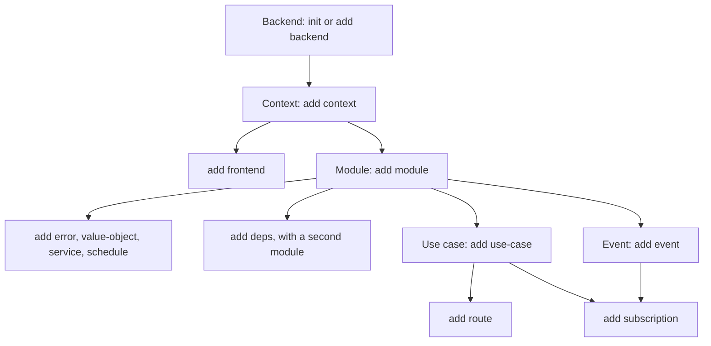

`newt` is the command line that creates a project and adds its pieces: contexts, modules, use cases, routes, events and more. You use it every time you add a piece, and it writes the code the way newt's lint expects it.

## How to run it

| Where you are | Command |
|---|---|
| No project yet | `bun create newt <name>` or `bunx @newt-js/cli init <name>` |
| Inside a project, after `bun install` | `bunx newt <command>` |

`bun create newt <name>` runs `newt init <name>` with the same flags. Every project has `@newt-js/cli` as a devDependency, so `bunx newt` runs the version the project installed.

:::caution
Outside a project, use `bunx @newt-js/cli`, not `bunx newt`: the npm package called `newt` is a different one.
:::

When a `newt` from elsewhere runs inside a project that has `node_modules/@newt-js/cli`, it hands the command over to the project's own copy. If that copy cannot run, it prints a warning and runs itself.

These pages write `newt <command>` for short.

## Commands

| Command | What it does |
|---|---|
| [`newt init`](/reference/cli/init/) | Creates a backend, or a monorepo with a first backend |
| [`newt add backend`](/reference/cli/add-backend/) | Adds a backend to a monorepo |
| [`newt add context`](/reference/cli/add-context/) | Adds a context, with its own database and files |
| [`newt add module`](/reference/cli/add-module/) | Adds a module: entity, use cases, routes, table, test |
| [`newt add use-case`](/reference/cli/add-use-case/) | Adds a use case to a module |
| [`newt add route`](/reference/cli/add-route/) | Adds a route that calls a use case |
| [`newt add event`](/reference/cli/add-event/) | Adds an event to a module |
| [`newt add subscription`](/reference/cli/add-subscription/) | Runs a use case when an event happens |
| [`newt add schedule`](/reference/cli/add-schedule/) | Runs a use case on a cron |
| [`newt add error`](/reference/cli/add-error/) | Adds an error with its HTTP status |
| [`newt add value-object`](/reference/cli/add-value-object/) | Adds a value object, its error and its test |
| [`newt add service`](/reference/cli/add-service/) | Adds a function that use cases share |
| [`newt add deps`](/reference/cli/add-deps/) | Lets a module use another module of its context |
| [`newt add frontend`](/reference/cli/add-frontend/) | Adds a React frontend served at `/<context>` |

### What each command needs first

Each arrow goes from what a command needs to that command. A new module already comes with some use cases (`create`, `get`…) and the event `created`, so `add route` and `add subscription` may not need `add use-case` or `add event` first.



## Global flags

| Flag | Where | Meaning |
|---|---|---|
| `-h`, `--help` | anywhere | Prints the help: the general one, or the command's after a command |
| `-v`, `--version` | without a command | Prints the version |
| `--json` | any command | Prints the result as JSON, and never asks questions |
| `--dry-run` | any command | Says what would change, and writes nothing |

- `--json` and `--dry-run` may also come before the command: `newt --json add module tasks/task`.
- Every option is checked: an unknown one, or one given twice, is an error.
- A command that takes no arguments refuses any it is given.

## What a command prints

A command lists each file it touched, then its warnings and its next steps:

```text
  created  src/contexts/chat/chat.context.ts
  created  src/contexts/chat/chat-modules.ts
  created  src/contexts/chat/migrations/.gitkeep
  skipped  src/auth.ts (already exists)
  updated  .env
  updated  .env.example
  updated  src/contexts.ts

Next steps:
  bun run dev
```

| Status | With `--dry-run` | Meaning |
|---|---|---|
| `created` | `will create` | A new file |
| `updated` | `will update` | A file that changed |
| `removed` | `will remove` | A file taken out |
| `skipped` | `will skip` | Left as it was, with a note why |

With `--dry-run` the list starts with `Dry run: nothing was written.` When there is nothing to change, it prints `Nothing to do.`

## The `--json` output

On success, on stdout:

```json
{
  "dryRun": false,
  "files": [
    { "path": "src/contexts/chat/chat.context.ts", "status": "created" },
    { "path": "src/auth.ts", "status": "skipped", "note": "already exists" }
  ],
  "warnings": [],
  "nextSteps": ["bun run dev"]
}
```

On failure, also on stdout, with exit code 1:

```json
{
  "error": "The backend has no context chat: add it with newt add context chat"
}
```

- Paths are relative to the folder where you run the command.
- `note` is there only when the command has one: `already exists`, `up to date`…
- `newt --json --version` prints `{ "version": "<version>" }`, and `newt --json --help` prints `{ "help": "<text>" }`.

## Exit codes

| Code | Meaning |
|---|---|
| `0` | Done, or help or version printed |
| `1` | Refused or failed: nothing was written |

Without `--json`, a failure's message goes to stderr.

## Rules every command follows

- **All or nothing.** A command prepares every change in memory first. If one cannot be made, or would leave a file with syntax errors, it writes nothing and says why.
- **Never overwrites.** A file that is already there is skipped (`already exists`). A variable already in `.env` keeps its value. Running a command twice changes nothing the second time.
- **Questions only in a terminal.** Only `newt init` without a name asks questions, and only in an interactive terminal without `--json`.
- **Finds the backend.** Commands work on the backend you are in. At a monorepo's root with one backend, they use it; with several, add `--backend <folder>`.

A backend is a folder whose `package.json` depends on `@newt-js/core` and that has `src/backend.ts`. When none is found, the command stops and says so:

- `This is not a newt backend` — no backend here or in a parent folder; make one with `newt init`.
- `This monorepo has no newt backend` — add one with `newt add backend`.
- `Which backend?` — the monorepo has several; add `--backend`.
- `<folder> is not a newt backend` — the folder given to `--backend` is not one.
- `package.json is not JSON` — fix it and run the command again.

:::tip
Run any command with `--dry-run` first to see which files it would touch.
:::
