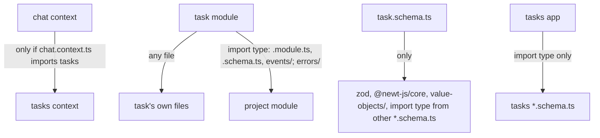

`@newt-js/lint` is an ESLint preset that keeps every module of your app built the same way. It exists so that whoever writes the code, a person or an AI agent, stays on the same rails: same files, same imports, writes only through the repository.

## Setup

`newt init` writes this file at the root of the backend:

```ts title="eslint.config.ts"
import { newt } from '@newt-js/lint'

export default newt({
  root: import.meta.dirname,
  contexts: { folder: 'src/contexts' },
})
```

Run it through the `lint` script, which calls ESLint with Bun so it loads the package's TypeScript as it is:

```sh
bun run lint   # bun --bun eslint
```

### Options of `newt()`

| Option | Meaning | Default |
|---|---|---|
| `root` | The folder of the config. Globs and folders are read from it. | ESLint's working folder |
| `files` | Globs of the files it lints. | `['**/*.ts']` |
| `contexts` | `{ folder, uses? }`: the folder of the contexts and, optionally, which contexts each one uses (`{ tasks: [], chat: ['tasks'] }`). Without `uses`, each context's `<name>.context.ts` says it by what it imports. | none: the context rules are off |

`uses` must list every context, each with the ones it uses (`[]` for none), and never in a cycle; otherwise `newt()` throws when ESLint loads the config.

Every rule is an `error`: a warning does not stop an agent. `**/dist/**` and `**/node_modules/**` are ignored.

:::caution
If you pass `uses`, list every context, even those that use none (`[]`). A missing context or a cycle makes the whole config fail to load.
:::

### What the package exports

| Export | What it is |
|---|---|
| `newt(options?)` | The preset: an array of ESLint configs. |
| `plugin` | The ESLint plugin with newt's rules, registered as `newt`. |
| `parser` | The TypeScript parser the preset reads with, for your own configs. |
| `tseslint` | The `typescript-eslint` the package carries. Take its configs from here: ESLint refuses two plugins under one name. |
| `STYLE` | The style rules from other plugins the preset turns on: `curly`, `brace-style`, `@stylistic/padded-blocks` and `@stylistic/max-len`. |

## Where each rule applies

| Files | Rules |
|---|---|
| Every linted file | `imports-and-exports`, `use-case-public-methods`, `use-case-params`, `use-case-reads`, `use-case-resolved`, `use-case-batched`, `route-body-unchecked`, `framework-tables`, `repository-public-methods`, `no-disable`, and the rules from other plugins |
| A module's files (`**/modules/<module>/**`) | `module-entity`, `module-files`, `module-imports`, `entity-method-params`, `reaction-queue`, `schema-imports`, `use-case-files`, `module-transactions` |
| Files in the contexts folder (with `contexts`) | `context-imports`, `route-context`; `module-imports` for files outside the modules |
| A context's app (`<context>/app/**/*.{ts,tsx}`, with `contexts`) | `app-imports`, `no-disable` |

Without `contexts`, `route-context` still runs on module files.

## What may import what

This is what the import rules (`context-imports`, `module-imports`, `schema-imports`, `app-imports`) allow, with the `tasks` and `chat` contexts as the example:



Each rule is described in the sections that follow.

## Modules and contexts

### newt/module-files

A module has only its own files, named after it.

Allowed in `modules/task/`: `task.module.ts`, `task.ts`, `task.schema.ts`, `task.repository.ts`, `task.routes.ts`, `task.workers.ts`, `task.deps.ts`, `task-options.ts`, any `*.test.ts`, and the folders `events/`, `errors/`, `value-objects/`, `services/`. An event's file starts with the module's name.

```txt
modules/task/helpers.ts                 wrong: not a file a module has
modules/task/utils/dates.ts             wrong: not a folder a module has
modules/task/events/completed.ts        wrong: name it task-completed.ts
modules/task/services/due-dates.ts      right
```

Why: whoever opens a module knows where everything is.

### newt/module-entity

A module keeps one entity: only its `<module>.ts` declares a class that extends `Entity`, and only one, even through base classes of your own.

```ts
// modules/task/task.ts
export class Task extends Entity<typeof TaskSchema> {

  /* ... */

}
export class Comment extends Entity<typeof CommentSchema> {

  /* ... */

} // wrong: a second entity
```

Right: make `comment` a module of its own (`newt add module tasks/comment`) and keep its id in the task.

Why: each module guards one thing; another entity is another module, referenced by its id.

### newt/module-imports

A module reaches another module of its context only through its API:

- its use cases, through the dependency [`newt add deps`](/reference/cli/add-deps/) wires (`this.deps.project.get(...)`), and its events through that same dependency (`tasks.on(project.events.created, ...)`);
- as types only (`import type`): its `.module.ts` (the type of the dependency), its `.schema.ts` (the DTOs) and its `events/`;
- its `errors/`, as they are, to tell a known error apart with `instanceof`.

Everything else is the module's own: its schemas as values, its entity, value objects, repository, routes, workers and services.

```ts
// modules/task/task.module.ts
import { Project_Repository } from '../project/project.repository' // wrong
import { ProjectSchema } from '../project/project.schema'          // wrong: a value
import { Project_Module } from '../project/project.module'         // wrong: a value
import type { ProjectDTO } from '../project/project.schema'        // right
import type { Project_Module } from '../project/project.module'    // right
import { ProjectNotFound } from '../project/errors/project-not-found' // right
```

An id a module keeps of another module's entity, such as a task's `projectId`, is a value object of its own: `value-objects/project-id.ts`, made with `uuidFactory('ProjectId')`. A `uuidFactory` brands the id with its name, so its type is the same as `project`'s own `ProjectId`, and a `ProjectDTO['id']` fits it.

A file outside the modules (such as `tasks-modules.ts`) may import what it composes, but re-exports only that API: `export type` of a `.module.ts`, a `.schema.ts` or an event, and errors as they are.

Why: through another module's entity, repository or schema, a module would read, write, build or parse its data behind its use cases, and a change inside that module would break it.

### newt/context-imports

A context imports only the contexts it says it uses, never in a cycle.

What a context uses is the `uses` option or, without it, the contexts its `<name>.context.ts` imports. A file directly in the contexts folder belongs to no context: no context imports it, and it imports no context.

```ts
// src/contexts/chat/modules/message/message.module.ts
import type { Task_Module } from '../../../tasks/modules/task/task.module'
// wrong, unless chat.context.ts imports tasks
// (or uses says chat: ['tasks'])
```

Why: contexts depend on each other in one direction only, so each can be read, tested and moved on its own.

### newt/schema-imports

A module's `<module>.schema.ts` imports only `zod`, `@newt-js/core` (its root), the module's own `value-objects/` and other modules' DTO types (`import type` from their `*.schema.ts`).

```ts
// modules/task/task.schema.ts
import { Task } from './task'                                 // wrong
import { ProjectSchema } from '../project/project.schema'     // wrong: newt/module-imports
import type { ProjectDTO } from '../project/project.schema'   // right
import { Priority } from './value-objects/priority'           // right
import { ProjectId } from './value-objects/project-id'        // right: task's own
```

That another module's schema comes as types only is `newt/module-imports`'s to say, so a value import of it is reported once.

Why: the schema is the module's contract; it says what the data is, not how the module works.

### newt/app-imports

A context's app imports its own files and, as types only, its context's schemas. Never server code: no module, repository or other context, and `@newt-js/*`, `bun`, `bun:*` and Node's modules only as types.

```tsx
// src/contexts/tasks/app/app.tsx
import { TaskSchema } from '../modules/task/task.schema'          // wrong
import type { TaskDTO } from '../modules/task/task.schema'        // right
```

Why: server code must never reach the browser.

## Use cases

### newt/use-case-public-methods

In a `*.module.ts`, every public method of a class that extends `Module` is marked `@UseCase()`. A public function in a field, or in a public constructor parameter, is refused too.

```ts
async archive(input: TaskArchiveDTO) { /* ... */ } // wrong
@UseCase()
async archive(input: TaskArchiveDTO) { /* ... */ } // right
private toRow(task: Task) { /* ... */ }            // right: private
```

Why: `@UseCase` is what runs a method as a use case (write rule, retry on conflict, trace).

### newt/use-case-params

A use case's parameters are attributes (a `string`, a `number`, a value object) or DTOs of the module's schema, and each input DTO is parsed with its schema.

Refused: `unknown` or `any`, an object type written in place, and an input DTO (`z.input<typeof XSchema>`) that nothing parses with `XSchema.parse` (in the use case or in a private method it hands it to).

```ts
@UseCase()
async completeTask(input: { id: string }) { /* ... */ } // wrong: object written in place

@UseCase()
async completeTask(input: TaskCompleteTaskDTO): Promise<TaskDTO> {
  const { id } = TaskCompleteTaskSchema.parse(input) // right
  // ...
}
```

Why: a type checks nothing at run time; the schema does.

### newt/use-case-reads

In a `*.module.ts`, `find` and `paginate` read by criteria and `get` by id, never by text; `search` takes exactly `(text, page)`.

```ts
async find(text: SearchText) { /* ... */ }                      // wrong
async search(text: SearchText, page: PageRequest) { /* ... */ } // right
```

Why: every module reads the same four ways: `find(criteria, sort?)`, `get(id)`, `paginate(criteria, page, sort?)`, `search(text, page)`.

### newt/use-case-resolved

What a use case returns holds no id it keeps of another entity: in place of `projectId` (an id made with `uuidFactory`), the entity it names, `project`. It looks through lists, pages and the entities resolved in them. An id of its own entity's kind (a task's `parentId`) and a plain `string` (an id of another system) are no reference. It needs the program typescript-eslint builds.

```ts
@UseCase()
async get(id: string): Promise<OrderRow> { /* ... */ } // wrong: returns customerId and lines[].productId

@UseCase()
async get(id: string): Promise<OrderDTO> {
  // ...
  return order.toDTO() // right: customer and lines[].product
}
```

Why: a module shows its entities, never what it keeps of them. See [References to other modules](/concepts/use-cases/#references-to-other-modules).

### newt/use-case-batched

In a `*.module.ts`, a call to another module's use case (`this.deps.<module>.<use case>(…)`) is never inside a loop (`for`, `for…of`, `while`…) or a callback a list runs once per item (`map`, `flatMap`, `forEach`, `filter`, `reduce`, `some`, `every`, `find`…). The list a `for…of` reads runs once, and is allowed.

```ts
const lines = await Promise.all(input.lines.map(async line => ({
  product: await this.deps.catalog.product.get(line.productId), // wrong: one call per line
  quantity: line.quantity,
})))

const products = await this.deps.catalog.product.find({ field: 'id', op: 'in', value: input.lines.map(line => line.productId) })
const lines = input.lines.map(line => ({ product: referenced(products, line.productId, 'product'), quantity: line.quantity })) // right: one call
```

Why: each call to another module is a query, or a request when it lives elsewhere. One per item makes a list as slow as it is long (N+1). See [References to other modules](/concepts/use-cases/#references-to-other-modules).

### newt/use-case-files

What a module does with its files is done by use cases named after it: `uploadUrl` is called by `uploadStart`, `verifyUpload` by `uploadConfirm`, `signedUrl` by `downloadUrl`, each a method of the module itself. Each of those use cases makes its call. A prefix tells apart several kinds of file (`avatarUploadStart`).

```ts
@UseCase()
async attach(input: DocumentAttachDTO) {
  await this.files.uploadUrl(/* ... */) // wrong: call it from uploadStart
}
```

Why: every module reads the same, and an upload is never confirmed without being verified.

## Entity, repository, routes and reactions

### newt/entity-method-params

In a module's `<module>.ts`, no non-private method of the entity takes a DTO (a type whose name ends in `DTO`) or an object type written in place. It takes `<Entity><Method>Props`, declared beside it. The constructor and `fromDTO` are exceptions.

```ts
static create(input: TaskCreateDTO): Task { /* ... */ }        // wrong
static create(input: { name: string }): Task { /* ... */ }      // wrong

export type TaskCreateProps = { name: string }
static create(props: TaskCreateProps): Task { /* ... */ }      // right
```

Why: the entity speaks its own words, so a change in the API contract does not change it.

### newt/repository-public-methods

A class that extends `Repository` (or `BaseRepository`) declares no public method and overrides none: `persist`, `find`, `count`, `paginate` and `purge` are all it has. It only says how rows are read and written, in the protected `toEntity`, `toRow` and `toChanges`.

```ts
export class Task_Repository extends Repository<Task, TaskRow> {

  async findOverdue() { /* ... */ }                           // wrong
  protected toEntity(row: ResolvedRow<TaskRow, Task>): Task { // right
    return Task.fromDTO(row)
  }

}
```

Why: decisions live in use cases and entities, not in the repository.

### newt/route-context

No route a context registers, on its router or a group of it, starts with the context's name: the router already puts `/<context>/api` before every route.

```ts
// src/contexts/tasks/modules/task/task.routes.ts
router.get('/tasks/tasks/:id', handle) // wrong: answers at /tasks/api/tasks/tasks/:id
router.get('/tasks/:id', handle)       // right: answers at /tasks/api/tasks/:id
router.group('/reports', { middleware }).get('/overdue', handle) // right
```

Paths are read through consts, templates and a group's prefix. A path the rule cannot read is let be. Test files are skipped.

Why: the context's prefix already keeps two contexts apart, so its name in the route would only repeat it.

### newt/route-body-unchecked

In a `*.routes.ts`, the request body is never given a type before something parses it: no `await request.json() as X`, `<X>`, or `const body: X = await request.json()`.

```ts
router.post('/tasks', async request =>
  Response.json(
    await tasks.create((await request.json()) as TaskCreateDTO),
  ),
) // wrong

router.post('/tasks', async request =>
  Response.json(await tasks.create(await bodyOf(request)), {
    status: 201,
  }),
) // right
```

Why: the use case parses the body with its schema; a cast would hide a missing parse.

### newt/reaction-queue

A subscription's queue is `<module>.<useCase>.on.<module>.<event>`. In a module's files, it starts with that module, its callback calls that use case on the module, and it ends with the event it subscribes to. `Module.on` must be called on the module whose files it is in.

```ts
// modules/task/task.workers.ts
tasks.events.completed.subscribe(
  c => tasks.notifyAssignee({ id: c.id }),
  { strategy: 'handler', queue: 'project.notify.on.task.completed' },
) // wrong

tasks.on(tasks.events.completed, 'notifyAssignee', completed => [
  { id: completed.id },
]) // right
```

Why: the queue's name says who reacts to what, and must not lie. `Module.on` names it for you.

### newt/module-transactions

A module never opens a transaction from its base's `transactions`: it writes through its repository's `persist`. A field of your own called `transactions` (such as a repository) is not affected; the rule tells them apart by type.

```ts
await base.transactions.run(async () => { /* ... */ })       // wrong
await this.tasks.persist(task)                               // right
```

Why: `persist` runs the transaction, checks the write rule and publishes the events.

### newt/framework-tables

No code names a table starting with `newt_`, neither in `records('…')` nor in SQL (after `FROM`, `INTO`, `UPDATE`, `JOIN`, `TABLE` or `ON`).

```ts
base.database.records('newt_job')            // wrong
db.query('SELECT * FROM newt_job')           // wrong
base.database.records<TaskRow>('task')       // right
```

Why: `newt_…` tables are newt's (jobs, schedule ticks, idempotency keys, applied migrations) and may change in any release.

## Style

### newt/imports-and-exports

Imports go first, then exports from other files. Packages go before local files, split from them by a line of dashes, and local files go from the farthest (`../../x`) to the nearest (`./x`). Each line imports one name, in braces, and the lines are sorted and aligned at `from`. A default import is written `{ default as name }`, and a type is imported with `import type`.

```ts
// wrong
import { Task, type TaskDTO } from './task'
import { z } from 'zod'

// right
import { z }            from 'zod'
// --------------------------------------------------------
import { Task }         from './task'
import type { TaskDTO } from './task'
```

It fixes itself, except where a comment sits among the imports or a line imports `* as`. The CLI writes its files this way.

Why: with one name per line, adding or removing an import changes one line, and every file reads the same.

## The lint's own discipline

### newt/no-disable

No comment turns off, for a stretch of code, a `newt/…` rule or one the preset turns on, nor changes it. One line may be let off with `eslint-disable-next-line` or `eslint-disable-line` when the comment names the rule and gives a reason after `--`.

```ts
/* eslint-disable newt/module-imports */ // wrong
/* eslint newt/module-imports: "off" */ // wrong
// eslint-disable-next-line curly // wrong: no reason
// eslint-disable-next-line       // wrong: names no rule
// eslint-disable-next-line curly -- generated by a tool, no braces
if (a) b() // right
```

A bare `/* eslint-disable */` is reported too: the preset's processor keeps it from silencing this rule.

Why: an agent that cannot make the code pass would otherwise make the lint pass.

## From other plugins

| Rule | Enforces |
|---|---|
| `@typescript-eslint/no-floating-promises` | Every promise is awaited or handled. |
| `@typescript-eslint/no-misused-promises` | No async function where nobody awaits it (a `setInterval`, an event, a `forEach`). |
| `curly` (`all`) | Every `if`, `else` and loop has braces. Fixes itself. |
| `brace-style` (`1tbs`, no single line) | Every body goes on lines of its own. Fixes itself. |
| `@stylistic/padded-blocks` (classes) | A class has a blank line inside it, after its `{` and before its `}`. Fixes itself. |
| `@stylistic/max-len` (80) | No line is longer than 80 characters, except a line with a string, a template literal, a URL or a regular expression. Does not fix itself: break the line. |

:::tip
`bun run lint --fix` fixes the `curly`, `brace-style`, `padded-blocks` and `imports-and-exports` errors for you.
:::

The preset also sets `reportUnusedDisableDirectives: 'error'`: a disable comment that turns off nothing is an error.
