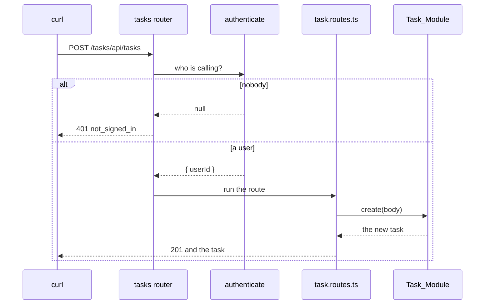

This page takes you from nothing to a backend that saves tasks in SQLite and answers over HTTP. It takes about ten minutes.

You need Bun 1.4.0 or newer. See [installation](/start/installation/).

## Create the project

```sh
bun create newt newthub
```

```txt
  created  newthub/package.json
  created  newthub/tsconfig.json
  created  newthub/eslint.config.ts
  created  newthub/AGENTS.md
  created  newthub/src/backend.ts
  created  newthub/src/stores.ts
  created  newthub/src/env.ts
  created  newthub/src/backend.test.ts
  created  newthub/src/contexts.ts
  created  newthub/src/index.ts
  created  newthub/src/auth.ts
  created  newthub/.env
  created  newthub/.env.example
  created  newthub/.gitignore
  created  newthub/CLAUDE.md

Next steps:
  cd newthub
  bun install
  bun run dev
```

Each file is explained in [project structure](/start/project-structure/).

## Install and start it

```sh
cd newthub
bun install
bun run dev
```

```txt
$ bun --watch src/index.ts
Listening on http://localhost:3000/
```

`bun run dev` restarts the backend every time you save a file. Leave it running in its own terminal.

## Check its health

Every backend answers `GET /health-check`:

```sh
curl localhost:3000/health-check
```

```json
{"status":"ok"}
```

While the backend stops, it answers `503` with `{"status":"stopping"}`, so a load balancer stops sending it requests.

## Add a context

A context is one part of your app with its own database. Newthub starts with tasks:

```sh
bunx newt add context tasks
```

```txt
  created  src/contexts/tasks/tasks.context.ts
  created  src/contexts/tasks/tasks-modules.ts
  created  src/contexts/tasks/migrations/.gitkeep
  skipped  src/auth.ts (already exists)
  updated  .env
  updated  .env.example
  updated  src/contexts.ts

Next steps:
  bun run dev
```

The context opens its SQLite database at `data/tasks.sqlite`, created on the next start. `.env` now says so:

```sh title=".env"
TASKS_DATABASE=data/tasks.sqlite
TASKS_FILES=data/files/tasks
```

See [contexts and modules](/concepts/contexts-and-modules/).

## Add a module

A module is one kind of thing in a context. Add tasks to the tasks context:

```sh
bunx newt add module tasks/task
```

```txt
  created  src/contexts/tasks/modules/task/value-objects/task-id.ts
  created  src/contexts/tasks/modules/task/task.schema.ts
  created  src/contexts/tasks/modules/task/events/task-created.ts
  created  src/contexts/tasks/modules/task/errors/task-not-found.ts
  created  src/contexts/tasks/modules/task/task.ts
  created  src/contexts/tasks/modules/task/task.repository.ts
  created  src/contexts/tasks/modules/task/task.module.ts
  created  src/contexts/tasks/modules/task/task.routes.ts
  created  src/contexts/tasks/modules/task/task.module.test.ts
  created  src/contexts/tasks/migrations/00001_task_up.sql
  created  src/contexts/tasks/migrations/00001_task_down.sql
  updated  src/contexts/tasks/tasks-modules.ts

Next steps:
  bun test src/contexts/tasks/modules/task
  its routes ask for a session: write authenticate in src/auth.ts to call them from outside the tests
```

The module comes with four use cases (`create`, `get`, `find`, `paginate`), a table, and three routes:

```ts title="src/contexts/tasks/modules/task/task.routes.ts"
export function registerTaskRoutes(
  router: HttpRouter,
  tasks: Task_Module,
) {
  router.post('/tasks', async request =>
    Response.json(await tasks.create(await bodyOf(request)), {
      status: 201,
    }),
  )
  router.get('/tasks', async request =>
    Response.json(await tasks.paginate({}, pageRequestFrom(request))),
  )
  router.get('/tasks/:id', async request =>
    Response.json(
      await tasks.get({ id: TaskId.from(request.params.id) }),
    ),
  )
  return { one: router.group('/tasks/:taskId') }
}
```

A route's path is the context, then `/api`, then the module's plural: `POST /tasks/api/tasks`.

## Call a route: the 401

Try to create a task:

```sh
curl -i -X POST localhost:3000/tasks/api/tasks \
  -H 'content-type: application/json' \
  -d '{"name":"Write the docs"}'
```

```txt
HTTP/1.1 401 Unauthorized
...

{"error":"Sign in first","code":"not_signed_in"}
```

This is on purpose. Every route is private unless you mark it `{ public: true }`, and a private route needs to know who is calling. `src/auth.ts` answers that question, and the generated one answers "nobody":

```ts title="src/auth.ts"
import type { Authenticator } from '@newt-js/core/http'

export const authenticate: Authenticator = async () => null
```

This is the path every request to a private route takes:



## Sign in for local testing

To try the API on your machine, let a fixed token from `.env` sign you in:

```ts title="src/auth.ts"
import { bearerAuthenticator } from '@newt-js/core/http'

export const authenticate = bearerAuthenticator(async token =>
  token === Bun.env.DEV_TOKEN ? { userId: 'dev' } : null,
)
```

```sh title=".env"
DEV_TOKEN=let-me-in
```

:::danger
This lets anyone who knows the token in. Use it only on your machine, and write a real authenticator before you deploy. See [authentication](/guides/authentication/).
:::

Restart `bun run dev` so it reads the new `.env`, then call the route with the token:

```sh
curl -X POST localhost:3000/tasks/api/tasks \
  -H 'authorization: Bearer let-me-in' \
  -H 'content-type: application/json' \
  -d '{"name":"Write the docs"}'
```

```json
{
  "id": "01a1e8be-dbae-7142-8f59-770eb529979d",
  "name": "Write the docs",
  "createdAt": "2026-11-17T09:03:04.622Z",
  "updatedAt": "2026-11-17T09:03:04.622Z"
}
```

List the tasks:

```sh
curl localhost:3000/tasks/api/tasks -H 'authorization: Bearer let-me-in'
```

```json
{
  "items": [
    {
      "id": "01a1e8be-dbae-7142-8f59-770eb529979d",
      "name": "Write the docs",
      "createdAt": "2026-11-17T09:03:04.622Z",
      "updatedAt": "2026-11-17T09:03:04.622Z"
    }
  ],
  "total": 1
}
```

## When something is wrong

Errors come back as JSON with a status, a message and a `code` your frontend can test:

| Request | Status | `code` |
|---|---|---|
| no session | 401 | `not_signed_in` |
| `{"name":"  "}` | 400 | `validation` |
| `GET /tasks/api/tasks/nope` | 400 | `invalid_uuid` |
| an id that does not exist | 404 | `task.not_found` |

A `validation` error also lists what failed in `issues`. See [errors](/concepts/errors/).

## Run the tests

```sh
bun run test
```

```txt
$ bun test
bun test v1.4.4

 9 pass
 0 fail
 16 expect() calls
Ran 9 tests across 2 files.
```

The tests run on an SQLite database in memory with the context's migrations, so they never touch `data/`. They sign in on their own, so they pass whatever `src/auth.ts` says. See [testing](/guides/testing/).

Two more checks belong with the tests:

```sh
bun run typecheck   # types
bun run lint        # newt's rules
```

:::tip
Run all three after every change. The lint tells you when a piece of code is in the wrong place, which is how newt keeps the shape of the backend.
:::

## Next steps

- See every file you now have in [project structure](/start/project-structure/).
- Add your own use case with `newt add use-case`. See [use cases](/concepts/use-cases/).
- Follow the [tutorial](/tutorial/) to build Newthub step by step.
