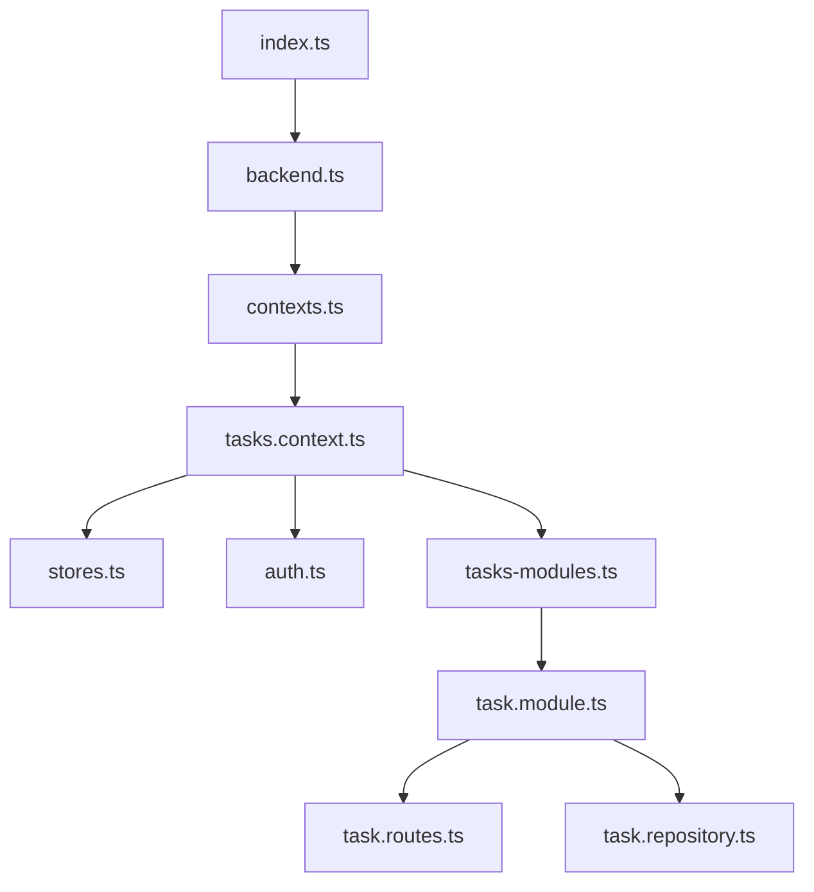

A newt project has the same layout every time: a few files at the root, the backend's wiring in `src/`, and one folder per context in `src/contexts/`. This page lists them all.

The tree is from a project with one context, `tasks`, two modules, `task` and `project`, and one of each piece the CLI can add.

## The tree

```txt
newthub/
├── .env
├── .env.example
├── .gitignore
├── AGENTS.md
├── CLAUDE.md
├── eslint.config.ts
├── package.json
├── tsconfig.json
├── data/                              created on the first start
│   ├── tasks.sqlite
│   └── files/tasks/
└── src/
    ├── index.ts
    ├── backend.ts
    ├── backend.test.ts
    ├── contexts.ts
    ├── stores.ts
    ├── auth.ts
    ├── env.ts
    └── contexts/
        └── tasks/
            ├── tasks.context.ts
            ├── tasks-modules.ts
            ├── migrations/
            │   ├── 00001_task_up.sql
            │   ├── 00001_task_down.sql
            │   ├── 00002_project_up.sql
            │   └── 00002_project_down.sql
            ├── app/
            │   ├── index.html
            │   ├── main.tsx
            │   ├── app.tsx
            │   ├── base.ts
            │   └── tsconfig.json
            └── modules/
                ├── project/
                │   └── …
                └── task/
                    ├── task.ts
                    ├── task.schema.ts
                    ├── task.repository.ts
                    ├── task.module.ts
                    ├── task.module.test.ts
                    ├── task.routes.ts
                    ├── task.deps.ts
                    ├── task.workers.ts
                    ├── events/
                    │   ├── task-created.ts
                    │   └── task-completed.ts
                    ├── errors/
                    │   ├── task-not-found.ts
                    │   ├── already-done.ts
                    │   └── invalid-priority.ts
                    ├── value-objects/
                    │   ├── task-id.ts
                    │   ├── priority.ts
                    │   └── priority.test.ts
                    └── services/
                        └── due-dates.ts
```

## How the files connect

Each file opens the next one, from `index.ts` down to the modules:



- `index.ts` calls `startBackend` with `PORT`.
- `backend.ts` picks the cluster, opens every context with `openContexts` and serves them with `runContexts`.
- `contexts.ts` opens each context, one line per context.
- `tasks.context.ts` opens the database and the files (`stores.ts`), creates the router with `authenticate` (`auth.ts`), and creates the modules.
- `tasks-modules.ts` creates each module. A module registers its routes and its workers when it is created.

## Root files

| File | What it is for |
|---|---|
| `package.json` | dependencies and scripts |
| `tsconfig.json` | TypeScript settings |
| `eslint.config.ts` | newt's lint rules |
| `.env` | your local settings and secrets |
| `.env.example` | the same keys, without secrets |
| `.gitignore` | keeps `node_modules`, `.env` and `data` out of git |
| `AGENTS.md` | how the project works, for AI agents |
| `CLAUDE.md` | points to `AGENTS.md` |

The scripts in `package.json`:

| Script | Runs |
|---|---|
| `bun run dev` | the backend, restarted on every change |
| `bun run start` | the backend, once |
| `bun run test` | the tests |
| `bun run typecheck` | the type checker (`bun check -b`) |
| `bun run lint` | newt's lint |

`.env` holds `PORT`, `PUBLIC_URL`, `FILES_SECRET`, and two lines per context: `<CONTEXT>_DATABASE` and `<CONTEXT>_FILES`. `newt init` writes a random `FILES_SECRET`. See [configuration](/reference/configuration/).

:::danger
`.env` holds secrets and is not committed. Commit `.env.example`, and keep its secrets empty.
:::

## `data/`

Where the backend keeps its data on your machine. It appears on the first start.

- `data/<context>.sqlite`: each context's SQLite database. The `-shm` and `-wal` files next to it belong to SQLite.
- `data/files/<context>/`: each context's uploaded files.

Delete `data/` to start again from empty databases. Tests never use it: they run in memory.

## `src/`

| File | What it is for |
|---|---|
| `index.ts` | starts the backend on `PORT` |
| `backend.ts` | `startBackend`: opens the contexts and serves them |
| `backend.test.ts` | checks that `/health-check` answers |
| `contexts.ts` | the list of contexts the backend opens |
| `stores.ts` | opens each context's database and file storage |
| `auth.ts` | `authenticate`: who is calling |
| `env.ts` | `requiredEnv`, for variables the backend needs |

- `backend.ts` also picks the cluster, which is what several instances of the backend share. See [running several instances](/guides/scaling/).
- `stores.ts` has a `memory` mode for tests: an in-memory database with the migrations, and in-memory files.
- `auth.ts` is explained in [authentication](/guides/authentication/).

## A context: `src/contexts/<context>/`

| Path | What it is for |
|---|---|
| `<context>.context.ts` | opens the context: database, router, storage, modules |
| `<context>-modules.ts` | creates the modules and hands each the ones it uses |
| `migrations/` | SQL files that create and change the tables |
| `app/` | the context's React app, if it has one, served at `/<context>` |
| `modules/` | one folder per module |

- Migrations come in pairs: `<number>_<table>_up.sql` makes the change, `<number>_<table>_down.sql` undoes it. The backend runs the pending ones when it opens the database. See [database and migrations](/concepts/database/).
- The context's routes live under `/<context>/api/`, and its app at `/<context>`.

## A module: `modules/<module>/`

### The files every module has

| File | What it is for |
|---|---|
| `<module>.ts` | the entity: one task and its rules |
| `<module>.schema.ts` | the shape of a task, what each use case takes, the filters |
| `<module>.repository.ts` | saves and loads tasks |
| `<module>.module.ts` | the module class: its use cases |
| `<module>.routes.ts` | the HTTP routes, each calling one use case |
| `<module>.module.test.ts` | the module's tests |

See [entities](/concepts/entities/), [schemas and DTOs](/concepts/schemas-and-dtos/), [repositories](/concepts/repositories/), [use cases](/concepts/use-cases/) and [HTTP and routes](/concepts/http/).

### Files that appear when you need them

| File | Added by | What it is for |
|---|---|---|
| `<module>.deps.ts` | `newt add deps` | the other modules this one uses |
| `<module>.workers.ts` | `newt add subscription`, `newt add schedule` | what runs on an event or a cron |

See [services and dependencies](/concepts/services-and-deps/), [events and subscriptions](/concepts/events/) and [scheduled tasks](/concepts/schedules/).

### Folders

| Folder | What it holds |
|---|---|
| `events/` | one file per event, such as `task.completed` |
| `errors/` | one file per error the module throws |
| `value-objects/` | values with rules, such as an id or a priority |
| `services/` | logic several use cases share |

- Every module starts with an id value object (`task-id.ts`), a `created` event and a `not-found` error.
- A value object comes with its test and its own error, such as `priority.test.ts` and `invalid-priority.ts`.

See [events](/concepts/events/), [errors](/concepts/errors/), [value objects](/concepts/value-objects/) and [services](/concepts/services-and-deps/).

:::tip
You rarely create these files by hand. `newt add` writes each one in its place, and the lint tells you when something is somewhere else.
:::
